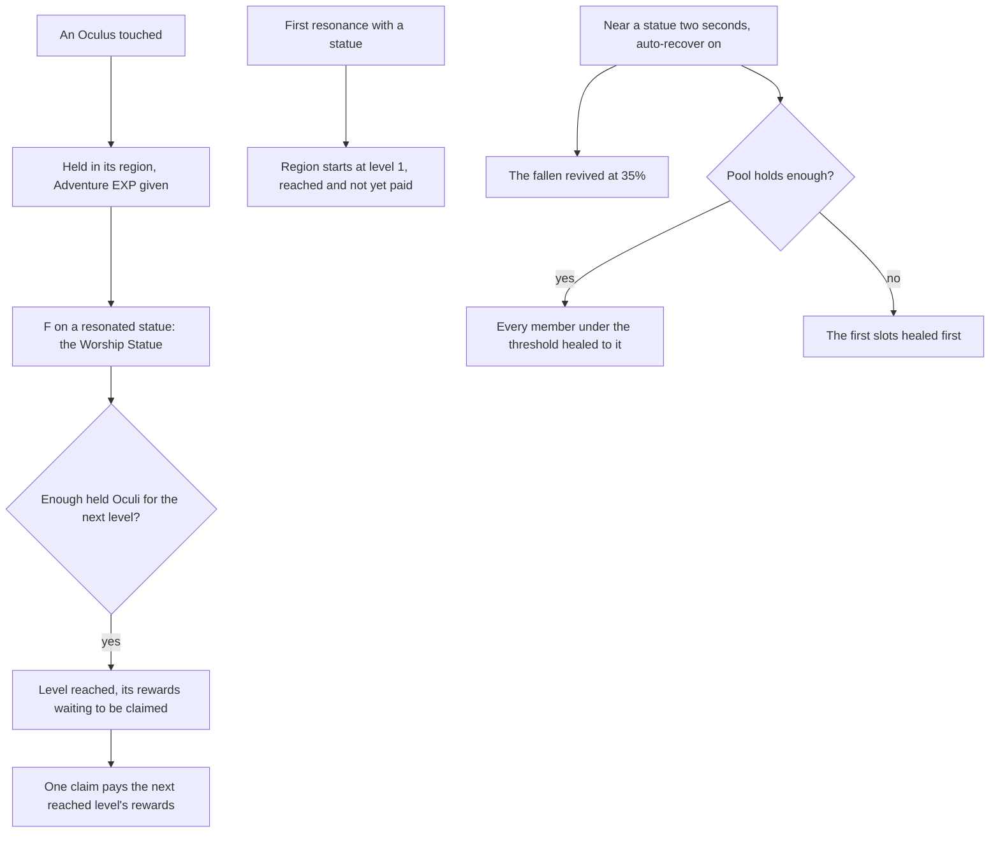

# Statues of The Seven

Each region's statues stand for its Archon, and they are the game's anchor for exploring it: a statue fills in its area of the map ([map unlocking](../genshin-map-unlocking/design.md)) and is a jump. The level rules, the maximum stamina they raise and the pool's heal are built and tested as rules, on the [Statues of The Seven](../../specs/genshin/statues-of-the-seven/design.md) page. The Oculi, the screens, the world's state those rules read and the Traveler's element are built on them in the world; what is left is the stamina maximum's wiring, auto-recover's switch and the later regions.

## Decisions

- **Oculi are found once.** Each region's Oculi, Anemoculi in Mondstadt, Geoculi in Liyue and so on, stand where the [spawned places](../genshin-spawned-places/design.md) fit them, since the game's servers spawn them. They are collected by touching them and never come back. Each gives one of its kind and 60 Adventure EXP, the wiki's figure for it (`OCULUS_ADVENTURE_EXP`). Within a short distance one shows on the minimap with a sound, as the game signals it.
- **The Oculus's minimap sound is provisional.** No sound in the game data this recreation reads fits a near Oculus: the login door's is the only one there, and the HUD plays none. So the mark's sound is a short synthesised chime (`services/statue/playOculusSound.ts`, a 1320 Hz sine for 0.4 seconds), and the distance it shows from, `OCULUS_MINIMAP_DISTANCE`, and the touch radius, `OCULUS_TOUCH_RADIUS`, are provisional until `oculus-minimap.mkv` is recorded and re-measured. The mark is a pale gold dot and the Oculus stand-in a sphere, both provisional.
- **A found Oculus is held until the Worship Statue offers it.** It joins its region's held count as it is found, in a started region or not, and the touch reaches no level. The Worship Statue's offer reaches the levels the held Oculi complete, in the order they are reached. The wiki gives the statues' way of taking Oculi as an offer (its Overview: "offer various rewards in exchange for Oculi") and names no separate claim, so the offer and the claim below are provisional.
- **A resonance reaches level 1.** Resonating with a statue starts its region at level 1, which takes no Oculi: the level is reached, its rewards wait to be claimed, and the Oculi the region holds stay held for an offer. An Oculus found in a region not yet started is held until that first resonance starts it.
- **Levels pay the game's rewards by region.** Adventure EXP, Primogems and Sigils everywhere, and each later region's own items, Liyue's Stones of Remembrance, the Shrine of Depths keys and the Traveler's Memories of Inazuma, Sumeru, Fontaine and Snezhnaya, and Natlan's Acquaint Fates, as the wiki lists them, each joining with that region's page. A level pays them when a claim takes it.
- **One loop pays a level's rewards.** `payOfferingLevels` pays the rewards of the levels it is given: the Adventure EXP is returned for the Adventure Rank, and every other reward is paid in as a pick up pays it. The Frostbearing Tree's bag offer and a statue level's claim both run it, so a level is paid by one rule. Liyue's levels are the dump's city 2, its level one taking no Oculi and each later level its Stones of Remembrance from the reward table; `genshin:assets statues` builds them beside Mondstadt's, and the main session publishes the record.
- **The Traveler resonates with its element.** She holds no element until her first resonance, as the prologue has her, and then the element of the statue she resonated with last: each region's, Anemo in Mondstadt and Geo in Liyue, read from `RegionIdTravelerElementMap`. Natlan's is left out until its quest step the wiki names is read, so a resonance there keeps the element of the region before. Her [constellations](../genshin-constellations/design.md) for that element come with its levels.
- **F on a resonated statue opens the Worship Statue, and the Statue's Blessing is one switch away.** The wiki's dialogue at a resonated statue offers two options, Worship Statue and Statue's Blessing, so F opens the Worship Statue first and each screen switches to the other. The Worship Statue's option is the game's dialogue row 3116001, whose text is `StatueWorship` and whose action opens the statue page (`UI/open_goddess_page`). The Blessing holds the healing pool and the party's portraits, and a click on a portrait heals that member a tenth of its maximum HP from the pool. Neither captured public clip shows either screen. The mp4 (`yt-b6YZXYBegKA-statue-blessing.mp4`) is 40.0 seconds long, not the 125 seconds named earlier: at one and two frames per second it shows combat, then the map and the healing caption from 30 seconds on. The webm (`yt-hRNYlusJqwA-statue-activate.webm`, 30 seconds) shows a statue's unlock line and the map filling in, with no option menu. So both screens' layouts are provisional until `statue-blessing.mkv` records them. The Worship Statue's offer and claim are the next decision. The auto-recover switch and its threshold are task 3.4, built on the screen as provisional controls. The pool is not saved yet: a world opening starts it full for the resonated statues, provisional until the save holds it.
- **The Worship Statue offers held Oculi, and each reached level is claimed in one action.** `offerStatueOculi` offers a started region the Oculi it holds through `offerItems`, reaching each level they complete. The rewards of a reached level wait, and `claimStatueLevel` takes the next level the region has reached and not yet claimed, paying its rewards once through `payOfferingLevels`, so a region with three reached levels takes three claims. The save keeps the level claimed per region as `claimedLevel`, beside its level reached and the Oculi held. The wiki's Statue Levels section says all statues of a region share one level, so the claim is per region, not per statue. The wiki names no claim action, so one claim per reached level is provisional until the Worship Statue's recording shows the screen's action.
- **The threshold's steps are provisional.** Auto-recover's threshold is set on the screen in steps the game offers, which no source here lists. The wiki gives one share the screen moves in, the tenth of Max HP a click heals, so the steps are ten percent, from ten to a hundred, starting at fifty percent (`AUTO_RECOVER_THRESHOLD_*` in `services/statue/constants.ts`), held provisional until `statue-blessing.mkv` records the game's steps. The switch's words are the wiki's (its "Auto-recover when nearby"), since no game text key for them is in the dump, so they wait on a key the main session writes.
- **The statues' state is a slice of the save.** Each region's level, level claimed and held count, and the ids of the Oculi found, are kept in the world's [save](../../specs/genshin/save-data/design.md) as every slice after the wallet is, [latest shape only](../../specs/architecture/persisted-data-latest-shape-only/design.md), and a new player's save holds no region started and no Oculus found. A merge keeps the account's statues whole, its regions and found Oculi together: the [statues' page](../../specs/genshin/statues-of-the-seven/design.md) gives the reason and the rest of the merge. The merge reaches no level and pays nothing, since it keeps the account's wallet and bag.
- **The Oculi's places are the generated ones.** The published `oculi/<region>` records already hold each region's Oculi from the official map's fit, Mondstadt's Anemoculi among them, each with its id, kind and ground place, so an Oculus is named by that id and no new data is written.
- **Auto-recover near a statue.** With it on and a threshold set, standing by a statue's base for two seconds revives the fallen and heals the members under the threshold from the pool, as the built rule does. The two seconds are the wiki's. The switch starts off, since the wiki says players activate it, and the switch and threshold are kept for the session as the pool is, not in the save. A stand runs its revive and heal once when it reaches the two seconds, and a step out of reach ends it, so the next stand runs its own (`services/statue/advanceAutoRecoverDwell.ts`). The stand counts a resonated statue in reach, the same prompts F reads, so the rule has no statue of its own to find.

## How it works



## Scope and order

**Today:** the levels, the stamina maximum and the pool's heal and auto-recover are built as rules and tested. The world holds the regions' levels, the Oculi found and the pool. A resonated statue's F opens the Worship Statue, which offers the held Oculi and claims each reached level, and the Blessing screen shows the pool, heals from it, and sets auto-recover's switch and threshold, which the Session's stand by a statue runs. The stamina maximum is the one piece left.

**Built, in order:**

```text
packages/genshin-world/src/models/statue/StatueProgressSave.ts
```

1. **The statues' state in the save, and an Oculus found.** `StatueProgressSave.ts` holds each region's `{ claimedLevel, heldCount, level }` by region id and `foundOculusIds`, its schema carrying no default as the [latest-shape rule](../../specs/architecture/persisted-data-latest-shape-only/design.md) sets, and `models/save/GenshinSave.ts` carries it as `statues`, with `services/save/toGenshinSave.ts`, `readGenshinSave.ts` and `mergeGenshinSave.ts` carrying it as they carry `reputation`. `services/statue/findOculus.ts` is pure: an Oculus id not yet found joins the found ids and its Oculus is held in its region's count, in a started region or not, since offering is the Worship Statue's act. A found id gives nothing a second time. The proof is `findOculus.test.ts`, and `mergeGenshinSave.test.ts` for the account's found ids and for each region as the account's copy, though the guest's is further on.
2. **Oculi in the world.** Each region's Oculi are fetched by key from its `oculi/<region>` record, drawn as a stand-in where none has been found, found by touch within a provisional `OCULUS_TOUCH_RADIUS`, paid their Adventure EXP and held in their region's count, and marked on the minimap within the provisional distance the owed `oculus-minimap.mkv` re-measures.
3. **A first resonance starts its region.** Resonating with a statue starts its region at level 1, reached but not paid until claimed.
4. **The Statue's Blessing screen and the Worship Statue.** The Blessing's pool and portraits are built from the wiki and its layout is provisional until `statue-blessing.mkv` records it. The Worship Statue (task 3.3) is built with its offer and claim.
5. **The Traveler's resonance.** `computeTravelerElement` gives the element of the region resonated with last, which the Session passes on (task 2.3).

**Still to add:**

1. **The maximum stamina**: `computeMaximumStamina` over the saved levels as the character's `staminaMaximum`, which the character still takes as the constant `STAMINA_MAX`.
2. **Each later region's Oculi and levels**, with that region.

## Data and measures

- **Read from the game's tables:** `CityLevelupConfigData` and `RewardExcelConfigData` for the levels, their Oculi, rewards and stamina actions, which are built for Mondstadt. The Oculi's places come from the spawned places' fit.
- **Measured:** how near an Oculus shows on the minimap, read off a recording of one being found, and the Blessing's threshold steps, read off a recording of the screen. Both wait on the [roadmap](../genshin-roadmap/tasks.md)'s owed clips.

## Key files

| File                                                                       | Role after the change                                                                                           |
| :------------------------------------------------------------------------- | :-------------------------------------------------------------------------------------------------------------- |
| `packages/genshin-world/src/models/world/StatueLandmark.ts`                | A statue, its region's level read from the progress                                                             |
| `scripts/src/services/genshinAssets/fit/fitRegionLandmarks.ts`             | Fits the Oculi from the official map's points                                                                   |
| `packages/genshin-world/src/components/Hud/Minimap/Index.vue`              | Marks a near Oculus                                                                                             |
| `packages/genshin-world/src/components/World/Session/Index.vue`            | Holds the regions' state and the pool, and wires them                                                           |
| `packages/genshin-world/src/services/statue/computeStatueInteractables.ts` | Names a resonated statue's F as the Worship Statue                                                              |
| `packages/genshin-world/src/components/Statue/Screen/Index.vue`            | The Blessing's wrapper, healing from the pool and switching to the Worship Statue                               |
| `packages/genshin-interface/src/components/BlessingScreen/Index.vue`       | The Blessing's provisional layout, its switch to the Worship Statue and auto-recover's switch and threshold     |
| `packages/genshin-interface/src/components/WorshipScreen/Index.vue`        | The Worship Statue's provisional layout                                                                         |
| `packages/genshin-world/src/components/Statue/Worship/Index.vue`           | The Worship Statue's wrapper: each level's state, the offer and the claim                                       |
| `packages/genshin-world/src/services/statue/offerStatueOculi.ts`           | Offers a started region's held Oculi through `offerItems`                                                       |
| `packages/genshin-world/src/services/statue/claimStatueLevel.ts`           | Takes the next reached level, its rewards paid once                                                             |
| `packages/genshin-world/src/services/statue/getStatueLevelState.ts`        | A level claimed, claimable or locked on the Worship Statue                                                      |
| `packages/genshin-world/src/services/statue/findOculus.ts`                 | Holds a found Oculus in its region's count                                                                      |
| `packages/genshin-world/src/services/statue/advanceAutoRecoverDwell.ts`    | A stand by a statue's base, due once when it reaches the two seconds                                            |
| `packages/genshin-world/src/services/statue/stepAutoRecoverThreshold.ts`   | The threshold one step up or down, held between one step and the maximum                                        |
| `packages/genshin-world/src/composables/useWorldStatues.ts`                | Holds, resonates, offers and claims, saving each region's progress, and holds the Worship Statue screen's state |

## Sources

- [Statue of The Seven](https://genshin-impact.fandom.com/wiki/Statue_of_The_Seven), Genshin Impact Wiki, read from its MediaWiki API: filling in the map, reviving and healing, the Traveler's element, the region's shared levels and their rewards by region, the Restorative Power pool, and the Worship Statue's offer of Oculi for each region's rewards.
- [Oculus](https://genshin-impact.fandom.com/wiki/Oculus), Genshin Impact Wiki: Oculi offered to their statue, one and Adventure EXP each, never respawning, and the minimap's mark with its sound.
- [Adventure EXP](https://genshin-impact.fandom.com/wiki/Adventure_EXP), Genshin Impact Wiki: collecting Oculi awards 60 Adventure Rank EXP per Oculus, the value `OCULUS_ADVENTURE_EXP` holds.
- [AnimeGameData](https://github.com/DimbreathBot/AnimeGameData), the community's per-patch dump: the statues' rows, their Oculi, rewards and stamina actions, and dialogue row 3116001, the Worship Statue option.

## Reference

- `statue-resonance.mkv` — F pressed at Windrise's Statue of The Seven from standing still, then the map on M opened, 10 seconds at most; the resonating light's length and how long it holds the player are measured from it, and the statue's area's first frame on the map. On the wiki and YouTube, none found.
- `statue-blessing.mkv` — F pressed at a resonated Statue of The Seven, the Statue's Blessing screen opened, the Worship Statue screen opened from the same F with its levels and what each pays shown, its auto-recover threshold turned through each of its steps, then one party member clicked to heal, 30 seconds at most; the threshold's steps and the Restorative Power shown before and after a click are read off it, and the screen's entry from the statue's F. On the wiki and YouTube, none found.
