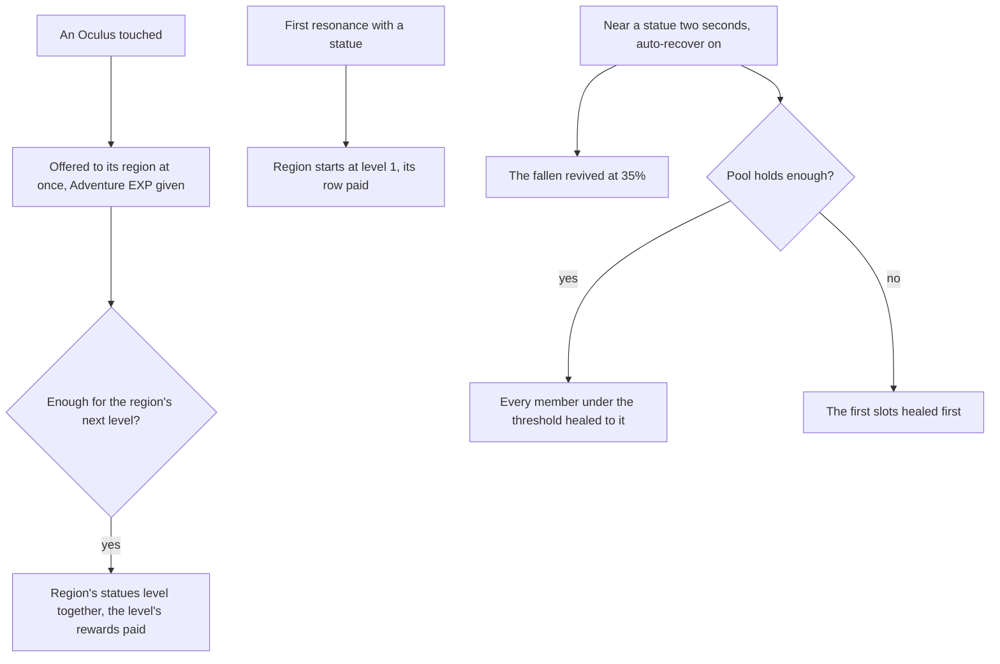

# Statues of The Seven

Each region's statues stand for its Archon, and they are the game's anchor for exploring it: a statue fills in its area of the map ([map unlocking](../genshin-map-unlocking/design.md)) and is a jump. The level rules, the maximum stamina they raise and the pool's heal are built and tested as rules, on the [Statues of The Seven](../../specs/genshin/statues-of-the-seven/design.md) page. What is left is the Oculi, the screen, the world's state those rules read, and the Traveler's element.

## Decisions

- **Oculi are found once.** Each region's Oculi, Anemoculi in Mondstadt, Geoculi in Liyue and so on, stand where the [spawned places](../genshin-spawned-places/design.md) fit them, since the game's servers spawn them. They are collected by touching them and never come back. Each gives one of its kind and 60 Adventure EXP, the wiki's figure for it (`OCULUS_ADVENTURE_EXP`). Within a short distance one shows on the minimap with a sound, as the game signals it.
- **The Oculus's minimap sound is provisional.** No sound in the game data this recreation reads fits a near Oculus: the login door's is the only one there, and the HUD plays none. So the mark's sound is a short synthesised chime (`services/statue/playOculusSound.ts`, a 1320 Hz sine for 0.4 seconds), and the distance it shows from, `OCULUS_MINIMAP_DISTANCE`, and the touch radius, `OCULUS_TOUCH_RADIUS`, are provisional until `oculus-minimap.mkv` is recorded and re-measured. The mark is a pale gold dot and the Oculus stand-in a sphere, both provisional.
- **A found Oculus is offered at once.** It joins its region's held count as it is found, and the levels it completes are reached there and then, so no held stack shows in the bag. The levels a region reaches are paid in the order the offer reaches them.
- **A region starts at its first resonance.** Resonating with a statue starts its region at level 1 and pays level 1's row once, which takes no Oculi. An Oculus found in a region not yet started is held until that first resonance starts it.
- **Levels pay the game's rewards by region.** Adventure EXP, Primogems and Sigils everywhere, and each later region's own items, Liyue's Stones of Remembrance, the Shrine of Depths keys and the Traveler's Memories of Inazuma, Sumeru, Fontaine and Snezhnaya, and Natlan's Acquaint Fates, as the wiki lists them, each joining with that region's page.
- **One loop pays a level's rewards.** `payOfferingLevels` pays the rewards of the levels an offering reaches: the Adventure EXP is returned for the Adventure Rank, and every other reward is paid in as a pick up pays it. The Frostbearing Tree's bag offer and the statues' levels both run it, so a level is paid by one rule. Liyue's levels are the dump's city 2, its level one taking no Oculi and each later level its Stones of Remembrance from the reward table; `genshin:assets statues` builds them beside Mondstadt's, and the main session publishes the record.
- **The Traveler resonates with its element.** She holds no element until her first resonance, as the prologue has her, and then the element of the statue she resonated with last: each region's, Anemo in Mondstadt and Geo in Liyue, read from `RegionIdTravelerElementMap`. Natlan's is left out until its quest step the wiki names is read, so a resonance there keeps the element of the region before. Her [constellations](../genshin-constellations/design.md) for that element come with its levels.
- **F on a resonated statue opens the Statue's Blessing.** Its screen holds the pool, the party's portraits and the auto-recover's switch and threshold. This entry is an assumption about the game's menu, provisional until the screen is recorded. The public clip (0 to 125 seconds) shows no Blessing screen: at a resonated statue it shows the Worship screen, which lists the statue's levels and their rewards, and the healing the voice-over calls the statue's. An anonymous YouTube search (six queries, about eight clips sampled) found no public clip that shows the Blessing screen either. So the screen's layout is owed `statue-blessing.mkv`, and task 3.1 waits on it.
- **The threshold's steps are the game's.** Auto-recover's threshold is set on the screen in steps the game offers, which no source here lists, so the steps are provisional until a recording shows them.
- **The statues' state is a slice of the save.** Each region's level and held count, and the ids of the Oculi found, are kept in the world's [save](../../specs/genshin/save-data/design.md) as every slice after the wallet is, [latest shape only](../../specs/architecture/persisted-data-latest-shape-only/design.md), and a new player's save holds no region started and no Oculus found. A merge keeps the union of the two copies' found ids, and each region keeps the copy the [save merge](../../specs/genshin/save-data/design.md) takes further on, by its level and then its held count, through the Frostbearing Tree's comparator, so a region only one copy holds is kept as it is. That needs no hosted data, so a region's held count is not re-split by Oculus: the Oculi a copy not kept held in a region are not carried, though their ids stay found and are not collected again. The merge reaches no level and pays nothing, since it keeps the account's wallet and bag.
- **The Oculi's places are the generated ones.** The published `oculi/<region>` records already hold each region's Oculi from the official map's fit, Mondstadt's Anemoculi among them, each with its id, kind and ground place, so an Oculus is named by that id and no new data is written.
- **Auto-recover near a statue.** With it on and a threshold set, standing by a statue's base for two seconds revives the fallen and heals the members under the threshold from the pool, as the built rule does. The two seconds are the wiki's.

## How it works



## Scope and order

**Today:** the levels, the stamina maximum and the pool's heal and auto-recover are built as rules and tested. No screen or world state calls them, and every statue is a jump at the start stamina.

**This still adds, in order:**

```text
packages/genshin-world/src/models/statue/StatueProgressSave.ts
```

1. **The statues' state in the save, and an Oculus found.** `StatueProgressSave.ts` holds each region's `{ heldCount, level }` by region id and `foundOculusIds`, its schema carrying no default as the [latest-shape rule](../../specs/architecture/persisted-data-latest-shape-only/design.md) sets, and `models/save/GenshinSave.ts` gains it as `statues`, with `services/save/toGenshinSave.ts`, `readGenshinSave.ts` and `mergeGenshinSave.ts` carrying it as they carry `reputation`. `services/statue/findOculus.ts` is pure: an Oculus id not yet found joins the found ids; in a region already started (level 1 or more) it is offered at once through `offerItems`, returning the levels gained for the caller to pay; in a region not started it raises the held count alone, since `offerItems` on level 0 would start the region, which only a resonance does. A found id gives nothing a second time. The proof is `findOculus.test.ts` for those three cases and `mergeGenshinSave.test.ts` cases for the union of found ids and for each region's copy further on.
2. **Oculi in the world**: each region's Oculi from its `oculi/<region>` record, fetched by key, drawn as a stand-in where none has been found, found by touch within a provisional `OCULUS_TOUCH_RADIUS`, paying its Adventure EXP and the levels `findOculus` returns, and marked on the minimap within the provisional distance the owed `oculus-minimap.mkv` re-measures.
3. **A first resonance starts its region and feeds the stamina**: resonating with a statue starts its region at level 1 and pays level 1's row once, and `computeMaximumStamina` over the saved levels is the character's `staminaMaximum`.
4. **The Statue's Blessing screen**, built from a public clip: `pnpm -C scripts recreation clip` into the captures folder, from https://www.youtube.com/watch?v=b6YZXYBegKA at 0 to 125 seconds, `--name statue-blessing-public` (1080p60, a statue's healing shown), its frames read for the screen's pool, portraits and auto-recover switch. Its threshold's steps stay provisional until `statue-blessing.mkv` shows them, and auto-recover's two-second dwell comes with it.
5. **The Traveler's resonance**, once the Traveler's kit follows its element, which the character kits unit the other machine holds is building.
6. **Each later region's Oculi and levels**, with that region.

## Data and measures

- **Read from the game's tables:** `CityLevelupConfigData` and `RewardExcelConfigData` for the levels, their Oculi, rewards and stamina actions, which are built for Mondstadt. The Oculi's places come from the spawned places' fit.
- **Measured:** how near an Oculus shows on the minimap, read off a recording of one being found, and the Blessing's threshold steps, read off a recording of the screen. Both are listed on the [roadmap](../genshin-roadmap/tasks.md).

## Key files

| File                                                            | Role after the change                                 |
| :-------------------------------------------------------------- | :---------------------------------------------------- |
| `packages/genshin-world/src/models/world/StatueLandmark.ts`     | A statue, its region's level read from the progress   |
| `scripts/src/services/genshinAssets/fit/fitRegionLandmarks.ts`  | Fits the Oculi from the official map's points         |
| `packages/genshin-world/src/components/Hud/Minimap/Index.vue`   | Marks a near Oculus                                   |
| `packages/genshin-world/src/components/World/Session/Index.vue` | Holds the regions' state and the pool, and wires them |

## Sources

- [Statue of The Seven](https://genshin-impact.fandom.com/wiki/Statue_of_The_Seven), Genshin Impact Wiki: filling in the map, reviving and healing, the Traveler's element, the region's shared levels and their rewards by region, and the Restorative Power pool.
- [Oculus](https://genshin-impact.fandom.com/wiki/Oculus), Genshin Impact Wiki: Oculi offered to their statue, one and Adventure EXP each, never respawning, and the minimap's mark with its sound.
- [Adventure EXP](https://genshin-impact.fandom.com/wiki/Adventure_EXP), Genshin Impact Wiki: collecting Oculi awards 60 Adventure Rank EXP per Oculus, the value `OCULUS_ADVENTURE_EXP` holds.
- [AnimeGameData](https://github.com/DimbreathBot/AnimeGameData), the community's per-patch dump: the statues' rows, their Oculi, rewards and stamina actions.

## Reference

- `statue-resonance.mkv` — F pressed at Windrise's Statue of The Seven from standing still, then the map on M opened, 10 seconds at most; the resonating light's length and how long it holds the player are measured from it, and the statue's area's first frame on the map. On the wiki and YouTube, none found (searched 2026-10-11).
- `statue-blessing.mkv` — F pressed at a resonated Statue of The Seven, the Statue's Blessing screen opened, its auto-recover threshold turned through each of its steps, then one party member clicked to heal, 30 seconds at most; the threshold's steps and the Restorative Power shown before and after a click are read off it, and the screen's entry from the statue's F. On the wiki and YouTube, none found (searched 2026-10-11).
