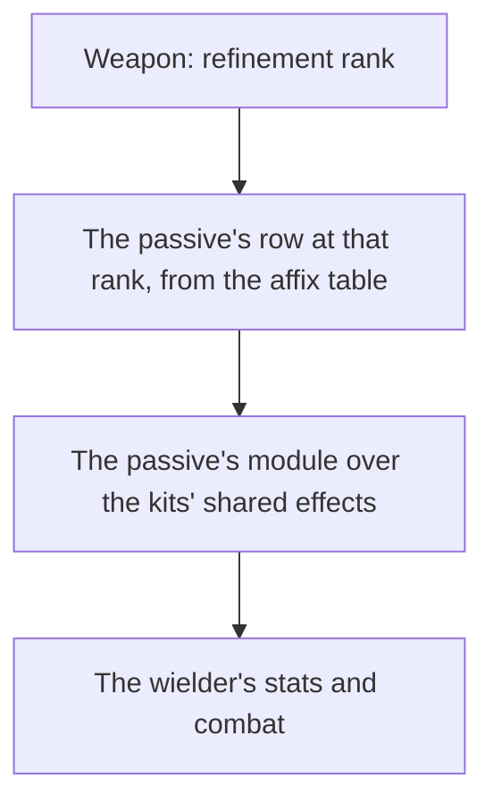

# Weapon enhancement

Levelling, ascension and refinement are built, as the [weapon enhancement](../../specs/genshin/weapon-enhancement/design.md) page describes. What is left is a weapon's passive: each refinement rank changes it, and it acts through the [character kits](../genshin-character-kits/design.md), so this page waits on them.

## Decisions

- **A passive is its table's numbers and a module.** `EquipAffixExcelConfigData` holds a passive's name, description and numbers at each refinement rank, which the stats run reads. What the passive does is written as a small module over the kits' shared effects, as a character's own module is, since the game's own weapon configs (`BinOutput/Talent/EquipTalents`) are scrambled like its ability configs.
- **A weapon's passive rows are its skill affix's.** A weapon names its passive by its `skillAffix` group, and the rows of that group are its ranks by their `level`, from zero for rank one to four for rank five.
- **The rows ride in the weapons' own record, flat and trimmed.** The weapons are already their own hosted record, `stats/weapons`, read on demand, so the passive adds no record: each weapon gains `passiveNameTextId` (`""` for a weapon with no skill affix), `passiveRankDescriptionTextIds`, one text id per rank, since each rank's description carries its own numbers, and `passiveRankParams`, one `paramList` per rank with the zeros past the longest rank's last used place cut (`[]` for none). The words stay text ids, never written into the per-language `nameText` records, until a screen shows them.
- **The passive reads the weapon's rank.** A weapon at refinement rank R reads the row of level R less one, so the rank kept with the weapon is the only input the module takes.
- **A passive's static stats are its rows' `addProps`, carried whatever its conditions.** Each rank's `addProps` is the stat the rank adds to its wielder at all times, read through the same converter as a weapon's ascension lines and kept per rank as `passiveRankAttributeLines`. A weapon's lines at its held rank join its character's attribute lines in `getCharacterAttributeLines`, so pricing and combat read them as they read the weapon's own. Provisional: that `addProps` is always on, not conditional; the 39 weapons that carry it are read from the dump, and a conditional passive that also adds a stat (Legend Falcon's ATK) keeps its condition in its module, not its stat.
- **An all-damage line returns with its attribute.** `FIGHT_PROP_ADD_HURT`, the all-damage bonus of Widsith (two weapons, ten rank rows), now names `Attribute.AllDamageBonus`, so the stats run keeps the line its converter had left out. The hosted weapon record carries it from the stats publish at integration, once genshin-world is built, and the lock moves with it.
- **A conditional passive is built only where its event and its attribute exist.** The kit's events are the normal attack's landing, a charged attack's landing, a skill's and a burst's use, a reaction, a particle's pickup, an elemental hit, a weak-point hit (no kit sets its flag yet), a defeat, a health change and an effect's expiry. The attributes are all-DMG, normal attack SPD and movement SPD. A passive that waits on an event or an attribute the model lacks is not approximated: it waits.
- **The speed attributes carry this repo's keys.** Movement SPD and normal attack SPD name no row in the game tables this repo reads, so `FIGHT_PROP_MOVE_SPEED` and `FIGHT_PROP_NORMAL_ATTACK_SPEED` are the repo's own keys. A table row with the game's name, once one lands, takes their place.
- **The shared events and primitives are built once, in the kit event model.** Each event is a kind in the one union, sent from the step or the strike that raises it, and no kit switches on the kind exhaustively, so a kit that does not listen is untouched. A passive's extra hit is queued from its own handler (`queueKitPassiveHit`), its energy regeneration is raised by Energy Recharge (`regeneratePartyMemberEnergy`), and its flat grant stays unraised (`gainPartyMemberEnergy`).
- **A defeat by any damage a kit owns is sent as EnemyDefeated.** A strike, an elemental tick, a reaction's reach and a Lunar hit each send `EnemyDefeated` once, from the combatant that owns the damage. A Lunar hit no member owns sends it with no striker, which is why the event's striker is optional. The tick and Lunar paths go through `damageKitEnemy`, which checks the enemy was standing before its damage, so an enemy already dead is not defeated again.
- **Batch one (provisional readings).** Built: Infusion Scroll (Mappa Mare, 14407), a reaction the wielder triggers adds a stack of 8% Elemental DMG Bonus on all seven elements, up to two, each stack lasting ten seconds from the last reaction; the rank's first number is the bonus per stack, and the stacks and seconds come from the passive's text, which its numbers do not carry. The four "Bane of X and Y" passives (Cool Steel, Bloodtainted Greatsword, Magic Guide, Raven Bow), 3-star drops whose element pairs are named by their passive, raise a strike's DMG Bonus by the rank's first number (12% to 24%) on an enemy under the aura of either element; "affected by" reads as the aura being present. Waiting, first ten forge passives (the Mondstadt blacksmith's 4-stars, by recipe player level): Prototype Rancour (11406) and Whiteblind (12407) wait on a charged-attack landing event, Iron Sting (11407) on an elemental-hit event and an all-DMG attribute, Crush (12406) on a kit-dealt extra AoE hit, Magic Affinity (13402) on a skill-used event, Infusion Needle (13403) on a flat extra normal-attack hit, Gilding (14406) on a passive's energy regeneration and a per-tick party heal, Unreturning (15406) on a weak-point hit and movement SPD, and Infusion Arrow (15407) is partly buildable (its ATK stacks) and waits on normal attack SPD. The shop weapons carry no passive (all are 1-star). Sources: the affix rows of each weapon's skill affix and `ForgeExcelConfigData` for the recipe order.
- **Batch two (provisional readings).** Built: the nine forge passives batch one waited on. Prototype Rancour (11406, Smashed Stone) and Whiteblind (12407, Infusion Blade) raise ATK and DEF by the rank's percentage per stack on each normal or charged attack hit their wielder deals, up to four stacks for six seconds, a stack at most once every 0.3s and 0.5s. Infusion Arrow (15407) raises ATK and Normal ATK SPD by the rank's first two numbers on the same stacks, a stack at most once every the rank's third number of seconds. Iron Sting (11407) raises All DMG by the rank's first number per elemental hit, up to the second number of stacks for the third number of seconds, a stack at most once a second. Magic Affinity (13402) raises normal and charged attack DMG by the rank's amount per stack after the wielder's skill, up to two stacks for twelve seconds; that bonus is two new attributes, `NormalAttackDamageBonus` and `ChargedAttackDamageBonus` (repo keys `FIGHT_PROP_NORMAL_ADD_HURT` and `FIGHT_PROP_CHARGED_ADD_HURT`, as the game's rows name no key this repo reads), each applied to a hit by its attack tag. Crush (12406) rolls the rank's chance on each normal or charged attack, and a proc queues one extra hit at the rank's multiplier, once every fifteen seconds. Infusion Needle (13403) makes each normal or charged attack land an extra hit at the rank's share of ATK for five seconds after its wielder picks up an orb or particle. Gilding (14406) after a burst regenerates the wielder's energy and each deployed member's share of Max HP on each two-second tick for six seconds. Unreturning (15406) raises movement SPD and ATK for ten seconds on a charged attack hit on a weak point; no kit sets a weak-point flag yet, so it is built and dormant. Provisional: Crush's extra hit lands on a two-metre circle about the wielder (the game's area is not in the dump); Infusion Needle gives one extra hit per attack, not per hit; Gilding's energy goes to the wielder. The modules share one stack helper, `addPassiveStack`, which keeps the stacks, the cooldown and the per-stack bonuses.
- **Batch three (provisional readings).** Built: sixteen modules cover the twenty-one three-star passives. Journey and Energy Shower restore the wielder the rank's share of Max HP per particle or orb. The reaction passives Dark Iron Sword (Overloaded), Quartz (Residual Heat) and Emerald Orb (Rapids) raise ATK for 12s on the reactions their text names; the dump's list gives 12 only on Dark Iron Sword, so 12s is held as a constant for all three, and Dark Iron Sword's list omits Stellar-Conduct, which is not a reaction type in the repo. Fillet Blade's Gash is a fifty per cent chance of the rank's multiplier on the one enemy struck, on a cooldown of the rank's seconds; its own extra hit has no attack tag. Ferrous Shadow's Unbending prices its charged-attack bonus below the rank's HP share, and its interruption resistance is not modelled here. Cull the Weak (White Iron Greatsword, Recurve Bow, and The Flagstaff, whose name text is TBD in the dump) heals per defeat. Guerilla Tactics and Determination raise ATK and Movement SPD. Blunt Conclusion's extra hit reaches a two-metre small AoE, provisional because the game's area is not in the dump, and its status lasts the seconds its text gives after a skill. Courage uses the attack-stack module's six seconds and four stacks. Heavy's extra hit lands on the normal attack's first hit area. Heritage buffs the character swapped in and holds its cooldown on the wielder. Elemental Mastery counts one stack per normal attack hit. Sharp, Bane of the Soft, Precise and Decimate price their bonus on the strike; Decimate reads the enemy's family from its kind row, which createEnemy now carries; Precise is dormant until weak points are set. Blocked: Messenger needs a per-hit forced critical and Slingshot needs the arrow's fire time, which no event carries.
- **Batch four (provisional readings).** Built: the four-star standard-banner passives the kits can carry. Windfall (the five Favonius weapons): a CRIT hit has the rank's chance of regenerating 6 energy for the wielder, the 6 being the text's own figure, on the rank's cooldown in seconds. The Bane passives of Lion's Roar, Rainslasher and Dragon's Bane are the existing bane module under their own name keys. Rust raises normal attacks by the first number and lowers charged attacks by the second. The Stringless raises elemental skill and burst DMG. Echo (Eye of Perception) fires a bolt at the enemy it struck, at the third number's multiplier on the fourth's cooldown; its bounces, which the text caps at four, are not modelled, so the bolt is a single hit provisionally. Not built: Composed (the Sacrificial weapons' skill cooldown reset, with no skill cooldown model in the kits), The Bell (its shield on taking damage, whose full text is not read yet), The Flute (Chord, harmonic stacks to a burst, full text not read yet), and The Widsith (three random themes, the third's text not read yet).
- **Weak points (provisional readings).** The strike sets `KitHit.weakPoint` on an aimed hit to an enemy whose family has weak points the wiki states, the Ruin machines (Automatons), each part cited in `enemyFamilyWeakPoints.ts`. The map is keyed by family, because the game's kind ids name only Ruin Drake among them. Exposure (airborne, paralysed, specific attacks) and the aim's point are not modelled, so every aimed hit on a Ruin machine takes one, which wakes Unreturning and Precise on those hits.
- **Stellar-Conduct (provisional reading).** The Dark Iron Sword's reaction ATK passive names Stellar-Conduct, the reaction a Superconduct becomes while a party's Stellar Jubilee enables it, so the wielder's ATK rises on that reaction too. Batch three left it out while the reaction type was missing.
- **Archer's Message (provisional reading).** Messenger's three-star passive: a Charged Attack hit on a weak point queues one extra hit at the rank's multiplier of ATK on the enemy it struck, which always lands as a critical hit, once every ten seconds. The text's 'as CRIT DMG' is read as a forced critical bonus hit, not a crit-damage stat, and the extra hit's area is not read, since it lands on the enemy struck. The forced critical is `KitHit.isForcedCritical`, which the strike reads before its CRIT roll.
- **Composed (provisional reading).** The four-star Sacrificial passive: an Elemental Skill that damages an enemy has the rank's chance to end its own cooldown, once every rank's cooldown in seconds (thirty down to sixteen). The reset sets the party member's `skillCooldownSeconds` to zero through `endPartyMemberSkillCooldown`; nothing else about the skill's recast is changed.
- **Chord (provisional reading).** The Flute's four-star passive: a normal or charged attack hit adds a harmonic through the passive stack, at most one every half second, and the fifth clears the count and deals the rank's multiplier of ATK to the surrounding enemies. Each gain restarts the harmonics' thirty seconds. The burst's area is not in the dump, so it reuses the small area, provisionally.
- **Rebellious Guardian (provisional reading).** The Bell's four-star passive: an enemy's strike that takes the wielder's HP (a loss naming no other character, which a drown also is) casts a shield of the rank's share of Max HP for ten seconds, and the wielder gains the rank's All DMG Bonus for the same ten seconds. The bonus does not end when the shield breaks, since the kit raises no event for a break. The forty-five-second cooldown starts with the shield.
- **Debut (provisional reading).** The Widsith's four-star passive: a swap that brings the wielder onto the field gains one of three themes, picked by a uniform roll (the first below a third, the Aria below two thirds, the Interlude above), for ten seconds, once every thirty. The first theme is the Recitative's ATK, the second the Aria's Elemental DMG Bonus on all seven elements, the third the Interlude's Elemental Mastery.
- **Slingshot (blocked on a kit field).** The Slingshot's three-star passive needs the travel time of a bow hit: a Normal or Charged Attack hit within 0.3 seconds of being fired takes the rank's bonus, and otherwise a 10% penalty. No record holds it. The field it needs is `KitHitRecord.travelFrames`, the frames from a bow hit's arrow leaving the bow to its hit, which the kit reads as `KitHit.travelSeconds`. Until a bow record carries it, the passive stays unbuilt.
- **Press the Advantage (provisional reading).** The Blackcliff Longsword's three-star passive: a defeat by the wielder's own strike adds a stack of the rank's ATK bonus for the rank's seconds, three at most. Each stack holds its own timer, so it lives on a source of its own and a defeat takes the first free one. A defeat at the cap adds nothing, since the text does not say it refreshes.
- **Justice (provisional reading).** The Black Sword's three-star passive: normal and charged attacks deal the rank's DMG bonus, and a critical hit by one restores the wielder the rank's share of its ATK, once every five seconds. The rank's fourth value (1.0 at both ranks) is not in the text and is not read.
- **Itinerant Hero (provisional reading).** The Alley Flash's three-star passive: the wielder's DMG is raised by the rank's percentage, priced as a passive. Taking DMG (a loss naming no other character) disables it for five seconds, modelled as a buff of the same amount taken off for those seconds, guarded so repeated DMG takes it off once.
- **Focus (provisional reading).** Each hit its wielder deals adds a stack of the rank's CRIT Rate, up to five, held as a hold with no end time. A CRIT Hit releases every stack and adds none, which is the outcome of adding one and then clearing it. Its CRIT Rate is a passive bonus that `getPassiveBonuses` reads from the holds in the team's effects as the wielder is priced, so a stack a CRIT removed is no longer read, and a Lunar reaction the wielder contributes to rolls with the stacks, as the game's stacks are a CRIT Rate buff on the character.
- **Undying Admiration.** Elemental Skill strikes gain the rank's DMG Bonus through getStrikeDamageBonus and its CRIT Rate through getStrikeCriticalRateBonus, at 16% and 6% at rank one. The text is one sentence with both numbers, so the reading is not provisional.
- **Spotless Heart (provisional reading).** Elemental Skill strikes gain the rank's 40% of the wielder's buffed DEF as flat base damage through getStrikeAdditiveBaseDamageBonus, while a status stands. A skill use sets a 1.5 s cooldown and the status; a skill hit shortens the status to 0.1 s, which is the reading of cleared 0.1s after the skill deals DMG. The rank's second value, 4000, is not described by the text and is not read.
- **Sword of Descension (out of scope, platform exclusive).** The text makes it effective only on the PlayStation Network platform, which the game has no platform to gate on. The coordinator put it out of scope, so it is not built, and the table row names the gate.
- **Iwakura Succession (provisional reading).** A skill use gains a seed as a hold of the rank's thirty seconds, up to three, once per five seconds. A burst releases every seed, and two seconds later the wielder gains the rank's six energy for each one released, through a delayed energy status. A burst with no seeds gives no energy.
- **Skyward Harp (Echoing Ballad).** CRIT DMG is a passive bonus. A hit of the wielder's own attack has the rank's 60% chance to queue a Physical small AoE at 125% ATK, once every 4 s. Provisional: hits reads as the wielder's own attacks, not a passive's queued hit, and the AoE is SMALL_AOE_AREA.
- **Skyward Spine (Black Wing).** CRIT Rate and Normal ATK SPD are passive bonuses. A Normal or Charged Attack hit has the rank's 50% chance to queue a vacuum blade of 40% ATK in a small AoE, once every 2 s. The 2 s is the text's, since the parameter list does not carry it. Provisional: the AoE is SMALL_AOE_AREA, as the game's area is not in the dump.
- **Wolf's Gravestone (Wolfish Tracker).** ATK is a passive bonus. A hit the wielder deals on an enemy under 30% of its HP raises the deployed team's ATK by the rank's 40% for 12 s, once every 30 s. The 12 s and 30 s are the text's, since the parameter list does not carry them. Provisional: all party members reads as the deployed team, as buffKitTeam does.
- **Aquila Favonia (Falcon's Defiance, provisional reading).** ATK is a static line the rank carries. A loss of HP naming no other character regenerates the wielder's HP by the rank's 100% of ATK and queues a physical hit at the rank's 200% of ATK on the surrounding opponents, once every 15 s. The text names neither the hit's element nor its area, so it is physical on SMALL_AOE_AREA.
- **Skyward Blade (Sky-Piercing Fang, provisional reading).** CRIT Rate is a static line the rank carries. A burst its wielder uses gives the wielder Movement SPD and Normal Attack SPD by the rank's 10% each, and its Normal and Charged Attack hits deal the rank's 20% of ATK as base damage, for 12 s. The flat damage reads the wielder's buffed ATK, through the character map the flat-damage hook is now handed. Provisional: the seconds are the text's, from its parameter list.
- **Skyward Pride (Sky-ripping Dragon Spine, provisional reading).** All DMG is a static line the rank carries. A burst its wielder uses starts the rank's 20 s and its count of eight blades, and each Normal or Charged Attack hit the wielder lands while both last queues a blade of 80% of ATK, using one blade. The blade is dealt on SMALL_AOE_AREA, since the game's area is not in the dump, and one blade is counted per hit event.
- **Skyward Atlas (Wandering Clouds, provisional reading).** Elemental DMG Bonus is a passive bonus on every element, since the rank's addProps are empty. A Normal Attack hit of the wielder's own has the rank's 50% chance to earn the favour of the clouds, which queues one physical AoE of 160% ATK on SMALL_AOE_AREA, once every 30 s. The clouds' 15 s of seeking out opponents, and their repeated hits, are not modelled: the favour is one hit, provisional.
- **Lost Prayer to the Sacred Winds (Boundless Blessing, provisional reading).** Movement SPD is a passive bonus on the wielder. A swap onto the field starts a repeating clock of four seconds, and each tick adds a stack of the rank's Elemental DMG Bonus on all seven elements, up to four, through the passive stack helper with no cooldown. A swap off the field or a fall clears the stacks and the clock. A battle that opens on the wielder starts the clock too, since the engine sends the opening character a swap with no character before it.
- **Eagle Spear of Justice (Primordial Jade Winged-Spear, provisional reading).** Each hit its wielder deals adds a stack of the rank's 3.2% ATK, up to seven, at most once every 0.3 s, each stack lasting 6 s from the last. At seven stacks the wielder's DMG dealt is raised by the rank's 12%, a buff the stacks carry and restart with, added when the seventh lands. Provisional: every hit counts, a passive's own queued hit too, since the text says only 'on hit'.
- **Smoke-and-Mirror Mystery (Flute of Ezpitzal, provisional reading).** Using an Elemental Skill raises DEF by the rank's 16% for 15 s, through createSkillBuffPassiveModule, which restarts the buff on each skill. The same helper builds Pact of Flowing Springs and The Law's Equilibrium.
- **Pact of Flowing Springs (Footprint of the Rainbow, provisional reading).** The same skill buff as Smoke-and-Mirror Mystery: DEF rises by the rank's 16% for 15 s after the wielder's Elemental Skill, through createSkillBuffPassiveModule.
- **The Law's Equilibrium (Covenant of Frost and Snow, provisional reading).** After the wielder's Elemental Skill, its Elemental Mastery rises by the rank's 120 for 12 s, through the same skill-buff helper as the DEF weapons. The rank's 240 at five stars is the same shape.
- **White Cruising Wave (Tidal Shadow, provisional reading).** After the wielder is healed, ATK rises by the rank's 24% for 8 s, through createHealBuffPassiveModule. A heal is a change of HP with a positive share; the text's 'even when not on the field' is read as the kit's events reaching every member, which the engine delivers.
- **Tip of the Spear (Rightful Reward, provisional reading).** After the wielder is healed, it restores 8 Energy, at most once every 10 s, whether or not the wielder is on the field. The cooldown is a status on the wielder, held as Heritage holds its cooldown.
- **Fall Into Place (Master Key, provisional reading).** After the wielder causes a reaction, its Elemental Mastery rises by the rank's 60 for 12 s, and by 60 more while the deployed team is Ascendant Gleam, read when the reaction lands, through createReactionBuffPassiveModule. The reaction counts whether or not the wielder is on the field.
- **Phantom Flash (Snare Hook, provisional reading).** The same reaction buff as Fall Into Place: Elemental Mastery rises by the rank's 60 for 12 s after the wielder's reaction, and by 60 more under Ascendant Gleam, through createReactionBuffPassiveModule.
- **Solemn Silence (Serenity's Call, provisional reading).** After the wielder causes a reaction, its Max HP rises by the rank's 16% for 12 s, and by 16% more while the deployed team is Ascendant Gleam, through createReactionBuffPassiveModule with the Max HP attribute. The reaction counts whether or not the wielder is on the field.
- **Full Draw (Hamayumi, provisional reading).** Its normal and charged attack DMG bonuses are passive bonuses on the wielder, in the two attributes the combined one was split into: 16% and 12% at the first rank. While the wielder's Energy is full, each hit of those attacks gains its bonus again, the rank's third number (100%) setting the increase. Provisional: the Energy is read as each hit strikes, and a character with no burst never reaches full Energy.
- **Cadence of Days Gone By (Song of the Vigil, provisional reading).** After the wielder triggers an Elemental Reaction, it regenerates 4 Energy to the wielder once every 9 s, through gainPartyMemberEnergy. A Stellar Glimmer reaction the wielder triggers raises its ATK by 20% for 12 s, through buffKitMember. Both count whether or not the wielder is on the field. The Stellar check is checkIsStellarGlimmerReaction, a Stellar-Conduct or Stellar Swirl.
- **Repentance and Redemption (Blade of Atonement, provisional reading).** After the wielder triggers an Elemental Reaction, its Elemental Mastery rises by 64 for 12 s, through createReactionBuffPassiveModule with no Ascendant Gleam clause. After a Stellar Glimmer reaction the wielder triggers, its ATK rises by 16% for 12 s, through createStellarGlimmerBuffPassiveModule. Both count whether or not the wielder is on the field.
- **An End Sublime (Finale of the Deep, provisional reading).** After its wielder uses its Elemental Skill, once every 10 s, its ATK rises by 12% for 15 s, and it is granted a Bond of Life worth 25% of its Max HP, through buffKitMember and grantPartyMemberBondOfLife. When that Bond is cleared, its flat ATK rises by 2.4% of the HP the bond cleared, at most 150, for 15 s. The cleared HP is the bond's total from bondOfLifeClearedShare, priced at the wielder's Max HP when it clears.
- **Unfinished Masterpiece (Flowing Purity, provisional reading).** After its wielder uses its Elemental Skill, once every 10 s, its All Elemental DMG Bonus rises by 8% for 15 s, and it is granted a Bond of Life worth 24% of its Max HP, through the shared createBondOfLifeSkillPassiveModule. When that Bond is cleared, its All Elemental DMG Bonus rises by 2% for every 1,000 HP the bond cleared, at most 12%, for 15 s. Provisional: the HP is floored to whole thousands.
- **Starfire Upon the Snowplains (Emberwell, provisional reading).** After the wielder causes an Elemental Reaction, its ATK rises by 16% for 12 s, through createReactionBuffPassiveModule with no Ascendant Gleam clause. A Stellar Glimmer reaction the wielder triggers raises its Stellar Glimmer reaction DMG by 16% for 12 s, through createStellarGlimmerBuffPassiveModule onto the repo-own Stellar Glimmer reaction DMG attribute, which the Stellar strike reads into each contributor's reaction bonus.
- **Echo of a Vow (Echoes of the Heart, provisional reading).** After the wielder causes an Elemental Reaction, its Elemental Mastery rises by 60 for 12 s, through createReactionBuffPassiveModule with no Ascendant Gleam clause. A Stellar Glimmer reaction the wielder triggers raises its Stellar Glimmer reaction DMG by 16% for 12 s, through createStellarGlimmerBuffPassiveModule onto the repo-own Stellar Glimmer reaction DMG attribute, which the Stellar strike reads into each contributor's reaction bonus.
- **Benthic Pulse (Song of Stillness, provisional reading).** After the wielder is healed, all DMG rises by the rank's 16% for 8 s, through the same heal-buff helper as Tidal Shadow, with the all-DMG attribute in place of ATK.
- **Samurai Conduct (Kitain Cross Spear and Katsuragikiri Nagamasa, provisional reading).** The Elemental Skill DMG its wielder deals rises by the rank's 6% to 12%. After its Elemental Skill hits an opponent, the wielder loses 3 energy and regenerates the rank's 3 or 5 on each 2 s tick for 6 s, once every 10 s, through scheduleKitTask and gainPartyMemberEnergy, whether or not the wielder is on the field.

## How it works



## Scope and order

**Today:** each weapon's passive rows are read from its skill affix into the hosted weapons record, which is republished, and the weapon screen lists the passive's name and each rank's description with the held rank marked. The weapon's passive joins its wielder's kit at the rank the weapon holds, and only Full HP Critic Up has its module; the other passives' modules are not yet written.

**This adds, in order:**

```text
packages/genshin-world/src/models/weapon/WeaponData.ts
```

1. **The affix table, read into each weapon: built.** `ExcelWeaponRow` (`scripts/src/models/genshinAssets/stats/ExcelWeaponRow.ts`) already declares `skillAffix: number[]`, and the affix row model (`ExcelEquipAffixRow`) already declares its `nameTextMapHash` and `descTextMapHash`; what is new is reading them into each weapon. The weapon's own `descTextMapHash` is its flavour text, so the passive does not read it. A new `toWeaponPassive.ts` takes one affix id's rows of `EquipAffixExcelConfigData` (an `ExcelEquipAffixRow`, as `getArtifactSetDatas` reads them) and returns the three passive fields, the rows ordered by `level`. `getWeaponDatas` groups the table by `id`, looks up each weapon's `skillAffix[0]` (0, for about a tenth of the weapons, is none) and spreads `toWeaponPassive` in, and `WeaponData` and `weaponDataSchema` gain the same three fields. `toWeaponPassive.test.ts` asserts rows given out of order come back by rank, the zeros cut to the longest used place, and no rows give `""`, `[]` and `[]`. `pnpm -C scripts genshin:assets stats` then republishes the `stats/weapons` record.
2. **Each passive as a module**, read at its rank, once the [character kits](../genshin-character-kits/design.md), the unit the other machine holds, hold the shared effects a passive acts through.

## Data and measures

- **Read from the game's tables:** `EquipAffixExcelConfigData`, in the stats run, grouped by the weapon's `skillAffix`.
- **Measured:** nothing; the passive's words are the game's own, through [game text](../../specs/genshin/game-text/design.md) by their text ids once they are keyed.

## Key files

| File                                                                                   | Role after the change                                                                             |
| :------------------------------------------------------------------------------------- | :------------------------------------------------------------------------------------------------ |
| `packages/genshin-world/src/models/weapon/WeaponData.ts`                               | Gains its passive's rows, grouped by its skill affix                                              |
| `scripts/src/services/genshinAssets/stats/getWeaponDatas.ts`                           | Reads the affix table into each weapon's passive rows                                             |
| `scripts/src/services/genshinText/constants.ts`                                        | Names the passive's name and rank text ids among the names `genshin:text names` publishes         |
| `packages/genshin-world/src/services/weapon/getWeaponPassive.ts`                       | The passive's name and each rank's description, the held rank marked                              |
| `packages/genshin-world/src/components/Weapon/Screen/Index.vue`                        | Lists the passive beneath the panel's ores; its place is provisional and unmeasured               |
| `scripts/src/services/genshinAssets/stats/toWeaponPassive.ts`                          | Carries each rank's `addProps` as attribute lines beside its numbers                              |
| `packages/genshin-world/src/services/weapon/getWeaponPassiveAttributeLines.ts`         | A weapon's passive lines at the held rank, read into the character's attribute lines              |
| `packages/genshin-world/src/services/weapon/getWeaponPassiveKit.ts`                    | The passive's module, read at the held rank, composed beside the kit's own passives and its sets' |
| `packages/genshin-world/src/services/weapon/WeaponPassiveNameTextIdCreateModuleMap.ts` | Each passive with a module, keyed by its name's text id                                           |
| `packages/genshin-world/src/services/kit/createCombatant.ts`                           | Composes the weapon's passive into the kit a combatant is priced and answers with                 |

## Sources

- [AnimeGameData](https://github.com/DimbreathBot/AnimeGameData), the community's per-patch dump: `EquipAffixExcelConfigData`, and the scrambled weapon configs (`BinOutput/Talent/EquipTalents`).

## Reference

- `weapon-levelling.mkv` — the Weapons tab on the English PC client: a three-star weapon at level 1 with no EXP fed one Enhancement Ore, with the Mora its change costs; then a weapon at its phase's cap fed ores past it, with the ores returned. 30 seconds at most. It settles the EXP each level takes, the Mora per ten points, and the EXP under the smallest ore that the game returns. On the wiki and YouTube, none found (searched 2026-10-11).
