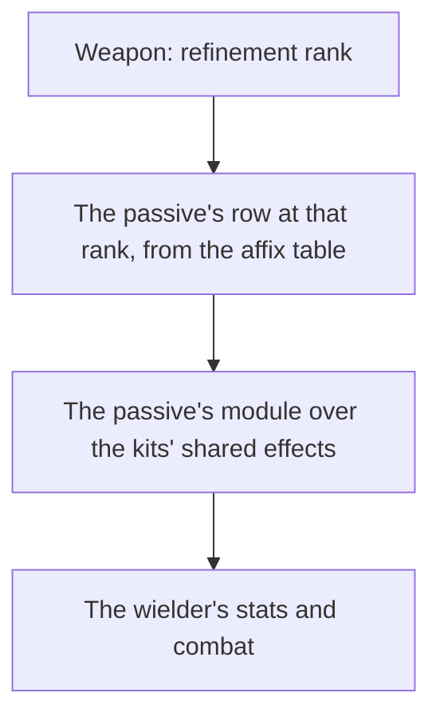

# Weapon enhancement

Levelling, ascension and refinement are built, as the [weapon enhancement](../../specs/genshin/weapon-enhancement/design.md) page describes. What is left is a weapon's passive: each refinement rank changes it, and it acts through the [character kits](../genshin-character-kits/design.md), so this page waits on them.

## Decisions

- **A passive is its table's numbers and a module.** `EquipAffixExcelConfigData` holds a passive's name, description and numbers at each refinement rank, which the stats run reads. What the passive does is written as a small module over the kits' shared effects, as a character's own module is, since the game's own weapon configs (`BinOutput/Talent/EquipTalents`) are scrambled like its ability configs.
- **A weapon's passive rows are its skill affix's.** A weapon names its passive by its `skillAffix` group, and the rows of that group are its ranks by their `level`, from zero for rank one to four for rank five.
- **The rows ride in the weapons' own record, flat and trimmed.** The weapons are already their own hosted record, `stats/weapons`, read on demand, so the passive adds no record: each weapon gains `passiveNameTextId` (`""` for a weapon with no skill affix), `passiveRankDescriptionTextIds`, one text id per rank, since each rank's description carries its own numbers, and `passiveRankParams`, one `paramList` per rank with the zeros past the longest rank's last used place cut (`[]` for none). The words stay text ids, never written into the per-language `nameText` records, until a screen shows them.
- **The passive reads the weapon's rank.** A weapon at refinement rank R reads the row of level R less one, so the rank kept with the weapon is the only input the module takes.
- **A passive's static stats are its rows' `addProps`, carried whatever its conditions.** Each rank's `addProps` is the stat the rank adds to its wielder at all times, read through the same converter as a weapon's ascension lines and kept per rank as `passiveRankAttributeLines`. A weapon's lines at its held rank join its character's attribute lines in `getCharacterAttributeLines`, so pricing and combat read them as they read the weapon's own. Provisional: that `addProps` is always on, not conditional; the 39 weapons that carry it are read from the dump, and a conditional passive that also adds a stat (Legend Falcon's ATK) keeps its condition in its module, not its stat.
- **An all-damage line returns with its attribute.** `FIGHT_PROP_ADD_HURT`, the all-damage bonus of Widsith (two weapons, ten rank rows), now names `Attribute.AllDamageBonus`, so the stats run keeps the line its converter had left out. The hosted weapon record carries it from the stats publish at integration, once genshin-world is built, and the lock moves with it.
- **A conditional passive is built only where its event and its attribute exist.** The kit's events are the normal attack's landing, a charged attack's landing, a skill's and a burst's use, a reaction, a particle's pickup, an elemental hit, a weak-point hit (no kit sets its flag yet), a defeat, a health change and an effect's expiry. The attributes are all-DMG, normal attack SPD and movement SPD. A passive that waits on an event or an attribute the model lacks is not approximated: it waits.
- **The speed attributes carry this repo's keys.** Movement SPD and normal attack SPD name no row in the game tables this repo reads, so `FIGHT_PROP_MOVE_SPEED` and `FIGHT_PROP_NORMAL_ATTACK_SPEED` are the repo's own keys. A table row with the game's name, once one lands, takes their place.
- **The shared events and primitives are built once, in the kit event model.** Each event is a kind in the one union, sent from the step or the strike that raises it, and no kit switches on the kind exhaustively, so a kit that does not listen is untouched. A passive's extra hit is queued from its own handler (`queueKitPassiveHit`), its energy regeneration is raised by Energy Recharge (`regeneratePartyMemberEnergy`), and its flat grant stays unraised (`gainPartyMemberEnergy`).
- **A defeat by any damage a kit owns is sent as EnemyDefeated.** A strike, an elemental tick, a reaction's reach and a Lunar hit each send `EnemyDefeated` once, from the combatant that owns the damage. A Lunar hit no member owns sends it with no striker, which is why the event's striker is optional. The tick and Lunar paths go through `damageKitEnemy`, which checks the enemy was standing before its damage, so an enemy already dead is not defeated again.
- **Batch one (provisional readings).** Built: Infusion Scroll (Mappa Mare, 14407), a reaction the wielder triggers adds a stack of 8% Elemental DMG Bonus on all seven elements, up to two, each stack lasting ten seconds from the last reaction; the rank's first number is the bonus per stack, and the stacks and seconds come from the passive's text, which its numbers do not carry. The four "Bane of X and Y" passives (Cool Steel, Bloodtainted Greatsword, Magic Guide, Raven Bow), 3-star drops whose element pairs are named by their passive, raise a strike's DMG Bonus by the rank's first number (12% to 24%) on an enemy under the aura of either element; "affected by" reads as the aura being present. Waiting, first ten forge passives (the Mondstadt blacksmith's 4-stars, by recipe player level): Prototype Rancour (11406) and Whiteblind (12407) wait on a charged-attack landing event, Iron Sting (11407) on an elemental-hit event and an all-DMG attribute, Crush (12406) on a kit-dealt extra AoE hit, Magic Affinity (13402) on a skill-used event, Infusion Needle (13403) on a flat extra normal-attack hit, Gilding (14406) on a passive's energy regeneration and a per-tick party heal, Unreturning (15406) on a weak-point hit and movement SPD, and Infusion Arrow (15407) is partly buildable (its ATK stacks) and waits on normal attack SPD. The shop weapons carry no passive (all are 1-star). Sources: the affix rows of each weapon's skill affix and `ForgeExcelConfigData` for the recipe order.
- **Batch two (provisional readings).** Built: the nine forge passives batch one waited on. Prototype Rancour (11406, Smashed Stone) and Whiteblind (12407, Infusion Blade) raise ATK and DEF by the rank's percentage per stack on each normal or charged attack hit their wielder deals, up to four stacks for six seconds, a stack at most once every 0.3s and 0.5s. Infusion Arrow (15407) raises ATK and Normal ATK SPD by the rank's first two numbers on the same stacks, a stack at most once every the rank's third number of seconds. Iron Sting (11407) raises All DMG by the rank's first number per elemental hit, up to the second number of stacks for the third number of seconds, a stack at most once a second. Magic Affinity (13402) raises normal and charged attack DMG by the rank's amount per stack after the wielder's skill, up to two stacks for twelve seconds; that bonus is a new attribute, `NormalAndChargedAttackDamageBonus` (repo key `FIGHT_PROP_NORMAL_AND_CHARGED_ADD_HURT`, as the game's rows name no key this repo reads), applied to a hit by its attack tag. Crush (12406) rolls the rank's chance on each normal or charged attack, and a proc queues one extra hit at the rank's multiplier, once every fifteen seconds. Infusion Needle (13403) makes each normal or charged attack land an extra hit at the rank's share of ATK for five seconds after its wielder picks up an orb or particle. Gilding (14406) after a burst regenerates the wielder's energy and each deployed member's share of Max HP on each two-second tick for six seconds. Unreturning (15406) raises movement SPD and ATK for ten seconds on a charged attack hit on a weak point; no kit sets a weak-point flag yet, so it is built and dormant. Provisional: Crush's extra hit lands on a two-metre circle about the wielder (the game's area is not in the dump); Infusion Needle gives one extra hit per attack, not per hit; Gilding's energy goes to the wielder. The modules share one stack helper, `addPassiveStack`, which keeps the stacks, the cooldown and the per-stack bonuses.
- **Batch three (provisional readings).** Built: sixteen modules cover the twenty-one three-star passives. Journey and Energy Shower restore the wielder the rank's share of Max HP per particle or orb. The reaction passives Dark Iron Sword (Overloaded), Quartz (Residual Heat) and Emerald Orb (Rapids) raise ATK for 12s on the reactions their text names; the dump's list gives 12 only on Dark Iron Sword, so 12s is held as a constant for all three, and Dark Iron Sword's list omits Stellar-Conduct, which is not a reaction type in the repo. Fillet Blade's Gash is a fifty per cent chance of the rank's multiplier on the one enemy struck, on a cooldown of the rank's seconds; its own extra hit has no attack tag. Ferrous Shadow's Unbending prices its charged-attack bonus below the rank's HP share, and its interruption resistance is not modelled here. Cull the Weak (White Iron Greatsword, Recurve Bow, and The Flagstaff, whose name text is TBD in the dump) heals per defeat. Guerilla Tactics and Determination raise ATK and Movement SPD. Blunt Conclusion's extra hit reaches a two-metre small AoE, provisional because the game's area is not in the dump, and its status lasts the seconds its text gives after a skill. Courage uses the attack-stack module's six seconds and four stacks. Heavy's extra hit lands on the normal attack's first hit area. Heritage buffs the character swapped in and holds its cooldown on the wielder. Elemental Mastery counts one stack per normal attack hit. Sharp, Bane of the Soft, Precise and Decimate price their bonus on the strike; Decimate reads the enemy's family from its kind row, which createEnemy now carries; Precise is dormant until weak points are set. Blocked: Messenger needs a per-hit forced critical and Slingshot needs the arrow's fire time, which no event carries.
- **Batch four (provisional readings).** Built: the four-star standard-banner passives the kits can carry. Windfall (the five Favonius weapons): a CRIT hit has the rank's chance of regenerating 6 energy for the wielder, the 6 being the text's own figure, on the rank's cooldown in seconds. The Bane passives of Lion's Roar, Rainslasher and Dragon's Bane are the existing bane module under their own name keys. Rust raises normal attacks by the first number and lowers charged attacks by the second. The Stringless raises elemental skill and burst DMG. Echo (Eye of Perception) fires a bolt at the enemy it struck, at the third number's multiplier on the fourth's cooldown; its bounces, which the text caps at four, are not modelled, so the bolt is a single hit provisionally. Not built: Composed (the Sacrificial weapons' skill cooldown reset, with no skill cooldown model in the kits), The Bell (its shield on taking damage, whose full text is not read yet), The Flute (Chord, harmonic stacks to a burst, full text not read yet), and The Widsith (three random themes, the third's text not read yet).
- **Weak points (provisional readings).** The strike sets `KitHit.weakPoint` on an aimed hit to an enemy whose family has weak points the wiki states, the Ruin machines (Automatons), each part cited in `enemyFamilyWeakPoints.ts`. The map is keyed by family, because the game's kind ids name only Ruin Drake among them. Exposure (airborne, paralysed, specific attacks) and the aim's point are not modelled, so every aimed hit on a Ruin machine takes one, which wakes Unreturning and Precise on those hits.

## How it works



## Scope and order

**Today:** each weapon's passive rows are read from its skill affix into the hosted weapons record, which is republished, and the weapon screen lists the passive's name and each rank's description with the held rank marked. The weapon's passive joins its wielder's kit at the rank the weapon holds, and only Full HP Critic Up has its module; the other passives' modules are not yet written.

**This adds, in order:**

```text
packages/genshin-world/src/models/weapon/WeaponData.ts
```

1. **The affix table, read into each weapon: built.** `ExcelWeaponRow` (`scripts/src/models/genshinAssets/stats/ExcelWeaponRow.ts`) already declares `skillAffix: number[]`, and the affix row model (`ExcelEquipAffixRow`) already declares its `nameTextMapHash` and `descTextMapHash`; what is new is reading them into each weapon. The weapon's own `descTextMapHash` is its flavour text, so the passive does not read it. A new `toWeaponPassive.ts` takes one affix id's rows of `EquipAffixExcelConfigData` (an `ExcelEquipAffixRow`, as `getArtifactSetDatas` reads them) and returns the three passive fields, the rows ordered by `level`. `getWeaponDatas` groups the table by `id`, looks up each weapon's `skillAffix[0]` (0, for about a tenth of the weapons, is none) and spreads `toWeaponPassive` in, and `WeaponData` and `weaponDataSchema` gain the same three fields. `toWeaponPassive.test.ts` asserts rows given out of order come back by rank, the zeros cut to the longest used place, and no rows give `""`, `[]` and `[]`. `pnpm -C scripts genshin:assets stats` then republishes the `stats/weapons` record.
2. **Each passive as a module**, read at its rank, once the [character kits](../genshin-character-kits/design.md), the unit the other machine holds, hold the shared effects a passive acts through.

## Data and measures

- **Read from the game's tables:** `EquipAffixExcelConfigData`, in the stats run, grouped by the weapon's `skillAffix`.
- **Measured:** nothing; the passive's words are the game's own, through [game text](../../specs/genshin/game-text/design.md) by their text ids once they are keyed.

## Key files

| File                                                                                   | Role after the change                                                                             |
| :------------------------------------------------------------------------------------- | :------------------------------------------------------------------------------------------------ |
| `packages/genshin-world/src/models/weapon/WeaponData.ts`                               | Gains its passive's rows, grouped by its skill affix                                              |
| `scripts/src/services/genshinAssets/stats/getWeaponDatas.ts`                           | Reads the affix table into each weapon's passive rows                                             |
| `scripts/src/services/genshinText/constants.ts`                                        | Names the passive's name and rank text ids among the names `genshin:text names` publishes         |
| `packages/genshin-world/src/services/weapon/getWeaponPassive.ts`                       | The passive's name and each rank's description, the held rank marked                              |
| `packages/genshin-world/src/components/Weapon/Screen/Index.vue`                        | Lists the passive beneath the panel's ores; its place is provisional and unmeasured               |
| `scripts/src/services/genshinAssets/stats/toWeaponPassive.ts`                          | Carries each rank's `addProps` as attribute lines beside its numbers                              |
| `packages/genshin-world/src/services/weapon/getWeaponPassiveAttributeLines.ts`         | A weapon's passive lines at the held rank, read into the character's attribute lines              |
| `packages/genshin-world/src/services/weapon/getWeaponPassiveKit.ts`                    | The passive's module, read at the held rank, composed beside the kit's own passives and its sets' |
| `packages/genshin-world/src/services/weapon/WeaponPassiveNameTextIdCreateModuleMap.ts` | Each passive with a module, keyed by its name's text id                                           |
| `packages/genshin-world/src/services/kit/createCombatant.ts`                           | Composes the weapon's passive into the kit a combatant is priced and answers with                 |

## Sources

- [AnimeGameData](https://github.com/DimbreathBot/AnimeGameData), the community's per-patch dump: `EquipAffixExcelConfigData`, and the scrambled weapon configs (`BinOutput/Talent/EquipTalents`).

## Reference

- `weapon-levelling.mkv` — the Weapons tab on the English PC client: a three-star weapon at level 1 with no EXP fed one Enhancement Ore, with the Mora its change costs; then a weapon at its phase's cap fed ores past it, with the ores returned. 30 seconds at most. It settles the EXP each level takes, the Mora per ten points, and the EXP under the smallest ore that the game returns. On the wiki and YouTube, none found (searched 2026-10-11).
