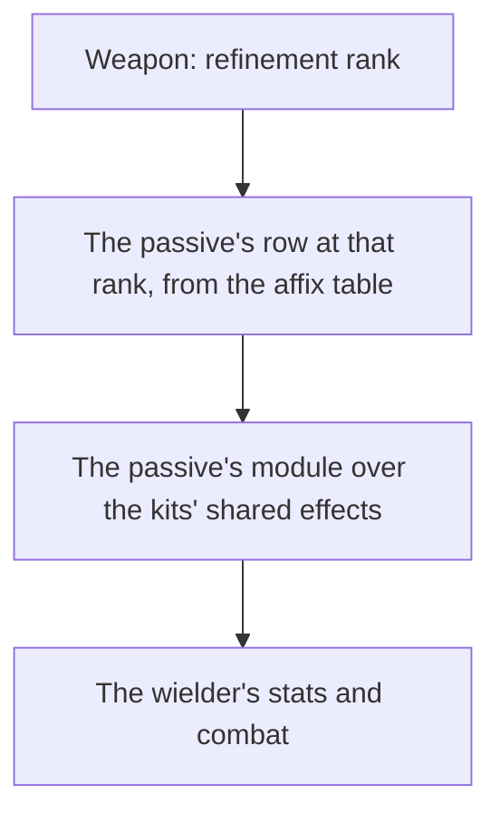

# Weapon enhancement

Levelling, ascension and refinement are built, as the [weapon enhancement](../../specs/genshin/weapon-enhancement/design.md) page describes. What is left is a weapon's passive: each refinement rank changes it, and it acts through the [character kits](../genshin-character-kits/design.md), so this page waits on them.

## Decisions

- **A passive is its table's numbers and a module.** `EquipAffixExcelConfigData` holds a passive's name, description and numbers at each refinement rank, which the stats run reads. What the passive does is written as a small module over the kits' shared effects, as a character's own module is, since the game's own weapon configs (`BinOutput/Talent/EquipTalents`) are scrambled like its ability configs.
- **A weapon's passive rows are its skill affix's.** A weapon names its passive by its `skillAffix` group, and the rows of that group are its ranks by their `level`, from zero for rank one to four for rank five.
- **The rows ride in the weapons' own record, flat and trimmed.** The weapons are already their own hosted record, `stats/weapons`, read on demand, so the passive adds no record: each weapon gains `passiveNameTextId` (`""` for a weapon with no skill affix), `passiveRankDescriptionTextIds`, one text id per rank, since each rank's description carries its own numbers, and `passiveRankParams`, one `paramList` per rank with the zeros past the longest rank's last used place cut (`[]` for none). The words stay text ids, never written into the per-language `nameText` records, until a screen shows them.
- **The passive reads the weapon's rank.** A weapon at refinement rank R reads the row of level R less one, so the rank kept with the weapon is the only input the module takes.

## How it works



## Scope and order

**Today:** a weapon's refinement rank is kept and paid for; nothing reads it as a passive, and the affix table is not read.

**This adds, in order:**

```text
scripts/src/services/genshinAssets/stats/toWeaponPassive.ts
```

1. **The affix table, read into each weapon.** `ExcelWeaponRow` (`scripts/src/models/genshinAssets/stats/ExcelWeaponRow.ts`) already declares `skillAffix: number[]`, and the affix row model (`ExcelEquipAffixRow`) already declares its `nameTextMapHash` and `descTextMapHash`; what is new is reading them into each weapon. The weapon's own `descTextMapHash` is its flavour text, so the passive does not read it. A new `toWeaponPassive.ts` takes one affix id's rows of `EquipAffixExcelConfigData` (an `ExcelEquipAffixRow`, as `getArtifactSetDatas` reads them) and returns the three passive fields, the rows ordered by `level`. `getWeaponDatas` groups the table by `id`, looks up each weapon's `skillAffix[0]` (0, for about a tenth of the weapons, is none) and spreads `toWeaponPassive` in, and `WeaponData` and `weaponDataSchema` gain the same three fields. `toWeaponPassive.test.ts` asserts rows given out of order come back by rank, the zeros cut to the longest used place, and no rows give `""`, `[]` and `[]`. `pnpm -C scripts genshin:assets stats` then republishes the `stats/weapons` record.
2. **Each passive as a module**, read at its rank, once the [character kits](../genshin-character-kits/design.md), the unit the other machine holds, hold the shared effects a passive acts through.

## Data and measures

- **Read from the game's tables:** `EquipAffixExcelConfigData`, in the stats run, grouped by the weapon's `skillAffix`.
- **Measured:** nothing; the passive's words are the game's own, through [game text](../../specs/genshin/game-text/design.md) by their text ids once they are keyed.

## Key files

| File                                                         | Role after the change                                 |
| :----------------------------------------------------------- | :---------------------------------------------------- |
| `packages/genshin-world/src/models/weapon/WeaponData.ts`     | Gains its passive's rows, grouped by its skill affix  |
| `scripts/src/services/genshinAssets/stats/getWeaponDatas.ts` | Reads the affix table into each weapon's passive rows |

## Sources

- [AnimeGameData](https://github.com/DimbreathBot/AnimeGameData), the community's per-patch dump: `EquipAffixExcelConfigData`, and the scrambled weapon configs (`BinOutput/Talent/EquipTalents`).

## Reference

- `weapon-levelling.mkv` — the Weapons tab on the English PC client: a three-star weapon at level 1 with no EXP fed one Enhancement Ore, with the Mora its change costs; then a weapon at its phase's cap fed ores past it, with the ores returned. 30 seconds at most. It settles the EXP each level takes, the Mora per ten points, and the EXP under the smallest ore that the game returns. On the wiki and YouTube, none found (searched 2026-10-11).
