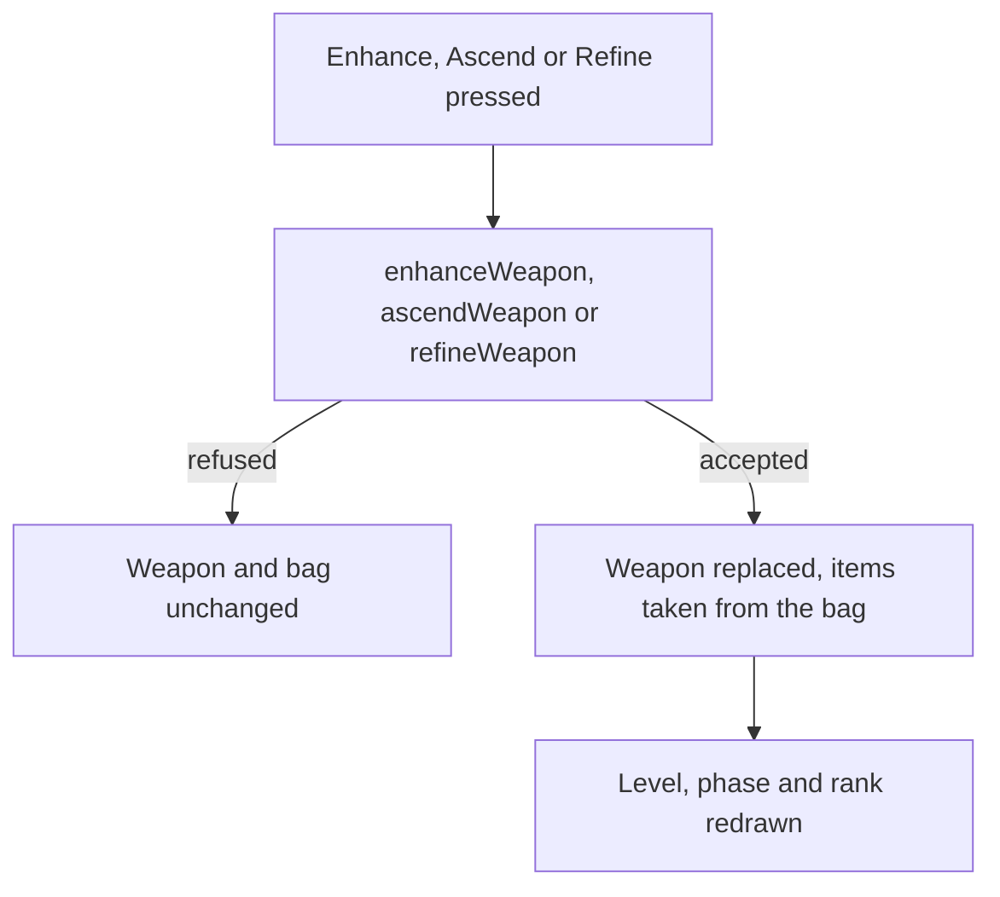

# Weapon screen

The [weapon enhancement](../../specs/genshin/weapon-enhancement/design.md) page builds three pure services that level, ascend and refine a weapon, and nothing calls them. This page is the screen that calls them, and it builds on that page's rules rather than restating them. It is its own screen beside the [character screen](../genshin-character-screen/design.md), since the weapon is its own record changed by its own three acts; the character screen's Weapons panel only shows the weapon a character wields.

## Decisions

- **The screen asks the service that owns the rule.** Enhance, Ascend and Refine each call `enhanceWeapon`, `ascendWeapon` or `refineWeapon` and apply the weapon the service returns. A refusal is the service's answer, so the screen holds no second copy of a gate, and a refused action leaves the weapon and the bag as they were.
- **The bag gives what the actions spend.** The ores, fodder weapons, copies and materials are picked from the bag's stacks, and the items an action spends are taken out through the inventory's own take, which refuses a stack that holds too few.
- **Ascend is offered at the cap.** The screen offers Ascend only while the weapon is at its phase's level cap. The Adventure Rank gate stays with `ascendWeapon`, so the screen and the rule cannot disagree about it.
- **Refine is not offered where it cannot apply.** One- and two-star weapons and a weapon at rank five show no Refine; the service keeps the same limits as its own refusal.
- **The passive waits on the kits.** A weapon's passive name and per-rank descriptions are the weapon enhancement's requirement, and the screen shows them once they land. What a passive does acts through the [character kits](../genshin-character-kits/design.md), so its effect waits on them.
- **The words are the game's.** Enhance, Ascend and Refine take their labels from the game text by their text ids, never written into the component.
- **Measured look.** The frame is measured from the game's own screen like the character screen's, and its look is judged against the weapon-levelling clip held by the weapon enhancement change. Until a measure is taken, its look is provisional.

## How it works



## Scope

**Today:** the three services are built and tested, a weapon's level, ascension and refinement are kept, and no screen calls them.

**This adds, in order:**

```text
packages/genshin-world/src/components/Weapon/Screen/Index.vue
packages/genshin-interface/src/components/WeaponMenu/Index.vue
```

1. **The screen, opened on a held weapon.** The screen shows the weapon's name, rarity, level, EXP towards the next level, phase and rank, with the three action labels.
2. **Enhance, Ascend and Refine**, each calling its service, in the order the spec's requirements state.
3. **The frame's look**, placed by its measured rects and compared with the reference clip.
4. **Each passive, shown** on the screen once the weapon enhancement's passive data lands. Its effect follows the kits.

## Key files

| File                                                                  | Role                                                               |
| :-------------------------------------------------------------------- | :----------------------------------------------------------------- |
| `packages/genshin-world/src/models/weapon/Weapon.ts`                  | The weapon the screen shows and the state its three actions change |
| `packages/genshin-world/src/services/weapon/enhanceWeapon.ts`         | The levelling the screen's Enhance calls                           |
| `packages/genshin-world/src/services/weapon/ascendWeapon.ts`          | The ascension the screen's Ascend calls, and its phase gate        |
| `packages/genshin-world/src/services/weapon/refineWeapon.ts`          | The refinement the screen's Refine calls                           |
| `packages/genshin-world/src/services/weapon/getWeaponActions.ts`      | Which of Ascend and Refine the screen offers for a weapon          |
| `packages/genshin-world/src/services/inventory/takeInventoryItems.ts` | The items the actions spend, taken out of the bag's stacks         |
| `packages/genshin-text/src/models/GameTextKey.ts`                     | Gains the three action labels                                      |

## Reference

The screen's reference is the weapon-levelling clip held by the [weapon enhancement change](../genshin-weapon-enhancement/design.md), the Weapons tab on the English PC client, which this screen is compared against.
