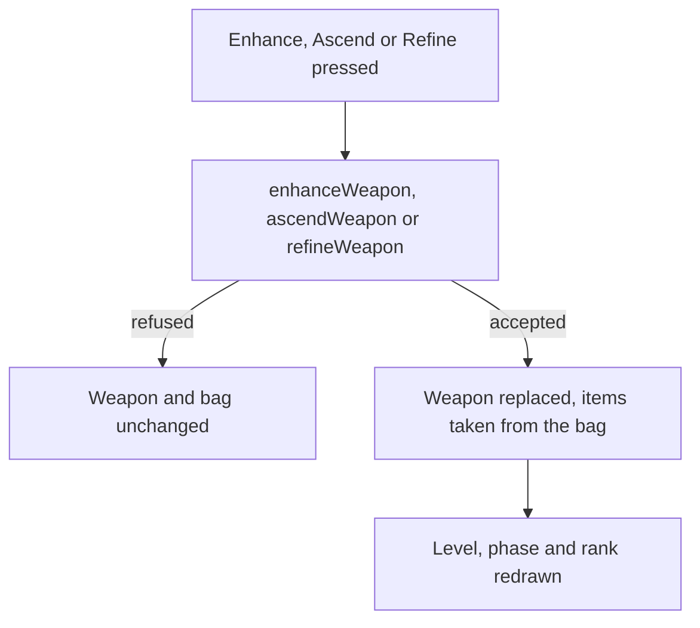

# Weapon screen

The [weapon enhancement](../../specs/genshin/weapon-enhancement/design.md) page builds three pure services that level, ascend and refine a weapon, and nothing calls them. This page is the screen that calls them, and it builds on that page's rules rather than restating them. It is its own screen beside the [character screen](../genshin-character-screen/design.md), since the weapon is its own record changed by its own three acts; the character screen's Weapons panel only shows the weapon a character wields.

## Decisions

- **The screen asks the service that owns the rule.** Enhance, Ascend and Refine each call `enhanceWeapon`, `ascendWeapon` or `refineWeapon` and apply the weapon the service returns. A refusal is the service's answer, so the screen holds no second copy of a gate, and a refused action leaves the weapon and the bag as they were.
- **The bag gives what the actions spend.** The ores, fodder weapons, copies and materials are picked from the bag's stacks, and the items an action spends are taken out through the inventory's own take, which refuses a stack that holds too few.
- **Ascend is offered at the cap.** The screen offers Ascend only while the weapon is at its phase's level cap. The Adventure Rank gate stays with `ascendWeapon`, so the screen and the rule cannot disagree about it.
- **Refine is not offered where it cannot apply.** One- and two-star weapons and a weapon at rank five show no Refine; the service keeps the same limits as its own refusal.
- **The passive waits on the kits.** A weapon's passive name and per-rank descriptions are the weapon enhancement's requirement, and the screen shows them once they land. What a passive does acts through the [character kits](../genshin-character-kits/design.md), so its effect waits on them.
- **The words are the game's.** Enhance, Ascend and Refine take their labels from the game text by their text ids, never written into the component.
- **Measured look.** The frame is measured from the English PC client's weapon-levelling clip `jXrYcFHiVnI` (Enhance at 2 seconds, the level cap at 53 seconds, Refine at 92 seconds). The sizes are read by eye off the frame, so the placement is provisional until the parity compare runs.
- **The EXP rules are the wiki's.** Ore EXP (400, 2,000 and 10,000), 10 EXP per Mora and the 80% returned from a fodder are read from the wiki's Weapon EXP page (`api.php?action=parse&page=Weapon_EXP&prop=wikitext`). Its fodder base EXP by star (600, 1,200, 1,800, 50,000 and 300,000) differs from the published `baseExp` the model reads; the model keeps the table's value, and the difference is open.
- **Provisional: an ore the bag cannot take is dropped.** An Enhance returns the EXP past the cap as ores, and `addInventoryItem` reports what does not fit; the screen does not yet show that overflow.
- **Provisional: Refine spends the refinement material.** A copy raising the rank waits on the bag's weapon entries holding a refinement, so until then Refine is offered only for the material.
- **Provisional: refusals are logged, with no Mora preview.** A refused action goes to `console.error` and changes nothing. The Mora an Enhance would cost is not previewed yet, an open follow-up.

## How it works



## Scope

**Today:** the three services are built and tested, a weapon's level, ascension and refinement are kept, and no screen calls them.

**This adds, in order:**

```text
packages/genshin-world/src/components/Weapon/Screen/Index.vue
packages/genshin-interface/src/components/WeaponMenu/Index.vue
```

1. **The screen, opened on a held weapon.** The screen shows the weapon's name, rarity, level, EXP towards the next level, phase and rank, with the three action labels.
2. **Enhance, Ascend and Refine**, each calling its service, in the order the spec's requirements state.
3. **The frame's look**, placed by its measured rects and compared with the reference clip.
4. **Each passive, shown** on the screen once the weapon enhancement's passive data lands. Its effect follows the kits.

## Key files

| File                                                                  | Role                                                               |
| :-------------------------------------------------------------------- | :----------------------------------------------------------------- |
| `packages/genshin-world/src/models/weapon/Weapon.ts`                  | The weapon the screen shows and the state its three actions change |
| `packages/genshin-world/src/services/weapon/enhanceWeapon.ts`         | The levelling the screen's Enhance calls                           |
| `packages/genshin-world/src/services/weapon/ascendWeapon.ts`          | The ascension the screen's Ascend calls, and its phase gate        |
| `packages/genshin-world/src/services/weapon/refineWeapon.ts`          | The refinement the screen's Refine calls                           |
| `packages/genshin-world/src/services/weapon/getWeaponActions.ts`      | Which of Ascend and Refine the screen offers for a weapon          |
| `packages/genshin-world/src/services/inventory/takeInventoryItems.ts` | The items the actions spend, taken out of the bag's stacks         |
| `packages/genshin-text/src/models/GameTextKey.ts`                     | Gains the three action labels                                      |

## Reference

The screen's reference is the English PC client's weapon-levelling clip `jXrYcFHiVnI` ("Ver7.1 Event Weapon Silver Light Upgrading Lv1 - 90", 115 seconds, 1920 by 864 pixels). The clip and its frames live outside the repository in `~/Esposter/genshin-parity/captures/` and `~/Esposter/genshin-parity/references/weapon-screen/`, and none is committed. The measured frames are 2 seconds (the Enhance tab at level one), 53 seconds (the level cap, "Max level reached") and 92 seconds (the Refine tab). The Ascend tab appears around 52 to 56 seconds and is not yet measured at full resolution.
