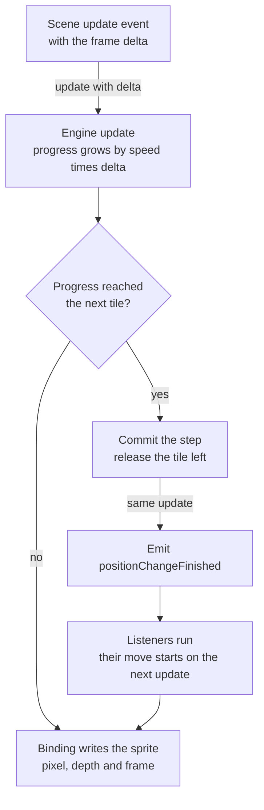

# grid-engine-headless

A headless grid movement package of ours replaces grid-engine: tile collision, characters on integer tiles that step in four directions, five typed events, and no Phaser, rxjs or other runtime dependency. A thin binding in the dungeon world draws it on Phaser's sprites, and the swap moves the world's call sites onto it in one commit.

## Scope

Today the dungeon world attaches grid-engine as a Phaser scene plugin. Its characters, NPC patrols, the player's steps and the encounter and interaction checks all go through that plugin, and the app's shared code mirrors its direction enum because importing the plugin's root loads Phaser.

This change adds the design and the build checklist. It adds no code, no package and no catalog or lockfile change. The build is the checklist in `tasks.md`, and it begins only after this design is accepted.

## How it works

The package holds the grid: which tiles block, where each character stands, which way it faces, and how far through its current step it is. It has no notion of pixels. The app's binding owns the Phaser objects. Each frame the scene's update event hands the frame's delta to the engine, and the engine's order of work is what makes a listener's call land where it should.



The commit and its event come before the sprite is written, so a listener sees the character on its new tile. A step starts only from a `move` call and no engine work starts one, so a move a listener makes is not a step the same update takes on, which is the ordering the upstream tracker's #528 reports as broken.

## Key files

| File                                                                               | Role after the change                                                                                                 |
| ---------------------------------------------------------------------------------- | --------------------------------------------------------------------------------------------------------------------- |
| `apps/web/app/services/dungeons/tilemap/createTilemapAssets.ts`                    | Reads the collision grid from the tilemap and makes the world's engine, replacing the plugin's create call            |
| `apps/web/app/store/dungeons/world/scene.ts`                                       | Holds the world's engine next to the tilemap it was made for, marked raw                                              |
| `apps/web/app/pages/dungeons.vue`                                                  | Stops registering grid-engine as a scene plugin                                                                       |
| `apps/web/app/types/vue-phaserjs.d.ts`                                             | Stops augmenting the scene's plugins with grid-engine's type                                                          |
| `apps/web/app/components/Dungeons/World/Character/Index.vue`                       | Attaches each character's sprite through the binding and subscribes to the five events, releasing them on teardown    |
| `apps/web/app/components/Dungeons/World/Character/Player.vue`                      | Teleports the player through the engine's position call, and reads the events the character already listens to        |
| `apps/web/app/components/Dungeons/World/Character/Npc.vue`                         | Types its direction and its movement from the core instead of grid-engine                                             |
| `apps/web/app/components/Dungeons/World/Map/Foreground.vue`                        | Unchanged in code; its depth rule holds because the binding keeps the player sprite's depth the way the plugin set it |
| `apps/web/app/models/resolvers/dungeons/world/MovementInteractionInputResolver.ts` | Moves the player through the core and checks whether the player is registered                                         |
| `apps/web/app/services/dungeons/scene/world/moveNpcs.ts`                           | Moves each patrolling NPC through the core and reads whether the next tile is blocked                                 |
| `apps/web/app/services/dungeons/scene/world/interaction/interactWithNpc.ts`        | Turns the NPC towards the player through the core                                                                     |
| `apps/web/app/services/dungeons/scene/world/constants.ts`                          | Types the walking animation mappings with the core's frame types                                                      |
| `apps/web/app/models/dungeons/scene/world/Character.ts`                            | Types a character's walking mapping and single-sided direction with the core's types                                  |
| `apps/web/app/services/dungeons/scene/world/readNpcs.ts`                           | Types its positions and directions with the core's types                                                              |
| `apps/web/app/store/dungeons/world/player.ts`                                      | Checks the respawn direction against the core's direction values instead of the engine's enum                         |
| `apps/web/app/services/dungeons/UI/input/checkIsMovingDirection.ts`                | Reads the core's direction values, with the no-direction value excluded as now                                        |
| `apps/web/app/models/dungeons/tilemap/TileProperty.ts`                             | Keeps the collision property name the binding reads from the tiles                                                    |
| `apps/web/app/models/dungeons/gridEngine/PositionChangeStarted.ts`                 | Deleted: the core's event payload types replace the types extracted from the plugin's streams                         |
| `apps/web/app/models/dungeons/gridEngine/PositionChangeFinished.ts`                | Deleted, for the same reason                                                                                          |
| `apps/web/app/services/dungeons/direction/DirectionToGridDirectionMap.ts`          | Deleted: the app and the core share one direction vocabulary                                                          |
| `apps/web/app/services/dungeons/direction/GridDirectionToDirectionMap.ts`          | Deleted, for the same reason                                                                                          |
| `apps/web/shared/models/dungeons/data/player/Direction.ts`                         | Deleted: shared code imports the core's direction values directly, since the core imports nothing that loads Phaser   |
| `apps/web/shared/test/setup.ts`                                                    | Loses the module mock of grid-engine, which existed only because importing it loads Phaser                            |
| `pnpm-workspace.yaml`                                                              | Loses the grid-engine catalog entry in the swap commit                                                                |
| `apps/web/package.json`                                                            | Depends on the new package instead of the catalog entry                                                               |
| `.agents/ledgers/dependencies.md`                                                  | Loses the grid-engine row in the swap commit, the catalog's own verdict record                                        |
| `.agents/ledgers/naming/dungeons.md`                                               | Its row for the `gridEngine` folder is swept with that folder's deletion                                              |
| `.agents/skills/naming/references/value-set-members.md`                            | Its example of a mirror of the engine's direction is rewritten, since the mirror is gone                              |
| `openspec/specs/dungeons/world/design.md`                                          | Its movement paragraph is rewritten as built at the swap                                                              |
| `openspec/specs/dungeons/scenes-and-input/design.md`                               | Its note that the plugin is registered on the dungeon page is rewritten as built at the swap                          |
| `openspec/rejected/dungeons/diagonal-movement/design.md`                           | Its note that the engine runs four-directional is reworded to the core, and the decision it records stands            |
| `openspec/specs/architecture/dependency-admission/design.md`                       | Gains the package in its precedent section once the swap lands                                                        |

The package and the binding are new paths, so they are not listed here. Their layout is in "Layout" below.

## Survey: the calls the app makes

The engine's instance is called from a handful of files of the web app, its types are imported across several dozen more, and no package in the repository calls it. The table is every grid-engine member the app reaches, with where it is reached.

| grid-engine member                                                                                                                 | Reached from                                         | Replacement                                                                                                                    |
| ---------------------------------------------------------------------------------------------------------------------------------- | ---------------------------------------------------- | ------------------------------------------------------------------------------------------------------------------------------ |
| `create` with `characters`, `collisionTilePropertyName`, `numberOfDirections`                                                      | `createTilemapAssets.ts`                             | A collision grid read by the binding, and the core's create. Four directions are the only mode, so the direction count is gone |
| `addCharacter` with `id`, `sprite`, `walkingAnimationMapping`, `startPosition`, `facingDirection`, `speed`                         | `Character/Index.vue`                                | The binding attaches the sprite and its frames, and the core takes the id, start, facing and speed                             |
| `hasCharacter`                                                                                                                     | `MovementInteractionInputResolver.ts`, `moveNpcs.ts` | The same name, a plain boolean                                                                                                 |
| `move`                                                                                                                             | `MovementInteractionInputResolver.ts`, `moveNpcs.ts` | The same name, a result, failing for an unknown character or a diagonal                                                        |
| `turnTowards`                                                                                                                      | `interactWithNpc.ts`                                 | The same name, a result                                                                                                        |
| `isBlocked` with a position                                                                                                        | `moveNpcs.ts`                                        | The same name, with the layer and group arguments gone                                                                         |
| `setPosition`                                                                                                                      | `Player.vue`                                         | The same name, a result, failing for an unknown character                                                                      |
| `getFacingDirection`                                                                                                               | `Character/Index.vue`, twice                         | Gone: the position events carry the direction, so no listener reads the engine back                                            |
| `movementStarted`, `movementStopped`, `directionChanged`, `positionChangeStarted`, `positionChangeFinished`                        | `Character/Index.vue`                                | Five typed events, each subscribed through the engine's on method, which returns its unsubscribe                               |
| The scene plugin registration                                                                                                      | `pages/dungeons.vue`, `types/vue-phaserjs.d.ts`      | Gone: the engine is held by the world's store                                                                                  |
| The `Direction`, `Position`, `FrameRow`, `WalkingAnimationMapping` and `NumberOfDirections` types, and the direction enum's values | several dozen files                                  | The core's own types, with one direction vocabulary                                                                            |

The app never calls the following, so the package leaves them out: `moveTo`, `moveRandomly`, `follow`, `stopMovement`, `findShortestPath` and the other pathfinding members, the queued-movement members, `getMovement`, `getMovementProgress`, `getPosition`, `getState` and `setState`, the speed getter and setter, `getTilePosInDirection` and `getTileCost`, labels, collision groups, `collidesWithTiles`, `ignoreMissingTiles`, character layers and their transitions, containers and sprite setters, offsets and the depth offset set through configuration, the walking mapping setter and getter, `characterShifted`, `steppedOn`, `removeCharacter`, `removeAllCharacters`, `getAllCharacters`, `getCharactersAt`, `rebuildTileCollisionCache` and the tile collision cache, `layerOverlay` and `tiledProject`.

## What grid-engine does that the app depends on

grid-engine's source is not in the installed package, which ships minified bundles and declaration files. The behaviour below is read from those declarations, the upstream tracker and the bundle's property names, and the build's first task pins each item with a characterization against the installed package before any of it is written.

- **Movement.** A character advances by its speed in tiles per second against the scene's update delta, and its default speed is four tiles per second. A step's progress is a value from zero to a thousand on the way to the next tile.
- **Collision.** A tile blocks when the collision property the config names is set on a tile of any layer at that position. A position with no tile on any layer blocks too, which is the documented default. Characters block each other by default, and a moving character also blocks the tile it has left until it has left it.
- **Facing.** A character faces the direction of its last step or turn. A move into a blocked tile turns the character without moving it. A move while the character is already moving is ignored.
- **Events.** `positionChangeStarted` fires when a step starts and `positionChangeFinished` when it is committed. `movementStarted` and `movementStopped` bracket a run of steps. `directionChanged` fires on a facing change that is not part of a step, once per change.
- **Teleport.** `setPosition` places the character at once, stops any movement, and emits the position events, as documented.
- **Sprite placement.** A sprite sits on its tile horizontally centred, which is half the tile width less half the sprite's displayed width, and bottom aligned, which is the tile height less the sprite's displayed height. The custom offsets are added to that.
- **Depth.** Each tile layer gets a depth from one upward in the order the tilemap lists them. A character's depth is the number of tile layers plus the sprite's bottom edge in pixels, floored, divided by ten million. A lower character draws in front, and the foreground's depth rule reads the player sprite's depth plus one.
- **Walking frames.** On each step the sprite shows the walking frame of the foot the last step did not use, and the standing frame of its facing when it stops or turns. The mapping's frames are `standing`, `leftFoot` and `rightFoot` for each direction.
- **Re-create.** `create` on a new tilemap discards the characters of the old one, which the world relies on when it switches tilemaps.
- **Errors.** A call for an unknown character, or made before `create`, throws. The app does not catch it.

## Upstream audit

The tracker holds several hundred issues and pull requests, most of them closed. Most of the issues are about pathfinding, queued movement, isometric and multi-tile maps, character layers, Tiled classes and documentation, none of which the app reaches. The surface's issues, close to a hundred, were read with their comments. The verdicts that decide a design choice are below; the build's first task types the verdict of every issue and pull request, each with its body and comments read, before any code is written.

Each verdict has its evidence in the right-hand column. Where a fix is already upstream, the test stays as a pin, since it passes against the installed package too.

| Issue                                          | What it reports                                                                                                              | Verdict                                 | Proof                                                                                                                                                                                                            |
| ---------------------------------------------- | ---------------------------------------------------------------------------------------------------------------------------- | --------------------------------------- | ---------------------------------------------------------------------------------------------------------------------------------------------------------------------------------------------------------------- |
| #528                                           | A move started in a `positionChangeFinished` listener still takes one more tile                                              | In scope, defect                        | Reproduce first against the installed package with a `moveTo` stopped in the listener. The core starts no step outside a `move` call, so the test is `a move from a position listener starts on the next update` |
| #551                                           | A teleport after an interrupted move leaves the old tile blocked; open upstream                                              | In scope, defect pending reproduction   | Reproduce first. If it reproduces, the test is `a teleport releases the tile a moving character left`; if it passes upstream too, it stays as a pin                                                              |
| #553                                           | Importing the package loads Phaser, which breaks server code; fixed upstream in a release, but the import still loads Phaser | In scope, defect, fixed by construction | The test `importing the core loads no Phaser module` runs in a Node environment with no window                                                                                                                   |
| #323, #319                                     | `directionChanged` repeats for the same facing; `turnTowards` did not emit it                                                | In scope, defects fixed upstream        | Pins: `directionChanged fires once per change of facing` and `turnTowards fires directionChanged when the facing changes`                                                                                        |
| #419                                           | A step's speed depended on the update rate                                                                                   | In scope, defect fixed upstream         | Pin: `a step takes the same time at any split of one second of updates`                                                                                                                                          |
| #293, #159                                     | Listeners were released too early; `movementStopped` named the tile behind                                                   | In scope, defects fixed upstream        | Pins: `a listener stays subscribed until it unsubscribes` and `movementStopped names the tile the character stopped on`                                                                                          |
| #93                                            | A moving character must block the tile it leaves                                                                             | In scope, behaviour kept                | `a moving character blocks the tile it leaves until it has left`                                                                                                                                                 |
| #213                                           | An `isBlocked` check over tiles and characters                                                                               | In scope, feature implemented           | `isBlocked is true on a tile another character occupies`                                                                                                                                                         |
| #136                                           | `setPosition` throws an error; the report has no body, and the owner closed it in a release                                  | In scope, defect, replaced by a result  | `setPosition for an unknown character returns an error`                                                                                                                                                          |
| #14, #287                                      | A removed character stayed in the tilemap and leaked                                                                         | Replaced by construction                | `a new engine has no character of the previous one`; a tilemap change makes a new engine, so no removal call exists                                                                                              |
| #306                                           | A sprite offset broke snapping to the grid, fixed upstream                                                                   | In scope, defect fixed upstream         | Pin: the placement table in the binding's tests                                                                                                                                                                  |
| #505, #338                                     | The default for a position with no tile                                                                                      | In scope, documented default kept       | `a position with no tile blocks movement`; the option that lets such positions open is left out, since no map of ours sets it                                                                                    |
| #62                                            | A custom name for the collision property                                                                                     | Moved to the binding                    | The binding reads the app's collision property name from the tiles                                                                                                                                               |
| #278                                           | A key press turns without moving                                                                                             | Out of scope                            | Input is the app's input resolver's, and the owner declined it upstream                                                                                                                                          |
| #341                                           | Snapping to the grid when a move stops                                                                                       | Declined                                | No caller wants it, and the owner declined it as against grid movement                                                                                                                                           |
| #26                                            | Border collisions with arcade physics                                                                                        | Out of scope                            | Arcade physics is not used                                                                                                                                                                                       |
| #503, #224, #185                               | Sprite placement, coordinates and a scene switch                                                                             | False positives                         | Usage or the reporter's own setup; each closed without a grid defect                                                                                                                                             |
| #432                                           | Sprite sizes mis-sorting                                                                                                     | False positive                          | Closed without a reproduction; the depth rule in the binding's tests pins ours                                                                                                                                   |
| #362, #201, #202, #206, #408, #422, #452, #512 | Character layers, their collisions and depths                                                                                | Declined                                | None of the three maps uses a character layer                                                                                                                                                                    |
| #451, #516, #517                               | Containers and their depth                                                                                                   | Declined                                | The app places sprites only                                                                                                                                                                                      |
| #244, #475, #534, #537, #538, #539             | Tiles-entered streams, cancellable moves, spot walks, fixed facing, jumps, contact observables                               | Declined                                | Not called by the app, and no design of ours needs them                                                                                                                                                          |

The rest of the tracker falls into these groups, largest first, each typed one by one in the build's first task: pathfinding and queued or targeted movement, which the app has no caller for; the build, the typings, the Phaser versions and the test harness, which the replacement has no part in; documentation, examples and questions, which are false positives or out of scope; other API features the app does not call; isometric, diagonal, multi-tile and height-shift maps, which none of ours uses; character layers and tile-layer depth; and a small residue of general reports the build reads one by one. Most of the pull requests are dependency bumps and features. A fix's pull request is read as the issue it closes, and the fixes that matter here are the ones for the issues above.

## Public API

Planned signatures, fenced because the names are not in the tree yet. The build confirms each against the tree.

```ts
// The vocabulary of directions, as a value set: the app's own, with the same keys and values as today
export const Direction = {
  DOWN: "down",
  DOWN_LEFT: "down-left",
  DOWN_RIGHT: "down-right",
  LEFT: "left",
  NONE: "none",
  RIGHT: "right",
  UP: "up",
  UP_LEFT: "up-left",
  UP_RIGHT: "up-right",
} as const;
export type Direction = (typeof Direction)[keyof typeof Direction];

export interface Position {
  x: number;
  y: number;
}

export interface CharacterConfig {
  id: string;
  startPosition?: Position; // absent: the origin
  facingDirection?: Direction; // absent: down
  speed?: number; // absent: four tiles per second
}

// A tile is blocking (true), open (false), or absent on every layer (undefined), and an absent tile blocks
export interface GridEngineConfig {
  tiles: ReadonlyArray<ReadonlyArray<boolean | undefined>>;
  characters?: CharacterConfig[];
}

export interface GridEngineError {
  kind: GridEngineErrorKind; // UnknownCharacter, OutsideGrid, DiagonalMove, InvalidGrid, InvalidSpeed
  id?: string;
  position?: Position;
}

export interface GridEngineEvents {
  movementStarted: { id: string; direction: Direction };
  movementStopped: { id: string; position: Position };
  directionChanged: { id: string; direction: Direction };
  positionChangeStarted: { id: string; exitTile: Position; enterTile: Position; direction: Direction };
  positionChangeFinished: { id: string; exitTile: Position; enterTile: Position; direction: Direction };
}

export interface GridEngine {
  addCharacter: (config: CharacterConfig) => Result<void, GridEngineError>;
  hasCharacter: (id: string) => boolean;
  move: (id: string, direction: Direction) => Result<void, GridEngineError>;
  turnTowards: (id: string, direction: Direction) => Result<void, GridEngineError>;
  setPosition: (id: string, position: Position) => Result<void, GridEngineError>;
  isBlocked: (position: Position) => boolean;
  update: (delta: number) => void;
  on: <TEvent extends keyof GridEngineEvents>(
    event: TEvent,
    listener: (payload: GridEngineEvents[TEvent]) => void,
  ) => () => void;
}

export const createGridEngine: (config: GridEngineConfig) => Result<GridEngine, GridEngineError>;
```

Queries that cannot fail return plain values, and the calls that can fail return a result, so a failure is a value the caller must read. The payloads carry the facing direction, so no listener reads the engine back. Each payload's `id` is the character's identity, where grid-engine calls it `charId`.

The binding is the part that knows Phaser. It reads the tilemap into the `tiles` grid, makes the engine, and per character holds the sprite and its walking frames in its own closure, so no Phaser object enters the engine or the store.

## Layout

```text
packages/grid-engine-headless/        ← the package: a manifest, a README, its source, and no Phaser import
  src/models/                         ← the types: Direction, Position, the config, the events, the error
  src/services/                       ← one function per step: the collision rule, the step, the commit, the events
  src/grid-engine-headless.ts         ← the entry the build generates a barrel for
apps/web/app/services/dungeons/gridEngine/   ← the binding: the collision read, the placement, the depth, the frames
```

The binding's folder is the one feature that consumes it, which is the world, and it replaces the existing `models/dungeons/gridEngine` folder's position-change types.

## Decisions

- **The core imports no Phaser, no rxjs and no tiled-property-flattener, and its one runtime dependency is neverthrow.** Alternative: keep grid-engine's headless class, which the package exports beside its Phaser plugin. Rejected: the one entry imports Phaser at module scope, so a server or a test loads Phaser to reach the class, and the class still carries rxjs, mnemonist and the Tiled reader.
- **The binding lives in the app, beside the world that is its only consumer.** Alternative: vue-phaserjs, which is the repository's Vue integration of Phaser's objects. Rejected: a movement rule set would make that package know the dungeon's grid, and it has no plugin or scene-attach pattern to reuse. Alternative: a package of its own, or a subpath of the core. Rejected: one consumer is not a shared package, and a subpath would give the core a Phaser peer it must not have.
- **The core is pixel-free.** Progress is a fraction of a tile and the binding maps tiles to pixels. Alternative: the core carries pixel positions, as grid-engine's character does. Rejected: the pixel map is the one thing a headless engine must not know, and grid-engine's own tracker asked for the same split for the same reason.
- **Four directions only, with the nine-value vocabulary kept.** A move in a diagonal direction fails with a diagonal-move error, and a turn may face any of the nine. Alternative: drop the diagonal members. Rejected: the walking mappings and the saved respawn direction hold them, and removing them changes stored data.
- **`Direction` is a value set, not a TypeScript enum.** Alternative: a TypeScript enum, as grid-engine exports. Rejected: two enums with the same members are still two types, which is the reason the mirror exists.
- **The no-direction value stays.** Alternative: the absent form, undefined. Rejected: the saved respawn location holds a direction, so changing the value is a stored-data change that this swap does not own.
- **No character layers, containers, pathfinding, queues, labels, collision groups or tile caches.** Alternative: the full surface, for later use. Rejected: none is called, and each is a feature the rejected and deferred pages would have to justify first.
- **Events are typed and carry `id` and `direction`.** Alternative: the streams and a facing getter. Rejected: the app's type extraction from stream signatures is the cost, and the facing getter is the read-back the payload removes.
- **Each `create` makes a new engine.** Alternative: clear the old one in place. Rejected: a new instance has no state to clear, and its listeners are dropped with the old one, so a stale character or listener cannot survive a tilemap change.
- **A listener's call applies from the next update.** Alternative: apply it at once within the commit. Rejected: a second step inside the same update is the defect #528 reports, and at once would make the commit's event and the step disagree.
- **A teleport emits the position events, as the documentation says.** Alternative: a teleport emits nothing. Rejected: the world's listeners rely on the position of the player changing, and the documented contract is the one the owner wrote.
- **A position with no tile blocks.** Alternative: open, as the option would give. Rejected for the default: the documented default blocks, and the map edges depend on it.
- **The engine is stored in the world's store, marked raw.** Alternative: a scene-level plugin property. Rejected: a plugin is registered on the scene object and typed by augmentation, and it lives as long as the scene, not the tilemap.

## Migration

The swap is one commit. The old and the new never meet at one site, because two direction types that carry the same strings are still two types to the compiler, so a site that calls the plugin and reads the core's direction cannot compile in between. A site either calls the plugin with the plugin's types or the core with the core's types.

```mermaid
flowchart LR
  core["Core package<br/>no app call site"]
  binding["Binding in the app<br/>not wired"]
  sweep["Sweep first<br/>unswept ledger units"]
  swap["Swap commit<br/>call sites, types, deletions"]
  verify["Verify<br/>typecheck, driven run, sizes"]
  archive["Archive<br/>specs as built"]
  core -->|"tests green"| binding
  binding -->|"unit tests green"| sweep
  sweep -->|"own commit"| swap
  swap -->|"deletes the catalog entry"| verify
  verify -->|"gates pass"| archive
```



The order is the core first, with its own tests and no app call site, then the binding, unwired, with its own tests. Then, where the swap touches a file an open sweep ledger still lists as unswept, that file is swept first in its own commit, as the repository's sweep rule asks. Then the swap commit. It carries these groups, in this order for review:

- the plugin's registration and the scene's type augmentation, both removed;
- the world's wiring: the tilemap creation, the store's engine and the binding's attach;
- the character, player, NPC and input call sites, moved to the core's calls and events;
- the type-only imports and the direction values across several dozen files, found by `git grep -l "grid-engine" -- apps packages` and changed in the same commit;
- the deletions: the mirror, its maps, the derived event types and the test mock;
- the catalog entry, the app's dependency line and the lockfile records, which go with the last import;
- the residue sweep, in the same commit: the ledgers' rows, the value-set skill's example and the world's design prose, as the `dependency-absorption` skill's residue sweep requires.

A revert is one commit's revert, which restores the plugin, the mirror and the catalog entry together.

## Size and dependency weight

The absorb score reads the client bundle report and the install. For grid-engine those are about 69 KB gzipped in the client, and its install is the package with three dependencies, where rxjs is by far the largest. Its standalone ESM bundle is about 65 KB gzipped, with rxjs, mnemonist and tiled-property-flattener inlined and only Phaser external. Its root imports Phaser at module scope.

| Measure                  | grid-engine today                                         | grid-engine-headless                                          |
| ------------------------ | --------------------------------------------------------- | ------------------------------------------------------------- |
| Runtime dependencies     | rxjs, mnemonist, tiled-property-flattener                 | neverthrow, which the client already ships                    |
| Peer dependencies        | phaser                                                    | none; the binding is app code and uses Phaser                 |
| Import without Phaser    | loads Phaser at module scope                              | loads nothing outside the package                             |
| Client gzipped bytes     | about 69 KB                                               | recorded by the bundle-size record at the verify step         |
| Surface the app reaches  | the calls, the getter and the streams in the survey table | the methods and the events in the public API                  |
| Surface on offer         | about seventy methods and about eight streams             | the methods and the five events in the public API             |
| Lockfile records removed | none                                                      | the three dependencies, when the swap removes the last import |

The replacement's bytes are not claimed before it is built. The verify step records them in the bundle-size record and compares them with the figure above, and the size claim stands only on that comparison.

## Test plan

Each test below earns its line: each is a rule with branches or a regression that the upstream tracker reports. Each is written first and seen failing, and each upstream defect's test is first run against the installed package.

- Collision: a blocking tile blocks; a position with no tile blocks; a moving character blocks the tile it has left until it has left; characters block each other.
- Steps and turns: a step takes the same time at any split of one second of updates; a move while moving is ignored; a move into a blocked tile turns once and emits once; a move from a position listener starts on the next update.
- Events and teleport: a listener stays subscribed until it unsubscribes; `movementStopped` names the tile the character stopped on; a teleport releases the tile a moving character left; a new engine has no character of the previous one; setPosition for an unknown character returns an error.
- Import: the core loads no Phaser module in a Node environment.
- Binding: the placement table for the sprite offset; the depth rule for the tile layers and a character; the frame sequence on steps, stops and turns; the collision grid read from a tilemap's collision property.
- Driven run: the world walked in a browser, with a wall bump, an NPC block, an encounter tile, a teleport mid-step, a respawn and the foreground's ordering over the player. This is the run-app skill's check and is not a committed suite.

Not earned: the direction values, which typecheck already holds; the README; the swap's own mechanics, which are one-time and are verified by the typecheck and the run; and the ledger and spec prose, which the repository's existing enforcers hold.

## Alternatives rejected

- **Keep grid-engine and patch it.** Rejected: the three runtime dependencies stay, the root still loads Phaser, and the repository would carry a fork of a surface it mostly does not use.
- **Port grid-engine's source.** Rejected: its source is not in the installed package, and the absorption standard is a rewrite from the surface's behaviour, not a port of its structure.
- **Use the headless class beside the plugin.** Rejected for the reasons in the decisions above.
- **Put movement rules in vue-phaserjs.** Rejected: that package is the Vue integration of game objects and would learn the dungeon's grid.
- **Carry pathfinding, diagonal movement or character layers for future maps.** Rejected: no caller exists, and the diagonal decision already stands in the rejected pages.
- **Make the engine reactive.** Rejected: the engine writes per frame, and a reactive wrapper would proxy its state; the store holds it raw.

## Notes

- **Teleports roll the encounter a step onto grass rolls.** The position events fire on a teleport, so the player's encounter check runs there as it does today. Whether a teleport should roll an encounter is a product question outside this package.
- **The residual upstream verdicts are the build's first findings.** #528 and #551 are defects only if they reproduce against the installed package, and the design names the tests to write if they do.
- **The build may become a program.** When the binding and the swap prove to be separate responsibilities, the checklist splits into a program, as the openspec page-shape rule asks. This change holds the whole checklist as its owner asked.
- **A dungeons roadmap item is not added here.** The admission page places an absorption's backlog on the roadmap of the area whose component carries the dependency; that item is a follow-up this change does not write.

## Sources

- [grid-engine](https://github.com/Annoraaq/grid-engine), the upstream repository. Its source is not in the installed package, so behaviour was read from the shipped declarations and bundles, and from the tracker below.
- [grid-engine issues](https://github.com/Annoraaq/grid-engine/issues), the tracker every verdict above is read from, with its comments.
- [grid-engine pull requests](https://github.com/Annoraaq/grid-engine/pulls), read as the issues they close; the fixes cited above are #319's [#320](https://github.com/Annoraaq/grid-engine/pull/320) and [#322](https://github.com/Annoraaq/grid-engine/pull/322), #323's [#324](https://github.com/Annoraaq/grid-engine/pull/324), #419's [#420](https://github.com/Annoraaq/grid-engine/pull/420), #293's [#294](https://github.com/Annoraaq/grid-engine/pull/294), #159's [#169](https://github.com/Annoraaq/grid-engine/pull/169) and #93's [#94](https://github.com/Annoraaq/grid-engine/pull/94).
- The package's README, which links the documentation site; the site was not fetched, and the README's description of the headless and plugin entries is what this design reads.
- [The dependency admission page](../../specs/architecture/dependency-admission/design.md), for the verdict, the stop list, the adapter branch and the standard an absorption meets.
