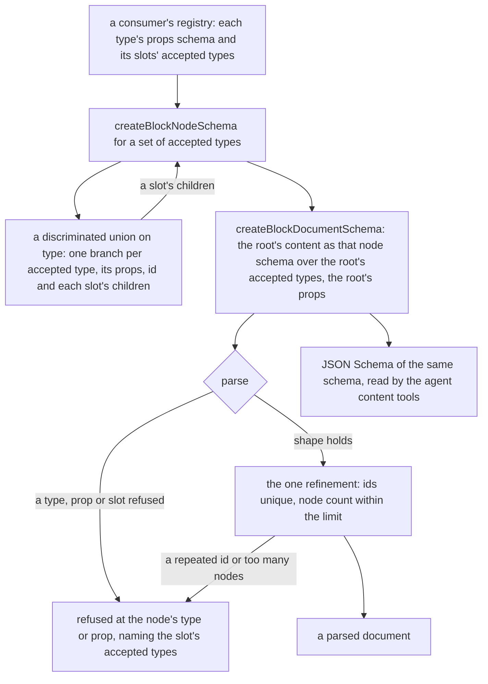

# Typed documents

A document's schema is built from its registry, so the same schema validates a document and describes it to an agent. The [editor core](../../specs/headless-block-editor/editor-core/design.md) checks a document through a refinement today; this change moves the slot rules into the shape, so the refinement keeps only what a JSON Schema cannot express, and the [document model](../../specs/resource/page-builder/document-model/design.md) builds its schemas through it.

## How a document is checked

## Decisions

- **The schema is the validator.** `createBlockNodeSchema(registry, acceptedTypes)` returns a discriminated union on `type`, one branch per accepted type. Each branch is a strict object whose props hold the type's own fields from `propsSchema`, a string `id`, and each slot as an array of the same schema over that slot's types. Rejected: keeping the refinement that walks the slots and adding a second JSON Schema projection beside it. The two would be written by hand from one registry and could disagree, which is the failure the [agent content tools](../../specs/architecture/agent-content-tools/design.md) conversion exists to prevent.
- **Recursion through `z.lazy`, cached per accepted-type set.** A type whose slot accepts its own type, or a type that accepts a child that accepts it back, makes the schema cyclic. The probe showed zod 4 emits a `$ref` for the cycle and no opaque part. The cache keys on the sorted accepted types, so a slot whose types are the same as another's reuses one schema.
- **Props are the type's own fields, plus `id` and the slots, and nothing else.** Each branch's props are built from the type's `propsSchema` shape, not by `extend`, which the repo's Zod conventions forbid. The object is strict, so a key the type does not declare is refused by name. Rejected: the default strip. An agent's patch that writes a misspelt key would then succeed and lose the key silently, which is the opposite of what an agent needs to learn.
- **An empty accepted set is `z.never()`.** A slot that accepts nothing refuses every child, and zod's discriminated union takes at least one branch, so the empty case is its own schema.
- **The refinement keeps two checks only.** Ids are unique across the whole parsed tree, and the node count stays within the consumer's limit. Both need the whole tree at once, which a per-node schema does not see, and neither is a shape a JSON Schema states. The walk reads the slots through the registry's `slots` keys, so it needs no separate type list.
- **Refusals move to the type field.** A child whose type its slot refuses fails at `[...path, "type"]`, and the message lists that slot's accepted types, not the whole registry. This overturns the editor core's earlier choice to check the shape first and the registry second, which rejected a recursive union because a union reports at its own position and buries the slot a refusal has to name. Each slot now owns its own union, so its message lists only its own types and names the slot by its path. The burial argument no longer holds, and that decision is replaced by this one.
- **Paste checks the copies by the same schema.** `createBlockNodesSchema(registry, acceptedTypes)` is `createBlockNodeSchema` over the destination slot's types as an array, with the same id walk, so a paste and a document refuse the same things.
- **The loose reader stays.** `blockNodeShapeSchema` is the one shape a reader of untrusted nodes uses (the clipboard payload, the remint and the layer rows), so it keeps its loose record. It is not the validator, and the change does not touch its callers.
- **Each registry declares what its editor stores.** The Webpage and Email props schemas gain any key a stored node already holds, so the typed schema does not refuse an existing document. The style each node carries is one of those keys, declared on the type that stores it, wherever the style panel puts it.
- **Types run end to end, and a schema satisfies its interface.** Each node type's props are a TypeScript interface, its slots typed as arrays of the registry's node union, and its `propsSchema` is `satisfies z.ZodType<` the type's own fields of that interface `>`, the repo's interface-first rule. A document's node is the union of the registry's typed nodes, so narrowing by `type` types the props, and a renderer, a props update and a store read them with no cast and no `parse` of a prop the node already has. `BlockNode` and `BlockDocument` take the node union as a type parameter, so the core's generic functions keep the consumer's types. The loose `Record<string, unknown>` props remain only at the parse boundary, where input is untrusted, and the parsed value is typed from there on. Rejected: deriving the document type from the schema with `z.infer` alone. Inference through the recursion `z.lazy` introduces is not verified here, and an interface states the contract the schema is then checked against.

## Typing contract

The types the code is written against, so the core and every consumer agree.

- **Core node.** `BlockNodeProps` is `{ id: string }`. `BlockNode<TType, TProps extends BlockNodeProps>` is `{ props: TProps; type: TType }`, with the defaults `string` and `BlockNodeProps`. A consumer's node is `BlockNode<"Name", NameNodeProps>`, and its props interface extends `BlockNodeProps` with the type's own fields and one field per slot, typed as the list of the child nodes that slot accepts.
- **The loose boundary.** `LooseBlockNode` is `{ props: Record<string, unknown>; type: string }`. It is the shape a JSON document has before a document schema checks it, so the loose reader and the JSON pointer and patch code take it and narrow `unknown` rather than assert. Nothing typed is read through it.
- **Slots are typed from the props.** `SlotKeys<TProps>` is the keys whose value is a list of nodes. A definition's `slots` is `{ [K in SlotKeys<TProps>]: NodeTypeOf<TProps[K]>[] }`, so a slot's accepted types are the node types its props interface holds: a registry cannot list a type its interface does not, nor omit one it does.
- **The definition.** `BlockTypeDefinition<TNode>` is `{ type: TNode["type"]; propsSchema: z.ZodType<OwnProps<TNode["props"]>>; slots }`, where `OwnProps` drops `id` and the slot keys. A schema satisfies its own fields with `satisfies z.ZodType<OwnProps<Interface>>`, the repo's interface-first rule.
- **The registry and the document.** `BlockRegistry<TNode, TRootProps>` holds `root: { content: TNode["type"][]; propsSchema: z.ZodType<TRootProps> }` and `types: BlockTypeDefinition<TNode>[]`. `BlockDocument<TNode, TRootProps>` is `{ content: TNode[]; root: { props: TRootProps } }`. A consumer's document is `BlockDocument<WebpageNode, WebpageRootProps>`, where `WebpageNode` is the union of its nodes.
- **Renderers read typed props.** A type's `render` receives its own node type, so `node.props` is the props interface and no renderer re-parses its props.
- **The one assertion.** The document schema is built at runtime from the registry's definitions, so its TypeScript type is not one the compiler derives. `createBlockNodeSchema` returns the consumer's node type by assertion, and the registry it is built from is the typed one. That is the only assertion in the core's schema path, and the fold that renders a parsed document's slots relies on the same parse, so it reads a parsed slot as the typed list. Both are named where they are written, and nothing else in the page builder asserts.

## Notes

- **An opaque part is a field's own.** A Note's ProseMirror document still holds loose attributes, so an agent reads them as opaque. That is a fact about the Note's own schema, recorded per type by the agent content tools' test when the type is registered, not something this change fixes.
- **Email's dataset binding is a merge-field prop.** The email's binding to a dataset becomes a string prop on the node that holds the merge field, so it is typed and writable like any other prop. The email editor's merge-field change decides its exact form.

## Key files

| File                                                                       | Role                                                                                                     |
| -------------------------------------------------------------------------- | -------------------------------------------------------------------------------------------------------- |
| `packages/headless-block-editor/src/services/createBlockNodeSchema.ts`     | the typed node union for a set of accepted types, cached and recursive                                   |
| `packages/headless-block-editor/src/services/createBlockDocumentSchema.ts` | the document: the root's content as the typed node schema, the root's props, the id and count refinement |
| `packages/headless-block-editor/src/services/createBlockNodesSchema.ts`    | a paste's copies as a slot's children, by the same typed schema                                          |
| `packages/headless-block-editor/src/services/blockNodeShapeSchema.ts`      | the loose node reader for untrusted nodes, unchanged                                                     |
| `packages/headless-block-editor/src/services/checkBlockNodes.ts`           | the slot walk this change retires                                                                        |
| `apps/web/shared/services/pageBuilder/webpageRegistry.ts`                  | the Webpage types' props declare what the editors store                                                  |
| `packages/mjml-blocks/src/services/createMjmlRegistry.ts`                  | the Email types' props declare what the editors store                                                    |
