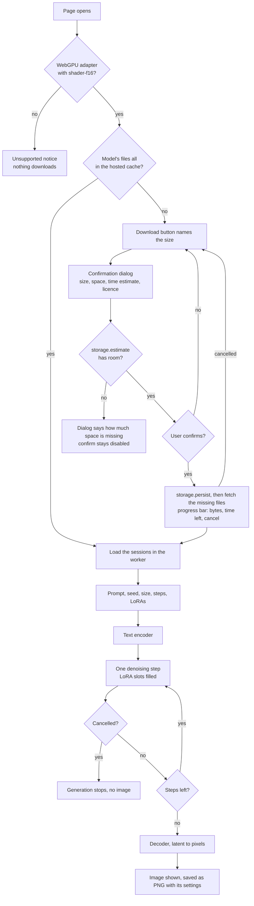

# Image Studio

A single route where a prompt and the user's own LoRAs become an image on the visitor's own graphics card. The model is downloaded once, after the user confirms it, and nothing the user types or uploads leaves the device.

## Scope

Nothing in the repository generates an image today. This change adds:

- the `image-diffusion` package, which holds the pipeline;
- a `scripts` command that converts and publishes the weights;
- the Image Studio route, with its entry in the product list's Labs group.

The model is Z-Image Turbo. Other models, a gallery kept across visits, editing and a server fallback are all outside it (the proposal's "Not in this change").

## How it works



### The models

The page reads WebGPU first. With no adapter, or an adapter without `shader-f16`, it shows a notice naming the browsers that run the page, Chrome and Edge, and it never offers a download. WebGPU tells a page nothing about a card's memory, so the page reads the adapter's buffer limits and, after the first load, times one denoising step. It defaults to low-memory mode and a 768×768 image when that step is slow, and to 1024×1024 otherwise. The user can always change either. In low-memory mode the worker releases the text encoder's session once the prompt is encoded, so the encoder and the denoiser are never on the GPU together.

**Nothing downloads until the user confirms.** The model card shows a "Download" button that names the model's size. Pressing it opens a confirmation dialog built on the app's dialog shell. The dialog shows:

- the download size, read from the lock;
- the space the model takes, the same figure, since the cache holds the files as they were sent;
- the free space `navigator.storage.estimate()` reports;
- a time estimate from the connection's `downlink`, falling back to "a few minutes on a fast connection" when the browser does not report one;
- the model's licence, Apache-2.0, linked in full;
- whether part of the model is already held from an interrupted download, and how much is left.

Confirm is disabled, and the dialog says how much space is missing, when the estimate leaves too little room. Confirming calls `navigator.storage.persist()`, so the browser does not evict the model under storage pressure, and then starts the download. The progress bar shows the bytes held out of the total, the time left and a Cancel button. Cancelling keeps the files already finished, so the next confirmation shows only what is left.

The files are the model's ONNX graphs and their external weight files. These are content-addressed objects under the hosted-assets lock for the `image-studio` scope, served from our public bucket and held in the hosted cache. Hosted assets already plans a download as the files the cache lacks, reports progress and evicts the files a newer lock no longer names. So a resumed download fetches only the missing files, and a model update fetches only the files that changed. Its preload cannot be stopped once started, so this change gives it an abort signal: a cancelled preload stops requesting files and keeps the ones it finished. The page adds the dialog, the space check and the persistence request around it.

### Generation

The sessions live in a dedicated Web Worker, so a step never blocks the page. The worker creates one ONNX Runtime Web session for each of the text encoder, the denoiser and the decoder, on the WebGPU execution provider, from the cached files. It uses ONNX Runtime's external data option, because each graph's weights exceed a single protobuf's two-gigabyte limit.

`image-diffusion` drives the sessions:

1. It encodes the prompt.
2. It draws the starting noise from the seed with a seeded generator, so a seed reproduces an image on the same device.
3. It runs the flow-matching sampler for eight steps. Z-Image Turbo is distilled to need no classifier-free guidance, so each step is a single denoiser call.
4. It decodes the latent to pixels.

After each step it reports progress and reads the cancel flag, so a cancellation lands within one step. A lost GPU device, or an allocation the GPU refuses, fails the generation with a message suggesting a smaller size or low-memory mode, and the sessions are rebuilt before the next generation.

An image is saved as a PNG whose `tEXt` chunk carries the prompt, the seed, the size, the steps, the model and each LoRA's file name and strength.

### LoRAs

The converter exports the denoiser with an empty low-rank slot beside each linear layer a LoRA can target, at a fixed rank of 48, the rank anima-webgpu settled on for its slots. Each slot's down and up matrices, and one scale, are inputs to the graph. The base weights never change, so a LoRA costs no re-export and no re-quantizing.

The page reads an uploaded `.safetensors` file in the worker, through the File API, and it never fetches anything with it. `image-diffusion` then:

1. maps the file's keys, in the forms Z-Image LoRAs are published in (the kohya `lora_unet_…` form and the `diffusion_model.` form), to slot names;
2. lists every key that maps to no slot, such as text-encoder keys or LoKr factors, and shows that list beside the LoRA;
3. refuses the file when none of its keys map, naming the file as made for another model.

One LoRA fills the slots directly, and its strength is the scale input, so moving its slider changes the next image without redoing any work. Several LoRAs are combined per layer:

1. each LoRA's change to the layer's weight is scaled by its strength;
2. the changes are summed;
3. the sum is truncated back to rank 48 by a singular value decomposition, in the worker.

A LoRA whose rank exceeds 48, or several whose summed rank does, loses its smallest components in that truncation. The design accepts this loss, and the LoRA panel says so when it happens.

### The weights

The conversion command in `scripts` reads the official Z-Image Turbo release, exports the denoiser with its LoRA slots, the text encoder (Qwen3-4B) and the decoder to ONNX, and quantizes the weights. It writes each graph's weights as external data files small enough for the bucket's object limit, and publishes them through hosted assets, which commits the lock. It checks each component's licence as it reads it, and refuses a component whose licence is not Apache-2.0 or MIT.

No browser port of Z-Image Turbo carries LoRA slots, so the command builds them, taking the slot construction from anima-webgpu's converter, which is MIT. It quantizes the denoiser and the text encoder to int4 and to int8, and measures each denoiser call against the PyTorch reference on fixed prompts and seeds. It publishes the smaller build whose relative difference per call stays under 3%, the upper end anima-webgpu reports for its own distilled preset. The int4 build is estimated at 5.5 to 6 GB, about 3 GB for the denoiser and 2 GB for the text encoder, but that figure is an estimate from the parameter counts until the command measures it.

## Decisions

- **Z-Image Turbo as the model.** It is the strongest open model whose licence allows a public page. Its Apache-2.0 licence allows hosting converted weights and any use of the page, paid or not. Its six billion parameters make it a larger download and a slower step than Anima, which is the cost of that licence.
- **Anima and Qwen-Image 2.1 deferred.** Anima's licence (CircleStone Non-Commercial, section 1(c)) excludes any use in direct interaction with third-party end users, paid or not, and counts hosting as distribution. Qwen-Image 2.1's licence allows research or evaluation only. Neither can back a public page without a licence from its maker, so both wait in [licensed models](../../deferred/image-studio/licensed-models/design.md).
- **The visitor's GPU over a server.** The Cloudflare estate has no GPU we control. Workers AI runs only its own catalogue, and a user's LoRA would have to leave the device to reach it. Running on the client costs nothing per image and keeps every prompt and LoRA private.
- **Our bucket over Hugging Face at run time.** A third party's uptime and rate limits would sit in front of every first visit. We could not pin a build's quantization. And the browser's storage partitioning means no visitor arrives with a copy cached from another site anyway. Hosted assets already gives content addressing, resumption and eviction. Hosting the converted weights is redistribution, which Apache-2.0 allows with its licence and notice kept beside them.
- **A confirmed download over a silent one.** A download of gigabytes is the visitor's bandwidth and disk, so it starts only from a dialog that states its cost. Downloading on page load was rejected, because a visitor who only looks at the page would pay for the model. A browser permission prompt was rejected too, because it shows no size or time.
- **Slot graphs over merging a LoRA into the weights.** Merging on the device would dequantize and requantize six billion weights for every LoRA change. Exporting a model per LoRA cannot take a file the user brings. Slots keep the base weights fixed and make one LoRA's strength a single input.
- **A package with the consumer's session, as `pitch-transcription` does.** `image-diffusion` builds its tensors from `onnxruntime-common`, and the worker brings `onnxruntime-web`. So the pipeline's pure parts (key mapping, the truncation, the sampler, the PNG chunk) are tested under Node with fake sessions, and no test needs a GPU. Transformers.js, already in the catalog, has no pipeline for these models.
- **ONNX Runtime Web's faster WebGPU build.** anima-webgpu reports that the default build lacks the DP4A and FlashAttention kernels its other build carries. Task 4.1 times both on the owner's GPU and keeps the faster one.
- **Images for the session only.** A stored gallery is a second feature with its own quota and deletion. Saving a PNG with its settings keeps every image the user wants.

## Key files

| File                                                               | Role                                                              |
| :----------------------------------------------------------------- | :---------------------------------------------------------------- |
| `packages/shared/src/models/router/RoutePath.ts`                   | gains the Image Studio route                                      |
| `apps/web/app/services/app/ProductGroups.ts`                       | lists Image Studio in the Labs group                              |
| `pnpm-workspace.yaml`                                              | the catalog gains `onnxruntime-web`                               |
| `AGENTS.md`                                                        | the package table gains the `image-diffusion` row                 |
| `packages/hosted-assets/src/composables/useHostedAssetsPreload.ts` | the preload takes an abort signal, so a download can be cancelled |
| `scripts/package.json`                                             | the conversion command's script                                   |

The package, the page and the command are new files:

```text
packages/image-diffusion/
  package.json, README.md, tsdown.config.ts, vitest.config.ts, tsconfig.json
  src/
    safetensors/   readSafetensors: header and tensors from bytes
    lora/          mapLoraKeys, combineLoras (scale, sum, truncated SVD), fillLoraSlots
    sampler/       flow-matching schedule and step, seeded noise
    pipeline/      generateImage over the three sessions, progress and cancel
    png/           writePngParameters: the tEXt chunk
apps/web/app/
  pages/image-studio.vue
  components/ImageStudio/   ModelCard, DownloadConfirmDialog, DownloadProgress, PromptForm, LoraPanel, ImageResult
  workers/imageStudio.ts    the sessions and the pipeline, off the main thread
scripts/src/imageStudio/
  convertModel.ts           export with slots, quantize, measure, split, publish
```

## Notes

- The download size is the cost a visitor sees, so a model update that changes every weight file costs every returning visitor the full download again. A converter change therefore ships only when it improves the images or their speed.
- The browser's storage partitioning means each site keeps its own copy, so a visitor who used another Z-Image demo still downloads ours.
- Tests cannot cover the real run, a prompt becoming a recognisable image on a GPU, because CI has none. That run is task 4.3's driven-browser check on the owner's machine, with the timings recorded in the commit body.

## Sources

- [anima-webgpu](https://github.com/joykst96/anima-webgpu) — the ONNX export with rank-48 LoRA slots, the multi-LoRA merge by summed change and SVD, the per-call difference against the reference and the note on ONNX Runtime Web's two WebGPU builds; its code is MIT.
- [Z-Image Turbo](https://huggingface.co/Tongyi-MAI/Z-Image-Turbo/blame/main/README.md) — the model, its parameter count, its eight-step distillation and its Apache-2.0 licence.
- [webnn/Z-Image-Turbo](https://huggingface.co/webnn/Z-Image-Turbo/blob/main/README.md) — an ONNX port run by ONNX Runtime Web on WebNN and WebGPU, which shows the model's graphs export and run in a browser.
- [ONNX Runtime Web](https://onnxruntime.ai/docs/tutorials/web/) — the WebGPU execution provider and external data loading.
- [onnxruntime-web](https://www.npmjs.com/package/onnxruntime-web) — the browsers its WebGPU backend lists.
