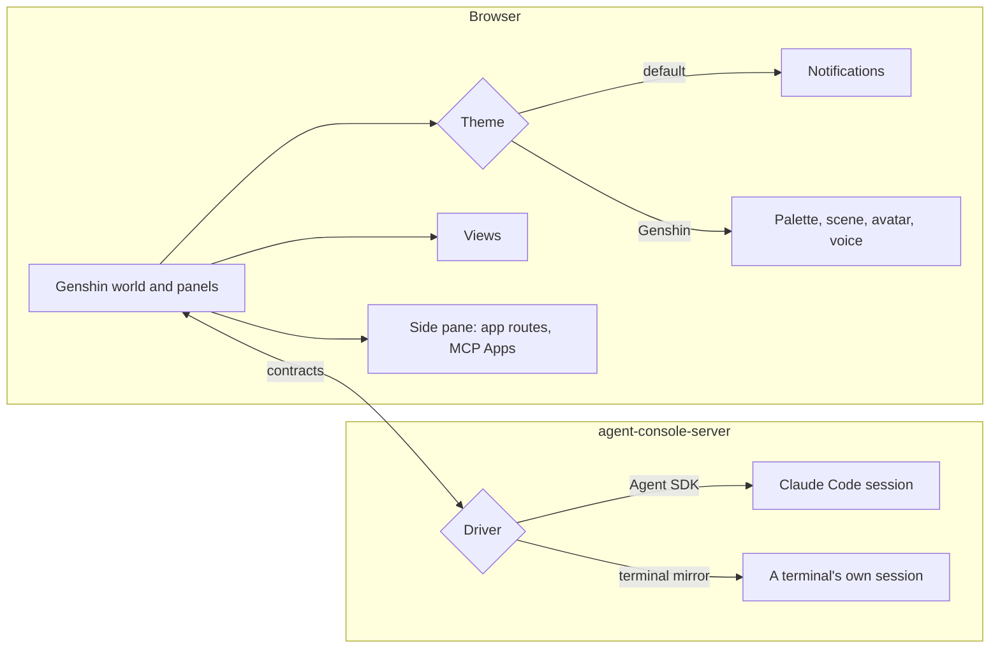
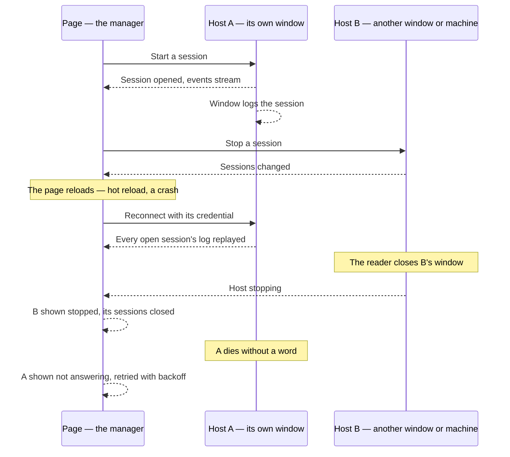

# Agent console

The [agent console](../../specs/infra/claude-interface/agent-console/README.md) is one page of the app that works every Claude Code session it starts on a machine in place of the terminal, from its [console overlay](../../specs/infra/claude-interface/agent-console/console-overlay/design.md) at [terminal parity](../../specs/infra/claude-interface/agent-console/terminal-parity/design.md). This proposal is what comes after it. It is judged by the [workflow comparison](../../specs/infra/claude-interface/agent-console/workflow-comparison/design.md): nothing here is built while the console still sends the person back to a terminal during a day's work.

## Decisions

- **Every view keeps the world's budget.** A view builds only what is in view and rebuilds only what a change touched, the rules the [Genshin engine](../../specs/genshin/engine-architecture/design.md) keeps, so no cost grows with the repository behind it.
- **The look is behind a theme.** The default theme is the world with no character. A theme may add a palette, a scene in the world, an avatar, reactions and a voice, and Genshin is the first to add them ([themes](../infra-agent-console-themes/design.md)).
- **Views are separate from themes.** A view is a panel any theme can show, so a repository's tooling is visualised whatever the console is dressed as.
- **Other tooling joins through tiers, cheapest first.** App routes open in a side pane with no code, external tools arrive through MCP Apps, and a first-party view is written only when a tool needs the scene ([extensions](../infra-agent-console-extensions/design.md)).
- **The world is Genshin's.** The console's world is the [Genshin](../genshin-program/design.md) recreation, built by its own program; the voxel world's open world, building, map, day, sound, atelier and codebase city are [rejected](../../rejected/infra/) with it.
- **A second driver, for sessions the SDK cannot hold.** A session a terminal already runs is attached to from the outside ([terminal-mirror driver](../infra-agent-console-terminal-mirror-driver/design.md)).
- **The page manages; each host runs.** The page is the manager of every session on every host it has paired — this computer's, and each [remote connection](../../specs/infra/claude-interface/agent-console/remote-connections/design.md) — and runs nothing itself. A host holds its sessions, its Claude Code login and its repositories, and a page reloading, a hot reload in development, or a closed tab never ends a turn, since the page reconnects and is replayed what it missed.
- **Both ends are live, and either can act.** A session started, stopped or answered in the page shows in the host's window at once, and a host stopped from its own window tells every page before it exits ([host installer](../../specs/infra/claude-interface/agent-console/host-installer/design.md)). A host that dies without a word is the one case the page shows as not answering and retries.
- **Nothing runs hidden.** This computer's host and each of its sessions run in windows the reader can see and close ([host installer](../../specs/infra/claude-interface/agent-console/host-installer/design.md), [session windows](../../specs/infra/claude-interface/agent-console/session-windows/design.md)): no login item, no tray, no background service. Stopping a session is closing its window, stopping the host is closing its own, and nothing is left running after either. A [remote connection](../../specs/infra/claude-interface/agent-console/remote-connections/design.md)'s sessions stay inside their host, since there is no desktop there to see them on, and are stopped from the page.
- **Nothing that costs money, Windows first.** The installer ships for Windows alone and unsigned, and every secret the app keeps is encrypted with a key the app already holds rather than a paid vault. Signing and the other platforms wait on [signed host installers](../../deferred/infra/signed-host-installers/design.md).
- **TresJS first; raw Three.js only where TresJS and cientos have nothing,** said on the page of the view that reaches for it, with the reason.

## How it works

How the page and its hosts stay in step — the principle every connection sub-spec builds to:

## The pages of this proposal

| Page                                                                                    | What it settles                                                               |
| :-------------------------------------------------------------------------------------- | :---------------------------------------------------------------------------- |
| [Anthropic-hosted sessions](../infra-agent-console-anthropic-hosted-sessions/design.md) | sessions Anthropic runs on the reader's API key, as one more connection       |
| [Side chat](../infra-agent-console-side-chat/design.md)                                 | a question beside the session on a discarded fork, adding nothing back        |
| [Effort level](../infra-agent-console-effort-level/design.md)                           | an effort select beside the model select, showing the level the session is at |
| [Session titles](../infra-agent-console-session-titles/design.md)                       | renaming a session by its title, saved in its own transcript                  |
| [Terminal-mirror driver](../infra-agent-console-terminal-mirror-driver/design.md)       | attaching to a session a terminal runs, through its transcript and a channel  |
| [Extensions](../infra-agent-console-extensions/design.md)                               | how other tooling joins — MCP Apps and first-party views                      |
| [Themes](../infra-agent-console-themes/design.md)                                       | the parts a theme adds past the default, and the Genshin theme                |
| [Wish banner](../infra-agent-console-wish-banner/design.md)                             | Genshin theme — the session's character arriving through a wish               |
| [Element ambience](../infra-agent-console-element-ambience/design.md)                   | Genshin theme — a backdrop in the element, moved by the spoken line           |
| [Spatial chat](../infra-agent-console-spatial-chat/design.md)                           | a theme option — the conversation placed in the scene                         |

                  |

## Scope and order

1. **One day's work in the console alone**, with every return to the terminal written into the [workflow comparison](../../specs/infra/claude-interface/agent-console/workflow-comparison/design.md) and closed where it recurs. [Anthropic-hosted sessions](../infra-agent-console-anthropic-hosted-sessions/design.md) come after the connecting pages of the [console](../../specs/infra/claude-interface/agent-console/README.md). The Code tab's lean core closes the returns the comparison predicts: [repository files](../../specs/infra/claude-interface/agent-console/repository-files/design.md) are shipped; [side chat](../infra-agent-console-side-chat/design.md) comes next, with [effort level](../infra-agent-console-effort-level/design.md) and [session titles](../infra-agent-console-session-titles/design.md) as small changes to the composer and the sessions tab.
2. **The Genshin theme**: persona, voice, wish banner, then the ambience, all inside the world.
3. **The terminal-mirror driver**, when a session started in a terminal needs to be picked up.

## What this does not propose

- **Agents hosted by Esposter.** A hosted agent needs a sandboxed checkout, the user's key held server-side and compute the app would pay for. Every console surveyed runs the agent where the code already is, and so does this one.
- **A renderer of the character's Live2D model.** The desktop viewer draws it ([own Live2D renderer](../../deferred/infra/own-live2d-renderer/design.md), deferred).
- **A new chat product.** The console works the session the code is in; it is not a chatbot beside it.
- **The rest of the Code tab.** Worktree sessions, remote sessions, split sessions, cross-session messages and the session archive are [deferred](../../deferred/infra/) behind their triggers. A browser pane and its other previews, a pull request bar, view modes, computer use, scheduled tasks, a customize panel, an environment editor and a pane layout are [rejected](../../rejected/infra/).

## Key files

| File                                                                | Role                                                                      |
| :------------------------------------------------------------------ | :------------------------------------------------------------------------ |
| `apps/web/app/components/Genshin/Index.vue`                         | The world's canvas, which every theme dresses and every view opens beside |
| `apps/web/app/services/agentConsole/themes/AgentConsoleThemeMap.ts` | The theme registry every new theme is added to                            |
| `packages/genshin-persona/hooks/hooks.json`                         | The persona's hooks, which the Genshin theme reads through the driver     |

## Notes

- The trade is stated rather than hidden. The terminal costs nothing to keep, while the console is a host, a page and a theme layer to maintain. It is taken because the terminal cannot show a diff, a context gauge, parallel sessions or a scene, and because the console can be played.
- This supersedes the page half of [chat into the session](../infra-channel-chat/design.md): with a driver holding the session, a line typed at the character is simply a prompt. The channel stays only as the terminal-mirror driver's input.
