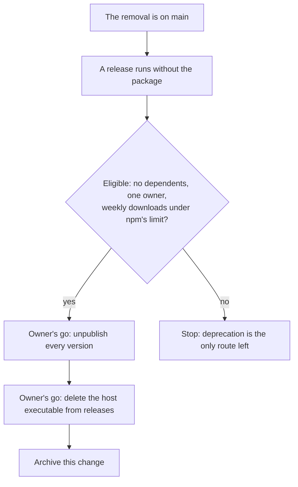

# Agent console retirement

The repository side of the retirement has shipped: the [rejected agent console](../../rejected/infra/agent-console/design.md) holds the decision and the reasons. This design settles the part outside the repository, which is permanent and so waits for the owner's go at each step.

## How it works

The order is fixed by what each step depends on. An unpublish before the release would be undone by the next release republishing the package from the repository, and the executable's deletion is last because nothing refers to it once the package is gone.

## Decisions

- **Unpublish, not deprecate.** A deprecated package stays installable and keeps a page announcing something that no longer exists, so a stranger can still run a host for a page that is gone. Deprecation lost for that reason.
- **Eligibility is checked the day it runs.** npm allows an unpublish after the first days only while the package has no dependents in the registry, one owner and a weekly download count under its limit, and the count sat close under the limit when this was written, so the route can close on its own. If it closes, the only route left is deprecation, and that is the owner's call.
- **Each step waits for an explicit go, and is run by whoever the owner hands it to,** not by the session that removed the code. An unpublish cannot be undone, no unpublished version can be published again, and the name is held for a day and then free to anyone. Deleting a release asset is as final. The host's own uninstall command is run on the owner's machine first, since it removes the registered link and the installed copy that the executable put there.

## Key files

| File                                   | Role                                                    |
| :------------------------------------- | :------------------------------------------------------ |
| `.github/workflows/FinishRelease.yaml` | The release no longer builds or attaches the executable |

## Sources

- [npm's unpublish policy](https://docs.npmjs.com/policies/unpublish) — the conditions for unpublishing after the first days, that an unpublish cannot be undone, that a used version can never be published again, and the wait before the name can be reused; the limits the decision is bound by.
