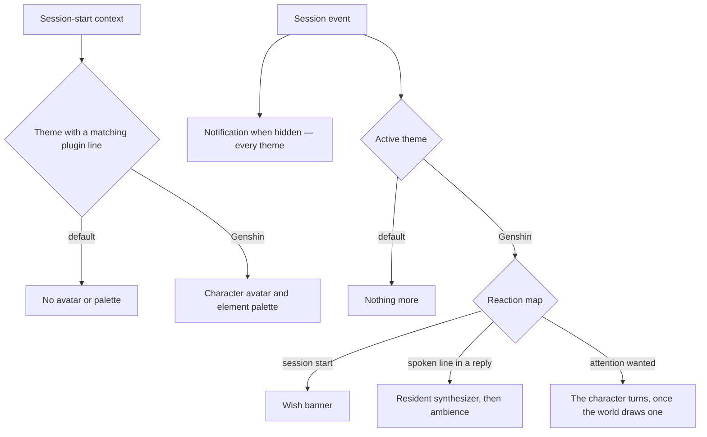

# Themes

The [agent console](../../specs/infra/claude-interface/agent-console/README.md) has a theme registry. It holds the default and the Genshin theme, and the parts a theme sets are its avatar, palette and reactions ([as built](../../specs/infra/claude-interface/agent-console/README.md)). This proposal tracks the remaining voice, scene and reaction work for the Genshin theme.

## What a theme may add

| Part      | What it is                                                                                                                                               | Default theme |
| :-------- | :------------------------------------------------------------------------------------------------------------------------------------------------------- | :------------ |
| Palette   | the tokens inside the console's theme scope for its panels                                                                                               | dusk          |
| Scene     | what the theme adds to the world, receiving the session's events                                                                                         | nothing       |
| Reactions | a map from session event to what the theme does — a pose, a sound, a notification tone — on top of the console's own notification when the tab is hidden | none          |
| Voice     | how the agent's spoken lines are heard                                                                                                                   | none          |

A theme never removes a part of the [console overlay](../../specs/infra/claude-interface/agent-console/console-overlay/design.md) that [terminal parity](../../specs/infra/claude-interface/agent-console/terminal-parity/design.md) needs. It may only dress the world and furnish it, which is what keeps a theme cheap to write and impossible to make a downgrade. Each part is added to `AgentConsoleTheme` with the first theme that sets it, never ahead of one.

## The Genshin theme

Built from what the [persona plugin](../../specs/infra/claude-interface/persona-plugin/README.md) already produces:

- **Palette** from the character's element.
- **Voice** from the plugin's resident synthesizer, which the theme calls on the loopback with each spoken line it finds in a reply. The terminal's message-display hook has no display to fire on in the console. The theme is the console's one producer of spoken lines: the synthesizer, the [element ambience](../infra-agent-console-element-ambience/design.md) and [spatial chat](../infra-agent-console-spatial-chat/design.md) all take the lines it finds, so no line is synthesized twice.
- **Scene and reactions** from the sub-specs: the [wish banner](../infra-agent-console-wish-banner/design.md), the [element ambience](../infra-agent-console-element-ambience/design.md) and, as an option, [spatial chat](../infra-agent-console-spatial-chat/design.md).



## Scope and order

1. **The voice**, from the resident synthesizer, using the console's spoken-line source.
2. **The scene and reactions**: the wish banner, then the element ambience, then spatial chat as an option. Each one is built as its own sub-spec.

## Key files

| File                                                                | Role after the change                                        |
| :------------------------------------------------------------------ | :----------------------------------------------------------- |
| `apps/web/app/services/agentConsole/themes/AgentConsoleThemeMap.ts` | The registry and Genshin theme's element palette             |
| `apps/web/app/models/agentConsole/AgentConsoleTheme.ts`             | The theme interface, including avatar, palette and reactions |
| `apps/web/app/store/agentConsole/session.ts`                        | Resolves the session theme and scoped palette                |
| `packages/genshin-text/src/services/ElementColorMap.ts`             | Element colours shared with the persona's generated module   |
| `packages/genshin-persona/scripts/speak.ts`                         | The resident synthesizer the Genshin theme speaks through    |

```text
apps/web/app/components/AgentConsole/Theme/Genshin/
packages/genshin-text/src/services/ElementColorMap.ts   ← the element colours, keyed by element
```

## Notes

- Each session keeps the look of the theme whose plugin began it, including the palette, so the Genshin theme on one session and the default on a parallel one is the ordinary state, not an edge case. Each part added here reads the session's theme the same way.
- A second persona set — another game, another cast — is another theme reading another plugin's hook line, and nothing in the console changes for it.
