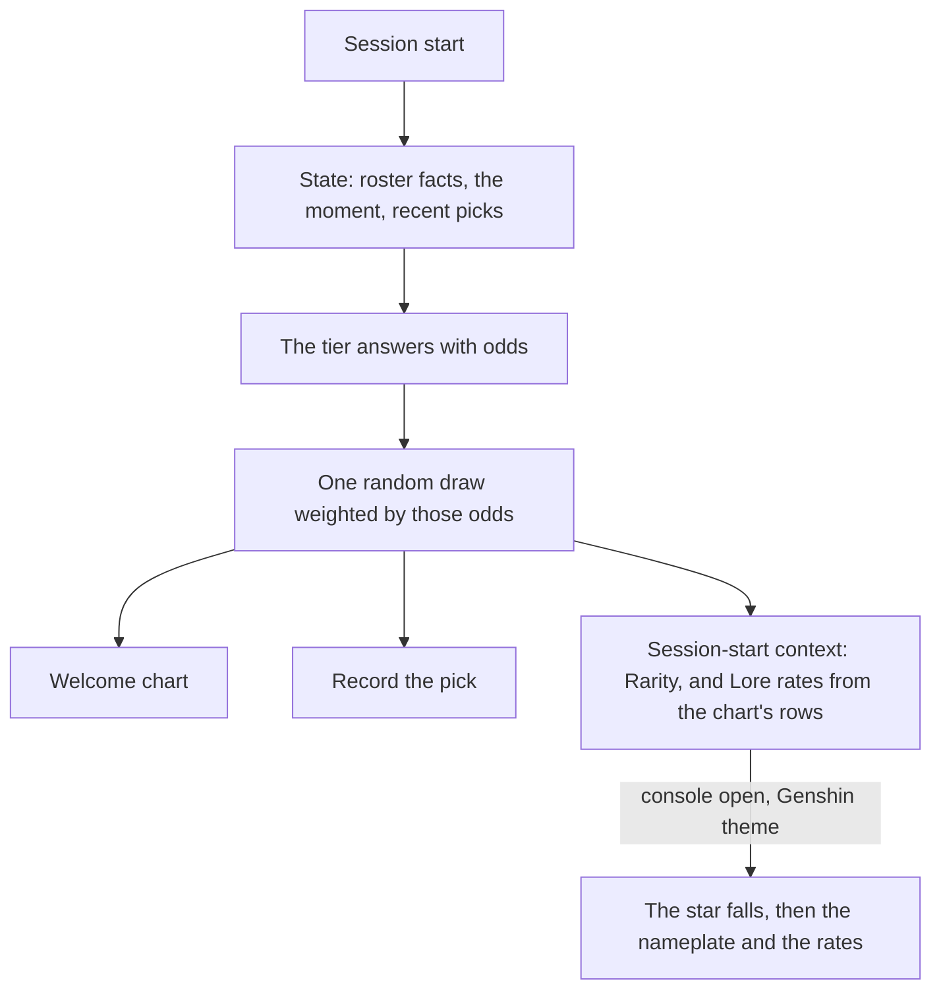

# Wish banner

The lore pick draws the session's character at random, weighted by exactly the odds the tier returns ([persona plugin](../../specs/infra/claude-interface/persona-plugin/README.md)), and the welcome prints those odds as a bar chart. A wish is the game's own picture of exactly that: a draw from published rates. So in the [Genshin theme](../infra-agent-console-themes/design.md), a session opens as a wish — a star falling in the colour of the character's rarity, resolving into the character's nameplate, the rates one tap away.

## Scope

**Today:** the draw is weighted by the tier's odds alone, and knows nothing of the sessions before it.

**This adds:**

1. **The animation.** When a session whose character was drawn by lore opens, a star falls and resolves into the character's nameplate — purple for four stars, gold for five, the rarity the roster data holds.
2. **The rates.** The rows the welcome chart prints, as the banner's details: the tier's choice and its runners-up, each with the probability the tier gave it. No rate is ours.
3. **History as state.** The characters met in recent sessions — the pick records the plugin already keeps — join the state the tier reads; how that state is weighed is set out in [character pick](../../specs/infra/claude-interface/persona-plugin/character-pick/design.md).

## How it works



The Genshin theme's `scene` part is the banner. The console mounts it over the world for the session it presents, handed the session's avatar and its session-start context, and the banner reads its own two lines from that context.

```text
apps/web/app/components/AgentConsole/Theme/Genshin/
  WishBanner.vue      ← the nameplate, the rates panel, and whether the star falls
  FallingStar.vue     ← the star's fall, drawn in TresJS
```

**Rendering:** TresJS, with cientos `Sparkles` for the star's trail; nothing needs raw Three.js.

**Decided: the rows reach the scene through the context.** The persona's session-start output carries two more lines beside the character's: `Rarity: ` with the character's stars on every card, and `Lore rates: ` with the welcome chart's rows as JSON, only when the lore pick drew the character. The console already reads that context for the avatar and the element, so the rows follow those lines rather than a second channel. The alternative, a field of the hook's output the console reads beside the context, would have the fold carry a new kind of value it does not carry today.

**Decided: the rates are the chart's rows, not the roster's.** The context is model input, so a distribution over the whole roster would put about a hundred name and probability pairs into every session's context for a picture the welcome already draws in four rows. The panel shows the same four, so the person reads one set of odds in two places.

## Key files

| File                                                                 | Role                                                    |
| :------------------------------------------------------------------- | :------------------------------------------------------ |
| `packages/genshin-persona/src/services/getLorePickRequest.ts`        | The state recent picks join                             |
| `packages/genshin-persona/src/services/readPickRecords.ts`           | The history the state is read from                      |
| `packages/genshin-persona/src/services/getLoreRates.ts`              | The chart's rows, from the tier's answer                |
| `packages/genshin-persona/src/services/formatLoreChart.ts`           | The welcome chart, printed from the same rows           |
| `packages/genshin-persona/src/services/getSessionStartOutput.ts`     | Prints the rarity and rates lines beside the character  |
| `apps/web/app/services/agentConsole/getLoreRates.ts`                 | Reads the rows back from the session-start context      |
| `apps/web/app/services/agentConsole/getStarColor.ts`                 | The star's colour by the character's stars              |
| `apps/web/app/components/AgentConsole/Theme/Genshin/WishBanner.vue`  | The scene: the nameplate, the rates panel, and the fall |
| `apps/web/app/components/AgentConsole/Theme/Genshin/FallingStar.vue` | The star's fall                                         |

## Notes

- Recent picks are the one part that changes the terminal's behaviour too, and it needs no console, so it ships first and on its own.
- Built: item 3, the recent picks in the lore request's state, as [character pick](../../specs/infra/claude-interface/persona-plugin/character-pick/design.md); and items 1 and 2 as code, with their data path through the session-start context. Both wait on a person's eye before they are accepted, as the proposal says: the fall's path and its landing point (`FALLING_STAR_LAND_Y` is a first guess at the nameplate's height, which the eye check tunes), the sparkle's colour, and the rates panel's layout. The console is unmounted while `/genshin` is the game alone, so they are seen only where the console is mounted.
- A session whose context replays on each load of the page plays the fall again each time, because the banner mounts with the session. Whether a replay should fall again is part of the eye check.
- A pinned character, or one a birthday chose, carries no rows: its nameplate appears from the start, with no fall and no Rates button.

## Sources

- [Genshin Impact Wiki — Wish](https://genshin-impact.fandom.com/wiki/Wish) — the game's draw from published rates, the falling star and its colour by rarity, which the banner takes as its picture.
