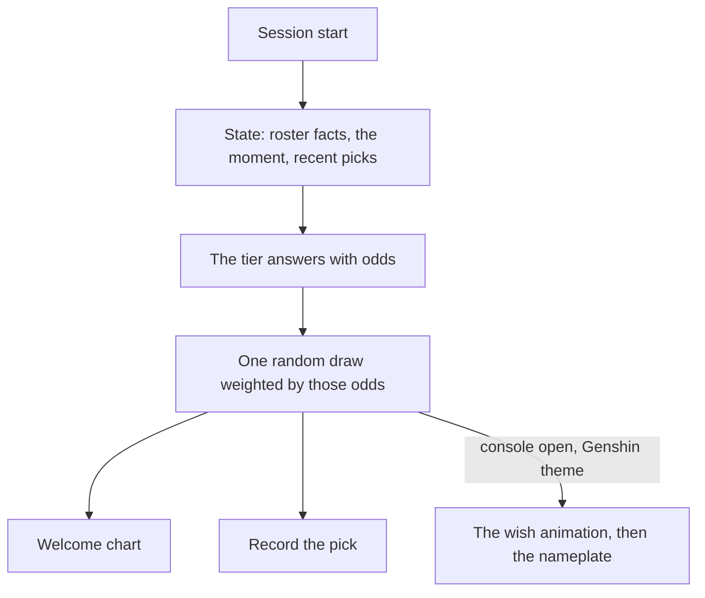

# Wish banner

The lore pick draws the session's character at random, weighted by exactly the odds the tier returns ([persona plugin](../../specs/infra/claude-interface/persona-plugin/README.md)), and the welcome prints those odds as a bar chart. A wish is the game's own picture of exactly that: a draw from published rates. So in the [Genshin theme](../infra-agent-console-themes/design.md), a session opens as a wish — a star falling in the colour of the character's rarity, resolving into the character's nameplate, the rates one tap away.

## Scope

**Today:** the draw is weighted by the tier's odds alone, and knows nothing of the sessions before it.

**This adds:**

1. **The animation.** When a session whose character was drawn by lore opens, a star falls and resolves into the character's nameplate — purple for four stars, gold for five, the rarity already in the roster data.
2. **The rates.** The rows the welcome chart shows, as the banner's details: every character with the probability the tier gave them. No rate is ours.
3. **History as state.** The characters met in recent sessions — the pick records the plugin already keeps — join the state the tier reads; how that state is weighed is set out in [character pick](../../specs/infra/claude-interface/persona-plugin/character-pick/design.md).

## How it works



```text
apps/web/app/components/AgentConsole/Theme/Genshin/
  AgentConsoleWishBanner.vue     ← the fall, the nameplate, the rates panel
```

**Rendering:** TresJS, with cientos `Sparkles` for the star's trail; nothing needs raw Three.js.

## Key files

| File                                                          | Role                               |
| :------------------------------------------------------------ | :--------------------------------- |
| `packages/genshin-persona/src/services/getLorePickRequest.ts` | The state recent picks join        |
| `packages/genshin-persona/src/services/readPickRecords.ts`    | The history the state is read from |
| `packages/genshin-persona/src/services/formatLoreChart.ts`    | The rows the rates panel shows     |

## Notes

- Recent picks are the one part that changes the terminal's behaviour too, and it needs no console, so it ships first and on its own.
- Built so far: item 3, the recent picks in the lore request's state, as [character pick](../../specs/infra/claude-interface/persona-plugin/character-pick/design.md). Items 1 and 2 wait for the console to be mounted again, since it is unmounted while `/genshin` is the game alone, and they need a person's eye to judge the animation and the rates panel. The open architecture call, a scene part on `AgentConsoleTheme` with the chart rows carried from session start, is made then, not now.
- A pinned character skips the draw, and so skips the banner: the nameplate appears without the fall.

## Sources

- [Genshin Impact Wiki — Wish](https://genshin-impact.fandom.com/wiki/Wish) — the game's draw from published rates, the falling star and its colour by rarity, which the banner takes as its picture.
