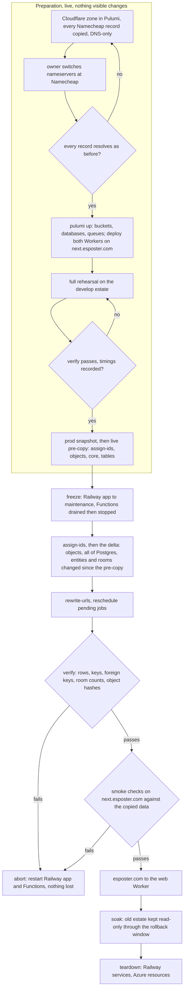

# Cloudflare cutover

Part of the [Cloudflare program](../infra-cloudflare-program/design.md), run after the branch is merged. It moves the data and the domain from Railway, Azure and Namecheap's DNS to Cloudflare without losing a row, an object or a session, and every step before the domain switch can be undone by restarting what was stopped.

## What moves

| From                                                   | To                            | How                                                                                         |
| :----------------------------------------------------- | :---------------------------- | :------------------------------------------------------------------------------------------ |
| Railway Postgres (production and develop)              | D1 `core`                     | rows read in key order, transformed by column type, re-keyed to UUIDv7, bulk-written        |
| Azure Table Storage, every table except messages       | its typed tables in D1 `core` | entities read page by page, mapped field by field to columns, re-keyed to UUIDv7            |
| Azure Table messages, reactions and scheduled messages | each room's `RoomObject`      | read per room, numbered in createdAt order, imported through the cutover route              |
| Azure AI Search `messages-index`                       | not copied                    | the room objects' own search rows are written by the import, so the Azure index is not read |
| every Blob container                                   | its R2 bucket                 | streamed object by object, live pre-copy then a frozen delta                                |
| pending scheduled message jobs and TodoList reminders  | Scheduler Durable Objects     | rescheduled from the copied rows, missed ones due at once (see the gaps below)              |
| `esposter.com`'s DNS at Namecheap                      | a Cloudflare zone in Pulumi   | every record re-declared, then the nameservers changed                                      |

Nothing else holds state: call sessions' participants are in memory, Redis holds only LiveKit's room state, the Azure Search index is not copied, and Event Grid and Service Bus are drained before the freeze.

## The order

Every write is frozen from the start of the delta copy until the switch, so no row is written to the old stores after it is read, and nothing is written to the new stores before they hold everything. The freeze is the only downtime; the rehearsal measures it, since most bytes move in the live pre-copy.

## Preparation

**The zone first, long before anything else.** A Cloudflare zone for `esposter.com` is declared in `apps/infra/src/cloudflare` with every record Namecheap serves today — the apex and `www` pointing at Railway, mail (MX, SPF, DKIM, DMARC), every verification TXT, CAA — all DNS-only, so traffic takes exactly the path it takes now. The owner reads the current record list from Namecheap's Advanced DNS page, turns off DNSSEC there if it is on, and changes the nameservers to the pair Cloudflare assigns: those are the only steps at Namecheap. Then every record is resolved through public resolvers and compared with Namecheap's answers before anything else proceeds. TTLs drop to sixty seconds a day before the cutover.

**Resources and a staging hostname.** `pulumi up` creates the buckets, databases, queues and notifications. Both Workers deploy with `next.esposter.com` as the web Worker's custom domain, so the new estate can be exercised on its real platform before it holds real data, and again after the copy, while the apex still points at Railway.

**The rehearsal.** The whole sequence — snapshot, pre-copy, freeze, delta, reschedule, verify, smoke — runs against the develop estate (Railway's develop environment and the Azure dev resources) into fresh dev Cloudflare resources, as many times as it takes to pass cleanly. It must not reuse a database a smoke test wrote messages into: the room import numbers messages in the archive's order, and a message written into an object before the import would take a number the import does not expect. It records the freeze-to-verified duration, which sets the production maintenance window, and it proves the copy on real data shapes before production data is touched.

**The snapshot.** Before production is copied, Postgres is dumped (`pg_dump --format=custom`) and every stream table exported as JSON lines, both written to a private `cutover-archive` R2 bucket and kept until teardown. Railway's own point-in-time recovery bucket and Azure's seven-day blob soft delete stay as they are underneath it.

**The cutover route.** The room import, the room summary and the reschedule are served by three temporary routes on the functions Worker (`apps/functions/src/services/cutover/handleCutoverRequest.ts`), each answering 401 without `CUTOVER_SECRET` in the `x-cutover-secret` header. The secret travels only in that header, is compared in constant time, and is never in a URL or a message body. The routes and the command are deleted at teardown.

## The copy

One committed command, `pnpm -C scripts cutover <step> --environment <develop|production>`, holds every step, each idempotent and resumable: re-running a step after a failure redoes only what is not yet verified, with a checkpoint per table and per bucket kept in the archive bucket. Credentials come from the environment (the old stores' connection strings, a Cloudflare API token, R2's S3 keys, the cutover secret); none is written to disk. Live, before the freeze, the order is `snapshot`, `assign-ids`, `copy-objects`, `copy-core`, then `copy-tables`: the typed rows reference parents only `copy-core` writes, so it runs before them, and each step re-runs freely while the app is live.

- **`inventory`** — row counts per table, entity counts per stream table, object counts and bytes per container, and an estimated duration; nothing is written.
- **`snapshot`** — the dump and exports above.
- **`assign-ids`** — gives every Postgres row of a table keyed by a single `id` its new key, and records it in the id map. A UUID-keyed row gets a UUIDv7 whose timestamp is its own `createdAt` with a random tail, so new ids sort by creation; a row with no `createdAt` takes the time it is first seen, which the map keeps. A bearer token holder gets the hash of a fresh token (see Ids below), and an invite gets a fresh code. It runs before `copy-core` in both orders, and `copy-core` refuses a row whose id was never assigned, so a missed step stops the copy rather than writing a stale key.
- **`copy-objects [--delta]`** — streams each blob to its bucket with its content type and disposition, skipping an object already present with the same size and MD5. Object keys that name an old id are rewritten. A textual blob (`application/json`, `text/*`) is read whole, has its old ids rewritten, and is written with the MD5 of the rewritten bytes, so it copies again on each run. The delta lists again, copies what is new or changed since the pre-copy, and deletes from R2 what was deleted from Azure since.
- **`copy-core`** — the whole of Postgres, run only inside the freeze: each table in foreign-key order, rows read in primary-key order and transformed by the column's type in the D1 schema (timestamps to epoch milliseconds, booleans to integers, JSON to text, uuids to text), every old UUID in a text value replaced through the id map, and written through D1's HTTP API in batched, parameter-bound inserts — no value is ever spliced into SQL text. Rows are upserted by primary key, and then the rows the source no longer holds are deleted, children first: clearing a table would cascade through the foreign keys into the typed Azure rows that reference it.
- **`copy-tables [--delta]`** — the room import first, then each typed table. The room import is described under Messages below. Each Azure Table entity maps to its typed row: a reverse-ticked row key becomes its `createdAt`, the partition key its foreign key, and a table with no timestamp of its own takes the entity's own time, or the time it is first seen. Each typed row takes its new id from the id map keyed by `(Azure table, partition key, row key)`, which the map loads at the start and appends to as it assigns, so a re-run and the delta reuse the same ids, and a reference to another entity is remapped through the map. The delta copies entities whose Azure `Timestamp` is after the pre-copy started, then compares the key sets of both sides and deletes what Azure no longer has (see the gaps below for messages).
- **`rewrite-urls`** — rewrites every stored absolute Azure blob URL (the columns the storage part lists) to its public asset URL.
- **`reschedule`** — schedules a Scheduler object for every scheduled message job neither completed nor cancelled, through the same services the app schedules with, through the cutover route; one whose time passed during the freeze is scheduled for now. TodoList reminders and the reminder jobs are not armed yet (see the gaps).
- **`verify`** — the counts and the keys, with nothing written:
  - per core table, every row is read from both sides through the same transform and compared by its new key, so a row that copied wrong names its key;
  - every text value of every core table is tested for an old UUID the map names, which the copy's rewrite would have replaced;
  - `PRAGMA foreign_key_check` on `core` returns nothing;
  - per typed Azure table and partition, the D1 row count equals the count the mapper keeps from Azure;
  - per room, the room object's own summary against Azure: the message count, and the newest number, which is the highest number any of the room's messages was given;
  - per bucket, the object count, total bytes and every object's MD5, with each key rewritten the way the copy wrote it;
  - each user's storage ledger total equal to the bytes their objects hold.

  Any difference fails the step at its first difference, naming its key.

Postgres stores microseconds and D1 milliseconds. `verify` checks that no unique index over a timestamp column gains a duplicate from the truncation, and the rehearsal runs it first.

## The freeze

1. The Railway app is put into maintenance: every request answers 503 with a maintenance page, WebSockets are refused, and no request writes. Because `userRouter.connect` writes on every socket open, a read-only mode is not enough; the app is closed.
2. The Functions keep running until Event Grid has delivered everything already published and the `deadletter` container is empty, then both Function Apps are stopped, so no Service Bus message or event writes after the read.
3. `assign-ids` runs, so every row written since the live pre-copy has its key before anything references it. Then the delta copy of the objects runs, `copy-core` in full, `copy-tables --delta`, `rewrite-urls`, `reschedule` and `verify`, in that order. `copy-core` runs again in full because it is idempotent and core is small, so the typed rows never reference a parent the freeze has not written.
4. With `verify` green, the smoke checks run on `next.esposter.com`: read a room's history, send a message and find it by search, upload and download a file, receive a push, post a webhook message, schedule a message a minute out and watch it arrive, start a call. They run as a session the command signs with the copied auth secret, so no OAuth provider has to know the staging hostname; OAuth sign-in itself is not exercised, since its callbacks, secrets and domain do not change.

**Abort** at any point up to here is restarting the Railway app and the Function Apps: the old stores were never written after the freeze began and the new ones are not yet live.

## The switch and the way back

The apex record changes from Railway to the web Worker's custom domain; the sixty-second TTL bounds how long resolvers keep sending visitors to Railway, which stays in maintenance so none of them writes. OAuth callbacks, the session cookie, the VAPID keys and every push subscription carry over unchanged, since the domain, the secrets and the rows are the same.

The rollback window is the soak, a few days: Railway and the Azure estate stay stopped but intact. Rolling back inside it is putting the Worker into maintenance, switching the apex back, and restarting Railway and the Functions — and it discards whatever was written on Cloudflare since the switch, which is why the smoke checks run on the real copied data before the switch rather than after it.

**Links change at the cutover.** Bearer tokens are stored only as their hash, and the copy writes the hash of a token nobody receives, so no readable token reaches D1. After the cutover:

- every webhook's URL changes, since it carries the webhook's token, and the old URL stops working at once; each owner regenerates it;
- every program participant's link changes for the same reason, and each owner regenerates it;
- every invite's link changes, since its code is re-issued as a fresh 43-character `generateSecretToken()` code, which admins read from the invite list.

Incoming webhooks also change host, from an Azure Function URL to `esposter.com/api/webhooks/...`, with no forwarder: no integration posts to one today, and the app shows the new address on regeneration.

## Teardown

Once the window closes: the Railway services are deleted, the one step done in a dashboard; the Azure resource files are deleted from `apps/infra/src/azure` with `protect` removed in the same change, and `pulumi up` deletes them; the `cutover-archive` bucket, which holds the old tokens and the id map, and the cutover command are deleted; the temporary routes are deleted from the functions Worker; `openspec/specs/architecture/cloudflare-services/design.md` becomes the Cloudflare services page, and the rejected and deferred pages the program overturned are rewritten.

## Key files

| File                                                        | Role after the change                     |
| :---------------------------------------------------------- | :---------------------------------------- |
| `apps/infra/src/azure/resources`                            | deleted at teardown                       |
| `apps/infra/src/index.ts`                                   | exports the zone and its records          |
| `apps/functions/src/services/cutover`                       | the temporary routes, deleted at teardown |
| `scripts/src/services/cutover`                              | the copy's services, deleted at teardown  |
| `scripts/package.json`                                      | the `cutover` script while it exists      |
| `openspec/specs/architecture/cloudflare-services/design.md` | rewritten for Cloudflare                  |
| `openspec/specs/infra/README.md`                            | the shipped log line for the program      |

## Ids and messages after the realtime change

The [realtime](../infra-cloudflare-realtime/design.md) design moves each room's messages, reactions and search rows into the room's object, and re-keys every D1 row. This section records what the copy does for those.

**Ids.** The old Postgres ids are UUIDv4: the id map's entry schema takes `z.uuidv4()`, which is an assumption the rehearsal checks against real data first. Each new id is a UUIDv7 whose timestamp is the row's `createdAt`, with a random tail, recorded in the id map. A row with no `createdAt` is given the time it is first seen. One rewrite function replaces each old UUID as a whole token (never a part of a longer id) through the map. It is applied to every text value copied from Postgres, to the Azure fields that name a Postgres row, to R2 object keys, and to textual blob contents. The replacement keeps the UUID's byte length, so object sizes still match; the MD5 of a rewritten textual blob differs, which is why such a blob copies again on each run.

**Credentials.** Webhook tokens and program participant tokens are stored in D1 only as their SHA-256 hash (`hashSecretToken` in `@esposter/shared`, with the fresh token from `generateSecretToken()`). The copy writes the hash of a fresh token that nobody receives, and a survey response that names its participant's old token takes that same hash, so the response still belongs to its participant. The old token is kept in the archive's id map only to find those references, and the archive is deleted at teardown. An invite's code is both its key and its credential: the copy gives each invite a fresh `generateSecretToken()` code, kept readable, and the links change as described under the switch.

**Messages.** Azure messages keep no D1 rows. Each room's messages are numbered in createdAt order, ties broken by row key, and the number of every message is kept in the archive's message-number scope before the room import writes it. A re-run and the delta then give every message the number it had. This corrects an earlier statement that messages need no map: the delta lists only the entities that changed, so an unchanged message's number has to come from the map. The room import posts the room's messages, reactions and scheduled messages to the cutover route, which writes them into the room object in one transaction, upserting by id, and arms the object's alarm. A message whose sender is gone keeps its row with no author, as the schema has it, so the replies to it keep their root. A reply whose root was never numbered becomes a plain message, which the schema allows.

**Gaps.** Each is recorded here rather than left implicit:

1. A delta does not remove a message Azure no longer lists, since no route deletes a message from an object yet, so such a message stays in its room object until a route exists.
2. The Reminder jobs (scheduled message jobs of type `Reminder`) are not imported into their users' objects yet: that import waits on a UserObject method that has not landed on the branch, so `reschedule` cannot arm them.
3. `verify` compares a room's count and newest number, not its text. Checking that message text survives needs the room summary route to return a sample of messages, which it does not yet.
4. The UUIDv4 assumption for the Postgres ids is unverified until the rehearsal reads real rows.
