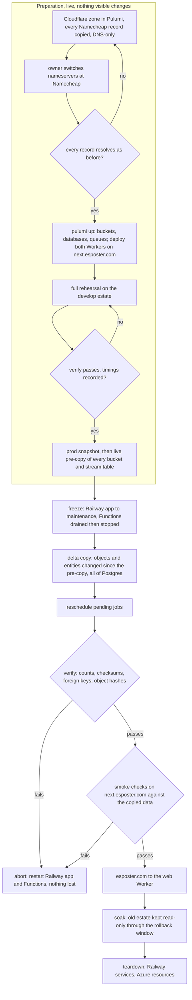

# Cloudflare cutover

Part of the [Cloudflare program](../infra-cloudflare-program/design.md), run after the branch is merged. It moves the data and the domain from Railway, Azure and Namecheap's DNS to Cloudflare without losing a row, an object or a session, and every step before the domain switch can be undone by restarting what was stopped.

## What moves

| From                                                  | To                            | How                                                              |
| :---------------------------------------------------- | :---------------------------- | :--------------------------------------------------------------- |
| Railway Postgres (production and develop)             | D1 `core`                     | rows read in key order, transformed by column type, bulk-written |
| Azure Table Storage, every table                      | its typed tables in D1 `core` | entities read page by page, mapped field by field to columns     |
| Azure AI Search `messages-index`                      | the messages FTS5 table       | rebuilt from the copied messages, never from the Azure index     |
| every Blob container                                  | its R2 bucket                 | streamed object by object, live pre-copy then a frozen delta     |
| pending scheduled message jobs and TodoList reminders | Scheduler Durable Objects     | rescheduled from the copied rows, missed ones due at once        |
| `esposter.com`'s DNS at Namecheap                     | a Cloudflare zone in Pulumi   | every record re-declared, then the nameservers changed           |

Nothing else holds state: call sessions' participants are in memory, Redis holds only LiveKit's room state, the Azure Search index is rebuilt, and Event Grid and Service Bus are drained before the freeze.

## The order

Every write is frozen from the start of the delta copy until the switch, so no row is written to the old stores after it is read, and nothing is written to the new stores before they hold everything. The freeze is the only downtime; the rehearsal measures it, since most bytes move in the live pre-copy.

## Preparation

**The zone first, long before anything else.** A Cloudflare zone for `esposter.com` is declared in `apps/infra/src/cloudflare` with every record Namecheap serves today — the apex and `www` pointing at Railway, mail (MX, SPF, DKIM, DMARC), every verification TXT, CAA — all DNS-only, so traffic takes exactly the path it takes now. The owner reads the current record list from Namecheap's Advanced DNS page, turns off DNSSEC there if it is on, and changes the nameservers to the pair Cloudflare assigns: those are the only steps at Namecheap. Then every record is resolved through public resolvers and compared with Namecheap's answers before anything else proceeds. TTLs drop to sixty seconds a day before the cutover.

**Resources and a staging hostname.** `pulumi up` creates the buckets, databases, queues and notifications. Both Workers deploy with `next.esposter.com` as the web Worker's custom domain, so the new estate can be exercised on its real platform before it holds real data, and again after the copy, while the apex still points at Railway.

**The rehearsal.** The whole sequence — snapshot, pre-copy, freeze, delta, reschedule, verify, smoke — runs against the develop estate (Railway's develop environment and the Azure dev resources) into the dev Cloudflare resources, as many times as it takes to pass cleanly. It records the freeze-to-verified duration, which sets the production maintenance window, and it proves the copy on real data shapes before production data is touched.

**The snapshot.** Before production is copied, Postgres is dumped (`pg_dump --format=custom`) and every stream table exported as JSON lines, both written to a private `cutover-archive` R2 bucket and kept until teardown. Railway's own point-in-time recovery bucket and Azure's seven-day blob soft delete stay as they are underneath it.

## The copy

One committed command, `pnpm -C scripts cutover <step> --environment <develop|production>`, holds every step, each idempotent and resumable: re-running a step after a failure redoes only what is not yet verified, with a checkpoint per table and per bucket kept in the archive bucket. Credentials come from the environment (the old stores' connection strings, a Cloudflare API token, R2's S3 keys); none is written to disk.

- **`inventory`** — row counts per table, entity counts per stream table, object counts and bytes per container, and an estimated duration; nothing is written.
- **`snapshot`** — the dump and exports above.
- **`copy-objects [--delta]`** — streams each blob to its bucket with its content type and disposition, skipping an object already present with the same size and MD5. The delta lists again, copies what is new or changed since the pre-copy, and deletes from R2 what was deleted from Azure since.
- **`copy-tables [--delta]`** — maps each Azure Table entity to its typed row: a reverse-ticked row key becomes its `createdAt`, the partition key its foreign key, and the row gets a UUID derived deterministically from the partition and row key (version 5 under one fixed namespace), so a reference to another entity — a reply, a forward, a pin — is remapped by recomputing the same UUID, with no lookup table, and a re-run writes the same ids. After the messages are copied, the FTS5 table is rebuilt with its own `rebuild` command. The delta copies entities whose Azure `Timestamp` is after the pre-copy started, then compares the key sets of both sides and deletes what Azure no longer has.
- **`copy-core`** — the whole of Postgres, run only inside the freeze: each table in foreign-key order, rows read in primary-key order and transformed by the column's type in the D1 schema (timestamps to epoch milliseconds, booleans to integers, JSON to text, uuids to text), written through D1's HTTP API in batched, parameter-bound inserts — no value is ever spliced into SQL text. A table is cleared before it is written, so a re-run starts it clean.
- **`rewrite-urls`** — rewrites every stored absolute Azure blob URL (the columns the storage part lists) to its public asset URL.
- **`reschedule`** — schedules a Scheduler object for every scheduled message job neither completed nor cancelled, and for every incomplete TodoList item with a due date, through the same services the app schedules with; one whose time passed during the freeze is scheduled for now.
- **`verify`** — per table, the row count and a checksum over its rows in key order, computed on both sides through the same transform; `PRAGMA foreign_key_check` on `core` returning nothing; per stream table and partition, the entity count; `messages_search` holding one row per message; per bucket, the object count, total bytes and every object's MD5; each user's storage ledger total equal to the bytes their objects hold. Any difference fails the step with the first differing keys.

Postgres stores microseconds and D1 milliseconds. `verify` checks that no unique index over a timestamp column gains a duplicate from the truncation, and the rehearsal runs it first.

## The freeze

1. The Railway app is put into maintenance: every request answers 503 with a maintenance page, WebSockets are refused, and no request writes. Because `userRouter.connect` writes on every socket open, a read-only mode is not enough; the app is closed.
2. The Functions keep running until Event Grid has delivered everything already published and the `deadletter` container is empty, then both Function Apps are stopped, so no Service Bus message or event writes after the read.
3. The delta copy, `copy-core`, `rewrite-urls`, `reschedule` and `verify` run.
4. With `verify` green, the smoke checks run on `next.esposter.com`: read a room's history, send a message and find it by search, upload and download a file, receive a push, post a webhook message, schedule a message a minute out and watch it arrive, start a call. They run as a session the command signs with the copied auth secret, so no OAuth provider has to know the staging hostname; OAuth sign-in itself is not exercised, since its callbacks, secrets and domain do not change.

**Abort** at any point up to here is restarting the Railway app and the Function Apps: the old stores were never written after the freeze began and the new ones are not yet live.

## The switch and the way back

The apex record changes from Railway to the web Worker's custom domain; the sixty-second TTL bounds how long resolvers keep sending visitors to Railway, which stays in maintenance so none of them writes. OAuth callbacks, the session cookie, the VAPID keys and every push subscription carry over unchanged, since the domain, the secrets and the rows are the same.

The rollback window is the soak, a few days: Railway and the Azure estate stay stopped but intact. Rolling back inside it is putting the Worker into maintenance, switching the apex back, and restarting Railway and the Functions — and it discards whatever was written on Cloudflare since the switch, which is why the smoke checks run on the real copied data before the switch rather than after it.

Incoming webhooks change address, from an Azure Function URL to `esposter.com/api/webhooks/...`, with no forwarder: no integration posts to one today, and the app shows the new address.

## Teardown

Once the window closes: the Railway services are deleted, the one step done in a dashboard; the Azure resource files are deleted from `apps/infra/src/azure` with `protect` removed in the same change, and `pulumi up` deletes them; the `cutover-archive` bucket and the cutover command are deleted; `openspec/specs/architecture/azure-services/design.md` becomes the Cloudflare services page, and the rejected and deferred pages the program overturned are rewritten.

## Key files

| File                                                   | Role after the change                |
| :----------------------------------------------------- | :----------------------------------- |
| `apps/infra/src/azure/resources`                       | deleted at teardown                  |
| `apps/infra/src/index.ts`                              | exports the zone and its records     |
| `scripts/package.json`                                 | the `cutover` script while it exists |
| `openspec/specs/architecture/azure-services/design.md` | rewritten for Cloudflare             |
| `openspec/specs/infra/README.md`                       | the shipped log line for the program |
