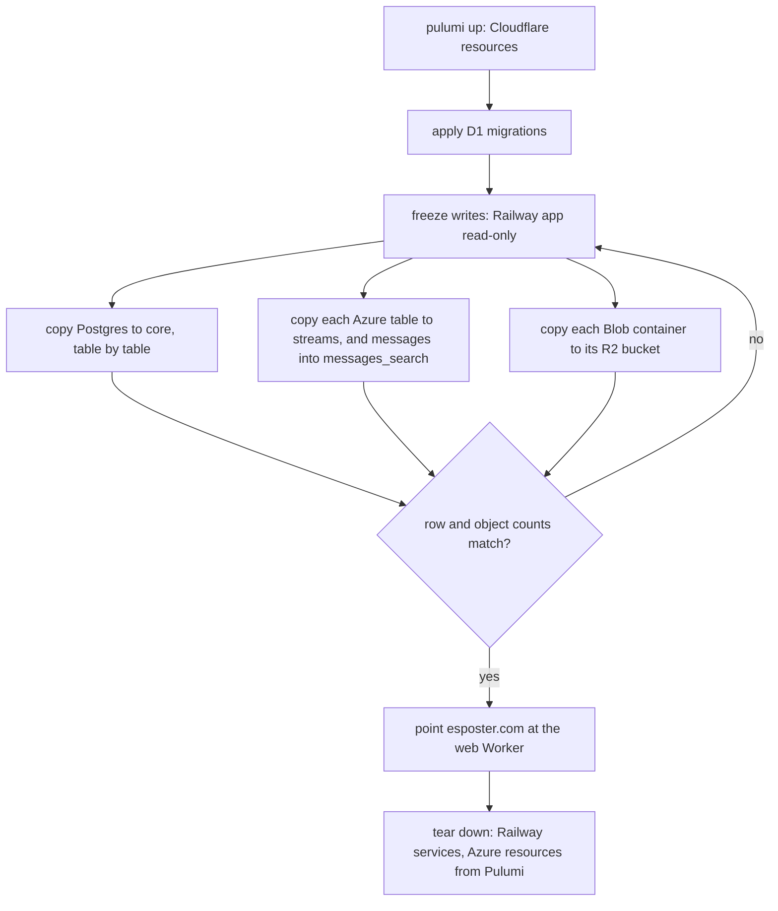

# Cloudflare cutover

Part of the [Cloudflare program](../infra-cloudflare-program/design.md), built after the branch is merged. The data is copied, the domain switched and the old estate removed.

## Order

The copy is a scratchpad script per store, run once (the backfills skill): Postgres rows are read with the Postgres schema at the last migration and written through the D1 schema, converting timestamps to milliseconds and booleans to integers; Azure entities are read with the table client and written as JSON entities; blobs are streamed object by object with their content type. Writes are frozen for the copy's duration, so no row is written to the old store after it is read.

## Teardown

The Azure resource files are deleted from `apps/infra/src/azure` with `protect` removed in the same change, and `pulumi up` deletes them; the Railway services are deleted by hand from the dashboard, the one step no file holds. The rejected and deferred pages the program overturned are rewritten, and `openspec/specs/architecture/azure-services/design.md` becomes the Cloudflare services page.

## Key files

| File                                                   | Role after the change                |
| :----------------------------------------------------- | :----------------------------------- |
| `apps/infra/src/azure/resources`                       | deleted                              |
| `openspec/specs/architecture/azure-services/design.md` | rewritten for Cloudflare             |
| `openspec/specs/infra/README.md`                       | the shipped log line for the program |
