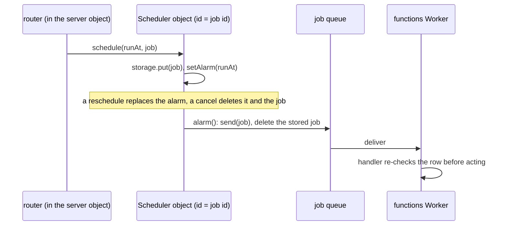

# Cloudflare jobs

Part of the [Cloudflare program](../infra-cloudflare-program/design.md). `apps/functions` becomes a Worker that consumes one Queue per job, runs the nightly purge on a Cron Trigger and reaches the app's live subscriptions through the `server` Durable Object. Delayed work is a Scheduler Durable Object's alarm.

## Jobs and their triggers

| Job (renamed from `AzureFunction` to `QueueJob`) | Trigger on Cloudflare                                                                        |
| :----------------------------------------------- | :------------------------------------------------------------------------------------------- |
| `DeleteAccount`, `ExportUserData`                | queue, sent by the user router                                                               |
| `ProcessBlobDeletion`                            | queue, sent by `publishBlobDeletion` and its prefix twin                                     |
| `ProcessNotification`                            | queue, sent by `publishNotification`                                                         |
| `ProcessWebhook`                                 | queue, sent by the webhook route                                                             |
| `ProcessScheduledMessageJob`, `SendTodoReminder` | queue, sent by the Scheduler object's alarm                                                  |
| `ReconcileStorageLedgerEntry`                    | queue fed by the `resource-assets` and `message-assets` buckets' object-create notifications |
| `DeleteOrphanedProfileImage`                     | queue fed by the `public-user-assets` bucket's object-create notification                    |
| `PurgeDeletedResources`                          | Cron Trigger `0 3 * * *`                                                                     |
| `PushWebhook`                                    | a route on the web Worker, `POST /api/webhooks/:id/:token`                                   |
| `ReplayDeadLetterEvent`                          | deleted: each queue's dead-letter queue keeps what failed                                    |

The queue consumer is the functions Worker's `queue(batch, env)` handler, dispatching on the batch's queue name to the handler the Function wrapper called; the handlers under `src/handlers` keep their bodies. A message is acknowledged when its handler resolves and retried when it throws, up to the job's retry count, then sent to the job's dead-letter queue. `AzureFunctionIsIdempotentMap` becomes the per-queue retry count: a non-idempotent job (`ProcessWebhook`) gets no retry. Event Grid's envelope (`createEventGridEvent`) is replaced by the job's payload, parsed with its existing Zod schema on receipt. R2's notification body is parsed with its own schema, replacing `blobCreatedEventGridDataSchema`.

## Scheduled work

The Scheduler is a Durable Object class exported by the functions Worker and bound in both Workers. It replaces `enqueueScheduledMessageJob` and `enqueueTodoReminder`. The handlers already re-check their row before acting, so an alarm's at-least-once delivery runs a job at most once in effect.

## Publishing to live subscriptions

The functions Worker binds the web Worker's `$DurableObject` class by `script_name` and calls `stub.publish(event)`, where `event` is a discriminated union of the emitter events a consumer produces today — a created message on a room, a storage usage change for a user. The object's `publish` re-emits on `messageEventEmitter` or `storageEventEmitter`, so the existing `onCreateMessage` and `onUpdateUsage` subscriptions deliver it. The client's Web PubSub connections (`useMessageSubscribables`'s and `useStorageSubscribables`'s second stream) are deleted, and with them `generateWebPubSubClientAccessUrl`, `removeUserFromRoomGroup` and `closeDeviceConnections`'s Web PubSub half; a departure needs no group removal, since the subscription's own membership check already ends the stream.

## Key files

| File                                                                           | Role after the change                              |
| :----------------------------------------------------------------------------- | :------------------------------------------------- |
| `packages/db-schema/src/models/azure/function/AzureFunction.ts`                | renamed to the queue job enum                      |
| `packages/db-schema/src/services/azure/eventGrid/publishNotification.ts`       | sends to the notification queue                    |
| `packages/db-schema/src/services/azure/eventGrid/createEventGridEvent.ts`      | deleted                                            |
| `packages/db/src/services/azure/serviceBus/enqueueScheduledMessageJob.ts`      | the Scheduler object's `schedule`                  |
| `packages/db/src/services/azure/serviceBus/enqueueTodoReminder.ts`             | the Scheduler object's `schedule`                  |
| `apps/functions/package.json`                                                  | a Worker: `wrangler`, no `@azure/functions`        |
| `apps/functions/src/functions/purgeDeletedResources.ts`                        | replaced by the Cron Trigger's `scheduled` handler |
| `apps/functions/src/functions/replayDeadLetterEvent.ts`                        | deleted                                            |
| `apps/functions/src/hooks/appStart.ts`                                         | deleted                                            |
| `apps/functions/src/services/message/createAndBroadcastMessage.ts`             | publishes through the server object                |
| `apps/functions/src/services/storage/broadcastStorageUsage.ts`                 | publishes through the server object                |
| `apps/web/server/services/azure/webPubSub/generateWebPubSubClientAccessUrl.ts` | deleted                                            |
| `apps/web/app/services/azure/webPubSub/startWebPubSubClient.ts`                | deleted                                            |
