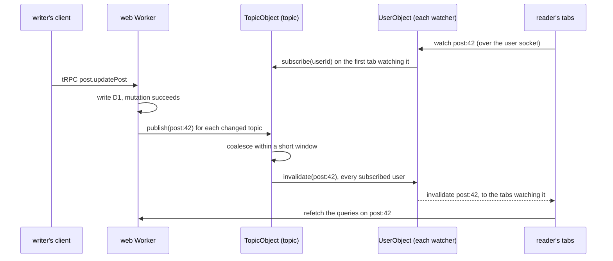

# Cloudflare live queries

Part of the [Cloudflare program](../infra-cloudflare-program/design.md), built on the [realtime objects](../infra-cloudflare-realtime/design.md). Every query a page shows stays current: a mutation that changes what a query reads reaches every reader showing it, and their copy refetches, with no event written by hand for the feature.

## Topics

A topic names a piece of state a query reads and a mutation changes: `post:<id>`, `resource:<id>`, `user:<id>`, `room:<id>`, `feed:posts`, `friends:<userId>`. Each tRPC query declares the topics of its result from its input, and each mutation declares the topics it changed from its input and its output, both through the procedure's `meta`, in one shared file per router so the client and the server compute the same names. A procedure without a declaration fails a test, so no read can quietly stay static and no write can quietly skip its readers.

## How an invalidation travels

The client sends `watch` and `unwatch` frames over the user socket it already holds, from the query cache: a query mounting watches its topics, the last query on a topic unmounting unwatches it. The user object records each socket's topics in the socket's attachment, so the record survives hibernation, and subscribes itself to a topic's object on the first of its tabs watching it and unsubscribes on the last. A `TopicObject`, one per topic, holds its subscribers in storage and, on publish, calls each subscriber's user object once per short window however many writes landed in it, so a burst of edits costs one refetch per reader. The tRPC middleware publishes after a mutation resolves, never before its write commits, and never for a failed one.

A reconnecting user socket re-sends its watches and refetches every watched query, because an invalidation sent while it was away was never delivered; that one rule replaces every per-feature re-read on reconnect.

The frame carries only the topic, never data, so the reader refetches through the same query with the same permission checks it ran the first time: liveness can never show a reader something the query would refuse them. A refetch is cheap because D1 reads are, and only queries on screen refetch.

## What stays pushed as data

Room messages, reactions, typing, member status and calls keep the typed events their objects push, because they are frequent, small and already exact: a refetch per message in a busy room would cost more than the message. Live queries cover everything the realtime objects do not: posts, comments and likes, resources and their versions, profiles, friends lists, room settings and member lists, achievements, dashboards, notifications counts.

## Why not row diffs

SpacetimeDB and Zero evaluate each subscribed query on the server and push the rows that changed. That needs an incremental query engine over the data, which D1 does not have, and a second copy of every permission rule in that engine. Invalidation reuses the queries and their checks as they are, at the cost of a round trip per change, which is the trade every Workers-hosted live-query system makes. Rejected also: a socket per topic, which multiplies sockets by the topics on a page; polling, which is the refresh the reader is trying to escape, made automatic.

## Key files

| File                                               | Role after the change                                                  |
| :------------------------------------------------- | :--------------------------------------------------------------------- |
| `apps/web/shared/models/realtime/`                 | the topic names, shared by queries, mutations and the client           |
| `apps/web/server/trpc/middleware/`                 | publishes a mutation's topics after it resolves                        |
| `apps/web/app/composables/realtime/`               | watches the topics of mounted queries and refetches on invalidation    |
| `apps/functions/src/durableObjects/TopicObject.ts` | one per topic: its subscribers and the coalesced fan-out               |
| `apps/functions/src/durableObjects/UserObject.ts`  | each socket's watched topics, subscribing and unsubscribing its topics |

## Sources

- [SpacetimeDB subscriptions](https://spacetimedb.com/docs/subscriptions) — reads as subscriptions, pushed as row changes.
- [WebSocket hibernation](https://developers.cloudflare.com/durable-objects/best-practices/websockets/) — `serializeAttachment` keeps a socket's state across hibernation.
