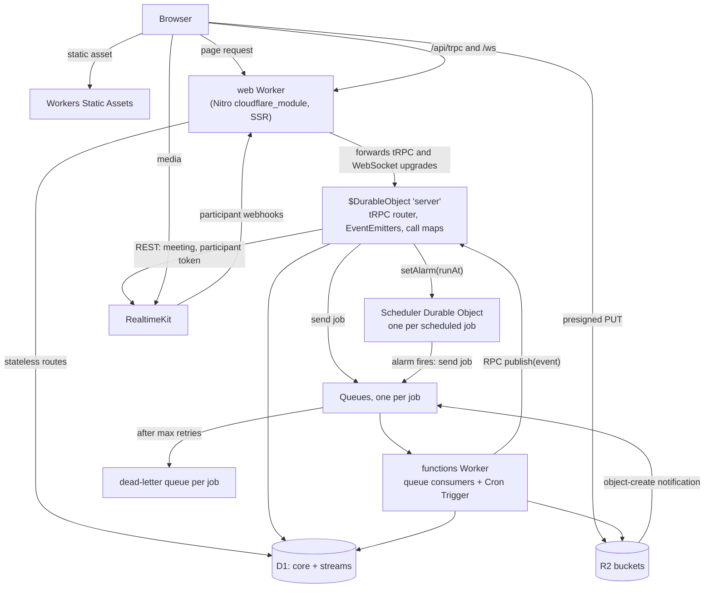

# Cloudflare program

Esposter moves from Railway and Azure onto Cloudflare's developer platform: one Worker serves the app, one Durable Object holds what needs a single long-lived process, D1 holds every row, R2 every file, Queues and alarms the async work, and RealtimeKit the calls. This page holds the decisions every part shares and the conventions each part's code follows; each part's own design holds its mechanics.

## Target architecture

The order that matters is the publish path. A mutation runs inside the Durable Object, so its `emit` reaches every subscription held there exactly as it does in the one Railway process today. Work done elsewhere — a queue consumer, a scheduled job, a webhook — reaches the same subscriptions by calling the object's `publish` method, which re-emits the event on the named emitter. That one entry point replaces Azure Web PubSub's two hubs.

## Service map

| Today                                        | On Cloudflare                                                 | Part                                               |
| :------------------------------------------- | :------------------------------------------------------------ | :------------------------------------------------- |
| Railway Node process (`node-server` preset)  | web Worker, `cloudflare_module` preset, Workers Static Assets | [runtime](../infra-cloudflare-runtime/design.md)   |
| In-process EventEmitters and call maps       | Nitro's `$DurableObject` instance `server`                    | [runtime](../infra-cloudflare-runtime/design.md)   |
| Railway Postgres                             | D1 database `core`                                            | [database](../infra-cloudflare-database/design.md) |
| Azure Table Storage                          | D1 database `streams`                                         | [database](../infra-cloudflare-database/design.md) |
| Azure AI Search `messages-index`             | FTS5 table in `streams`, written with the message             | [database](../infra-cloudflare-database/design.md) |
| PGlite in tests, `azure-mock`                | Miniflare's D1, R2 and Queues                                 | [database](../infra-cloudflare-database/design.md) |
| Azure Blob Storage                           | R2, one bucket per container                                  | [storage](../infra-cloudflare-storage/design.md)   |
| Event Grid custom topic + Functions          | one Queue per job, the functions Worker consuming them        | [jobs](../infra-cloudflare-jobs/design.md)         |
| Event Grid storage system topic              | R2 event notifications to a Queue                             | [jobs](../infra-cloudflare-jobs/design.md)         |
| Service Bus delayed messages                 | a Scheduler Durable Object per job, its alarm at the due time | [jobs](../infra-cloudflare-jobs/design.md)         |
| Functions timer trigger                      | a Cron Trigger on the functions Worker                        | [jobs](../infra-cloudflare-jobs/design.md)         |
| Web PubSub hubs                              | RPC `publish` on the `server` Durable Object                  | [jobs](../infra-cloudflare-jobs/design.md)         |
| Event Grid dead-letter container and replay  | each Queue's dead-letter queue                                | [jobs](../infra-cloudflare-jobs/design.md)         |
| LiveKit server, monitor and Redis on Railway | RealtimeKit                                                   | [calls](../infra-cloudflare-calls/design.md)       |
| `@pulumi/azure-native`, Logic App guards     | `@pulumi/cloudflare`, billing notification policies           | [pulumi](../infra-cloudflare-pulumi/design.md)     |
| Railway deploy of `main`                     | `wrangler deploy` from CI on `main`                           | [pulumi](../infra-cloudflare-pulumi/design.md)     |

## Decisions

**The app's stateful half runs in Nitro's own Durable Object.** The installed Nitro's `cloudflare_module` preset exports a `$DurableObject` class with one instance, `server`, whose `fetch` runs the whole Nitro app and which takes every WebSocket upgrade once its binding is declared. The web Worker forwards `/api/trpc` and `/ws` to that instance, so every tRPC procedure, every subscription, every module-scope EventEmitter and every in-memory call map lives in one isolate, as it does in the one Railway process. Rejected: running tRPC in the stateless Worker and bridging each emitter across isolates — the [cross-process event bridge](../../deferred/esbabbler/cross-process-event-bridge/design.md) idea — because it rewrites fourteen emitters, thirty-nine subscriptions and four call maps into a distributed protocol for a scale the app does not have. The object cannot hibernate while tRPC holds subscription generators in memory, so it stays awake while anyone is connected. One object awake all month at 128 MB is about a third of a million GB-seconds, inside the 400,000 the paid plan includes.

**Sharding waits for a measured ceiling.** One Durable Object runs one thread, and Cloudflare documents its soft ceiling in the order of a thousand requests a second. When the object's CPU or request rate approaches that, rooms move to an object each, keyed by room id, and the emitters become per-room. Until then a second object is a second process, with nothing to coordinate it.

**Every row moves to D1, Postgres is retired.** D1 is SQLite in the same account, reached by a binding with no connection to pool, billed inside the paid plan. Two databases split the data the way Postgres and Azure Table split it today: `core` holds the relational schema, `streams` the append-heavy tables Azure Table holds now, so neither nears D1's per-database limit and no query ever joined across the two. Rejected: Postgres on PlanetScale behind Hyperdrive, which keeps the schema but adds a second vendor, a connection pool and a per-request driver; Cloudflare also states that Drizzle with the `postgres` driver is not supported over Hyperdrive, so the driver would change anyway. Rejected: the Durable Object's own SQLite as the database, which makes every reader — the functions Worker, every SSR request — a client of one object, and caps the whole store at one object's storage.

**D1 has no interactive transaction, so a transaction becomes a batch or a constraint.** `db.batch([...])` runs its statements atomically; a transaction that reads and then decides becomes a single conditional statement (`INSERT ... ON CONFLICT`, `UPDATE ... WHERE` with a returning clause) or a unique constraint that makes the losing write fail. The [database part](../infra-cloudflare-database/design.md) lists every transaction and its replacement.

**Search is written with the message.** The FTS5 table in `streams` is updated in the same batch as the message row, so a sent message is searchable at once, where the Azure indexer took up to five minutes. This replaces the [search index capacity](../../deferred/infra/search-index-capacity/design.md) concern with D1's per-database limit.

**One Queue per job, named after it.** The `AzureFunction` enum already names each job and its idempotency; each becomes a `QueueJob` with its own queue and dead-letter queue, so retries and failures stay per job as Event Grid subscriptions kept them. Rejected: one queue with a discriminated payload, which shares one retry policy and one dead-letter queue across jobs with different idempotency.

**Delays are alarms, never queue delays.** A Queue delays a message by at most a day, and a scheduled message or a TodoList reminder has no upper bound. A Scheduler Durable Object, one per job id, sets its alarm at the due time and sends the job to its queue when the alarm fires; rescheduling sets a new alarm and cancelling deletes it.

**Calls move to RealtimeKit.** The paid plan's account includes ten thousand audio-and-video participant minutes a month and RealtimeKit runs the SFU, TURN and signalling, so nothing of ours routes UDP. Rejected: LiveKit Cloud, which keeps the client but is a second vendor with half the free minutes and a fifty-dollar next tier. Rejected: the raw Realtime SFU with our own signalling in the Durable Object, which rebuilds what RealtimeKit already is. RealtimeKit's general-availability status and its server-side participant removal are unconfirmed, so the [calls part](../infra-cloudflare-calls/design.md) opens with a check of both.

**Resources in Pulumi, code by Wrangler.** `@pulumi/cloudflare` declares the buckets, databases, queues, consumers, custom domains, the Realtime app and the billing notifications; Nitro writes the Worker's `wrangler.json`, and CI runs `wrangler deploy` on `main` after its checks pass, which is what Railway's Wait for CI did. Rejected: deploying the Worker's code through `WorkerVersion` resources, which turns every app deploy into a Pulumi update of the prod stack.

**The size ceiling is measured, not assumed.** A Worker's code is capped at 64 MiB uncompressed with no compressed limit. The last `node-server` build was about 50 MB of JavaScript without source maps, much of it client-only libraries the server never runs. The [runtime part](../infra-cloudflare-runtime/design.md) keeps those out of the server bundle and records the build's size in CI against the cap.

**These decisions overturn three settled ones.** [CDN in front of Railway](../../rejected/infra/cdn-in-front-of-railway/design.md) and [LiveKit stack trim](../../rejected/infra/livekit-stack-trim/design.md) were argued from staying on Railway and waiting for it to route UDP; the program leaves Railway instead. The [cross-process event bridge](../../deferred/esbabbler/cross-process-event-bridge/design.md) stays deferred, for the reason above. Each page is rewritten when the cutover ships.

## Conventions every part follows

- **Bindings are read from `cloudflare:workers`'s `env`**, typed once in the web app's server and once in the functions Worker; no binding name is a string in a service.
- **A binding is a parameter, never a module-scope client.** A service takes the `D1Database`, `R2Bucket` or `Queue` it uses, so a test passes Miniflare's.
- **The Azure names go with the services.** `AzureContainer`, `AzureTable`, `AzureFunction` and every `azure` folder are renamed to what they now name (`StorageBucket`, `StreamTable`, `QueueJob`), in the same change that moves their service, never aliased ([no compatibility debt](../../../.agents/skills/no-compatibility-debt/SKILL.md)).
- **`@esposter/azure` and `azure-mock` are deleted** with their last importer; Miniflare is the one test double for every binding.
- **No feature changes behaviour by accident.** Where a platform forces a difference — search becoming immediate, a delay becoming an alarm — the part names it.

## Build order

The parts land on the `ai/cloudflare` branch in waves, each wave's agents in their own worktrees off the branch with disjoint files.

1. The database schema (by schema folder), the runtime, storage, jobs, calls and Pulumi, in parallel; each owns its own folders.
2. The server's queries and transactions on the new schema, and the tests on Miniflare.
3. One fixer over the branch's typecheck and tests, then the specs and skills swept.

The cutover is the last part and runs after the branch is merged.

## Risks

- **RealtimeKit's status.** If its server API cannot remove a participant or set a participant's permissions, the call moderation actions lose their server enforcement; the calls part stops at its first task and reports rather than ship that.
- **D1's write throughput.** Each database has one writer. A message is one batch of a few statements, well inside it at this app's volume, but a burst of webhook messages queues behind itself.
- **Nuxt on Workers.** The app is a Nuxt nightly; Nitro's Cloudflare preset is exercised by far fewer apps than its Node preset, so the runtime part's first task is a build and a local `wrangler dev` of the unmodified app.

## Sources

- [Workers limits](https://developers.cloudflare.com/workers/platform/limits/) — 128 MB per isolate, 64 MiB uncompressed script size and no compressed limit, 30 s default CPU on the paid plan.
- [Durable Objects pricing](https://developers.cloudflare.com/durable-objects/platform/pricing/) — 400,000 GB-s and one million requests a month on the paid plan, WebSocket messages billed 20:1.
- [Durable Objects alarms](https://developers.cloudflare.com/durable-objects/api/alarms/) — one alarm per object at any epoch time, at-least-once with retries.
- [D1 limits](https://developers.cloudflare.com/d1/platform/limits/) and [D1 SQL statements](https://developers.cloudflare.com/d1/sql-api/sql-statements/) — 10 GB per database, 100 bound parameters per statement, FTS5 supported.
- [Queues limits](https://developers.cloudflare.com/queues/platform/limits/) — 128 KB messages, a delay of at most 24 hours, dead-letter queues per consumer.
- [R2 presigned URLs](https://developers.cloudflare.com/r2/api/s3/presigned-urls/) and [R2 event notifications](https://developers.cloudflare.com/r2/buckets/event-notifications/) — presigned PUT signed with an API token, object-create events to a Queue.
- [Hyperdrive with Drizzle](https://developers.cloudflare.com/hyperdrive/examples/connect-to-postgres/postgres-drivers-and-libraries/drizzle-orm/) — Drizzle with the `postgres` driver is not supported over Hyperdrive.
- [RealtimeKit pricing](https://developers.cloudflare.com/realtime/realtimekit/pricing/) and [webhooks](https://developers.cloudflare.com/realtime/realtimekit/webhooks/) — ten thousand audio-and-video participant minutes included, participant join and leave events.
- [Nitro Cloudflare preset](https://nitro.build/deploy/providers/cloudflare) — `cloudflare_module`, and WebSocket upgrades forwarded to the `$DurableObject` binding.
- [Pulumi Cloudflare provider](https://www.pulumi.com/registry/packages/cloudflare/) — R2 buckets, D1 databases, Queues and consumers, custom domains, Realtime apps.

## Key files

| File                                                              | Role after the program                                        |
| :---------------------------------------------------------------- | :------------------------------------------------------------ |
| `apps/web/configuration/nitro.ts`                                 | the `cloudflare_module` preset and its Durable Object binding |
| `apps/web/server/db/index.ts`                                     | the Drizzle client over the `core` D1 binding                 |
| `packages/db-schema/src/pgTable.ts`                               | replaced by the SQLite table factory                          |
| `packages/db-schema/drizzle.config.ts`                            | the SQLite dialect and the D1 migrations folder               |
| `packages/db/src/services/azure/table/getTableClient.ts`          | replaced by the `streams` tables                              |
| `packages/db/src/services/azure/container/generateWriteSasUrl.ts` | replaced by the presigned R2 PUT                              |
| `packages/db-schema/src/models/azure/function/AzureFunction.ts`   | renamed to the queue job enum                                 |
| `apps/functions/package.json`                                     | the functions Worker                                          |
| `apps/web/server/api/webhooks/livekit.post.ts`                    | replaced by the RealtimeKit webhook                           |
| `apps/infra/src/index.ts`                                         | the Cloudflare provider folder beside GitHub                  |
| `packages/db-mock/src/createMockDb.ts`                            | the Miniflare D1 test database                                |
| `packages/azure-mock/package.json`                                | deleted                                                       |
| `packages/azure/package.json`                                     | deleted                                                       |
| `livekit-server/Dockerfile`                                       | deleted                                                       |
| `livekit-monitor/Dockerfile`                                      | deleted                                                       |
| `openspec/specs/architecture/azure-services/design.md`            | rewritten as the Cloudflare services page at the cutover      |
