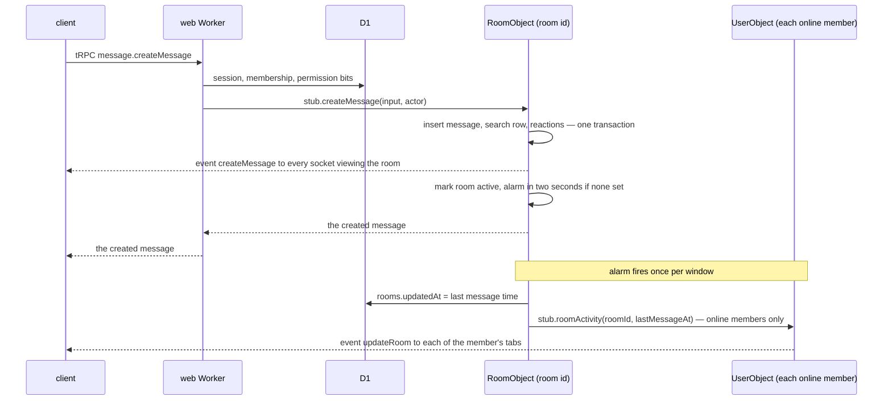

# Cloudflare realtime

Part of the [Cloudflare program](../infra-cloudflare-program/design.md). The app's live state moves out of one global Durable Object into one object per thing that has live state, and its live updates move from tRPC subscriptions over in-process EventEmitters to typed events pushed over hibernating WebSockets.

## The objects

| Object       | One per      | Owns                                                                                                                                                        | Its sockets                                |
| :----------- | :----------- | :---------------------------------------------------------------------------------------------------------------------------------------------------------- | :----------------------------------------- |
| `RoomObject` | room         | the room's messages, reactions and message search in its own SQLite; its scheduled messages; the set of members online; the debounced room-activity fan-out | everyone viewing the room                  |
| `CallObject` | call session | the participant, knocker and admitted maps, the call's start time, the RealtimeKit participant map and the per-participant preset queue, all in its storage | everyone joined to or knocking on the call |
| `UserObject` | user         | the person's sockets across devices, their sent-message index, their reminders and TodoList reminders, their online status                                  | every signed-in tab of the person          |

Everything relational — users, rooms, members, roles, resources, friends — stays in D1. The objects are classes exported by the functions Worker, which also consumes the queues and runs the cron; the web Worker binds them by `script_name`. The web Worker holds no state at all: SSR, tRPC queries and mutations, webhooks and the MCP route run in any isolate.

A room's messages leave D1 because they are the one data set that grows without bound and is read almost only within its room: each room gets its own ten gigabytes, its own row allowance at the cheaper object storage rate, and reads with no network hop from the code that broadcasts them. A message, its reactions and its search row are written in one synchronous SQLite transaction inside the object, so they can never disagree.

## How a message travels

The Worker authorises, the object writes and broadcasts. Permission checks stay in the Worker because they read D1's relational tables; the object trusts the actor its caller passes, and only the two Workers can reach it. The room-list bump — the room moving to the top of each member's list — is the one fan-out a message causes beyond the room, so it is debounced to one wave per two-second window per room and goes only to members who are online.

## Who is online, and who hears what

A person is online while their `UserObject` holds at least one socket. On the first socket it reads the person's room ids from D1 and calls `attachMember(userId)` on each room's object; on the last close it calls `detachMember`. A room therefore knows its online members without a query, broadcasts their status change to its viewers, and fans out room-level events only to them:

| Event                                                                                                     | Raised by                      | Delivered to                                        |
| :-------------------------------------------------------------------------------------------------------- | :----------------------------- | :-------------------------------------------------- |
| messages, edits, deletes, typing, reactions, room emojis, roles, admin actions (targeted by user tag)     | the room's object              | the room's viewers                                  |
| room renamed, deleted, joined, left; a member's mention count                                             | the room's object              | the online members' user objects, then their tabs   |
| member online / offline                                                                                   | the member's user object       | each of the member's rooms, then the rooms' viewers |
| call participants, camera, mute, hand, knocks                                                             | the call's object              | the call's sockets                                  |
| achievement, friend requests, storage usage, Genshin session replaced, a resource saved on another device | the Worker or a queue consumer | the person's user object, then their tabs           |

A room deleted or a member removed closes that member's sockets on the room's object; a session revoked closes the session's sockets on the user object and on each of the person's room and call objects, so a revoked device keeps nothing open.

## Events, not subscriptions

tRPC's WebSocket server keeps one in-memory async generator per subscription, which pins an object awake for as long as a socket is open. The objects use the WebSocket hibernation API instead: a socket is accepted with tags for its user, session and device, the object is evicted while no message is in flight, and a broadcast is a loop over `getWebSockets(tag?)` writing one JSON frame. Idle sockets cost no duration. Every frame is `{ type, data }`, a member of a discriminated union per object — `RoomEvent`, `CallEvent`, `UserEvent` — declared once in `packages/db-schema` with its Zod schema beside the other contracts both Workers share, so the objects write and the client reads the same types. A broadcast can exclude a tag, so the sender's own socket does not receive the echo of its write; a knocker is admitted to the call socket before it is joined, so it hears its own admission. Queries and mutations stay on tRPC over HTTP.

A client holds at most three sockets: its user socket on every signed-in page, a room socket while a room is open, and a call socket while in a call. Each is opened through the web Worker at `/ws/user`, `/ws/room/:roomId` or `/ws/call/:callSessionId`, which reads the session, checks membership or call admission against D1, and forwards the upgrade to the object with the verified identity in headers only the object reads. One client-side connection manager owns the three sockets, reconnects with backoff, and dispatches each event to the store handler the matching subscription called before. The room socket connects with `?after=<last message id>` and the object first replays every message after it, then goes live, so a reconnect misses nothing; the client then refreshes the loaded window for edits made while it was away.

## Scheduled work is an alarm on its owner

A scheduled message belongs to a room, and a reminder or a TodoList reminder to a person, so each is a row in its owner's object storage, and the owner's single alarm is set to the earliest row due; on firing it runs every due row and re-arms for the next. The `Scheduler` object, its two queues and the `/_internal/publish` route go: a queue consumer that changes live state calls the owning object's RPC method directly, through the same bindings.

## Reads across rooms

Few reads span rooms, and each has an owner:

- **Sent messages** (`readMySentMessages`): the sender's `UserObject` keeps an index of `(roomId, messageId, createdAt)` that the room's object appends to on send and removes from on delete; the page reads the index, then the messages from their rooms.
- **Search across rooms** (`searchMessages` with several rooms): the Worker asks each listed room's object in parallel and merges by rank; the list is the caller's own filter, so the fan-out is bounded by what they asked for.
- **Scheduled messages list**: the sender's `UserObject` indexes their pending scheduled messages the same way.
- **Forward to many rooms**: one `createMessage` per target room's object, settled independently, as today.
- **Account deletion and data export**: the queue consumer walks the person's rooms and calls each room's `deleteUserMessages`, `deleteUserReactions` or `exportUserMessages`; an owned room's object is deleted with `deleteAll`. The removals reach open views through the room's ordinary delete events, because the object that erases is the one that broadcasts. Rejected: leaving them for a reload to correct, which is the stale view live updates exist to remove.

## Ids

A message's id is its room's `INTEGER PRIMARY KEY`, a sequence the room's one writer hands out. It is SQLite's fastest key — the table's own B-tree, eight bytes, no second index — and it only grows, so newest-first is `ORDER BY id DESC`, a page is `id < ?`, and FTS5 runs in external-content mode over the stable integer rowid with no copy of the text. Sixty-four bits cannot be exhausted by any room. A message's global identity is `(roomId, id)`, and the room id is needed anyway to reach its object.

Every D1 row's id is a UUIDv7 (RFC 9562): unique without coordination, generated in the Worker so a batch knows every id before it runs, and time-ordered, so new rows append to their index and ordering by id is ordering by creation. Cursors over D1 tables therefore page on `id` alone. Every id is made by the `uuid` package's `v7`, in the Worker, the objects and the column defaults alike, and schemas validate with `z.uuidv7()`; better-auth generates its ids through the same function. `crypto.randomUUID()` makes a version 4, so a lint rule bans it everywhere — and the `uuid` package's `v4` with it — and the one generator is the only way to mint an id. Rejected: UUIDv4, which scatters inserts across the index and needs `createdAt` beside it for every cursor; ULID, which is the same idea without the standard; a Snowflake id, which needs worker ids that nothing here coordinates.

The [cutover](../infra-cloudflare-cutover/design.md) re-keys existing rows: each gets a UUIDv7 built from its own `createdAt` and a random tail, kept in the id map, and one pass rewrites every occurrence of an old UUID — in key and foreign-key columns, JSON columns, R2 object keys and object contents — through the map. A UUID is a collision-free token, so a replace through the map cannot touch anything else. Messages are numbered per room in `createdAt` order, which is deterministic, so they need no map.

## Two Workers by job, named for it

`apps/functions` is an Azure name for what becomes two jobs, so it splits and renames once the objects land: `apps/realtime` (`@esposter/realtime`, Worker purpose `realtime`) exports `RoomObject`, `CallObject` and `UserObject` and nothing else, and `apps/jobs` (`@esposter/jobs`, Worker purpose `jobs`) consumes the queues and runs the nightly purge, reaching live state through the realtime Worker's bindings. Each deploys on its own. Deploying a Worker restarts the objects it exports, which drops every socket they hold, so the objects live in the one Worker that changes only when they do: a web release or a job fix never disconnects anyone. The Worker is named for what its objects are for — live state and the sockets that carry it — and its objects keep the `Object` suffix so `RoomObject` never reads as the D1 `Room` row. Rejected: one Worker for both, which ties every socket's lifetime to every queue consumer's deploy; the objects inside the web Worker, which drops every socket on every release; `durable-objects` as the name, which names the mechanism rather than the job.

## Rejected

- **One global object running the whole app** — the first design. One thread and one location for every socket, no hibernation, and every event filtered by every subscription in memory.
- **Room sockets for every room in the list.** A person in hundreds of rooms would hold hundreds of sockets; the user object carries room-list events instead.
- **Fan-out of every message to every member.** A thousand-member room would cost a thousand object requests per message; the bump is debounced and sent only to online members.
- **tRPC subscriptions inside the objects.** They hold a generator per subscription in memory, which forbids hibernation.
- **Messages in D1 with a projection per room.** It keeps two copies in step and still needs the objects for the sockets.

## Key files

| File                                                  | Role after the change                                              |
| :---------------------------------------------------- | :----------------------------------------------------------------- |
| `apps/functions/src/durableObjects/RoomObject.ts`     | messages, reactions, search, scheduled messages, room sockets      |
| `apps/functions/src/durableObjects/CallObject.ts`     | call participants and knockers, call sockets                       |
| `apps/functions/src/durableObjects/UserObject.ts`     | a person's sockets, sent and scheduled index, reminders            |
| `apps/functions/src/durableObjects/Scheduler.ts`      | deleted                                                            |
| `apps/web/server/middleware/trpcDurableObject.ts`     | deleted                                                            |
| `apps/web/server/routes/_internal/publish.post.ts`    | deleted                                                            |
| `apps/web/server/routes/ws/`                          | authenticate and forward the three socket kinds                    |
| `apps/web/server/services/**/events/*EventEmitter.ts` | deleted; their events become `RoomEvent`, `CallEvent`, `UserEvent` |
| `packages/db-schema/src/models/realtime/`             | the three event unions and their schemas                           |
| `apps/web/app/composables/realtime/`                  | the connection manager and the event dispatch                      |
| `packages/trpc-nuxt-module`                           | its WebSocket handler is no longer used by the app                 |

## Sources

- [WebSocket hibernation](https://developers.cloudflare.com/durable-objects/best-practices/websockets/) — `acceptWebSocket` with tags, `getWebSockets`, no duration while hibernated.
- [Durable Objects limits](https://developers.cloudflare.com/durable-objects/platform/limits/) — ten gigabytes of SQLite per object on the paid plan.
- [Durable Objects pricing](https://developers.cloudflare.com/durable-objects/platform/pricing/) — object SQLite rows at D1's rates and storage at a lower rate.
- [Durable Objects RPC](https://developers.cloudflare.com/durable-objects/best-practices/create-durable-object-stubs-and-send-requests/) — methods called on a stub, across Workers by `script_name`.
- [RFC 9562](https://www.rfc-editor.org/rfc/rfc9562) — UUID version 7.
