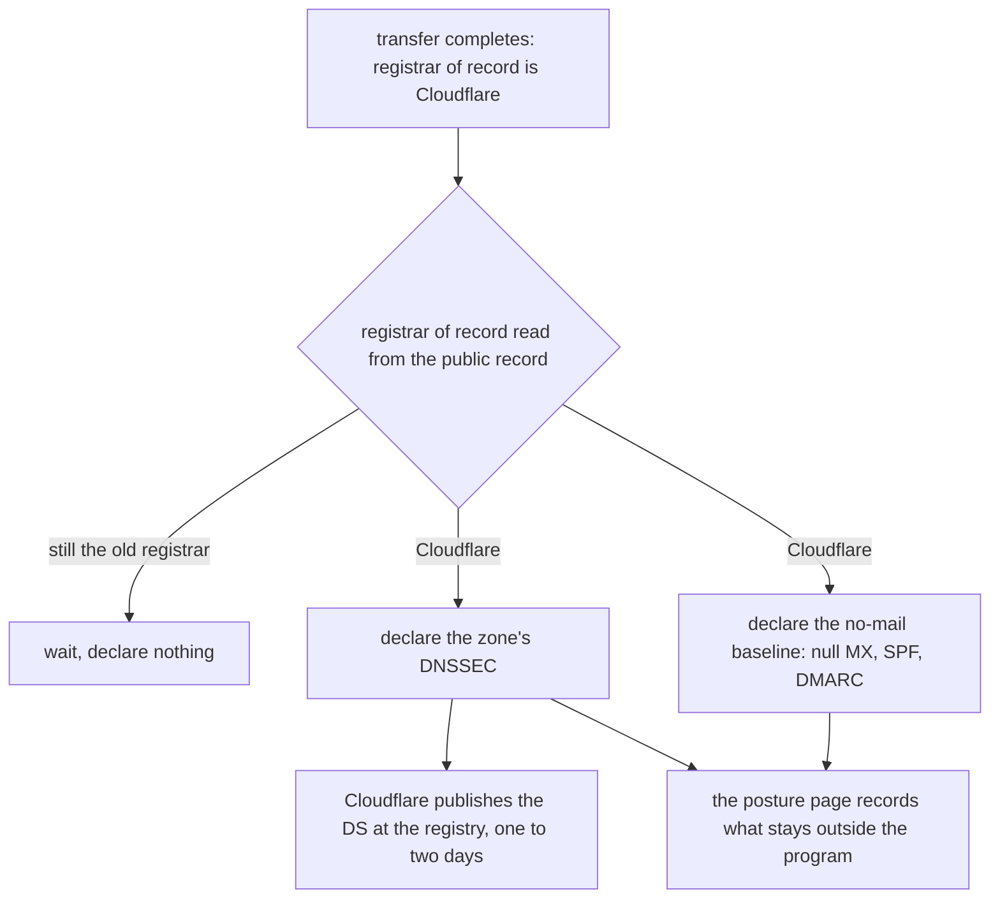

# Cloudflare registrar

Closes the gaps a registrar move leaves, after the [Cloudflare program](../archive/2026-11-15-infra-cloudflare-program/design.md) already moved the zone: what the program declares about the domain, what stays outside it on purpose, and the account settings the program cannot hold.

## What works today against what the change adds

Today the zone is declared in Pulumi with `protect: true`, its nameservers already point at Cloudflare, DNSSEC is off, and the domain publishes no MX, SPF or DMARC record. The transfer is in progress and nothing in the program mentions the registration.

The change adds four resources to the program and records everything else on the posture page. It adds no Worker code.

## How it works



The gate is the only ordering that matters. DNSSEC has to be off for the transfer, and while the old registrar holds the domain a DS record would have to be copied there by hand. With Cloudflare as both registrar and DNS host, Cloudflare scans the zone's CDS and CDNSKEY records and publishes the DS itself.

## Decisions

- **DNSSEC is declared once the registrar is Cloudflare, not before.** Cloudflare's DNSSEC page says it adds the DS record automatically for a domain on Cloudflare Registrar and that the timing of its publication cannot be controlled, which takes one to two days. Declaring it earlier would ask the old registrar for a DS record by hand. Enabling it in the dashboard was rejected: it leaves an account setting the program does not declare, which the [posture page](../../specs/infra/cost-and-security-posture/design.md) already refuses for the spend alert.
- **The domain publishes a no-mail baseline until inbound mail ships.** A null MX (`0 .`), `v=spf1 -all` and `v=DMARC1; p=reject;`. A domain with no mail records gives a spoofed `@esposter.com` message nothing to fail, so the records cost nothing and close a phishing path. Leaving the domain empty until mail ships was rejected for that reason. Reviving [inbound mail](../../deferred/esbabbler/inbound-mail/design.md), or its cheaper interim of storing what arrives, deletes the null MX and the SPF record before it enables Email Routing, which writes its own and refuses a domain that holds another provider's MX record, and keeps the DMARC record.
- **The registration is not declared in Pulumi.** The installed `@pulumi/cloudflare` has no registrar resource. Cloudflare's own pages disagree about the API: the Registrar API guide says transfers, renewals and contact updates are not yet available through it, while the API reference lists transfer and update endpoints. The program therefore cannot hold the registration, and the posture page records its three settings instead: auto-renew on, the registrar lock on and WHOIS redaction on. The dashboard enrols a domain in auto-renew by default.
- **Expiry is not alerted on by the program.** Cloudflare's notification types include none for a domain's expiry, so no policy can be declared. Cloudflare emails the Super Admin monthly about domains expiring within the next 45 days and the WHOIS registrant weekly in the last month, so the posture is that both addresses must be read by a person. A failed auto-renewal is also emailed, and Cloudflare retries it three more times before renewal turns manual.
- **The account's sign-in security is the domain's security.** Anyone with a super-admin or admin role on the account can unlock the domain and take its auth code, and a changed registrant name, organisation or email starts a 60-day transfer lock. Cloudflare recommends two-factor authentication and lets a Super Admin enforce it. The posture is that enforcement is on, the number of admin roles is kept to those who need one, and the deploy token's permissions carry nothing for the registrar. These are account settings with no resource behind them, so the owner makes them and the posture page records them.

## Not built

- A budget or expiry monitor. Cloudflare's alerts offer scheduled queries, and none of the pages read says whether a registrar dataset exists for one.
- Registry Lock. Cloudflare applies it to its Custom Domain Protection product on the Enterprise plan, and the standard registrar pages do not say it applies.

## Key files

| File                                                               | Role                                                                                       |
| ------------------------------------------------------------------ | ------------------------------------------------------------------------------------------ |
| `apps/infra/src/cloudflare/resources/zones/esposterCom.ts`         | The zone the new records and DNSSEC belong to                                              |
| `apps/infra/src/cloudflare/resources/dnsRecords/esposterComWww.ts` | The shape every record file takes: logical name from the hostname, zone as parent, protect |
| `apps/infra/docs/cloudflare/naming-conventions.md`                 | Lists each resource type's folder, so the DNSSEC folder is added to it                     |
| `openspec/specs/infra/cost-and-security-posture/design.md`         | Where the registration, expiry and account rows land                                       |
| `openspec/specs/infra/README.md`                                   | Its opening names what the stack owns, and gains the registrar                             |

New files, written by the change:

```text
apps/infra/src/cloudflare/resources/zoneDnssecs/esposterComDnssec.ts
apps/infra/src/cloudflare/resources/dnsRecords/esposterComNullMx.ts
apps/infra/src/cloudflare/resources/dnsRecords/esposterComSpf.ts
apps/infra/src/cloudflare/resources/dnsRecords/esposterComDmarc.ts
```

## Sources

- [Transfer a domain to Cloudflare](https://developers.cloudflare.com/registrar/get-started/transfer-domain-to-cloudflare/): the prerequisites, the order (DNSSEC off at the old registrar, nameservers moved, lock removed, auth code entered), the one-year extension and the up-to-ten-day timeline.
- [Cloudflare DNSSEC](https://developers.cloudflare.com/dns/dnssec/) and [Enable DNSSEC](https://developers.cloudflare.com/registrar/get-started/enable-dnssec/): the DS record added automatically for Cloudflare Registrar domains, and its one-to-two-day publication.
- [Registrar API](https://developers.cloudflare.com/registrar/registrar-api/) and [Renew domains](https://developers.cloudflare.com/registrar/account-options/renew-domains/): what the API does not yet cover, and the expiry and failed-renewal emails.
- [Cloudflare account two-factor authentication](https://developers.cloudflare.com/fundamentals/user-profiles/2fa/) and [Transfer out from Cloudflare](https://developers.cloudflare.com/registrar/account-options/transfer-out-from-cloudflare/): the recommendation and Super Admin enforcement, and the warning that admin roles can unlock a domain and take its auth code.
- [RFC 7505](https://www.rfc-editor.org/rfc/rfc7505): the null MX record, which says a domain accepts no mail.
