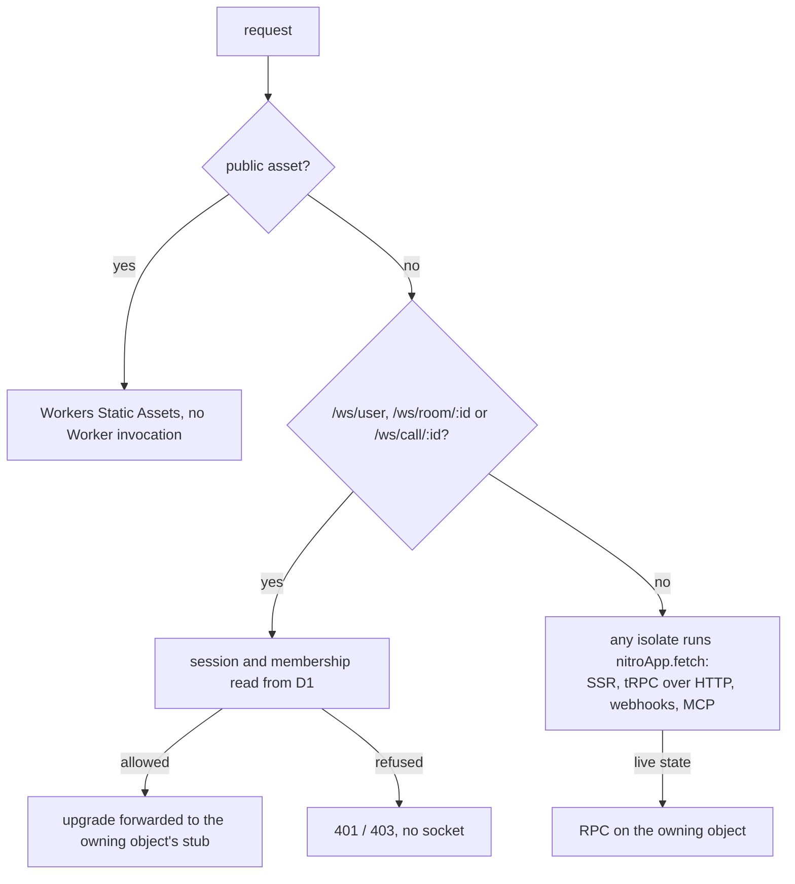

# Cloudflare runtime

Part of the [Cloudflare program](../infra-cloudflare-program/design.md). The app builds with Nitro's `cloudflare_module` preset and runs as one stateless Worker; live state and sockets belong to the per-room, per-call and per-person objects of the [realtime](../infra-cloudflare-realtime/design.md) design.

## How a request is served

Nothing the app holds lives in a Worker isolate between requests, so SSR, tRPC, the RealtimeKit webhook and the MCP route all run wherever the request lands and reach live state the same way, through the owning object's RPC methods. Nitro's own `$DurableObject` binding and its WebSocket handling are not declared.

## Node APIs

The preset turns on `nodejs_compat`. Every server import of a `node:` module is covered by it except two:

- `node:zlib`'s `zstdDecompress` on the resource read path. Workers' zlib does not document zstd, so the read path decompresses with a WebAssembly zstd decoder when the runtime lacks it, and the write path compresses the same way.
- `node:fs`, `node:os` and `node:path` in the Genshin scene exports, which a module registers only under `nuxt dev`. They stay dev-only.

`web-push` signs with `node:crypto` and sends with `node:https`; both are in `nodejs_compat`. The VAPID setup in the Nitro plugin moves to where a push is sent, since a Worker has no process start.

## The bundle

A Worker's code is capped at 64 MiB uncompressed. The server bundle carries libraries the server never runs — the charts, three.js, pdf.js and the call's track processors — because components that import them are rendered on the server. Each such component becomes a client-only component (`.client.vue` or a lazy `defineAsyncComponent` behind `<ClientOnly>`), so its library leaves the server bundle. Source maps are not uploaded. CI records the server bundle's uncompressed size after the app build and fails past the cap, the one budget the [bundle budgets](../../deferred/architecture/bundle-budgets/design.md) idea did not need a policy for.

## Startup work

A Worker has no process start, so the Nitro plugins that ran once at boot run on first use: environment validation runs on the first request of an isolate, and `getCommitCount`'s cached promise is per isolate, which is the same contract as per process.

## Environment

Each Worker declares every variable it reads in its schema, and [the environment spec](../../specs/architecture/environment/design.md) holds that model. Bindings are not variables: D1, R2, Queues and the Durable Objects come from `cloudflare:workers`'s `env`. A D1 database's id is not set in the environment either: `CloudflareCoreDatabaseIdMap` commits each environment's id, and the wrangler configs and the migrations read it from there.

- **Vars** are the values an environment's name fixes, written into wrangler: the web Worker's come from `configuration/wrangler.ts` (`APP_ENV`, `BASE_URL`, `BETTER_AUTH_URL`, `CLOUDFLARE_ACCOUNT_ID`, `CLOUDFLARE_ENVIRONMENT`, `PUBLIC_ASSETS_BASE_URL`), the functions Worker's are in its `wrangler.jsonc`.
- **Secrets** are the schema keys marked `.meta({ secret: true })`. Each Worker's list is in `.github/worker-secrets.json`, and the deploy job puts them with `wrangler secret bulk` after the Worker deploys. Each value is read from Pulumi ESC `esposter-infra/prod` as `pulumiConfig.esposter-infra:<environment>_<NAME>`, so `dev_` and `prod_` values sit side by side in one environment.
- **Build-time values.** The web build bakes its public config into its runtime config, so `FACEBOOK_CLIENT_ID` and `VAPID_PUBLIC_KEY` are read from ESC before the build, and the origins come from the workflow's environment for each branch.
- **Local development.** `predev` writes `.wrangler/local/wrangler.jsonc` from the same function and applies the `core` migrations to local D1. Nitro's Miniflare takes its bindings from `configuration/nitro.ts`, and `.env` supplies the variables, as `.env.example` lists them.

## Key files

| File                                                             | Role after the change                                     |
| :--------------------------------------------------------------- | :-------------------------------------------------------- |
| `apps/web/configuration/nitro.ts`                                | the `cloudflare_module` preset, no brotli                 |
| `apps/web/configuration/modules.ts`                              | the tRPC module's WebSocket endpoint, unchanged path      |
| `apps/web/server/plugins/webpush.ts`                             | removed; VAPID details set where a push is sent           |
| `apps/web/server/plugins/environment.ts`                         | environment validated per isolate                         |
| `apps/web/server/services/resource/readResourceContentDelta.ts`  | zstd decoded without `node:zlib`                          |
| `apps/web/server/services/resource/readStagedResourceContent.ts` | gunzip through `DecompressionStream`                      |
| `apps/web/package.json`                                          | `wrangler` as a dev dependency; `start` is `wrangler dev` |
