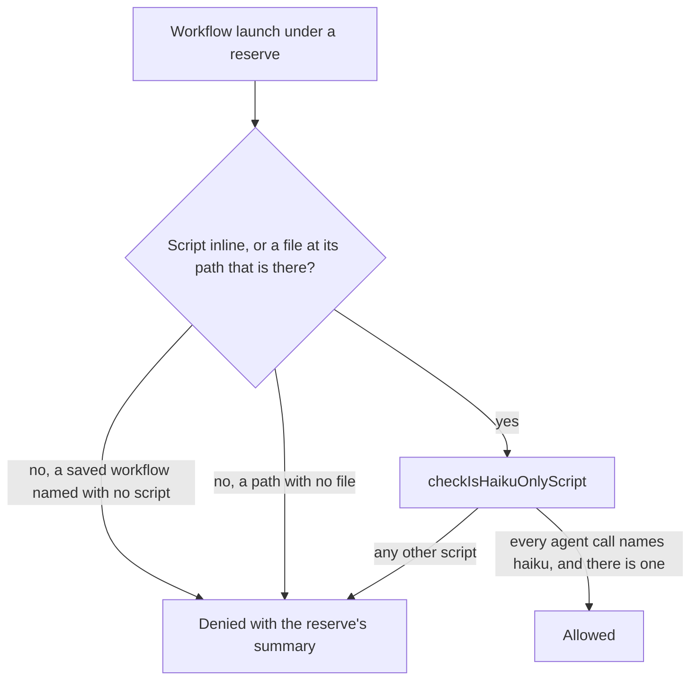

# Resin workflow gate for haiku-only scripts

A workflow launched under a usage reserve is allowed when its script provably runs every agent on the haiku model, and refused otherwise. Such a workflow costs what the same number of haiku `Agent` calls cost, which the reserve already allows.

## How it works

The gate's order is unchanged. The resin mod must be on, a reserve must hold and its window must not have reset, and only then is the launch judged. Under a reserve the gate reads the launch's script, inline or from the file at its path, and passes it to a pure check. The check allows the launch only when it can see every `agent(` call and each one passes the haiku model in its options. Anything else is refused with the reserve's summary and the existing instruction.

## What the check reads

The check first masks the script's code. Strings, template text and comments are blanked to spaces at their own positions, while the code inside a template's `${}` stays visible, so an `agent(` written in an interpolation still counts. A construct the mask cannot classify makes the whole script a refusal: a slash, which may open a regular expression or be a division, a backslash outside a string, an HTML-style comment, and any literal or comment left open.

On the masked code the check refuses a script that names `workflow`, `eval`, `Function`, `constructor`, `import`, `require`, `process`, `globalThis`, `Reflect`, `self`, `window` or `this`, since each reaches code or a name the script does not show, and the mask hides a name spelled inside a string. Every `agent` name must be a call, so an alias or a property named `agent` is refused. Each call's second argument must be an object literal whose one `model` key sits at the object's own top level and holds the literal `'haiku'` or `"haiku"`, with the closing quote followed by a comma or the end of the object. A spread, a computed key, a getter, a shorthand, a second `model`, a nested `model`, a template-literal value, a concatenated value, a quoted or escaped key that reads as `model`, or any quoted string with an escape in it at the object's top level each refuse the call.

## Decisions

### Allow a workflow whose every agent is pinned to haiku

The reserve already allows haiku agent launches, and a workflow of haiku agents spends no more of the window than those launches do. The gate therefore judges the script's agents, not the workflow.

**Rejected: refuse every workflow under a reserve.** This was the old direction. It refused workflows whose agents cost no more than haiku `Agent` calls, which the reserve allows, and it pushed the session onto many separate agent launches, each a round trip a single workflow runs in one script. It is named here so it cannot return.

**Rejected: allow every workflow under a reserve.** An opus agent inside a workflow spends the window the reserve is there to protect, and nothing would stop it.

**Rejected: a text match for the haiku literal anywhere in the script.** A prompt quoting `model: 'haiku'` beside an opus call would pass. The check reads each call's own options instead.

**Rejected: a JavaScript parser.** It would be a dependency in the plugin's bundle, and the hooks module has no Node to run one from. A scan that refuses whatever it cannot classify bounds the risk without one.

**Rejected: allow a saved workflow named with no script.** The launch carries none of its agents, and the gate has no way to read them, so the denial is the rule.

### A missing file is refused; a read that throws is not

A script path with no file behind it is refused, since the gate can see that the file is absent. A read that throws after the path is found is a failure of the gate, and under the failure rule the launch goes through. The package has no result helper, and the repo bans `try`/`catch` and promise `catch`, so there is no way to turn that read into a denial here. The gap is stated in the Notes.

## Key files

| File                                                                      | Role                                                                                              |
| :------------------------------------------------------------------------ | :------------------------------------------------------------------------------------------------ |
| `packages/genshin-mods/src/services/resin/registerReserveGate.ts`         | The `tool.call` hook on `Workflow`: reads the script under a reserve and allows a haiku-only one  |
| `packages/genshin-mods/src/services/resin/checkIsHaikuOnlyScript.ts`      | The pure check: whether every `agent(` call in the script passes the haiku model                  |
| `packages/genshin-mods/src/services/resin/checkIsHaikuOptions.ts`         | Whether one call's options object names the haiku model as its one top-level `model` key          |
| `packages/genshin-mods/src/services/resin/maskScriptCode.ts`              | The script's code with strings, template text and comments blanked, or nothing when it is unclear |
| `packages/genshin-mods/src/services/resin/findClosingBracket.ts`          | The bracket closing the one at a position, counting every kind alike                              |
| `packages/genshin-mods/src/services/resin/findTopLevelComma.ts`           | The first comma that sits inside no bracket, which separates an agent call's arguments            |
| `packages/genshin-mods/src/services/resin/findNonSpace.ts`                | The first non-space character in a span                                                           |
| `packages/genshin-mods/src/services/resin/readWorkflowScript.ts`          | The launch's script: the inline one, or the file at its path when it is there                     |
| `packages/genshin-mods/src/models/WorkflowLaunch.ts`                      | The part of a workflow launch the gate reads: `script`, `scriptPath` and `name`                   |
| `packages/genshin-mods/src/services/resin/registerReserveGate.test.ts`    | The gate's allow and deny cases under a reserve, through the hook's own handler                   |
| `packages/genshin-mods/src/services/resin/checkIsHaikuOnlyScript.test.ts` | The check's cases: haiku in either quote, the refusals, and the constructs the mask cannot read   |

## Notes

- The check is deliberately conservative. A script with a regular expression or a division is refused, which is the status quo, so the cost is a missed allow, not a missed refusal.
- The check guards against an agent that a script reaches by accident, not against a script written to hide one. The session writes the script, and the reserve is cost discipline, not a sandbox.
- A read that throws after a file is found passes through as a gate failure, as noted in the decisions above.
- The resin design's "What is refused at launch" paragraph and the delegation design's sentence that a workflow's agents are not read by the gate still describe the old direction. They are rewritten as built when the change is archived, with the old direction named as rejected.
