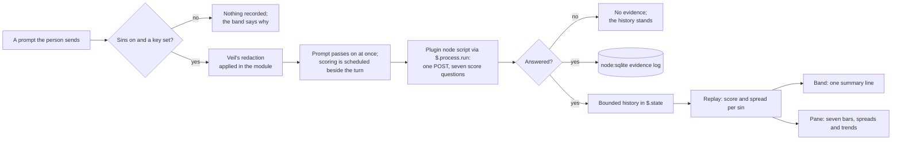

# Seven sins

A sixth Claude Code mod that scores each prompt of a session against seven sins, one score per sin from a single TypeSafe Jev call, and shows the seven discounted scores as a pane of bar charts with their spread, plus a one-line summary in the band.

## How it works

On each prompt the person sends, the lifecycle's prompt hook checks that sins is on and that a TypeSafe key is set. If both hold, it redacts the prompt with veil's redaction and schedules the scoring beside the turn, so the prompt is never held for the answer. The scoring passes the redacted text and the seven questions to the plugin's node script through `$.process.run`. The script makes one HTTP call to TypeSafe, appends the answer to a node:sqlite evidence log, and returns the seven answers. The hook turns each answer into one evidence value per sin, appends it to a bounded history held in `$.state`, and the band and the pane draw from the scores computed from that history.

The module itself has no Node and no SDK. Only the script touches the network and the database. A failed or slow call leaves the history as it was.



## The seven sins

Each sin is a label this design picks, and its question text lives in `sins/getSinQuestions.ts`, the one place these definitions are written.

| Sin      | What Jev is asked                                                                                                               |
| :------- | :------------------------------------------------------------------------------------------------------------------------------ |
| Pride    | How far does the prompt assert certainty and wave off checks: "obviously", "definitely", "no need to test", "trust me"?         |
| Greed    | How far does the prompt ask for more than one sentence holds: "and also", "while you're at it", "everything", several requests? |
| Wrath    | How heated is the register: runs of punctuation, capitals, "again", "still broken", "why won't"?                                |
| Envy     | How far does the prompt measure against another: "the other tool", "like theirs", "why doesn't ours do what X does"?            |
| Lust     | How far does the prompt crave the new over the finished: "rewrite", "from scratch", "redesign", "a new approach"?               |
| Gluttony | How heavy is the prompt: a large pasted share, a whole file or log pasted in?                                                   |
| Sloth    | How far is effort handed off without a steer: "idk", "whatever", "you decide", "figure it out", a one-word prompt?              |

Each question takes the same five criteria, from none to extreme, so the answers are comparable across sins.

## The scoring

### The evidence

The `score` primitive returns a probability-weighted expected level on the five levels 0 to 4. The evidence for a sin on a prompt is that expected level divided by 4, so it lies in $[0, 1]$:

$$p_{k,t} = \frac{\text{score}_{k,t}}{4}$$

The answer's confidence is kept in the evidence log and is not used to weight the update in this version. The update treats the evidence as the probability it is on Jev's own scale. Nothing checks that probability against the owner's labels, so the panel calls the number a score and never a calibrated probability.

### The posterior

Each sin $k$ has a posterior pair $(\alpha_k, \beta_k)$ that starts from a flat prior $\alpha_0 = \beta_0 = 1$. Each prompt discounts the old counts by $\gamma$ and adds the new evidence:

$$\alpha_{k,t} = \gamma\,\alpha_{k,t-1} + p_{k,t}, \qquad \beta_{k,t} = \gamma\,\beta_{k,t-1} + (1 - p_{k,t}), \qquad \gamma = 2^{-1/H}$$

with $H = 30$ prompts, the half-life. The panel draws each sin's score and its spread:

$$S_k = \frac{\alpha_k}{\alpha_k + \beta_k}, \qquad \sigma_k = \sqrt{\frac{\alpha_k\,\beta_k}{(\alpha_k + \beta_k)^2\,(\alpha_k + \beta_k + 1)}}$$

The pair is never stored. It is replayed from the bounded history of each sin, which holds the last 300 evidence values. The discount after 300 prompts is $\gamma^{300} = 2^{-10}$, about a tenth of a percent, so the cap changes the score by less than a rounding step in the panel.

Three facts follow from the update.

- **Effective evidence.** The total count approaches $1/(1-\gamma)$, and the effective sample size approaches $\frac{1+\gamma}{1-\gamma} \approx \frac{2H}{\ln 2}$, about 87 at $H = 30$.
- **Steady spread.** A steady stream at level $p$ settles to a total count of $1/(1-\gamma) \approx 44$, so the posterior's spread is $\sqrt{p(1-p)/45}$, about seven and a half points at $p = 0.5$. The effective sample size of about 87 measures something else, the sampling spread of the discounted mean, and the posterior does not use it.
- **Adaptation.** After a change from level $p_0$ to $p_1$, the score is $S_t \approx \gamma^t p_0 + (1-\gamma^t)\,p_1$, so it sits halfway between them after $H$ prompts. The prior's share decays by the same factor, so the result is exact in the limit and close at 30.

The trend in the pane is the score after each of the last thirty prompts, from the same replay, so it is the score's own curve and not a second estimate.

## The panel

The pane is where the sins are read. The band keeps one summary line, and the pane gives each sin its own bar.

```text
Seven sins                                          prompts scored 214
Pride    ████████████████▒▒▒▒▒     62%  ±9   ▂▃▅▆▇▇█
Greed    ███████▒▒▒                28%  ±7   █▇▆▅▄▃▂
Wrath    ██▒▒                       9%  ±5   ▁▁▁▂▁▁▁
Envy     █████████▒▒▒▒▒▒▒          41%  ±8   ▃▃▄▄▅▄▅
Lust     ████████████▒▒▒           52%  ±8   ▆▅▅▆▇▆▅
Gluttony ██████▒▒▒▒▒▒              22%  ±6   ▂▃▂▂▂▃▂
Sloth    ███████████▒▒▒▒           46%  ±9   ▇▆▆▅▅▅▄
```

The numbers above are illustrative. Each row is one sin, in the same order every time:

- **The bar** is the score. The solid run runs to $S_k$, and the lighter run runs from $S_k$ to $S_k + \sigma_k$, so the spread reads as the tail of the same bar and never as a separate series.
- **The label** is the sin's name, the score and the spread in figures. Every bar is named and valued, so identity never rests on colour.
- **The trend** is the last thirty prompts as eight glyph heights, from `▁` to `█`.

The panel is opened by the band's `p` button and closed by the person through the engine's own mark. The engine places it: docked beside the transcript where the surface is wide enough, otherwise inline above the prompt. Once the switch is off the pane says so and draws no bars, so it never shows the scores of a mod that is off.

Before the first scored prompt, the panel draws no bars. It says so in one line, and names the missing key or the Node version when that is the reason. A bar for a sin with no evidence is never drawn at zero.

### Colour

Each sin takes one fixed categorical slot from the dataviz reference palette and keeps it in both modes and as its score moves. The slots are the first seven of that palette, in its order, which is the only order its validator has passed.

| Slot | Sin      | Light     | Dark      |
| :--- | :------- | :-------- | :-------- |
| 1    | Pride    | `#2a78d6` | `#3987e5` |
| 2    | Greed    | `#eb6834` | `#d95926` |
| 3    | Wrath    | `#1baf7a` | `#199e70` |
| 4    | Envy     | `#eda100` | `#c98500` |
| 5    | Lust     | `#e87ba4` | `#d55181` |
| 6    | Gluttony | `#008300` | `#008300` |
| 7    | Sloth    | `#6250d6` | `#9085e9` |

The dataviz validator passes this set in both modes on the adjacent pairs a stack of bars needs. In light mode it warns that aqua, yellow and magenta sit below 3:1 against the surface. The warning's rule is direct labels, and every bar carries its name and figures, so the rule is met. The sin text, the figures and the title take the text colours, never a series colour.

The colours do not match the sins' meanings. Red is the natural colour for wrath, but the reference palette's red is close to the status palette's critical hue, and under the palette's gates red beside green fails for deuteranopes. The order is the palette's own, and a semantic order would have to pass the validator again. That is a choice for the owner.

The mode is read from the session's theme: `$.config.list()` returns the `theme` row, and a theme name containing "light" selects the light steps, anything else the dark ones.

### Element construction

The pane is built with the engine's element table, `$.ui.resolve(e)`, as plain function calls taking `children` as a prop. The repo's mod rules forbid JSX in a mod, so the built-in example `.tsx` is not followed. A bar is a run of `Text` cells coloured with the sin's slot; the engine's `Text` takes a raw colour.

## Scope

Today the band has five mods and none scores a prompt. This change adds the sins mod: a switch, a prompt hook, a band line, a pane, and a plugin node script for the network call and the evidence log.

The cheapest infrastructure is what exists: the person's home folder, one node:sqlite file in it, and the TypeSafe key the person already has. No service and no server.

A failed or slow call records nothing for that prompt and is not retried. The next prompt supplies the next evidence, so a retry would only double the cost of one prompt.

## Data model

### The evidence log

One node:sqlite database, `${home}/.claude/genshin-mods/sins.sqlite`, written only by the plugin's node script. The home folder is read through the shared `readHome` helper, which the ward mod's records file also uses.

| Table      | Holds                                                                                                                           | Written                              |
| :--------- | :------------------------------------------------------------------------------------------------------------------------------ | :----------------------------------- |
| `evidence` | One row per scored prompt: the session, its seven answers as JSON, each with its score and confidence, and when it was recorded | On each answered prompt; append-only |

Two sessions on one machine can write the log at once. The script sets a five-second busy timeout on every open, because without it a second writer fails at once with "database is locked" and loses its prompt's evidence. The timeout must be on every writer: a writer without it also fails its own commit while another connection reads.

The table's shape changed after its first version reached `main` (`648353f4a7` wrote one row per sin, with `sin`, `score` and `confidence` columns, all `NOT NULL`). `CREATE TABLE IF NOT EXISTS` leaves that table as it is, so on a machine that ran the first version this shape's `INSERT` fails and every scored prompt there reads `failed`. The script neither migrates nor drops the old table. Converting its rows into this shape (one row per session and `recorded_at`) or discarding them as pre-release evidence is the owner's call, and it is open until the change ships.

The log is what a later change would replay under a different half-life. The scores the person sees do not read from it.

### The drawn history

`$.state` holds `sinHistory`: for each sin, its last 300 evidence values in order. `sinSession` marks the conversation the history belongs to, and `sinStatus` says what the last prompt's scoring found. A session's history starts empty and is reset on `clear` or `resume`, as the commission and the cache are. The scores, spreads and trends are computed from it by the replay above, so the state holds the evidence and nothing derived from it.

## The call

The script makes one `POST` to `https://api.typesafe.ai/v1/systemone` with the `Authorization: Bearer` header from `TYPESAFE_API_KEY`. The body names the model `jev-latest`, the redacted prompt as `state`, and seven `score` questions keyed by sin name, each with its instructions and five criteria. One call answers all seven, which is the batching rule of the typed-decisions tier: every independent question about one state goes in one call.

The script returns one of four results: the seven answers; `no-key`, when no key is set; `node-too-old`, when the Node cannot open the log; or `failed`, with a reason. The module treats only the answers as evidence, and records the other three as the status the band and the pane explain.

## Key files

| File                                                            | Role                                                                                                                                       |
| :-------------------------------------------------------------- | :----------------------------------------------------------------------------------------------------------------------------------------- |
| `packages/genshin-mods/src/register.ts`                         | The module the engine loads; registers the sins pane beside the others                                                                     |
| `packages/genshin-mods/src/services/registerLifecycle.ts`       | The prompt hook that schedules the scoring beside the turn, the reset on `clear` and `resume`, and the refusal of `/sins on` without a key |
| `packages/genshin-mods/src/services/band/registerBand.ts`       | The band's summary line, its `p` button, and the lines for a missing key or an older Node                                                  |
| `packages/genshin-mods/src/services/InitialState.ts`            | The switch's default, off, and the empty state                                                                                             |
| `packages/genshin-mods/src/services/ModDescriptionMap.ts`       | The `sins` command and its menu line                                                                                                       |
| `packages/genshin-mods/types/index.d.ts`                        | The state contract: the switch, the history, the session and the status                                                                    |
| `packages/genshin-mods/src/services/ward/resolveRecordsPath.ts` | Reads the home folder through the shared `readHome`, as the sins scoring does                                                              |
| `packages/genshin-mods/README.md`                               | The command table, and the Decisions bullet this change rewrites on ship                                                                   |

The new files:

```text
packages/genshin-mods/src/services/readHome.ts         ← the home folder from the engine's environment, shared by ward and sins
packages/genshin-mods/src/services/sins/   ← each module with its co-located .test.ts where it has one
  constants.ts            ← the seven sins and their criteria, the half-life, the prior, the history cap, the bar width, the pane's id and the API URL
  SinColorMap.ts          ← each sin's slot of the palette, light and dark
  SinStatusTextMap.ts     ← the words the band and the pane give a status
  sinsScript.ts           ← the node script's code, run inline with `node -e`: one POST and the evidence log
  getPosteriorTrail.ts    ← the replayed posterior after each prompt, and the posterior now
  getScoreAndSpread.ts    ← the score and spread from one posterior
  getTrend.ts             ← the score after each of the last thirty prompts, and its glyphs
  appendSinEvidence.ts    ← the history with one prompt's evidence appended: the score as a share of the top level, in [0, 1], capped at the history's length
  getSinScores.ts         ← the drawn copy: each measured sin, and which are left out
  getBarCells.ts          ← a bar's solid and tinted cells from the score, the spread and the width
  getSinQuestions.ts      ← the seven `score` questions one call answers, and the question each sin asks
  parseSinsResult.ts      ← the script's one JSON result
  readIsLightTheme.ts     ← the palette mode from the engine's theme row
  readSinStatus.ts        ← the status as drawn, with a key removed since the last prompt read off the environment
  registerSins.ts         ← the pane's render, and the switch that hides it
packages/genshin-mods/src/models/   ← SinPosterior, SinFigures, SinScore and SinsResult
```

## Notes

- **The decision this overturns.** The genshin-mods README says that nothing goes beyond the session's own account and that no mod adds a service or a key. This change makes the sins mod the one exception: it calls TypeSafe with the person's key, once per prompt. The owner chose this on 2026-10-27 over the earlier draft, which kept the scorer local and rejected a per-prompt call. On ship, the README bullet is rewritten to name the sins mod as the exception, and the old direction is named there as rejected.
- **No SDK.** The repo's pipeline reads Jev through `scripts/src/services/jev/readAnswers.ts` and the `@typesafe-ai/sdk` client. The plugin cannot import from the repo's scripts, and adding the SDK would add a dependency and a lockfile the plugin install reads only from npm. The plugin makes the one documented call itself, with `fetch`.
- **The module has no Node.** The repo's mod rules keep Node out of a hooks module, so the network call and the database run in the node script, which the hook reaches through `$.process.run` with the request on stdin. The script is a string in `sinsScript.ts` because a plugin reaches none of its own files from inside the module.
- **Cost is unverified.** Secondary write-ups from September 2026 put Jev at $0.042 per million input tokens, with output free. One vendor demo puts a call at about $0.00008, roughly 1,900 input tokens. By those figures that is about $0.08 per thousand prompts. No official pricing page was found, and access is an early-access waitlist, so the key may not exist for everyone. The real tokens per call and the bill are read off the account in use; no task gates shipping on either.
- **The prompt leaves the machine.** Every scored prompt is sent to TypeSafe after veil's redaction. Redaction is always on rather than a setting, because prompts routinely carry secrets. This is the owner's call to confirm.
- **Scores are Jev's own, not calibrated.** Jev's `score` is already a probability-weighted level, and the evidence is that probability on Jev's scale, so no calibration step is built or gates shipping. The panel labels the number a score, and says nothing about matching the person's own judgement. If the owner later wants the numbers read as calibrated probabilities, a calibration check against their labels comes first, as a separate change.
- **Estimator choices considered and rejected.**
  - A Dirichlet over the seven sins forces one unit of mass across them, so a prompt cannot be both greedy and wrathful. Independent Betas fit a prompt that carries several sins.
  - A Kalman filter on the raw level has no bounds, so a score can leave the range from 0 to 1. The Beta is exact for a bounded mean.
  - A plain EWMA is the Beta's mean without the spread. The Beta costs the same to update and gives the spread for free.
  - Robbins–Monro steps of $1/n$ converge to one fixed value, which is the thing the forgetting is there to avoid. It is the $\gamma = 1$ limit of this design.
  - A confidence weight from the API's confidence is not used. The confidence is stored, so a weight can be replayed later.
  - Seven calls, one per sin, cost seven times as much for the same prompt, and the batching rule answers the question in one call.
  - A fork of the session's own model per prompt spends the same window the resin mod's usage reserve protects.
- **Sorting the bars by score is rejected.** Colour follows the sin, and sorting would make the adjacent pairs change with every prompt, which the palette's gates do not cover. The order is fixed.
- **Retention.** The evidence log is kept. A retention rule waits until the log is large enough to matter, and is deferred rather than built.
- **The node:sqlite module is a release candidate** (stability 1.2 in its docs). Its API can move, so it is checked on each Node bump.
- **Labels are ours.** The seven definitions are this design's operational labels, and the owner can rename them.

## Sources

- [Taming Non-stationary Bandits: A Bayesian Approach](https://arxiv.org/abs/1707.09727), Raj and Kalyani, 2017. The abstract names discounting the prior's parameters to reduce the effect of past observations. Taken: the idea of discounting a Beta's counts. The rule here is this design's own; the full paper was not read for its exact form.
- [node:sqlite](https://nodejs.org/api/sqlite.html), Node.js documentation. A built-in module with a synchronous API, release-candidate stability, and no flag from Node 22.13 and 23.4. Taken: the evidence log and the version floor.
- [TypeSafe System One HTTP API](https://docs.typesafe.ai/api.md). The endpoint, the Bearer header, the `score` question's shape and the response's `score`, `confidence` and `probabilities`. Taken: the one call the script makes.
- [TypeSafe Score primitive](https://docs.typesafe.ai/primitives/score.md). The score is the probability-weighted level, from 0 to the top level. Taken: the evidence is the score divided by the top level.
- [TypeSafe Jev pricing write-up](https://www.eesel.ai/blog/typesafe-jev-pricing), September 2026. A secondary source for $0.042 per million input tokens with output free. Unverified; read off the bill in use.
- The dataviz skill's reference palette (`references/palette.md`) and its `validate_palette.js`. Taken: the first seven categorical slots in their order, validated in both modes on adjacent pairs, and the rule that a light-mode contrast warning is met by direct labels.
- The Claude Code plugin API declarations, as the plugin-authoring skill lays them: the pane's placement, the element table reached through `$.ui.resolve`, `$.process.run` with stdin, and `$.config.list()`. Taken: the pane, the band and the script run as the engine offers them.
- Repo: `.agents/skills/llm-delegation/references/jev.md`, for the `score` primitive and the one-call-per-state rule; the ward mod's records file, for the home-folder store convention.
