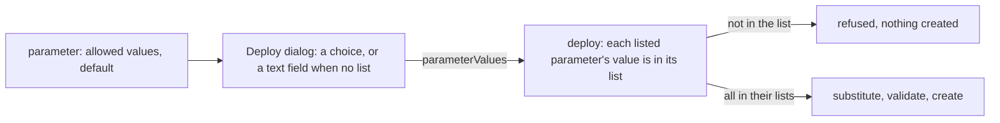

## Context

A parameter is a key, a title, a description and a default, all strings, and the Deploy dialog draws a text field for each. Deploy substitutes the values it is handed into names and content strings and validates every entry afterwards, so a value never meets a rule of its own before substitution.

## How it works

The check runs on the server before substitution, with the same list the dialog drew, so a request that skips the dialog meets it too. A parameter with no list is not checked.

## Gap analysis

| Feature                          | Verdict                                                                                            |
| -------------------------------- | -------------------------------------------------------------------------------------------------- |
| Allowed values                   | Built as the optional list.                                                                        |
| Length and numeric bounds, types | Deferred: [typed parameters](../../deferred/resource/blueprint-typed-parameters/design.md).        |
| Secure parameters                | Not built: a parameter's value is a name or a content string, and nothing in a manifest is secret. |

## Decisions

- **A list of strings, not a new parameter type.** Every parameter stays a string, so substitution is unchanged and a choice is one more check.
- **Checked on the server.** The dialog's choice is a convenience; the deploy procedure is the front door every caller uses.
- **The default must be a listed value.** A prefilled value the deploy would then refuse is a form that starts broken.

## Key files

| File                                                                         | Role                                            |
| ---------------------------------------------------------------------------- | ----------------------------------------------- |
| `apps/web/shared/models/resource/blueprint/BlueprintParameter.ts`            | the optional list and the default-in-list rule  |
| `apps/web/app/components/Resource/Blueprint/DeployDialog.vue`                | draws a choice for a parameter that has a list  |
| `apps/web/shared/services/resource/blueprint/buildBlueprintDeployReviews.ts` | the review a deploy shows, from the same values |
