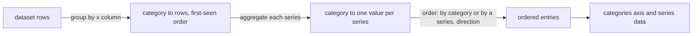

## Context

`computeDatasetVisualPropsData` groups the rows by the x column into a map keyed in first-seen order, then computes one value per category for each series. The categories and every series' data are read off that one map, so an order is one sort of the map's entries before both are read.

## How it works

The sort runs over the aggregated values, never the rows, so a series order ranks categories by the number the chart draws. It is stable, so categories that tie keep their first-seen order. A category order compares numbers as numbers and other text as text.

## Gap analysis

| Feature                          | Verdict                                                                                   |
| -------------------------------- | ----------------------------------------------------------------------------------------- |
| Sort an axis by a field          | Built as the order, by the category or by one of the visual's own series.                 |
| Sort by a field the visual lacks | Not built: a series order names one of the query's series, so the choice is always drawn. |
| Reader re-sorts a chart          | Not built: the reader's sort is the Table's header, and a chart's order is the owner's.   |

## Decisions

- **The order lives in the query.** The query already says which columns and aggregations a visual draws, and the order says how its categories are ranked, so one value serves the canvas, the published page and the export.
- **Sort the aggregated values.** Sorting rows would rank a category by an arbitrary row.
- **Absent means first-seen.** An omitted order is the order every stored visual already has.

## Key files

| File                                                                       | Role                                    |
| -------------------------------------------------------------------------- | --------------------------------------- |
| `apps/web/shared/models/dataset/DatasetQuery.ts`                           | the optional order and its schema       |
| `apps/web/app/services/dashboard/dataset/computeDatasetVisualPropsData.ts` | orders the categories before the series |
| `apps/web/app/components/Dashboard/Editor/VisualFormFields.vue`            | the Order control in the binding form   |

## Sources

- [Microsoft — Key Performance Indicator (KPI) visuals](https://learn.microsoft.com/en-us/power-bi/visuals/power-bi-visualization-kpi) — its steps sort a visual's axis by a field and choose ascending.
