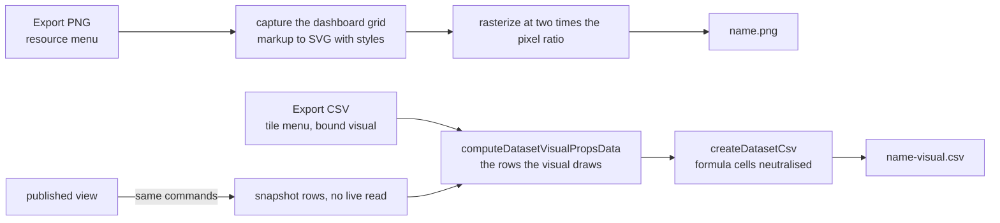

# Dashboard export

A Dashboard exports its page as a PNG from the resource menu, and each bound visual exports the rows it draws as CSV from its tile menu, both computed in the browser from what the page already holds.

## Scope

Today the Dashboard is a resource with no Portable capability and no export. A bound visual already resolves its rows at render time through `computeDatasetVisualPropsData`, and a published dashboard already holds the projected rows in its snapshot. The change adds the page capture, the per-visual CSV and the two commands in the editor and the published view. It adds no server procedure and no stored data.

## Decisions

- **The page is captured in the browser, not on the server.** A server render needs a headless browser, which is a service or a dependency the owner has ruled out. The flowchart's capture already turns live markup into an SVG with its styles and rasterizes it, and the dashboard reuses that path, so the capture is extracted into a shared service rather than copied.
- **PNG only.** The alternative, a PDF, needs a renderer. The browser's print path would need a print stylesheet for the grid, which is its own piece of work, so it waits for a request.
- **A visual's CSV holds what the visual draws.** The alternative was the bound dataset's raw rows. Those rows carry every column of the source, and the publish snapshot deliberately keeps only the columns a query reads, so a public file of raw rows would leak what the snapshot removes. The drawn rows are the query's result: one row per category with a column per series, one value for a Card, and the grouped rows of a Table.
- **The CSV goes through the dataset export's helper.** `createDatasetCsv` already neutralises every cell that starts with a formula character. A category value is respondent text, so the neutralisation is not optional, and a second CSV writer would be the copy the repo removes. The visual's rows are passed to it as a dataset of those rows.
- **Static visuals have no CSV.** Their values are typed into the chart by the owner, and the editor already shows them. Exporting them adds a second copy of data with no source.
- **The published view exports the snapshot.** The public view never issues a live dataset read, and an export there reads the same baked rows the viewer sees.

## How it works



- **Page image.** The command captures the grid element at its rendered size, after its charts have drawn. A capture that fails shows an alert and writes no file.
- **Visual rows.** The rows are the function's output for the visual's current query. A bound visual whose source is gone has no rows and shows no Export CSV, since its tile already shows the error.
- **Capped reads.** A query over a capped dataset carries the truncation the dataset export reports, so the CSV's alert says the rows are the ones read, not all the source's rows.

## Key files

| File                                                                       | Role                                                                          |
| -------------------------------------------------------------------------- | ----------------------------------------------------------------------------- |
| `apps/web/shared/services/resource/ResourceDefinitionMap.ts`               | the Dashboard opts into the Portable capability, export only                  |
| `apps/web/app/services/resource/PortableFormatMap.ts`                      | the Dashboard's Export PNG entry                                              |
| `apps/web/app/services/resource/flowchart/captureFlowchart.ts`             | the capture and rasterizer the page image reuses, moved to the shared service |
| `apps/web/app/services/resource/flowchart/createFlowchartSvg.ts`           | copies computed styles and embeds font faces, moved with the capture          |
| `apps/web/app/services/resource/flowchart/rasterizeFlowchartSvg.ts`        | rasterizes the SVG at two times the pixel ratio, moved with the capture       |
| `apps/web/app/services/dashboard/dataset/computeDatasetVisualPropsData.ts` | the rows a visual draws, the source of the CSV                                |
| `apps/web/app/composables/dashboard/useVisualPropsData.ts`                 | the render-time rows, whose result the CSV reuses                             |
| `apps/web/app/services/dataset/createDatasetCsv.ts`                        | the header and cell rows, through the neutralising escape                     |
| `apps/web/app/services/dataset/exportDatasetCsv.ts`                        | the download helper the visual CSV reuses                                     |
| `apps/web/app/components/Dashboard/Visual/Preview/Container.vue`           | the tile's corner menu, where Export CSV sits beside Duplicate                |
| `apps/web/app/components/Dashboard/Grid.vue`                               | the grid element the page capture reads                                       |
| `apps/web/app/components/Dashboard/Index.vue`                              | the published grid, whose tiles offer the same CSV from the snapshot          |
| `apps/web/app/components/Resource/Dashboard/View.vue`                      | the published renderer that hosts the page export                             |
| `apps/web/server/services/dashboard/projectDatasetToQuery.ts`              | the publish projection that decides which columns the snapshot holds          |

A new file, in the tree form the design template asks for:

```text
apps/web/app/services/dashboard/export/exportDashboardVisualCsv.ts   the drawn rows of one visual, as a CSV file
```

## Notes

- The page image is a picture, so it is not an import format. The Portable capability's import path stays off for the Dashboard.
- The page image reflects the column count the page is drawn at when the command runs. A published view captures at the breakpoint column count the viewer's width picks, the same one it draws at.
