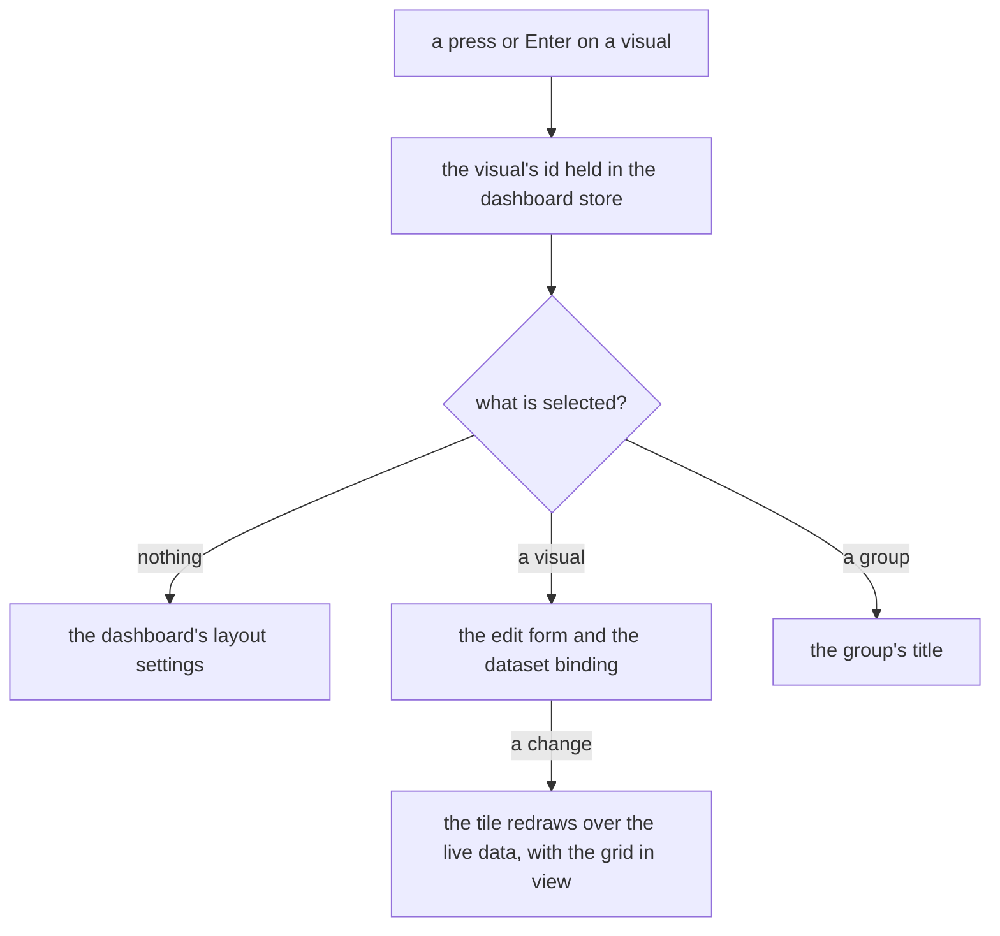

# Dashboard layout

The dashboard editor on the [editor shell](../resource-editor-shell/design.md): a bar, a palette the reader opens, an inspector for the selection and the grid as the canvas. It is a part of the [editor layout program](../resource-editor-layout-program/design.md), and it keeps what the [dashboard grid](../../specs/resource/dashboard-grid/design.md) settled about the grid, the tiles and the published page.

Today the editor is a bar, a collapsible strip of palette tiles above the grid, and the grid. A visual is edited in a dialog, and the Layout popover on the bar holds the settings of the whole canvas.

## How it works

| Region    | Edge        | Opens        | Holds                                                                      |
| :-------- | :---------- | :----------- | :------------------------------------------------------------------------- |
| Bar       | top, docked | always       | the visual count and the one accent action, Add visual                     |
| Visuals   | start       | on demand    | the palette: Charts and Layout groups, with search                         |
| Inspector | end         | with content | the selection's form, below                                                |
| Canvas    | the rest    | always       | the grid of tiles, each drawn by the same renderer the published page uses |

The selection has three kinds. With nothing selected the inspector shows the dashboard's settings, how visuals pack and what a drop does, which the Layout popover held. With a visual selected it shows the visual's edit form and its dataset binding. With a group selected it shows the group's title. A press or Enter on a visual selects it, which is how it is opened now, and a press on the empty canvas clears the selection. The visual's menu keeps the occasional actions: duplicate, export, fit height, move to and delete, with the delete confirmation and the move dialog as they are.

A compact window opens the Visuals region and the inspector as sheets from two buttons, and the inspector's button is shown while something is selected. The published page is unchanged: it draws the visuals and its own controls, and no editor region.

## Decisions

- **The edit form is in the inspector, not a dialog.** The editor's tiles are the published renderer over live data, so an owner who changes a visual's type or binding wants to see the tile change. A dialog's scrim hides it. A dialog is for what must interrupt, and an edit that the canvas answers is not an interruption. Rejected: the dialog, which this replaces, and a popover over the tile, which covers the tile it is editing.
- **The dashboard's settings are where nothing is selected.** A setting of the whole canvas belongs to the canvas, and nothing selected is the reader looking at the whole of it. Rejected: the popover on the bar, which kept one rarely used setting in the bar's row and gave the editor a second way to open a form.
- **The palette is a region the reader opens.** Types are chosen where they land, and a docked palette keeps the canvas wide when closed and gives the groups room when open. Rejected: the strip above the grid, which spends the grid's height on a row of chips and has no search.
- **The grid package stays.** The canvas region holds the grid, and the [retirement](../../deferred/resource/retire-grid-layout-package/design.md) of the package waits on a product decision about free placement.
- **Selection is store state, an id.** The pinia skill's rule for selection, so a move or a delete that changes a visual's place keeps it selected or clears it. Rejected: selection held in the tile component, which a second tile or the inspector cannot read.

## Not in this change

- **New visual types, bindings or data sources.** The visuals and their forms are as they are.
- **The grid's behaviour.** Packing, collision and the pointer gestures are the grid package's.

## Key files

| File                                                                  | Role                                                             |
| :-------------------------------------------------------------------- | :--------------------------------------------------------------- |
| `apps/web/app/components/Resource/Dashboard/Editor.vue`               | the editor's arrangement, replaced by the layout                 |
| `apps/web/app/components/Dashboard/Editor/Header.vue`                 | the bar, which keeps the count and Add visual                    |
| `apps/web/app/components/Dashboard/Editor/Layout.vue`                 | the layout popover, whose content moves into the inspector       |
| `apps/web/app/components/Dashboard/Editor/Content.vue`                | the grid and the delete and move dialogs, which keep the dialogs |
| `apps/web/app/components/Dashboard/Palette/Index.vue`                 | the palette strip, which becomes the Visuals region              |
| `apps/web/app/components/Dashboard/Visual/Preview/EditFormDialog.vue` | the edit form's dialog, whose form moves into the inspector      |
| `apps/web/app/components/Dashboard/Visual/Preview/ActionsMenu.vue`    | the visual's menu, which keeps the occasional actions            |
| `apps/web/app/store/dashboard/visual.ts`                              | the visuals and the edited item, which gains the selection       |
| `apps/web/app/store/dashboard/dialog.ts`                              | the delete and move targets, kept                                |

## Sources

- [Power BI's report view](https://learn.microsoft.com/en-us/power-bi/create-reports/desktop-report-view), already cited by the [live canvas design](../../specs/resource/dashboard-live-canvas/design.md): the visualisation pane beside a canvas that redraws as a visual is changed.
- [Nielsen Norman Group, modal and nonmodal dialogs](https://www.nngroup.com/articles/modal-nonmodal-dialog/), already in the [design sources](../../specs/architecture/design-sources/design.md): a modal only for what must interrupt.
