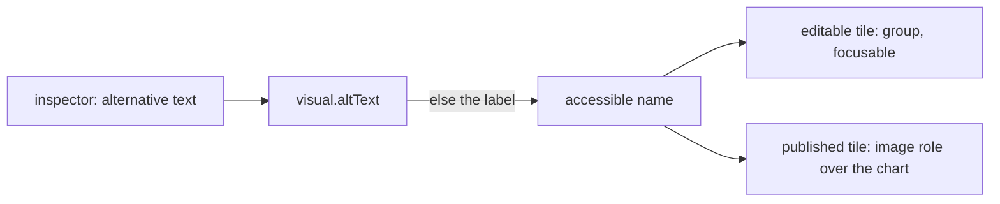

## Context

The tile names itself with its label only while it is editable, as a focusable group the owner moves by keyboard. In the published view it carries no role or name, so a chart reads to a screen reader as whatever its drawing exposes.

## How it works

The published tile takes the name on its container, with an image role for a chart so the description stands for the drawing, and none for a Table, whose cells are read as they are. A Group holds other visuals and keeps its own label.

## Gap analysis

| Feature                     | Verdict                                                                             |
| --------------------------- | ----------------------------------------------------------------------------------- |
| Alternative text per visual | Built as the optional field.                                                        |
| Tab order of visuals        | Not built: the grid's reading order is its row order, which keyboard order follows. |

## Decisions

- **The label is the default.** A visual with no alternative text still has a name, so the field refines a description and never gates one.
- **An image role over a chart only.** A table's own structure is the accessible form of its data, and covering it would hide it.

## Key files

| File                                                            | Role                                        |
| --------------------------------------------------------------- | ------------------------------------------- |
| `apps/web/shared/models/dashboard/data/Visual.ts`               | the optional alternative text and its limit |
| `apps/web/app/components/Dashboard/Grid/Tile.vue`               | names the published tile                    |
| `apps/web/app/components/Dashboard/Editor/VisualFormFields.vue` | the alternative text field                  |

## Sources

- [Microsoft — Design Power BI Reports for Accessibility](https://learn.microsoft.com/en-us/power-bi/create-reports/desktop-accessibility-creating-reports) — alternative text per visual, entered in the visual's format settings, up to 250 characters.
