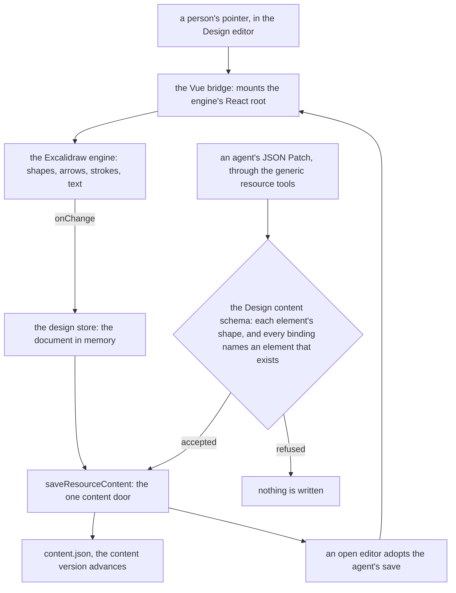

# Design Canvas

The recommendation is a new `Design` resource type whose editor is the Excalidraw engine, kept as a package and mounted by one thin Vue component. Excalidraw is MIT-licensed, draws in the hand-drawn style a freeform canvas needs, and already owns the shape, arrow, text, freehand and export behaviour that a canvas would otherwise have to build. The price is React. Its editor is a React component, so the Design editor's chunk loads React and React DOM, which the client does not carry today. The sections below set out what exists, what each option costs and why this one wins, and what the owner still has to decide.

## What exists today

No type in the `ResourceDefinitionMap` is a freeform canvas. The closest three each fit a different shape of work:

- **Flowchart.** A Vue Flow graph of nodes on fixed handles, joined by edges that connect two nodes, with a label and an arrowhead on each edge ([flowchart connectors](../../specs/resource/flowchart-connectors/design.md)). A freehand stroke or an arrow that points at nothing has no place in that model, and the pending [flowchart shapes](../resource-flowchart-shapes/design.md) change extends the same graph.
- **Webpage and Email.** Typed block trees over the headless block editor, rendered to HTML at publish ([document model](../../specs/resource/page-builder/document-model/design.md)). Their nodes sit in a slot tree, not at coordinates.
- **Dashboard.** A placement grid of visuals over datasets ([dashboard grid](../../specs/resource/dashboard-grid/design.md)). Its placement is grid cells, and the [vue-grid-layout-headless](../../specs/vue-grid-layout-headless/README.md) triage marks free-form placement out of scope.

The headless packages do not fill the gap. `headless-block-editor` is a typed tree edited by JSON Patch commands ([editor core](../../specs/headless-block-editor/editor-core/design.md)), and `vue-grid-layout-headless` is grid placement. Neither is a freeform canvas, and whether the editor core can carry a graph at all is the open question its own deferred page names.

The [deferred flowchart page](../../deferred/resource/flowchart-on-editor-core/design.md) already lists Excalidraw as one future, and rules it out in one sentence: embedding it "is not one of the options: it is a React application, and the app is Vue." **This design rejects that direction for the Design type.** The reasoning there is about the framework cost alone. This change scopes React to one lazily loaded chunk and weighs that cost openly, in the Recommendation below, rather than at the outset. The Flowchart's own future (a rebuild on the core, a removal, or staying on Vue Flow) is not decided here and stays deferred.

## Options

Each option is judged on the same four axes: its license, its client weight, its fit with the content door and storage, and the cost of absorbing it.

### A. Extend the Flowchart on Vue Flow

Vue Flow is MIT-licensed, and the Flowchart already loads it with four plugin components, so no engine is added. The fit is poor. The graph model holds nodes and node-to-node edges only, so a freeform arrow, a stroke and a free text box each need a node type that is not a step, and each needs its own renderer. The result is a flowchart that grows toward a whiteboard while its own future is still open, and it still has no hand-drawn look. **Rejected.**

### B. Extend the page builder

The page builder's document is a block tree rendered to HTML, and a canvas positions elements at coordinates and renders to a picture. Nothing in the page builder beyond the content door would be reused. **Rejected.**

### C. tldraw

The tldraw license, read from its `LICENSE.md` text, allows use without a fee for internal development, testing and staging that the public cannot reach. Production use needs a trial or a commercial license, which comes with a license key that the software enforces, and its watermark must stay visible. Esposter is a public product, so tldraw is not usable without a paid agreement. It is also React only, with React and React DOM as its peer dependencies, so it carries the same React cost as option D while adding the license problem. **Rejected on license.**

### D. Excalidraw engine behind a Vue bridge (recommended)

The engine is MIT-licensed (its npm metadata), with React and React DOM as peer dependencies. Its element model is published as a separate package, `@excalidraw/element`, whose only dependency is `@excalidraw/common` and which declares no React, so the shapes, bindings and geometry are framework-free. The React surface is the editor on top of them. Its own dependency list is about thirty packages, including a rough-drawing renderer, a freehand stroke library and a state library, plus React UI parts, a CSS preprocessor and a cross-platform environment helper listed as runtime dependencies. Its Mermaid converter is also a dependency, and whether that reaches the client bundle is for the measurement to say.

The client weight, per bundlephobia's reading taken on the day this was written, is about 1.1 MB minified and roughly 350 KiB gzipped, excluding its React peers. That is an external estimate. The repo's score tool measures the bytes that reach the app's own client build, and that measurement is the figure of record; task 1.1 reads it before any code lands.

Its fit with the content door is good. The document is a list of plain JSON element objects with ids, so one content blob holds it, and each field of each element is a path an agent can patch. Its cost is one bridge: a Vue component that creates a React root on mount and unmounts it on leave, feeds the engine's changes into the store, and an element schema, a file-asset mapping and an export wiring. The engine's own interaction and styling stay its own, which is the cost the admission standard names first.

### E. Konva with vue-konva

Konva and vue-konva are both MIT-licensed, and vue-konva is a Vue 3 component wrapper with Konva as its peer. This option has no second framework and draws to a canvas. But Konva supplies only hit-testing and transform handles. Arrow binding, text editing, the hand-drawn look (a rough-drawing library is a separate package) and export would all be ours. This is the largest build of the options, since it rebuilds behaviour the Excalidraw engine already has. It is the fallback if the owner refuses React. **Not chosen for v1.**

### F. Our own editor on the headless core, roughjs and perfect-freehand

roughjs and perfect-freehand are both MIT-licensed and small, and they are the rendering primitives Excalidraw uses. Building the editor on the headless block editor would reuse its patch and history model. But the core is a tree of slots, while a canvas is a flat set of positioned elements whose cross-references (an arrow to a shape) are ids, not children, and the core's own deferred page asks whether it can carry a graph at all. The admission standard also says an accessibility-shaped surface is where our own version "reliably ships worse", and a canvas's pointer and keyboard surface is that kind of surface. **Rejected for v1.**

**Why D.** It is the only option that is MIT-licensed, that has a mature element model, hand-drawn rendering and export already built, and whose cost is one bridge rather than a whiteboard. Its cost is React, which is the decision the owner has to take (see Open choices).

## Recommendation

The Design editor is a Vue component that mounts the engine, the engine's changes reach the content door through the store, and a write from an agent takes the same door behind a schema check. The engine is client-only, and its React root is created and disposed by the bridge.

### The document

The content is one object with four parts:

- **`elements`**, a record keyed by element id. Each value is the fields of one engine element that the editor uses: its type, its geometry, its stroke and fill, its text, its points for lines and strokes, its bindings for arrows, and its file id for an image. It is validated as a union on `type`, and it passes through fields the schema does not name, so an upgrade of the engine does not refuse a document saved before it.
- **`order`**, the element ids in z-order, back-most first. The bridge derives the engine's own fractional index from it when the document loads.
- **`files`**, a record keyed by file id, holding the mime type and the content-addressed name the Design's file assets are stored under.
- **`appState`**, only the view background and the grid size, the two app-state fields worth saving.

The record is keyed for a reason. JSON Patch addresses an array by index, and an element inserted by a second writer shifts every index after it. Keyed by id, `/elements/<id>` is a stable address for a person's editor and for an agent alike. Z-order is a sequence, so it is its own list, and an agent reorders only there.

A binding (an arrow to its shape, or a text to its container) must name an element in the record. The content schema's refinement refuses a document where one does not, the same id walk the headless core runs over its own tree.

The engine's internal fields, its `seed` for rough drawing, its `versionNonce` for reconciling edits and its `index`, are filled by the bridge or by the server when an element is created. An agent reads them and may not write them, so the describe result marks them.

A freehand stroke stores every point it samples, so a long drawing grows toward the content ceiling. The content schema's free-form lists take that ceiling, as [file uploads](../../specs/architecture/file-uploads/design.md) states for every content schema.

### How an agent reads and edits it

The Design type is reached through the generic tools, with no procedure of its own, as the [agent content tools](../../specs/architecture/agent-content-tools/design.md) and the [AI-native program](../architecture-ai-native-resources-program/design.md) set out for every type:

1. **Describe** returns the content's JSON Schema, with the server-filled paths marked read-only and the binding rule stated.
2. **Read** returns the whole document, or one element by its pointer, `/elements/<id>`. A large document is read by pointer and in pages.
3. **Edit** applies JSON Patch. Adding a shape and an arrow bound to it is a few operations: an add at `/elements/<newId>` for each, and an append of each id to `/order`. A patch that leaves a binding naming a missing element fails the schema, and nothing is written.
4. **Lifecycle** (create, rename, tag, delete, restore) comes from the typeless lifecycle tools.

Three things a patch fits badly are typed-command candidates, named now so they are not found late. **Moving a shape does not move its bound arrows**: the engine reroutes a bound arrow when its shape moves, so a patch that moves only the shape leaves the arrow where it was until the editor opens. **Text size is measured by the engine**, so text an agent writes carries a width and height that the editor corrects at first open. **Group membership is a list on every element**, so moving a group is a change to each member. These are the audit's "an edit whose effect is computed" case, and they belong to the [typed commands](../../specs/architecture/ai-native-resources/typed-commands/design.md) layer.

### Storage, saves and collaboration

- The editor saves through `saveResourceContent`, as every type does, and `contentVersion` guards a concurrent write. A large document saves as a delta, per [delta content saves](../../specs/resource/delta-content-saves/design.md).
- When an agent writes while an editor is open, the open editor adopts the save through `useAdoptResourceContent`, as the Note does. The live-edits unit defines how an unsaved local edit meets it.
- Collaboration is single-owner, as for every type. Simultaneous editing stays with the [deferred document collaboration](../../deferred/resource/document-collaboration/design.md) page. The engine's own collaboration protocol is not used.
- A pasted image is uploaded through `useUploadResourceFile` to the Design's files path, and the element keeps only the file id. The engine holds an image as a data URL in memory, and the bridge converts that to the upload. An image no element names is released at the next save, through the same reference scan [content-addressed assets](../../specs/resource/content-addressed-assets/design.md) owns.
- Export to PNG and SVG is a Portable format, produced from the stored elements by the engine's own export functions. Whether those functions run without a mounted editor is for the build to confirm against the engine's documentation.

### The bridge and the client

- The engine and React are imported only inside an async, client-only component, the way the Flowchart and the Note editors are. The server renders nothing for the canvas.
- The bridge creates a React root on mount and unmounts it when the component leaves. It owns no engine state beyond the scene it hands in.
- The engine's chrome, its toolbar and its menus, is its own. Restyling it through its theme inputs and CSS, to meet the [design language](../../specs/architecture/design-language/design.md) and the [UI library](../../specs/architecture/ui-library/design.md) rules, is an open choice.
- The engine keeps its own undo history. The alternative is the app's bounded history in `@esposter/shared`, which the page builder's undo uses. Also open.
- The engine binds keys on the page. The app's own shortcuts, such as the command palette, must stop at the editor's focus.

## Dependency admission

The [dependency admission](../../specs/architecture/dependency-admission/design.md) gate applies to each new package in turn.

- **`@excalidraw/excalidraw`** is used, is not a platform or an installed-tool feature, and is a heavy engine, so it is **kept** as a package and not absorbed. The bridge is the thin branch: both engines stay and the connection is ours. The enforcer's `allowed` entry, with its reason, is written if `depend/ban-dependencies` flags it.
- **`react` and `react-dom`** are a framework, which the stop list keeps. The cost is the app's second UI runtime, and the owner decides it (see Open choices).
- The engine's transitive dependencies are the score tool's to measure. Its client bytes, including whatever its Mermaid converter adds, is the measurement the gate reads before the editor ships.
- The standard's accessibility rule is the reason to take the engine rather than build option F. A canvas's pointer and keyboard surface is the part an own version would be most likely to ship worse.
- Excalidraw is not security-shaped and does not track a registry, so it needs no advisory watch beyond the normal updates. Its inputs are user files, though: imported `.excalidraw` JSON and pasted images reach the engine, so the `security` skill's review of the import path is part of task 3.1.

## Open choices

For the owner to decide. Each has a recommendation, and none blocks the proposal's shape.

1. **React as a second UI runtime.** The central choice. Accept React and React DOM, loaded only by the Design editor's chunk (recommended), or build option E and write the canvas's behaviour ourselves.
2. **The engine's chrome.** Accept its toolbar and menus as they are (recommended for v1), or restyle them to the design language, which is more work and a rule the engine can break on each upgrade.
3. **Stored element shape.** Store the engine's element fields as a passthrough subset (recommended: an upgrade of the engine then needs a backfill only when a field this schema names changes), or own a normalised element shape with a conversion layer on each side.
4. **Undo.** The engine's own history (recommended, since it already tracks each element's bindings), or the app's bounded history.
5. **Publishing.** Not in v1 (recommended). A read-only view of a Design is a later Publishable capability, and the Flowchart's publish is the precedent.
6. **Sticky notes.** The engine has no sticky-note element. Recommended: a filled rectangle with a preset colour and text, for v1. A sticky element of our own is a later addition.
7. **Export and import.** Export PNG and SVG (recommended), and whether the engine's own `.excalidraw` JSON is an import and export format too, which would make a Design portable to and from the engine's ecosystem.
8. **The Flowchart's future.** Once a Design ships, the deferred page's option to remove the Flowchart in favour of a whiteboard becomes live. Whether to start that removal, with its two-step purge, is the owner's call and is not decided here.
9. **The client-weight gate.** The bundle the score tool measures, and the ceiling the owner accepts for a Design page, decide whether the editor ships.

## Notes

- The engine's element schema is the engine's, and its releases change it. The stored subset is ours, and a field this schema names that changes shape needs a backfill under the [backfills](../../../.agents/skills/backfills/SKILL.md) rule, not a compatibility branch. The [latest-shape-only](../../specs/architecture/persisted-data-latest-shape-only/design.md) standard holds the one shape the schema reads.
- Excalidraw has no sticky-note element type. Its element types are shapes, lines, text, images and frames, so a sticky note is a filled rectangle until the owner chooses otherwise (open choice 6).
- Text width and height are the engine's to measure, and an agent's text is corrected only on the first open of the editor. A patch that writes text and reads it back gets the agent's own geometry, not the rendered one.
- The bridge is the only place React is imported. A second import anywhere in the app is a second UI runtime, and a lint rule over the bridge's file is the enforcement, not a convention.
- The figures for bundle size and dependency count are external and read on the day this was written. The repo's own measurement replaces them when task 1.1 runs.

## Key files

The table lists existing files this change touches, with the role each plays after it.

| File                                                            | Role                                                                                           |
| --------------------------------------------------------------- | ---------------------------------------------------------------------------------------------- |
| `packages/db-schema/src/models/resource/ResourceType.ts`        | The `ResourceType` enum, which gains the `Design` value                                        |
| `packages/db-schema/src/schema/resource/resourcesInResource.ts` | The `resourceTypeEnum` column the migration extends                                            |
| `apps/web/shared/services/resource/ResourceDefinitionMap.ts`    | The `Design` entry: its content schema, icon, and its `fileAssets` and `portable` capabilities |
| `apps/web/shared/models/resource/FileAssetsResourceType.ts`     | Derives `Design` into the file-assets unions                                                   |
| `apps/web/shared/models/resource/PublishableResourceType.ts`    | Leaves `Design` out, so no publish route is typed for it                                       |
| `apps/web/app/services/resource/ResourceEditorComponentMap.ts`  | Maps `Design` to its async, client-only editor                                                 |
| `apps/web/app/services/resource/ResourceTypeDescriptionMap.ts`  | The description shown in the create flow                                                       |
| `apps/web/app/services/resource/ResourceBladeDefinitionMap.ts`  | Gives `Design` no blade beyond the built-in Overview, as the Flowchart has                     |
| `apps/web/app/services/resource/PortableFormatMap.ts`           | The PNG and SVG formats for `Design`, as the Flowchart declares its own                        |
| `apps/web/app/components/Resource/Flowchart/Editor.vue`         | The editor shape the Design editor mirrors: the component that owns the canvas and its store   |
| `apps/web/app/composables/resource/useAdoptResourceContent.ts`  | Adopts an agent's save into an open editor                                                     |
| `apps/web/app/composables/resource/useUploadResourceFile.ts`    | Uploads a pasted image to the Design's file assets                                             |
| `pnpm-workspace.yaml`                                           | The catalog entries for the engine, React and React DOM                                        |
| `scripts/src/services/dependencies/score`                       | The score tool whose client-bytes measurement gates the editor                                 |
| `packages/configuration/eslint/plugins/depend.js`               | `depend/ban-dependencies` and its `allowed` entry for the engine and React                     |

## Sources

- [Excalidraw on npm](https://www.npmjs.com/package/@excalidraw/excalidraw): the MIT license, the React and React DOM peer dependencies, and the dependency list, read from its registry metadata on the day this was written.
- [@excalidraw/element on npm](https://www.npmjs.com/package/@excalidraw/element): the MIT license, and its one dependency, `@excalidraw/common`, with no React. Taken for the element model being framework-free.
- [tldraw license](https://github.com/tldraw/tldraw/blob/main/LICENSE.md): the production-use restriction, the license key and the watermark, read as a plain-language summary of the file. The owner should read the file itself before any licensing decision.
- [roughjs on npm](https://www.npmjs.com/package/roughjs): the MIT license, and the rough-drawing renderer behind the hand-drawn look.
- [perfect-freehand on npm](https://www.npmjs.com/package/perfect-freehand): the MIT license, and the freehand stroke outline option F would use.
- [Konva on npm](https://www.npmjs.com/package/konva) and [vue-konva on npm](https://www.npmjs.com/package/vue-konva): the MIT licenses, and the Vue 3 peer of the wrapper, for option E.
- [bundlephobia, @excalidraw/excalidraw](https://bundlephobia.com/package/@excalidraw/excalidraw): the minified and gzipped sizes, excluding peer dependencies, read on the day this was written. External, and replaced by the repo's measurement.
