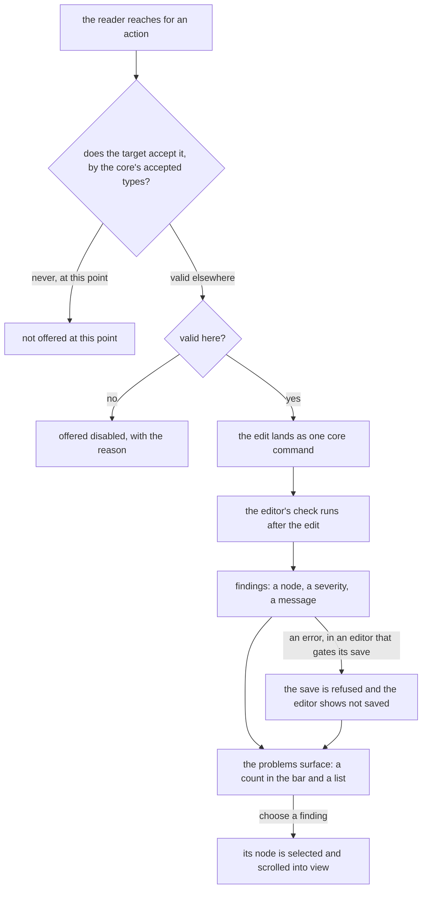

# Editor guardrails

How a guided editor keeps its reader from making a mistake. It is the third part of the [editor layout program](../resource-editor-layout-program/design.md), and it applies the enforcement ladder's first rung to an interface: where a wrong action can be made impossible to express, the editor does not offer it, and where it cannot, the editor says what is wrong and where.

It changes no document model and no check's rules. The accepted types a slot carries, the survey check and the page builder's critique stay as they are. This change decides what the reader sees of them.

## How it works

There are three layers, in the order a reader meets them: an action that is never offered, an action that is offered with a reason it is unavailable, and a problem that is found after the fact and shown with its place.

**Never offered.** An insertion point is a place in the document: after the selected element, at the end of a page, inside a section. Its menu lists the kinds the slot there accepts, taken from the core's accepted types for that slot, so an email's insertion inside a column never offers a section and a survey's page never offers a panel's own children. A palette drag lights only the slots that accept the dragged kind, which the editors already do, and the insertion menu adopts the same rule. A kind no slot accepts here is absent, since offering it can only produce a refusal.

**Offered with a reason.** An action that is valid somewhere but not at the reader's selection is shown disabled with its reason: Move out at the top level says it is already there, Move down on the last element says it is last. This is the shell's disabled-with-reason item, and the reason comes from the same command that would refuse the edit, so the two cannot disagree.

**Found afterward.** Some rules cannot be enforced by what is offered, since they hold between two elements: a name that two questions share exists only once both do, and the edit that fixes it must not be refused. Those are findings. Every editor's check reports them in one shape, a node, a severity and a message, and one surface lists them.

## The problems surface

The surface is one component in the top bar. It shows a count of the findings, none when there are none, and opens a list. Each row names the node it concerns by the title the layers tree gives it and carries the message. Choosing a row selects the node and scrolls it into view, so a reader goes from a count to the element in one step. The list follows the document: the check runs after each edit, so a fix removes its row and an edit that breaks a rule adds one.

A finding is an error or a warning. An editor that gates its save on its check gates on errors. The survey maps every issue to an error, since its save is refused while one stands. The webpage's critique reports warnings, since a low contrast or a fixed width does not stop a publish. The email maps its validator's messages the same way, by the severity the validator gives them.

A refused save is not a transient alert. The editor keeps the reader's edit, as it does now, and the surface stays on its error count with the editor's save state reading not saved, until the findings clear and the next save lands.

## Per editor

| Editor  | Never offered                                                                   | Found afterward                                                   |
| :------ | :------------------------------------------------------------------------------ | :---------------------------------------------------------------- |
| Survey  | Kinds a page or a panel does not accept; move targets that do not take the node | The survey check: a clashing name, a rule that cannot hold        |
| Email   | Anything MJML does not nest: a section inside a section, an empty column        | The validator's messages                                          |
| Webpage | Kinds a slot's allow list refuses                                               | The critique: contrast, a fixed width, an unpublished survey link |

The survey's logic builder, the existing delete-reference warning and the page builder's allow lists already refuse what they refuse. This change adds nothing to what a document accepts and only moves the refusal to before the action.

## Decisions

- **Offer only what the slot accepts, rather than refusing afterward.** An insertion menu that lists every kind and refuses most of them spends the reader's attention on choices that were never valid. Hick's law prices a longer menu in time. Rejected: listing every kind with a refusal on choice, which is what the palettes do today.
- **Disable with a reason what is valid elsewhere, and absent what is never valid here.** Absent for a kind the slot cannot take, disabled for an action the selection could take were it elsewhere. A reader learns from a disabled action why, and an absent kind teaches nothing and costs nothing. Rejected: disabling every refused kind, which fills a menu with items that can never be used.
- **Problems are one surface and one shape.** The survey's alert, the webpage's tab and the email's alert are three presentations of one thing. Rejected: keeping each editor's own, which is why a reader of one editor cannot find the problems in another.
- **The check runs after each edit.** The rules are computations over the document, so a run is cheap and a finding never lags the edit that caused it. Rejected: running at save only, which tells the reader after the work is done, as the survey does now.
- **A name clash is a finding, not a refused edit.** An edit that resolves a clash would be refused as well, since the clash exists only between two elements. This keeps the settled decision that the check gates the save and not each edit.
- **A save is refused by errors only.** A warning informs and never blocks. Rejected: blocking on every finding, which would make a contrast warning stop a publish.

## Not in this change

- **New rules.** No check gains a rule here. A new rule is a change to the check and its own spec.
- **A graph view of the logic.** The survey's logic is a rules list and stays one. A map of the jumps between questions, as Typeform draws, is a later idea and not designed here.

## Key files

| File                                                                      | Role                                                                     |
| :------------------------------------------------------------------------ | :----------------------------------------------------------------------- |
| `packages/headless-block-editor/src/services/getAcceptedTypes.ts`         | the kinds a slot accepts, which an insertion menu lists                  |
| `packages/headless-block-editor/src/services/getAcceptingSlotPointers.ts` | every slot that accepts a node, which a move target list reads           |
| `packages/headless-block-editor/src/services/checkAcceptedType.ts`        | the refusal an edit makes, whose reason a disabled action shows          |
| `apps/web/app/composables/survey/useSurveyCreatorCommands.ts`             | the survey's insert and move commands, which return no edit when refused |
| `apps/web/app/composables/pageBuilder/usePageBuilderCritique.ts`          | the page builder's findings, mapped to the one shape                     |
| `apps/web/app/components/Resource/Survey/Editor.vue`                      | where the survey check runs before a save                                |
| `apps/web/app/components/Resource/Survey/Creator/Layers.vue`              | the layers tree whose titles name a finding's node                       |

## Sources

- [Microsoft Forms branching](https://support.microsoft.com/en-us/office/use-branching-logic-in-your-form-0a092a1c-8fe4-441c-9fc6-cd0aad3b52b2), [Google Forms sections](https://support.google.com/docs/answer/141062?hl=en) and [Typeform's questions that cannot be logic conditions](https://help.typeform.com/hc/en-us/articles/5821097529620-Why-doesn-t-my-question-work-with-logic) (excerpt): choices narrowed to what is valid before the author picks. The never-offered layer.
- [Qualtrics survey flow](https://www.qualtrics.com/support/survey-platform/survey-module/survey-flow/survey-flow-overview/): a change to the flow committed with Apply or Revert, which is the destructive-confirmation pattern the repo already holds.
- [MJML's documentation](https://documentation.mjml.io/): the nesting rules an email's insertion menu mirrors, already held by the document's accepted types.
- [Litmus Builder's QA checks](https://help.litmus.com/article/674-qa-tab-in-builder) (excerpt): findings grouped and shown apart from the visual editor. The problems surface.
- [Laws of UX, Hick's law](https://lawsofux.com/hicks-law/), already cited by the [design sources](../../specs/architecture/design-sources/design.md): the cost of a longer menu.
