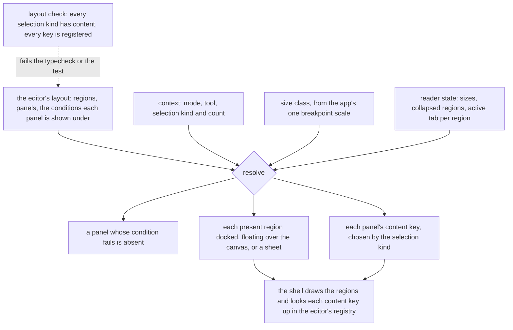

# Editor layout program

Every resource editor is arranged from a layout description of its own, resolved by one headless engine and drawn by one shell. The program replaces the per-editor shell components, and the rule that the same chrome serves every editor, with a spectrum: a freeform editor asks for a toolbar and almost nothing else, and a guided editor asks for structure, constraints and a place where problems appear.

It builds on the [editor compact chrome](../../specs/resource/editor-compact-chrome/design.md), whose palette shell, density tokens and overflow menu it keeps, and on the [page layout](../../specs/architecture/page-layout/design.md), which owns the page's own drawers and leaves what happens inside a resource editor to this program.

## How it works

An editor gives the engine a layout and the engine gives the shell a resolved layout. The layout never changes while the editor is open. What changes is the context: the mode the editor is in, the tool in hand, what is selected and how large the window is.

The check is the point of making the layout data. A layout that leaves a selection kind with no content, or names a content key nobody registered, is a finding the build reports, not a blank panel a reader meets.

## Two poles

| Pole     | The reader's job                          | The screen's job                                                             | Editors                         |
| :------- | :---------------------------------------- | :--------------------------------------------------------------------------- | :------------------------------ |
| Freeform | Write a lot, quickly, with few rules      | Stay out of the way: every tool one press away, a panel only for a selection | Whiteboard                      |
| Guided   | Produce a document that is correct to use | Show the structure, offer only what is valid, say what is wrong and where    | Survey, email, webpage          |
| Document | Write prose                               | One bar over the text                                                        | Note, and every rich text field |

The poles differ in what the layout holds, not in the engine. A freeform layout has a tool region and a contextual panel, and its panels open on demand. A guided layout also has a structure region that is always present, modes that change which regions exist, and a problems surface the [guardrails](../resource-editor-guardrails/design.md) define.

## Coverage

Every editor the app mounts has a row, so none is left to drift.

| Editor                       | Pole     | Layout change                                                                                   | Part                                                         |
| :--------------------------- | :------- | :---------------------------------------------------------------------------------------------- | :----------------------------------------------------------- |
| Whiteboard                   | Freeform | One top toolbar of every tool, a contextual panel, zoom beside undo                             | [whiteboard layout](../resource-whiteboard-layout/design.md) |
| Survey                       | Guided   | Design, Logic, Theme and Preview as modes, structure on the left, properties by selection scope | [survey layout](../resource-survey-layout/design.md)         |
| Email                        | Guided   | Blocks on the left, Design and Preview in the top bar, email checks in the problems surface     | [email layout](../resource-email-layout/design.md)           |
| Webpage                      | Guided   | Navigator and blocks on the left, device and mode in the top bar, the style panel by selection  | [webpage layout](../resource-webpage-layout/design.md)       |
| Note                         | Document | Unchanged: one bar over the text, with no region beside it                                      | none                                                         |
| Dashboard                    | Guided   | A palette the reader opens, an inspector in place of the edit dialog, the grid as the canvas    | [dashboard layout](../resource-dashboard-layout/design.md)   |
| Blueprint, sheet, to-do list | none     | Not changed. They have no panels to arrange                                                     | none                                                         |

## Decisions

- **Each editor declares its layout as data on one engine.** The layout names regions, the panels in them, and the conditions each panel is shown under, and a check reads it. Rejected: one standardized chrome every editor wears, which gives a freeform and a guided editor the same screen, and the current hand-wired shell per editor, which no check can read and which repeats the same responsive rules once per editor.
- **The conditions are declarative, not functions.** A panel is shown under a match on mode, tool and selection kind, each a list where an empty list means any. A layout stays plain data, so it can be checked for coverage, rendered into a spec table and read by an agent. Rejected: a predicate per panel, which does what a match does and can be none of those things.
- **Content follows the selection kind natively.** A panel names its content by the selection kind, and an editor with no selection gets the document's own settings, as Figma's panel shows them. No layout library surveyed does this; the two that react to a selection, Puck and Craft.js, are page editors whose panels are fields, not layout engines.
- **The engine is our own, written from the behaviours and not ported.** The docking engines model a tree of tabs and splits a reader rearranges, with floating and popout windows, which no editor here needs; none collapses a panel to a sheet and none selects content by selection. The dependency-absorption skill's rule against porting holds here too, though no dependency is being replaced: what the engines settled, state kept apart from layout, panels by stable id, splitters with limits and the keyboard contract of a window splitter, is rewritten here, so no licence text travels with it. Rejected: adopting Dockview's Vue binding, which brings the docking and popout surface along for a layout of four regions.
- **A freeform editor's tool region is one toolbar.** It holds every tool, groups variants of one tool in one slot, and folds what does not fit into one menu, as Excalidraw and tldraw do. Rejected: a palette beside a tool row, which is two places to look for the one thing a freeform editor is for.
- **A guided editor never offers what its document refuses.** The insertion points, the move targets and the logic choices come from the core's accepted types, and a problems surface lists what the document check finds. Rejected: validating at save alone, which tells the reader after the work is done.
- **Headless packages are Vue packages with one entry.** Every consumer is Vue code, the server being the same Nuxt app, so a second framework-free tier buys nothing and the composables an editor repeats are written once in the package. See the [package shape](../architecture-headless-package-shape/design.md). Rejected: a framework-free core with a Vue subpath.
- **The grid package is not merged into the engine.** The grid places items inside a canvas by cells, with packing and collision; the engine places regions around a canvas by size class. Their models share nothing but a size and a pointer, and the engine's canvas region holds a grid, as the dashboard's does. Rejected: one engine for both, which would give the dashboard the editor's chrome model for a problem it does not have. Whether the grid is needed at all is a product question about free placement, and the [deferred retirement](../../deferred/resource/retire-grid-layout-package/design.md) holds it.
- **A panel opens over the canvas, as before.** A selection never moves the canvas, so the whiteboard's panel and the guided editors' contextual panels float over its edge. This keeps the compact chrome's decision and extends it from the whiteboard to every editor that opens a panel for a selection. Rejected: reflowing the canvas, which moves what the reader just selected.

## What the app already has

Each part reaches for what the app and its libraries already hold before it writes anything, so the program adds arrangement and not plumbing.

| Concern                                   | Used                                                                                          | Instead of building                                      |
| :---------------------------------------- | :-------------------------------------------------------------------------------------------- | :------------------------------------------------------- |
| The size class                            | the app's display composable, Vuetify 0's breakpoints over the one scale                      | a width reader or a second set of cuts in the engine     |
| A handle between docked regions           | the existing resize handle, which carries the window splitter's keys and values               | a splitter in the shell                                  |
| A reader's sizes across visits            | a Pinia store over VueUse's local storage, as the room's side bar widths are held             | storage code in the shell                                |
| A choice between tools                    | the toggle group, a Vuetify 0 radio group with its roving focus                               | a roving tab index of our own                            |
| A toolbar that does not fit               | the overflow menu and one VueUse resize observer                                              | a measurement per item                                   |
| A panel on a compact window               | the dialog sheet the page's drawers already use                                               | a second sheet                                           |
| Data derived from the document or context | computed values over shallow refs, with a value or a getter taken by `toValue`                | a watcher that copies one ref into another               |
| The problems list                         | one computed over the document, behind VueUse's debounced ref with the autosave's settle time | a check run by hand after each edit                      |
| Undo and redo                             | the shared bounded history over inverse patches                                               | VueUse's ref history, which snapshots the whole document |
| The three stores' shared shape            | one generic composable called in each store's setup                                           | three copies, or a store factory the id test cannot read |
| Keyboard shortcuts                        | the registered commands the whiteboard and page builder already use                           | a key listener per editor                                |
| A long layers tree                        | measured on a large document first, then VueUse's virtual list if the measure asks            | virtualising before it is slow                           |

VueUse's shared singleton helper is not used: the repo bans it, since a singleton bypasses Pinia's devtools and reset, and state that outlives an editor belongs in a store.

## Build order

The engine first, then the shell over it, then the guardrails, then the editors, the whiteboard first as the freest and the one with the least to carry across. The package shape lands beside the engine, since the engine is its first package named under it.

## Not in this program

- **Rearranging the layout.** A reader resizes and collapses regions. They do not drag a panel to another edge or float it. A layout the reader can rearrange needs a way back to the default and a saved arrangement per editor, for nothing an editor here has asked for. See the [rejected docking layout](../../rejected/resource/editor-docking-layout/design.md).
- **Email client previews and a dark-mode preview.** They need a rendering service or an approximation with no surveyed standard. See the [deferred idea](../../deferred/resource/email-client-and-dark-previews/design.md).
- **A new document model.** The layouts arrange what each editor already edits. The whiteboard's tools arm and place elements the document already holds.

## Sources

Verification marks how each was read: fetched is the vendor's own page, excerpt is a search result only. An excerpt is a lead, to be read in full before the part taken from it ships.

- [Excalidraw's toolbar](https://raw.githubusercontent.com/excalidraw/excalidraw/master/packages/excalidraw/components/Toolbar.tsx), [its actions panel](https://raw.githubusercontent.com/excalidraw/excalidraw/master/packages/excalidraw/components/Actions.tsx) and [its layer](https://raw.githubusercontent.com/excalidraw/excalidraw/master/packages/excalidraw/components/LayerUI.tsx) (fetched): the tool strip of a few direct tools with the rest in one menu, a properties panel shown while something is selected or a drawing tool is active, and a phone layout with its own bottom bar. The whiteboard's arrangement.
- [tldraw's toolbar](https://raw.githubusercontent.com/tldraw/tldraw/main/packages/tldraw/src/lib/ui/components/Toolbar/DefaultToolbar.tsx), [its relevant styles](https://raw.githubusercontent.com/tldraw/tldraw/main/packages/tldraw/src/lib/ui/hooks/useRelevantStyles.ts), [its mobile style panel](https://raw.githubusercontent.com/tldraw/tldraw/main/packages/tldraw/src/lib/ui/components/MobileStylePanel.tsx) and [its UI components](https://tldraw.dev/sdk-features/ui-components) (fetched): a toolbar that keeps a minimum and a maximum of visible tools and overflows the rest, a style panel shown only when the tool or the selection has styles, the style panel becoming a popover on a narrow window, and named slots an embedder hides or replaces. The overflow rule and the narrow-window behaviour. Its licence was not verified, so only its behaviour is read.
- [Figma's properties panel](https://help.figma.com/hc/en-us/articles/360039832014-Design-Prototype-and-view-Code-in-the-Properties-Panel) (fetched): with nothing selected the panel shows the document's settings. The nothing-selected state of every contextual panel.
- [SurveyJS Creator's user interface](https://surveyjs.io/survey-creator/documentation/end-user-guide/user-interface) and [its UI preset editor](https://surveyjs.io/survey-creator/documentation/ui-preset-editor) (fetched): the Designer, Preview, Themes, Logic and translation tabs as modes, a property grid scoped to a question, a panel or the survey, and a customisation that reorders tabs and toolbox groups but is not documented to move panels. The survey's modes and scopes.
- [Microsoft Forms branching](https://support.microsoft.com/en-us/office/use-branching-logic-in-your-form-0a092a1c-8fe4-441c-9fc6-cd0aad3b52b2) and [Google Forms sections](https://support.google.com/docs/answer/141062?hl=en) (fetched): a branch target offered from the later questions only, and a routing list that offers sections only. Constraint by construction in the survey's logic.
- [Typeform's questions that cannot be logic conditions](https://help.typeform.com/hc/en-us/articles/5821097529620-Why-doesn-t-my-question-work-with-logic) (excerpt) and [Typeform's logic jumps](https://www.typeform.com/developers/create/logic-jumps/) (fetched): kinds excluded from a condition by the editor, and the first matching rule winning. The condition kinds the logic builder offers.
- [Qualtrics survey flow](https://www.qualtrics.com/support/survey-platform/survey-module/survey-flow/survey-flow-overview/) (fetched): a change to the flow committed with Apply or Revert. A destructive restructure asks to commit.
- [Tally's create a form](https://tally.so/help/create-a-form) (fetched): a block inserted by typing a slash and moved by its handle. The inline insertion point.
- [MJML's documentation](https://documentation.mjml.io/) (fetched): the section, column and content nesting an email is built of, with no section inside a section and no empty column. The email's structure rules, which the document's accepted types already hold.
- [Beefree's configuration parameters](https://docs.beefree.io/beefree-sdk/readme/installation/configuration-parameters) (fetched): sidebar position, default tab, merge tags and a limit to one editable row. What an embedder may configure of an email editor.
- [Puck's overrides](https://next.puckeditor.com/docs/api-reference/overrides) (fetched, experimental) and [its slot field](https://puckeditor.com/docs/api-reference/fields/slot) (excerpt): a header, an outline, a fields panel and a drawer as replaceable parts, and an allow and a disallow list per slot. The webpage's outline and the accepted-types rule it already holds.
- [GrapesJS's layer manager](https://grapesjs.com/docs/modules/Layers.html) (fetched): a tree of the page's components. The navigator.
- [Litmus Builder](https://help.litmus.com/article/674-qa-tab-in-builder) (excerpt): checks grouped by accessibility, links, tracking and loading speed, apart from the visual editor. The email checks.
- [FlexLayout](https://github.com/caplin/FlexLayout), [Dockview](https://github.com/mathuo/dockview), [rc-dock](https://github.com/ticlo/rc-dock), [golden-layout](https://github.com/golden-layout/golden-layout) and [Lumino](https://github.com/jupyterlab/lumino) (readmes fetched): layout held as a serialisable tree that names panels by id and keeps the reader's sizes apart from it. The engine's state.
- [Zag's splitter](https://zagjs.com/components/react/splitter) (fetched): panel ids, minimum and maximum sizes, collapsible panels and a controlled size. The engine's resize.
- [WAI-ARIA window splitter](https://www.w3.org/WAI/ARIA/apg/patterns/windowsplitter/) and [toolbar](https://www.w3.org/WAI/ARIA/apg/patterns/toolbar/) patterns: the keyboard contract of a splitter and of a toolbar. The shell's controls.
- [Material 3 window size classes](https://m3.material.io/foundations/layout/applying-layout/window-size-classes) and [canonical layouts](https://m3.material.io/foundations/layout/canonical-layouts/overview), already cited by the [design sources](../../specs/architecture/design-sources/design.md): the compact, medium and expanded classes the engine resolves for.

## Key files

| File                                                        | Role                                                                            |
| :---------------------------------------------------------- | :------------------------------------------------------------------------------ |
| `openspec/specs/resource/editor-compact-chrome/design.md`   | the decisions this program keeps and the ones it supersedes where they conflict |
| `apps/web/app/components/Resource/Whiteboard/Editor.vue`    | the whiteboard's hand-wired arrangement, replaced by a layout and a registry    |
| `apps/web/app/components/Resource/Survey/Creator/Shell.vue` | the survey's three panes and its narrow tabs, replaced by a layout              |
| `apps/web/app/components/PageBuilder/Editor.vue`            | the webpage and email arrangement, replaced by a layout each                    |
| `apps/web/app/components/Ui/Palette/Index.vue`              | the palette shell, kept as the insert menu's content                            |
| `apps/web/configuration/breakpoints.ts`                     | the one breakpoint scale the engine's size class is derived from                |
