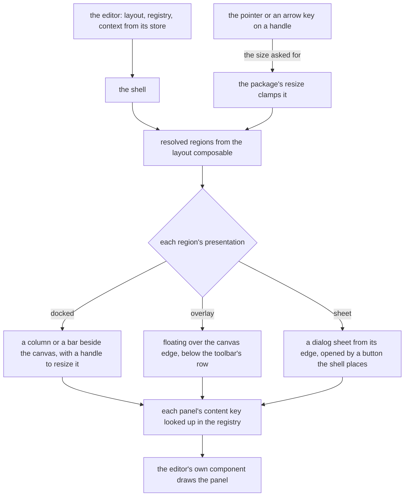

# Editor shell

The one component that draws an editor's screen, over a layout the [layout package](../vue-editor-layout-headless-package/design.md) resolved. It is the second part of the [editor layout program](../resource-editor-layout-program/design.md): the package decides which regions exist and how each is presented, and the shell draws them, resizes them and makes them reachable from the keyboard and from a phone.

An editor today wires its own regions in its own component. After this change an editor supplies a layout, a registry of what fills each panel and a context, and the shell does the rest.

## How it works

The shell calls the layout package's composable with the editor's layout and a reactive context built from the editor's store: the mode, the tool in hand and the selection's kind and count. It receives the resolved regions and draws each by its presentation.



The shell owns arrangement, and the editor owns content. A registry maps a content key to a component, so the whiteboard's arrow properties, the survey's question properties and the page builder's style panel are each the editor's own, drawn by the shell where the layout put them.

## The toolbar

A toolbar is one component and every editor's tool region is one. It holds groups of items, and an item is a tool, a toggle or a command with an icon, a title, the shortcut its registered command carries, a pressed state and, when it cannot be used, the reason.

- **One slot holds the variants of a tool.** The shapes are one slot showing the variant last used, with the others in a menu from its edge, so a freeform toolbar holds a handful of buttons, not forty. This is the arrangement of Excalidraw's shape groups and tldraw's. A tool with no variants is a single button.
- **What does not fit folds into one menu.** The toolbar keeps its pinned items and moves the rest, in their order, into the overflow menu the app already has, so it never wraps or scrolls. One resize observer from VueUse reads the toolbar's width and the items' widths are read once, so the fold is a computation over two numbers, not a measurement per item per frame. Pinned items are the tools a reader reaches for most, and the layout names them.
- **A group of tools is one tab stop.** The tools a reader chooses between are the app's toggle group, a radio group over Vuetify 0, so it is one tab stop and the arrows move the choice along it, with no roving code of our own. The toolbar is a named toolbar landmark holding such groups and buttons. A disabled item stays focusable and its reason is its description, so a reader is told why an action is unavailable instead of finding it gone.

## The contextual panel

A contextual panel's content follows the selection, and in an editor that has document settings it shows them when nothing is selected, as Figma's panel does. An editor with nothing of the kind, the whiteboard, has no panel while nothing is selected. A panel with several selected elements shows a field's value when every element holds the same one and "Mixed" when they differ, and a change writes to each. The panel's header names what is selected, "Arrow" or "3 shapes", so a reader knows what a change will touch. The panel opens over the canvas, below the toolbar's row, so a selection never moves the canvas.

## A compact window

One component serves every window. A compact window is not a second shell: the layout declares what each region becomes at that size, and the shell draws it.

- The tool region sits at the bottom edge, within a thumb's reach, as Excalidraw's phone bar does, and its overflow folds earlier.
- Each side region is a sheet from its own edge, closed until the reader opens it.
- A button, placed by the shell and visible only while a region has something to show, opens the contextual panel. It is there while something is selected, so a selection does not cover the canvas with a sheet nobody asked for, as tldraw's style panel waits behind its button on a narrow window.

## Keyboard and focus

The canvas is the main landmark, the toolbar a toolbar with a name, and each side region a complementary landmark with a name, so a screen reader can jump between them. A handle between docked regions is the app's resize handle, which already is a separator that reports its value and moves by an arrow key, with Home and End as its limits, as the WAI-ARIA window splitter sets out. A sheet or a floating panel closes on Escape and returns focus to the control that opened it. Motion follows the reduced-motion preference through the motion tokens the app already has.

## Decisions

- **The shell owns arrangement and the editor owns content.** A registry maps content keys to components, so a layout names a key and never a component. Rejected: a layout holding components, which makes it code and puts the layout check out of reach of data.
- **One toolbar component serves every editor.** The whiteboard's tool row, the survey's bar and the page builder's device toggle become instances of it. Rejected: a toolbar per editor, which is the repeat this program removes, and a toolbar that wraps, which moves the canvas under the reader.
- **An unavailable action is disabled with its reason, not hidden.** The reader learns why from the item. The guided editors hide what the document cannot accept at a given insertion point, since that choice is never valid there, and disable what is valid elsewhere. See the [guardrails](../resource-editor-guardrails/design.md). Rejected: hiding every unavailable action, which makes an action vanish and reappear with the selection and gives no way to learn why.
- **The compact tool region is at the bottom.** A thumb reaches the bottom edge, and the top is covered by the hand. Rejected: keeping the toolbar on top on a phone, which is where a reader's own hand hides it.
- **A sheet is the app's own dialog sheet.** It is the container the page layout's drawers already use on a narrow window. Rejected: a second sheet component for editors.
- **The reader's sizes persist per editor, in a Pinia store over VueUse's local storage.** A store holds each editor type's reader state under a key from the local storage key enum, as the room's side bar widths are held, and the layout package parses the stored state against the layout, so a changed layout drops what it no longer names. Rejected: storage code in the shell, which the store already does for every other width.
- **The size class is read from the display composable.** The shell maps the app's breakpoint flags to a class: compact on a small window, medium while the page's drawers are sheets, expanded otherwise. Rejected: measuring the window again, which would be a second reading of the one scale.
- **The palette shell stays.** It becomes the content of the insert menu and of a side region where an editor keeps one, with its search and groups. Rejected: replacing it, since the compact chrome settled it and nothing here changes its job.
- **The panel's document state follows its named slot.** With nothing selected the panel draws the document's settings when the editor passes a `documentSettings` slot, and draws no panel when it passes none. `Ui/Frame.vue` already reads an optional region's presence from its slot, so no flag repeats what the slot says. Rejected: a boolean prop saying the editor has settings, which could disagree with the slot it describes.
- **The panel takes the selected count and a title; the editor names the kind.** The panel branches only on whether anything is selected, so a kind prop would go unread there. The title is built where the kind's name and its plural live, in the editor's own vocabulary. Rejected: a generic kind prop with the panel pluralising names itself.
- **A mixed value names its state, and an empty selection has none.** `getMixedValue` answers `{ isMixed: true }` or the shared value, on the same `isMixed` flag `Ui/Checkbox.vue` reads for its indeterminate state, so a field narrows on the flag and never matches a sentinel. Values compare with `===`, so the compared type is limited to boolean, number and string: two objects with equal content are not the same value. No element selected answers `undefined`, as `getSelectedElement` does. Rejected: a sentinel string or symbol, which a field could mistake for a stored value.
- **A region's content is the component its active panel's key names; the canvas is the default slot.** The canvas is not a region: the shell draws the default slot where the canvas sits, and an overlay floats over it. A bar or a tool region is an ordinary region whose panel's content key the registry maps to the editor's own component, so the shell draws it at its edge like any other. A content component takes no props and reads its own store. Rejected: a slot per region, which would move each panel's content out of the registry the layout check reads.
- **The canvas is not a second main landmark.** The app's default layout already holds the page's `main` (`apps/web/app/layouts/default.vue`), so the canvas is a plain element inside it. Rejected: a `main` of the canvas's own, which nests a second main landmark in every editor page.
- **The registry is keyed by string.** The package holds content keys as strings, so `EditorRegistry` is a record of components by string key, and the layout check reports a key with no entry. Rejected: a generic per editor, which the shell would have to thread through every prop.
- **A side region's name is the shell's `regionNameMap`, keyed by region id.** The package's region holds no name, and a landmark and a sheet are each announced by one. Rejected: a name on the package's region, which is landed and describes layout, not what a reader is told.
- **The editor types are the three editors this change's Impact names.** No enum of editor types existed. `ResourceType` keys editors by resource, and Email and Webpage share one page builder, so their sizes would split by resource where the editor is the thing that owns them. `EditorType` names the whiteboard, the survey and the page builder, each editor's change using its member.
- **One local storage record holds every editor type's state.** `LocalStorageKey.EditorReaderStates` is one record keyed by editor type, read with `mergeDefaults` so a stored value that is not an object reads as an empty record, and each entry is read back through the parse. Rejected: one key per editor type, which needs a ref created on demand for each key.
- **The store is written from a watch on the composable's state.** Keeping a state is a side effect of a change to it (the `vue` skill's watch decision tree, case 6), and every change, a resize, a toggle or an active panel, is one new state, so one watch covers all of them. Rejected: a save in each function the shell calls, which the next function added would forget.
- **Compact is the `xs` breakpoint and medium is the mobile one.** `xs` is below the small breakpoint, 600px. `isMobile` is below the app's mobile breakpoint, `lg` at 1280px, where `store/layout.ts` closes the page's drawers and the drawers are sheets, so that band is medium. Expanded is the rest. Rejected: a width read in the shell, which would be a second reading of the one scale.
- **A sheet's placement is its edge's drawer, and a top or bottom sheet has none.** A start or end sheet uses the drawer placements the page's drawers use. The library has no top or bottom drawer, so a sheet from there stands high or in the middle (`RegionEdgeDialogPlacementMap`).
- **A handle sits on the region's inner edge, and the shell assumes left-to-right.** A region at the end or the bottom takes its handle on its start or top side. `ResizeHandle` places itself by physical side, so a right-to-left page would put a handle on the wrong side. No editor is right-to-left yet, so the case is left to the first editor that is.
- **Only docked regions take a handle, and a closed docked or overlay region draws nothing.** The spec puts handles between docked regions, and an on-demand region that is closed takes no space. A sheet stays mounted closed, so the reader can open it.

## Build

```text
apps/web/app/components/Editor/Shell.vue          the shell: regions, handles, sheets, landmarks
apps/web/app/components/Editor/Region.vue         one region: its landmark or sheet, its handle and its content
apps/web/app/components/Editor/Toolbar.vue        groups, the variant slot, the fold, the keyboard contract
apps/web/app/components/Editor/ContextualPanel.vue  the header, mixed values and the document settings state
apps/web/app/models/editor/EditorRegistry.ts      content key to component, typed from the layout
```

## Key files

| File                                                        | Role                                                                                              |
| :---------------------------------------------------------- | :------------------------------------------------------------------------------------------------ |
| `apps/web/app/components/Ui/Palette/Index.vue`              | the palette shell, kept as an insert menu's content                                               |
| `apps/web/app/components/Ui/OverflowMenu.vue`               | the overflow menu the toolbar folds into                                                          |
| `apps/web/app/components/Ui/ResizeHandle.vue`               | the handle between docked regions, which already carries the window splitter's contract           |
| `apps/web/app/store/message/ui/layout.ts`                   | the precedent for sizes held in a store over local storage, which the editor layout store follows |
| `apps/web/app/components/Ui/Dialog.vue`                     | the sheet a compact region opens as                                                               |
| `apps/web/app/components/Ui/ToggleGroup.vue`                | the pressed-state group a toolbar's toggles use                                                   |
| `apps/web/app/components/Ui/IconButton.vue`                 | a toolbar item                                                                                    |
| `apps/web/app/composables/ui/useUiDisplay.ts`               | the app's reading of the breakpoint scale, from which the size class's cuts are taken             |
| `apps/web/app/store/layout.ts`                              | the page's own drawers, which the shell leaves alone                                              |
| `apps/web/app/components/Resource/Whiteboard/Editor.vue`    | the whiteboard's arrangement, replaced in its own change                                          |
| `apps/web/app/components/Resource/Survey/Creator/Shell.vue` | the survey's panes, replaced in its own change                                                    |
| `apps/web/app/components/PageBuilder/Editor.vue`            | the page builder's panes, replaced in its own change                                              |

## Sources

- [WAI-ARIA toolbar](https://www.w3.org/WAI/ARIA/apg/patterns/toolbar/) and [window splitter](https://www.w3.org/WAI/ARIA/apg/patterns/windowsplitter/): the keys of a toolbar and of a handle between regions.
- [Excalidraw's mobile toolbar](https://raw.githubusercontent.com/excalidraw/excalidraw/master/packages/excalidraw/components/MobileToolbar.tsx): shape groups in popovers and a bottom bar on a phone, with items folding into overflow below fixed widths.
- [tldraw's mobile style panel](https://raw.githubusercontent.com/tldraw/tldraw/main/packages/tldraw/src/lib/ui/components/MobileStylePanel.tsx): the style panel behind a button on a narrow window.
- [Material 3 canonical layouts](https://m3.material.io/foundations/layout/canonical-layouts/overview): the supporting pane that becomes a sheet when the window is compact.
