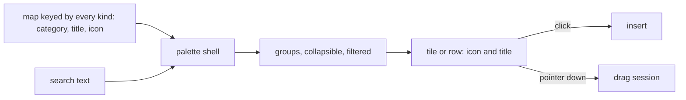

# Editor compact chrome

A palette is the same thing in every editor, a set of kinds the reader picks from, so it is one component fed by a keyed map, and the chrome around it takes one density.

## Decisions

- **Categories and icons live in the app, keyed by every kind.** The typecheck then holds each map complete, as the page builder's icon maps already do. Rejected: a category and an icon on the headless packages' kind definitions, which the survey runner and the publish render never read.
- **The survey's groups are by what the reader asks.** Text (Text, Comment, Multiple text), Choice (Radio group, Checkbox, Dropdown, Tag box, Button group, Boolean, Image picker), Scale and ranking (Rating, Slider, Ranking), Grids and repeats (Matrix, Dynamic matrix, Dynamic panel), Content (Html, Image, Calculated value) and Layout (Panel). Rejected: the current "Input" and "Choice grids and lists", which put a ranking beside a dynamic panel and nine unlike kinds in one list.
- **One palette shell, three feeds.** The shell takes groups of `{ kind, title, icon }`, filters by title, collapses a group and emits an insert and a drag start. Rejected: a search in each editor's own palette, which is what drifted.
- **A pane opens over the canvas.** The whiteboard's properties panel and the page builder's inspector float over the canvas edge, so a selection changes nothing beneath it. Rejected: reflowing the canvas, which moves the thing the reader just selected.
- **The survey canvas has a readable width.** Its questions are capped at a measure a form is read at and centred, and the pane around it keeps the rest. Rejected: filling the centre, which stretches a text field across the screen.
- **Density comes from tokens.** Tab panels, toolbars and sectors use the UI library's spacing, and the shared tab panel's top padding is not applied to a filling panel.
- **Overflow folds into one menu.** A toolbar that cannot fit its controls keeps the primary ones and moves the rest into a menu, rather than wrapping or scrolling.

## Key files

| Path                                                            | Role                                 |
| :-------------------------------------------------------------- | :----------------------------------- |
| `apps/web/app/services/resource/survey/constants.ts`            | the survey's palette groups today    |
| `apps/web/app/components/Resource/Survey/Creator/Palette.vue`   | the survey palette                   |
| `apps/web/app/components/PageBuilder/Palette.vue`               | the page builder palette             |
| `apps/web/app/components/Resource/Whiteboard/EditorPalette.vue` | the whiteboard palette               |
| `apps/web/app/components/Ui/Tabs.vue`                           | the shared tab panel and its padding |

## Sources

- The page builder's [canvas design](../../specs/resource/page-builder/canvas/design.md) and the survey Creator's [design](../../specs/resource/survey-creator/design.md), whose layouts this tightens.
