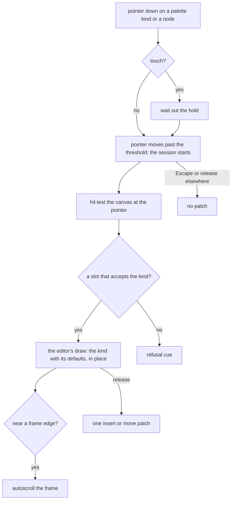

# Editor drag preview

One drag session serves three editors. It owns the pointer, the ghost, the autoscroll, the touch hold and the cancel. Each editor supplies two things: how a kind is drawn, and which slots accept it.

## Decisions

- **The preview is drawn in the render path, not written to the document.** The session hands the editor a pending insertion, `{ slot, index, node }`, and the editor's own canvas renderer draws that node among the slot's children, marked as a preview and not selectable. The document, the history and the undo stacks never see it. Rejected: inserting the real node and removing it on cancel, which leaves history entries a cancelled drag must not leave.
- **The node is the kind's defaults.** The preview draws `createDefaultProps` for the kind, the same node a click would insert, so what the reader sees is what lands.
- **The hit test is the page builder's.** The nearest ancestor slot whose allow list accepts the kind is the target, and the index is the first child whose midpoint the pointer has not crossed. The survey and the whiteboard supply their own slots to the same session.
- **The page builder's gap is closed here.** Its canvas design promises edge autoscroll and a touch hold, and its drag composable has neither; the session takes both from `useDragReorder`, which already has them, rather than writing them a third time.
- **The twin is unchanged.** Alt+arrow, Move to… and Insert stay as the keyboard path to the same patch, which is what makes a drag permissible.
- **A refused target says why.** The cue names the rule, "A Column goes in Columns", where the pointer is, so a refusal is never a silent no-op.

## Key files

| Path                                                                | Role                                                              |
| :------------------------------------------------------------------ | :---------------------------------------------------------------- |
| `apps/web/app/composables/pageBuilder/usePageBuilderDrag.ts`        | the page builder's drag, the starting point of the shared session |
| `apps/web/app/composables/ui/useDragReorder.ts`                     | the autoscroll and the touch hold the session reuses              |
| `apps/web/app/components/PageBuilder/Canvas/Overlays.vue`           | where the drop line is drawn today                                |
| `apps/web/app/services/pageBuilder/resolveDropTarget.ts`            | the hit test                                                      |
| `apps/web/app/components/Resource/Survey/Creator/Palette.vue`       | the survey palette, click only today                              |
| `apps/web/app/components/Resource/Whiteboard/EditorPaletteItem.vue` | the whiteboard's drag, with no ghost today                        |

## Sources

- The page builder's [canvas design](../../specs/resource/page-builder/canvas/design.md), the pointer drag and the keyboard twin this builds on.
- The survey Creator's [design](../../specs/resource/survey-creator/design.md), whose two decisions against dragging this overturns.
