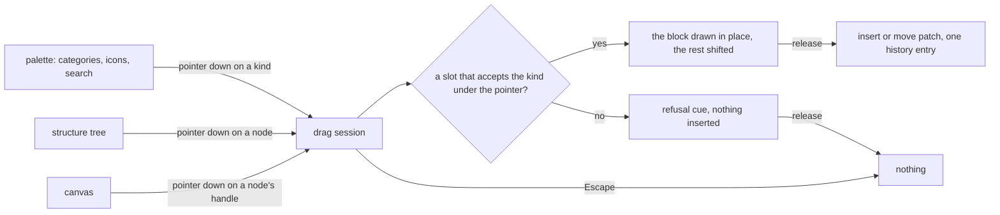

# Resource editors

The three editors are one family: a palette of kinds, a canvas that draws the document, a structure tree and a properties pane, over one store of selection and history, with every edit a patch. What they lack is a shared answer to two questions: what does a drag show, and how dense is the chrome.

## Decisions

- **The drag is a preview, never an edit.** The block is drawn in the render path as a view-only node and the document is not touched until release. Rejected: inserting the real node and removing it on cancel, which writes history entries a cancelled drag must not leave and makes an agent's concurrent edit race the drag.
- **One drag session for all three editors.** Each editor supplies how a kind is drawn and where it may land; the session, the ghost, the autoscroll, the touch hold and the cancel are written once. Rejected: three drags, which is what drifted.
- **The survey Creator is draggable.** This overturns two decisions the Creator's design records, "reorder lives in the layers tree" and "the palette inserts; it is not dragged", whose reason was a canvas drag with no keyboard twin. The twin exists now: the Alt+arrow moves and Move to… already work from the keyboard, so the drag is the pointer's path to the same patch. Those two decisions become rejected alternatives in the part that ships it.
- **A palette is grouped, iconed and searchable, in the app.** Categories and icons live in a map in the app keyed by every kind, so the typecheck holds it complete, as the page builder's already do. Rejected: a category and an icon on the shared kind definition, which the headless packages and the publish render never read.
- **One density.** The editors share spacing, tab and toolbar heights from the UI library's tokens rather than each template's own padding.
- **The flowchart stays gone.** The whiteboard replaced it, and nothing here brings it back.

## Design sources

Recorded from the reference products' public documentation and the galleries the design-sources page lists; screens were not captured in this pass, so the driven-browser look after each part ships is what signs the look off.

- **Webflow and GrapesJS (page builder).** An insertion line with the element's own preview in place, and a block manager of categorized tiles with a name and an icon each; the page builder already follows the second.
- **SurveyJS Creator (survey).** A toolbox grouped by kind of question, each with an icon, dragged into the design surface where a placeholder shows the question; the Creator's grouping follows it with our own names.
- **Miro and FigJam (whiteboard).** A ghost of the shape at the pointer, snapped to where it will land.
- **Mobbin.** Compact toolbars and side panes across editors, for the density settled here.

## Parts

| Part                                                           | Capability                                                            |
| :------------------------------------------------------------- | :-------------------------------------------------------------------- |
| [Drag preview](../resource-editors-drag-preview/design.md)     | one drag session with a live in-place preview, over the three editors |
| [Compact chrome](../resource-editors-compact-chrome/design.md) | categorized, iconed, searchable palettes and one density              |
