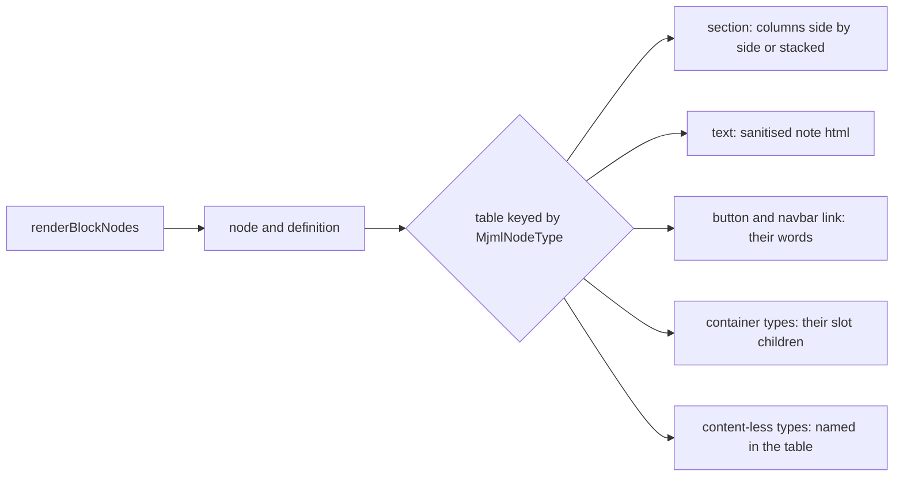

# Email canvas drawing per node type

Each email node type is drawn by its own renderer, held in one table keyed by `MjmlNodeType`. The table's type is `Record<MjmlNodeType, EmailCanvasRenderer>`, so adding a type to the MJML blocks package without a drawing fails the typecheck. Today the drawing is one callback with a chain of type checks and a fallback at the end, and that fallback is where the labelled boxes come from.

## How it works

The canvas hands each node to the block editor's `renderBlockNodes`, which resolves the node's registry definition and its slots, then calls the render callback. The callback looks the node's renderer up in the table and calls it with a context: the node, its definition, its resolved attribute reader, its slot children and the email kind's width state. The renderer returns a VNode. A section is the one renderer that reads its children directly, since it lays out its columns side by side or stacked.

Every branch of the table is explicit, so a reader can see which type draws what without tracing a fallback.

## Data model

None. The drawing reads the document as it is.

## Key files

| File                                                                      | Role                                                                                                            |
| ------------------------------------------------------------------------- | --------------------------------------------------------------------------------------------------------------- |
| `apps/web/app/services/pageBuilder/email/renderEmailCanvasVNodes.ts`      | the render callback; after the change it resolves each node through the table instead of a chain of type checks |
| `apps/web/app/services/pageBuilder/email/renderEmailCanvasVNodes.test.ts` | the drawing's tests; the button expectation now reads the button's words, and a navbar test is added            |
| `apps/web/shared/services/pageBuilder/email/starterEmailSource.ts`        | the starter email, the one document that must draw every part with its content (read only)                      |
| `packages/mjml-blocks/src/models/MjmlNodeType.ts`                         | the enum the table is keyed by, so a new type is a new key the typecheck requires (read only)                   |

## Notes

- The web page canvas already draws each node through a per-type path (`renderWebpageNode`) that the published page shares. That precedent is the same shape: one drawing per type, chosen by the node's type. No outside source was read for this pattern, so none is cited.
- A button's text is the node's `content` prop. A navbar link's text is its `content` prop, and a link is drawn as an inline element so a navbar lays its links in one row.
