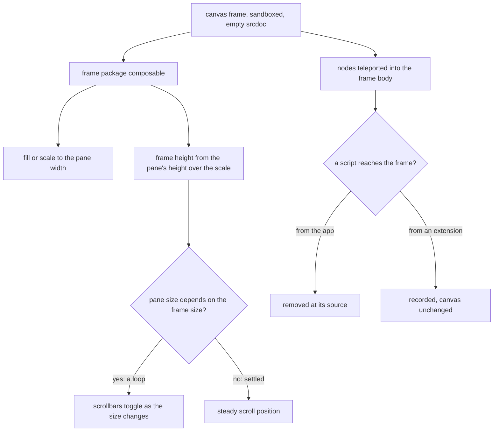

# Canvas frame: blocked script and scroll flicker

The page builder draws a page or an email in an iframe, the canvas frame, so the drawing has its own document and its own layout. The frame is sandboxed to keep a drawn page from reaching the owner's session, and it is scaled to fit the pane it sits in.

## How it works

The canvas creates the frame with an empty srcdoc. The frame package's composable then sizes the frame against its pane: a fill or a scale to the pane's width, and a frame height equal to the pane's measured height over the scale. A ResizeObserver watches the pane and re-measures it on each resize, and nothing measures the frame's own content. The canvas draws its nodes into the frame's body through a teleport.

The pane takes its height from the editor's `h-full` chain and clips its content with `of-hidden`. The frame's layout box is the pane's height over the scale, so it is taller than the pane whenever the frame is scaled down, and the pane clips it. It cannot resize the pane. An email taller than the pane therefore scrolls inside the frame's own document, in a viewport that the pane's height over the scale sets.

Every HTML string the frame receives passes the sanitiser first: text nodes and email text through `renderNoteHtml`, and custom HTML blocks through `sanitizeHtml` at their render. Neither allows a script element or an event-handler attribute, so the markup the app draws gives the frame nothing to run.

The loop at `E` is one of the open hypotheses. The layout above makes it unlikely, since nothing in the frame's size reaches the pane, so the scrollbars the symptom names are most likely the frame's own document's. The reproduction decides both.

## Data model

None.

## Key files

| File                                                                   | Role                                                                                         |
| ---------------------------------------------------------------------- | -------------------------------------------------------------------------------------------- |
| `apps/web/app/components/PageBuilder/Canvas/Frame.vue`                 | the canvas frame: `sandbox="allow-same-origin"`, the empty srcdoc, the teleport of the nodes |
| `apps/web/app/components/PageBuilder/Canvas/Index.vue`                 | the email's body-width wrapper and the node drawing the frame holds                          |
| `packages/vue-canvas-frame-headless/src/composables/useCanvasFrame.ts` | the frame's sizing: fill or scale to the pane, the frame height, and the adopted style sheet |
| `packages/vue-canvas-frame-headless/src/services/constants.ts`         | `CANVAS_FRAME_SRCDOC`, the empty document the frame starts from                              |
| `apps/web/shared/services/resource/note/renderNoteHtml.ts`             | the sanitised note html a text node and an email's text draw                                 |
| `apps/web/shared/services/pageBuilder/customHtmlNodeType.ts`           | the custom HTML block, sanitised at its render: the other user html the frame receives       |

## Notes

- A script the sandbox blocks is the sandbox doing its job. The fix is to find what tried to run, not to add `allow-scripts`, which would let a drawn page run code beside the owner's session.
- The reproduction is done in the browser, the same way as the other page-builder checks: the dev server running, the email open on the canvas, and the console and the frame's stack read there.
