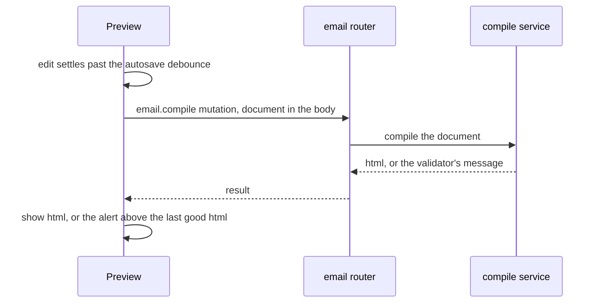

# Email preview transport

Preview asks the server to compile the open email, and shows the html the server returns or the validator's message. The request carries the email document. Today that request is a query, so the document is serialised into the URL, and the URL outgrows the server's header limit for a realistic email.

## How it works

Preview debounces its refresh on the autosave cadence, so a run of keystrokes produces one compile. The compile is then one request that carries the document in its body. The server runs the MJML compile and returns either the html or the validator's message, and Preview keeps the last good html on a refused compile so the alert sits above the preview it did not replace.

## Data model

None. The compile reads the document it is sent and stores nothing.

## Procedures

| Procedure       | Auth            | Input                   | Purpose                                                              |
| --------------- | --------------- | ----------------------- | -------------------------------------------------------------------- |
| `email.compile` | standard authed | the open email document | the preview's compile, now a mutation so the document rides the body |

## Key files

| File                                                        | Role                                                                                    |
| ----------------------------------------------------------- | --------------------------------------------------------------------------------------- |
| `apps/web/server/trpc/routers/email.ts`                     | `compile` becomes a mutation, its `humanOnly` note kept                                 |
| `apps/web/app/components/PageBuilder/Email/Preview.vue`     | calls the mutation through the debounced refresh; keeps the last good html on a refusal |
| `apps/web/app/components/PageBuilder/Email/Preview.test.ts` | the preview's tests mock the procedure as a mutation                                    |
| `apps/web/server/trpc/routers/email.test.ts`                | the router tests cover the compile through the caller, unchanged in shape               |

## Notes

- The change alters only the transport. The compile, its validator messages and the substitution of merge fields are unchanged.
- A mutation's retry is not automatic, so a dropped compile is retried by the next settled edit or by Preview's retry control.
- The Preview paragraph of the email design: the query it describes becomes a mutation carrying the document in its body.
