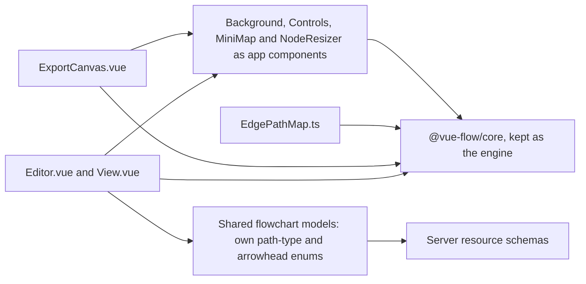

# Flowchart Canvas

The chosen design keeps Vue Flow as the flowchart's canvas engine, takes its four plugin packages back as the app's own components, and stops the shared flowchart models from importing the engine at runtime. [The proposal](proposal.md) holds the comparison with the alternatives and the open choices; this page holds how the chosen design is built.

## What the canvas must do today

The canvas is one component tree in two modes, the editor and the published view, and the export draws the same tree once more. Everything below is behaviour the current specs or code rely on, so a canvas that replaces Vue Flow must match each item or the owner has to accept its loss:

- Dragging nodes, and dropping a palette entry onto the canvas (`apps/web/app/composables/flowchartEditor/useDragAndDrop.ts`).
- Connecting one node's handle to another's, which creates an edge with the default arrowhead and right-angled path ([flowchart connectors](../../specs/resource/flowchart-connectors/spec.md)).
- Choosing an edge's path type among curved, right-angled and straight, and editing an edge's label inline.
- Resizing a node, with a minimum size, and keeping a colour the owner picked as the node's style.
- Panning and zooming, fitting the view, and a zoom control set.
- A minimap of the whole diagram.
- Exporting the whole diagram as PNG or SVG, which fits the view and captures the `.vue-flow` element ([flowchart image export](../../specs/resource/flowchart-image-export/spec.md)).
- A read-only published view that keeps panning and zooming and refuses moving, connecting and selecting ([flowchart publish](../../specs/resource/flowchart-publish/spec.md)).

## The design

Four changes, in dependency order. The engine is the one dependency the design keeps, and its path functions stay in `EdgePathMap.ts`, where the stored path type is turned into a drawn path.



The editor and the export reach the engine through the app's own components for the four plugin roles, and the shared models no longer import it, so the server's schema path carries none of the engine.

1. **Shared models own their enums.** `GraphEdge.ts` defines the path-type and arrowhead values the editor stores, with the same string values as the engine's, so stored content and the schema's accepted values do not change. `GraphNode.ts`, `XYPosition.ts` and their tests take the same types from the model, not the engine. The engine stays imported only by the canvas components, the path map and the constants that name a default path type.
2. **The background and the controls become app components.** The background is a dot grid drawn in the canvas's own layer, and the controls are buttons that call the engine's instance. Both are absorbed first because they are the smallest and touch only public API.
3. **The minimap becomes an app component.** It draws one rectangle per node at the scale the engine's viewport reports, and the published view and the export use the same component.
4. **The node resizer becomes an app component.** A pointer resize writes the node's width and height into its style, clamped at the minimum the Rectangle node sets. Its keyboard path is an open choice, below.

The four `@vue-flow` plugin packages leave `apps/web/package.json` and the catalog, and their four ledger rows move from hold to removed in the commit that removes the last import, as the admission standard requires.

## Key files

Existing files this design touches, with each one's role after the change:

| File                                                            | Role after the change                                                         |
| --------------------------------------------------------------- | ----------------------------------------------------------------------------- |
| `apps/web/shared/models/flowchartEditor/data/GraphEdge.ts`      | Owns the path-type and arrowhead enums; no runtime import of the engine       |
| `apps/web/shared/models/flowchartEditor/data/GraphNode.ts`      | Owns its node type; no engine import                                          |
| `apps/web/shared/models/flowchartEditor/data/XYPosition.ts`     | Owns its position type; no engine import                                      |
| `apps/web/app/components/Resource/Flowchart/Editor.vue`         | Mounts the engine and the app's own background, minimap and controls          |
| `apps/web/app/components/Resource/Flowchart/View.vue`           | The published view; mounts the same app components, read-only                 |
| `apps/web/app/components/Resource/Flowchart/ExportCanvas.vue`   | The export; mounts the same node and edge maps, with the app's own background |
| `apps/web/app/components/FlowchartEditor/Controls.vue`          | The zoom controls, rewritten over the engine's instance                       |
| `apps/web/app/components/FlowchartEditor/Node/Rectangle.vue`    | Uses the app's own node resizer in place of the plugin                        |
| `apps/web/app/services/flowchartEditor/EdgePathMap.ts`          | The engine's path functions, unchanged                                        |
| `apps/web/package.json`                                         | Loses the four plugin dependencies; keeps `@vue-flow/core`                    |
| `pnpm-workspace.yaml`                                           | Loses the four plugin catalog entries; keeps `@vue-flow/core`                 |
| `.agents/ledgers/dependencies.md`                               | The four `Keep — hold` rows are removed with their last import                |
| `openspec/deferred/resource/flowchart-on-editor-core/design.md` | Its revisit trigger is recorded as fired and decided here                     |

Paths the change creates go in this tree, not the table:

```text
apps/web/app/components/FlowchartEditor/
├── Background.vue      dot grid drawn in the canvas's own layer
├── MiniMap.vue         one rectangle per node at the viewport's scale
└── NodeResizer.vue     pointer resize, clamped at the node's minimum
```

## Sources

- [tldraw SDK licence](https://tldraw.dev/legal/tldraw-license): the source-available licence since SDK 4.0, read for option 3's licence row.
- [tldraw license key](https://tldraw.dev/sdk-features/license-key): the trial, commercial and hobby licence types and the production-key rule, read for option 3.
- [@excalidraw/excalidraw on npm](https://npmjs.com/@excalidraw/excalidraw): the MIT licence and the React peer requirement, read for option 4. Its unpacked size is not a bundle size.
- [@antv/x6-vue3-shape on npm](https://npmjs.com/package/@antv/x6-vue3-shape) and [its Snyk advisor page](https://snyk.io/advisor/npm-package/@antv/x6-vue-shape): the Vue shape package's licence and last release, read for option 5.
- [@vue-flow/core on DepScope](https://mcp.depscope.dev/pkg/npm/@vue-flow/core): a third-party aggregator's MIT licence and approximate gzipped size for the core and its plugins. Not measured in the repository; task 1 replaces it with the score's number.
- [Dependency admission](../../specs/architecture/dependency-admission/design.md): the stop list, the component-wrapper rule and the absorption stages this design follows.
- [Flowchart on the editor core](../../deferred/resource/flowchart-on-editor-core/design.md): the three futures and the revisit trigger, which has fired.
