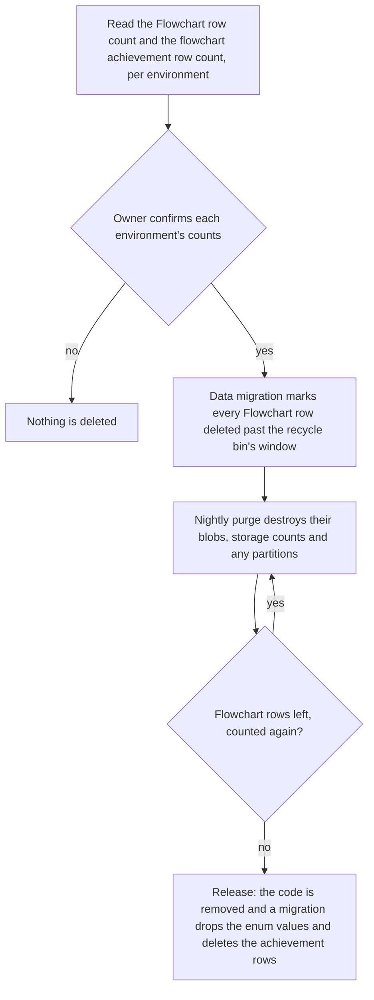

# Flowchart Retirement

This change removes the Flowchart type, its canvas dependency and every stored flowchart, in one release. [The proposal](proposal.md) records the owner's decisions. This page holds the order of the deletion, the check that the whiteboard covers the flowchart's work, and the files the removal touches.

## The deletion order

Existing flowcharts are deleted, and the order matters. A PostgreSQL enum value cannot be dropped while a row still holds it, and a row deleted directly leaves its blob and its storage count behind, since the nightly purge is the one job that destroys them. So the order is fixed:

The release is the only point at which code and data change together. Before it, the type still parses, so the purge can run. After it, nothing names the type. The purge is the existing job in `apps/functions/src/handlers/purgeDeletedResourcesHandler.ts`, which destroys everything the recycle bin held past its window; the marking step reuses it rather than writing a second deletion path.

The count is a number each environment holds, not one this repository can state, so it is read from the environment's database before the marking runs and recorded in the owner's confirmation. Its form is one count of rows whose resource type is the Flowchart and one count of achievement rows naming the Flowcharter achievement, per environment. The marking migration and the release migration are written under the drizzle and backfills skills, and the release migration refuses to run while any Flowchart row remains.

## The whiteboard covers the feature list

Nothing is dropped unnoticed: each feature the Flowchart has is checked against the [design canvas](../resource-design-canvas/design.md), the whiteboard that succeeds it, and each row ends as covered or as an owner's confirmed loss. A row left open blocks the release.

| Flowchart feature                                 | Whiteboard counterpart                                                 | Status                                              |
| ------------------------------------------------- | ---------------------------------------------------------------------- | --------------------------------------------------- |
| Labelled step nodes                               | Shapes with text bound to their container                              | Covered                                             |
| Node colour                                       | Element fill and stroke                                                | Covered                                             |
| Node resize with a minimum size                   | Free resize with no minimum                                            | Owner confirms                                      |
| Four connection points per node, loose connection | Arrows bound to a shape, with no fixed points                          | Owner confirms                                      |
| Arrowhead on every connector                      | Arrow end head                                                         | Covered; verify in the whiteboard's build           |
| Connector labels, edited inline                   | Text bound to an arrow                                                 | Covered; verify                                     |
| Curved, right-angled and straight paths           | The whiteboard's arrow kinds                                           | Owner confirms                                      |
| Palette of node types, dropped on the canvas      | The whiteboard's toolbar                                               | Covered                                             |
| Minimap                                           | None in the whiteboard                                                 | Owner confirms: dropped, or added to the whiteboard |
| Dot grid and snap to grid                         | The whiteboard's grid                                                  | Verify                                              |
| Pan, zoom and fit                                 | The whiteboard's viewport                                              | Covered                                             |
| Delete by keyboard                                | The whiteboard's shortcuts                                             | Verify                                              |
| Export to PNG and SVG, fonts and theme background | The Portable formats, from stored elements                             | Covered; verify export without an open editor       |
| Read-only published view                          | None: publishing is not in the whiteboard's first version              | Owner confirms the loss                             |
| Agent reads and patches of flowchart content      | The whiteboard's content schema, read and patched by the generic tools | Covered                                             |
| Flowchart achievement                             | Removed with the type                                                  | Owner confirms the loss                             |

## Scope of the removal

Each file below is removed or has its entry removed in the release. The paths are the ones that name the type, its canvas, its dependency or its agent surface; the sweep in the tasks finds the rest.

| File                                                                    | Role in the removal                                                 |
| ----------------------------------------------------------------------- | ------------------------------------------------------------------- |
| `packages/db-schema/src/models/resource/ResourceType.ts`                | Drops the Flowchart value                                           |
| `packages/db-schema/src/services/resource/ResourceOwnedTablesMap.ts`    | Drops the Flowchart entry                                           |
| `packages/db-schema/src/schema/resource/resourcesInResource.ts`         | The resource type enum column the release migration narrows         |
| `packages/db-schema/src/models/achievement/FlowchartAchievementName.ts` | Deleted with the achievement                                        |
| `packages/db-schema/src/services/achievement/AchievementName.ts`        | Drops the achievement from the name union                           |
| `apps/web/shared/models/achievement/AchievementCategory.ts`             | Drops the Flowchart category                                        |
| `apps/web/shared/models/flowchartEditor`                                | Deleted: the graph's models and their tests                         |
| `apps/web/shared/models/trpc/TRPCProcedureInputs.ts`                    | Drops the flowchart save input                                      |
| `apps/web/shared/services/resource/ResourceDefinitionMap.ts`            | Drops the Flowchart definition                                      |
| `apps/web/shared/services/superjson/JSONClassMap.ts`                    | Drops the flowchart classes                                         |
| `apps/web/server/trpc/routers/flowchart.ts`                             | Deleted: the flowchart router                                       |
| `apps/web/server/trpc/routers/index.ts`                                 | Drops the flowchart router                                          |
| `apps/web/server/trpc/routers/resourceDispatch.ts`                      | Drops the flowchart dispatch entry                                  |
| `apps/web/app/components/Resource/Flowchart`                            | Deleted: editor, published view, dialogs and export canvas          |
| `apps/web/app/components/FlowchartEditor`                               | Deleted: nodes, edges, panels and the sidebar                       |
| `apps/web/app/services/flowchartEditor`                                 | Deleted: node and edge maps, path functions and constants           |
| `apps/web/app/composables/flowchartEditor`                              | Deleted: drag and drop                                              |
| `apps/web/app/store/flowchartEditor`                                    | Deleted: the editor and export stores                               |
| `apps/web/app/services/resource/flowchart`                              | Deleted: the export capture and its SVG rasterizing                 |
| `apps/web/app/models/resource/FlowchartExportRequest.ts`                | Deleted                                                             |
| `apps/web/app/models/resource/FlowchartExportFormat.ts`                 | Deleted                                                             |
| `apps/web/app/services/resource/PortableFormatMap.ts`                   | Drops the flowchart formats                                         |
| `apps/web/app/services/resource/ResourceBladeDefinitionMap.ts`          | Drops the entry                                                     |
| `apps/web/app/services/resource/ResourceDialogsComponentMap.ts`         | Drops the entry                                                     |
| `apps/web/app/services/resource/ResourceEditorComponentMap.ts`          | Drops the entry                                                     |
| `apps/web/app/services/resource/ResourceTypeDescriptionMap.ts`          | Drops the entry                                                     |
| `apps/web/app/services/resource/ViewComponentMap.ts`                    | Drops the published view entry                                      |
| `apps/web/package.json`                                                 | Drops the five `@vue-flow` dependencies                             |
| `pnpm-workspace.yaml`                                                   | Drops the five catalog entries                                      |
| `pnpm-lock.yaml`                                                        | Regenerated by `pnpm i`, without the Vue Flow packages              |
| `.agents/ledgers/dependencies.md`                                       | Drops the Vue Flow rows, with their last import                     |
| `.agents/ledgers/quality/shared.md`                                     | Drops the flowchart editor row                                      |
| `apps/functions/src/handlers/purgeDeletedResourcesHandler.ts`           | Destroys the blobs and storage of the rows the marking step sets up |
| `openspec/specs/resource/README.md`                                     | Drops the three flowchart capabilities from the index               |
| `openspec/specs/architecture/agent-content-tools/design.md`             | Drops its flowchart rows                                            |
| `openspec/changes/resource-roadmap/tasks.md`                            | Drops the flowchart shapes line, and links this change              |

## Specs

This change writes no spec delta now. Its removal is recorded as REMOVED requirements in the three flowchart capabilities when the change is built, since the requirement names are read from those specs then. The capabilities are `openspec/specs/resource/flowchart-connectors`, `flowchart-image-export` and `flowchart-publish`, and the archive deletes their folders.

## Sources

- [Flowchart on the editor core](../../deferred/resource/flowchart-on-editor-core/design.md): the removal future, and the two-step rule that a resource type leaves PostgreSQL only after its rows are purged.
- [Design canvas](../resource-design-canvas/design.md): the whiteboard whose capabilities the feature check reads.
