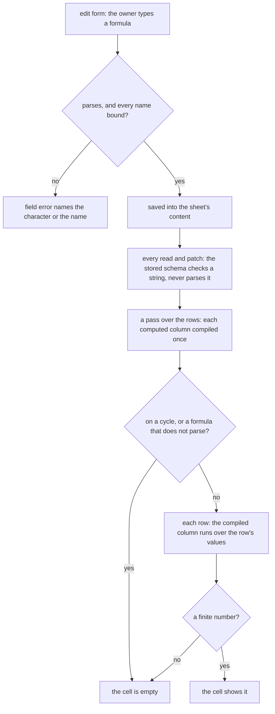

# Math Expression Compiler

A sheet's math column holds a formula such as `col0 * (1 - col1)`, with each `colN` bound to a source column, and shows its value in every row. This change replaces mathjs, the engine that parses and evaluates the formula today, with a parser and a compiler of our own in a package of its own, `math-expression-compiler`. It reads every formula the way mathjs reads it, over plain JavaScript numbers, so no formula a sheet holds changes its value except where mathjs's own answer is a defect. And where mathjs parsed the formula again for every cell, a sheet now compiles each of its computed columns once and runs the result per row.

## Why not keep the engine

mathjs is on the [dependency admission](../../specs/architecture/dependency-admission/design.md) stop list as an engine, and that verdict holds for the engine's product: units, matrices, complex numbers, big numbers, fractions and symbolic algebra. The column uses none of it. It evaluates a formula over numbers, and any value that is not a finite number becomes an empty cell. A recursive descent parser over mathjs's numeric syntax, with a table of its numeric functions, is static code with nothing in it to maintain against a moving platform. The engine it replaces is one of the heaviest packages the browser loads, because the column's schema is shared with the client and imports the parser. Loading it later was the other way to pay less, and it lost: the sheet editor would still fetch the whole engine on its first math column, to use its arithmetic.

## A package of its own

The parser and the compiler are a workspace package, `math-expression-compiler`, unscoped and publishable like `keyframe-store`, rather than a folder of `@esposter/shared`. Every app and package imports shared, and the function table with its special functions — gamma and its logarithm, the error function and its inverse, zeta, the Bernoulli numbers, the counting functions and a Miller–Rabin primality test — nearly doubled that bundle, for consumers that never evaluate a formula. Shared is for small utilities with no opinion of their own; a language with a grammar, a function table and a parity record is not one. The sheet's math column is the one consumer, and a survey runner would be the second, reusing the function table (see "Notes").

The special functions stay inside the package rather than a numerics package of their own, because nothing reads them outside a formula. They split out when something does.

## The bar

**Every formula mathjs evaluates to a finite number, given numbers for its variables, keeps its value.** mathjs's own parser source, `lib/esm/expression/parse.js` in the installed package, is the reference for each rule, and it is read before the rule is written. The proof outlives the dependency: before mathjs leaves the catalog, a generator evaluates a corpus of formulas with it — every operator form, every precedence pair, every function over a spread of inputs — and commits the answers as `mathExpressionParity.snapshot.json` beside the evaluator. The parity test evaluates the same corpus with ours and requires the same answer, to the last bit for arithmetic and within a relative `1e-12` for the special functions, whose series are our own.

Three kinds of difference are allowed, and each is listed in the snapshot by the formula it applies to, never left to a tolerance:

- **A fix.** Where mathjs's answer is a defect — an issue on its tracker, or one the corpus finds — ours is the correct one. The snapshot names each fix's cause, the issue or, where the tracker has none, a sentence saying what mathjs gets wrong, and the regression test's title carries it. A formula mathjs evaluates that ours refuses is recorded as an error, never as `NaN`, so the parity test can require every other formula to parse.
- **Booleans become numbers.** A comparison or a logical operator yields `1` or `0`. mathjs yields a boolean, which the column turned into an empty cell, so a bare comparison showing a value is a fix too; inside arithmetic or a conditional, where mathjs converts the boolean, the value is the same.
- **Syntax that reaches a number only through a non-numeric value.** Strings, units, matrices, objects, property access, `null` and `undefined`, ranges, several statements and function definitions. Over numeric columns each one is an empty cell already, or needs a literal converted to the number the formula could hold directly, such as `number("12")`; reading them puts most of the engine back. A flat list of numbers in square brackets is the exception, read as an argument of a function that takes a list, so `sum([col0, col1])`, `dot([col0, col1], [0.3, 0.7])` and `quantileSeq([col0, col1, col2], 0.5)` keep their values. A list inside a list is a matrix, and stays out with the rest.

## The language

The precedence is mathjs's. From the loosest binding to the tightest:

| Operators                   | Meaning                                                                   |
| --------------------------- | ------------------------------------------------------------------------- |
| `=`                         | assignment: binds a name for the rest of the formula and yields the value |
| `? :`                       | conditional, right associative                                            |
| `or`, `xor`, `and`          | logical, in that order                                                    |
| `\|`, `^\|`, `&`            | bitwise or, exclusive or, and, in that order                              |
| `==` `!=` `<` `<=` `>` `>=` | comparison, chained                                                       |
| `<<` `>>` `>>>`             | shifts                                                                    |
| `+` `-`                     | add, subtract, and their percentage forms                                 |
| `*` `/` `%` `mod`           | multiply, divide, modulo                                                  |
| implicit multiplication     | `2 col0`, `(1 + 2)(3 + 4)`, with mathjs's division exception              |
| postfix `%`                 | percentage                                                                |
| unary `+` `-` `~` `not`     | sign, bitwise not, logical not                                            |
| `^`                         | power, right associative                                                  |
| `??`                        | nullish coalescing, which over numbers yields its left side               |
| postfix `!` `'`             | factorial, and transpose, which is the identity on a number               |
| `name(…)`, `( … )`, `[ … ]` | function call, grouping, a function's list argument                       |

- **A condition is truthy** when it is neither zero nor `NaN`. `and` and `or` evaluate their right side only when the left does not decide them, as mathjs does, and so do `&` and `|`: `0 & x` is `0` and `-1 | x` is `-1` without reading `x`.
- **Power binds tighter than a sign**, so `-2 ^ 2` is `-4`, and its right operand may carry one, so `2 ^ -1` is `0.5`. Factorial binds tighter still, so `-3!` is `-6` and `2 ^ 3!` is `64`.
- **Modulo is floored**, taking the sign of the divisor: `-7 % 3` is `2`, where JavaScript's `%` gives `-1`. A dividend within mathjs's own tolerances of a whole multiple of the divisor gives `0`, so `mod(10.8, 1.2)` and `0.3 mod 0.1` are `0`. mathjs gives a residue of the binary round-off there, sometimes against the divisor's sign ([#513](https://github.com/josdejong/mathjs/issues/513), [#2936](https://github.com/josdejong/mathjs/issues/2936)).
- **`%` is a percentage** when no operand follows it, or a sign does: `8%` is `0.08`, `100 * 3%` is `3` and `100*25% + 2` is `27`. Followed by any other operand it is modulo, so `8 % 3` and `8% 3` are both `2`. A percentage added to or taken from a value is a percentage of that value, so `100 + 3%` and `100 - 3%` are `103` and `97`, as mathjs reads them. Added to a percentage, a percentage adds as a value, so `10% + 20%` is `0.3` and `10% + 20% + 30%` is `0.6`. mathjs reads a `%` before a sign as modulo, which makes `10% + 20%` zero, and its maintainers call that parse a defect ([#3563](https://github.com/josdejong/mathjs/issues/3563)). It is the one fix that changes how a formula parses: `7 % -3`, which mathjs reads as a modulo of a signed divisor, `-2`, is now `7% - 3`, `-2.93`, and a modulo of a signed divisor is written `mod(7, -3)`.
- **Implicit multiplication** binds tighter than `*` and `/`, except a division of a number, signed or not, by an unsigned number, followed by a name or a parenthesis, which divides first: `1/2 col0` is `(1/2) * col0`. A signed divisor is outside the exception in mathjs too, so `1/-2 col0` is `1 / (-2 col0)`. Two bare numbers side by side, `2 3`, are an error, as in mathjs. A parenthesis after a name is a call, never a product.
- **A chained comparison** `a < b < c` holds when each adjacent pair does.
- **Bitwise operators and shifts** take integers, as mathjs's do, and anything else is an error, which the cell shows as empty.
- **Factorial** of a non-integer is `gamma(n + 1)`, as in mathjs, and of a negative integer is an error.
- **A number** is decimal digits with an optional fraction and an optional exponent, whose `e` takes a digit after its optional sign, so `2e.5` is an error as in mathjs. It can also be a radix literal, as mathjs reads one: `0x`, `0b` or `0o`, then that radix's digits, an optional fraction and an optional word size such as `i8`, which reads the digits as a signed integer of that many bits, so `0xFFi8` is `-1` and `0x1FFi8`, too wide for eight bits, is an error. A radix literal stops at the first character that is not one of its digits, so `0x` before a name is zero times the name, where mathjs refuses it ([#2374](https://github.com/josdejong/mathjs/issues/2374), [#3421](https://github.com/josdejong/mathjs/issues/3421)). A comment runs from `#` to the end of the line.
- **Spaces, tabs and non-breaking spaces separate tokens**, as in mathjs, and so does a newline inside parentheses; outside them a newline starts another statement, which the language leaves out.
- **A name** is a letter, an underscore or a dollar sign followed by those and digits, as mathjs accepts. It resolves to an assigned name, then a column variable, then a constant: mathjs's `pi` and `PI`, `e` and `E`, `tau`, `phi`, `LN2`, `LN10`, `LOG2E`, `LOG10E`, `SQRT1_2`, `SQRT2`, `Infinity`, `NaN`, `true` and `false`. A name is looked up only as an own entry of the scope or a table, so `constructor` or `__proto__` is an unknown name rather than a member of an object's prototype — the class of escape mathjs's own security advisories were about.
- **Functions** are every mathjs function that reads numbers and flat lists of numbers to a number or a boolean — the arithmetic, bitwise, combinatorics, geometry, logical, probability, relational, set, special, statistics, trigonometry and utility functions among others — under mathjs's names and with every such signature it accepts: `max(col0, col1)` and `max([col0, col1])`, `quantileSeq([col0, col1, col2], 0.5)`, `distance([0, 0], [col0, col1])`, `setSize([col0, col1, col0])`. The table is enumerated by probing the installed mathjs, every exported function called with numbers and flat lists in each shape it could take, rather than from its documentation, so no function a formula could have called is missed. A function whose answer for a list is a list stays out, with the matrices. `random`, `randomInt` and `pickRandom` are left out, because a computed cell must show the same value on every render and a seed is not a column concept.
- **A function mathjs gets wrong is correct here.** `and`, `or` and `xor` take any number of arguments where mathjs reads two ([#2483](https://github.com/josdejong/mathjs/issues/2483)), `nthRoot` of a perfect power is exact ([#2464](https://github.com/josdejong/mathjs/issues/2464)), and `coth`, `csch` and `sech` are the reciprocals of `tanh`, `sinh` and `cosh`, keeping their precision near zero ([#2967](https://github.com/josdejong/mathjs/issues/2967)). `erfinv` is added, the one function mathjs lacks that a formula has no other way to write ([#2011](https://github.com/josdejong/mathjs/issues/2011)).
- **The defects the corpus found are fixed too**, each listed in the snapshot by its cause. A comparison under `|` is its one or zero, so `2 < 3 | 4` is `5`, where mathjs takes the four as a boolean and answers `1`. A conditional nests in a conditional's true branch, so `1 ? 2 ? 3 : 4 : 5` is `3`, where mathjs refuses it. A stray `:` or an unclosed parenthesis after a percentage, `1 ? 2 : 3 : 4` and `3% (2`, is an error, where mathjs drops what follows. `isPrime` of a non-integer is false, where mathjs answers true for `1.5`. `catalan` stays finite well past the index where mathjs's factorials overflow, `169` and beyond. And `zeta` of a negative number and `lgamma` keep their digits where mathjs's series lose them: `zeta(-5)` is `-1/252`, where mathjs answers `-0.003965`. The norms and `hypot` lose magnitudes in mathjs. Its infinity norms pass over a `NaN` magnitude, which its `max` answers `NaN` for, and its minus infinity norm passes over a zero before a larger magnitude, so `norm([0, 1], -1 / 0)` is `1` where the smallest magnitude is `0`. Its infinity norm starts from zero, which a magnitude within the absolute tolerance never passes, so `norm([1e-16], 1 / 0)` is `0`. Its `hypot` reads a magnitude within that tolerance of the largest so far as no larger, so `hypot(0, 1e-16)` is `0`, and it answers `NaN` for two infinite magnitudes, where the length is infinite. Here the infinity norms fold from the first magnitude, as `max` and `min` do, and `hypot` compares its magnitudes exactly.
- **A function's cost is bounded, since a cell must never take seconds.** `isPrime` is a deterministic Miller–Rabin test where mathjs divides by trial, a large part of a second on a large prime; every double above the safe integers is even, so it is composite at once. `combinations` and the other counting functions stop once the count overflows, where mathjs's `combinations(1e9, 5e8)` takes seconds to reach the same empty cell. `stirlingS2` builds only the band of the triangle its answer needs, the columns up to its second argument or the diagonals down to it, whichever is narrower, and refuses a band too large to build in a cell's time.
- **`round` rounds half away from zero at its digit count**, corrected for binary representation, so `round(-2.5)` is `-3` and `round(1.005, 2)` is `1.01`, as mathjs gives. `Math.round` would give `-2` and `1`.
- **`max` and `min` compare as mathjs's `larger` and `smaller` do**, within its relative and absolute tolerances, so of two nearly equal values the first is kept: `max(0.3, 0.1 + 0.2)` is `0.3`, where `Math.max` gives `0.30000000000000004`. A `NaN` among the values answers `NaN`. The infinity norms fold their magnitudes the same way.
- **`hypot` is mathjs's running rescale**, the largest magnitude so far scaling the sum of squares, so its last bit is mathjs's. `Math.hypot` uses another algorithm, and differs from mathjs in the last bit for about one vector in twenty.
- **An unknown name evaluates to `NaN`**, which the column shows as an empty cell; the edit form names it before it is saved.

## Where the work runs

The stored content schema is applied to every read and every patch of a sheet (`readResourceContent.ts`, `applyResourceContentPatches.ts`). A parse check inside it makes a sheet holding any expression the parser refuses impossible to open, so the stored schema checks only that the expression is a string within the content limit. The parse moves to the column's edit form schema in `ColumnTransformationForm.ts`, which also refuses a name the formula reads while nothing binds it: neither a declared variable, a constant, nor a name the formula has certainly assigned by then. The check follows evaluation order, so `(x = 2) * x` binds its `x` and `x * (x = 2)` does not. A name assigned on one branch of a conditional, on the side of `and`, `or`, `&` or `|` that may not run, or past a chained comparison's first pair, which runs only while every pair before it holds, is bound after it only if every path assigns it. A stored formula that does not parse leaves its column empty, and the edit form shows why when its owner opens it.

A parse is pure and returns a `Result`, with an error naming the character it starts at. Where mathjs's parser refuses a formula the words are its own, `Parenthesis ) expected (char 7)`, `Unexpected operator ) (char 8)`, `Unexpected end of expression (char 4)`. Where mathjs found the fault only when evaluating, the words are ours, since its run-time wording names no position: `Unknown function "foo" (char 1)`, where mathjs says `Undefined function foo`, and `"round" takes 1 or 2 arguments (char 1)`, where it says `Too many arguments in function round (expected: 2, actual: 3)`. Nesting deeper than `MAX_MATH_EXPRESSION_DEPTH` is a parse error rather than a stack overflow, since the expression is typed by a user and stored at any length the content limit allows.

**A formula is compiled once, never per cell.** mathjs's `evaluate` parsed the formula again for every cell. The compute around it searched the sheet's columns for each source of every cell, and built a regular expression column's pattern again for every cell too. The compiler turns the parsed tree into one function of the variables' values. Each name is resolved to its slot, each call to the signature its arguments match and each constant subtree folded, a list of constants included, so a row runs only its arithmetic, and `and`, `or`, `&`, `|` and the conditional stay lazy as closures.

**A function is a list of signatures, and a list is a node.** mathjs dispatches on its arguments' types at every call. A list in square brackets can only be written, never computed from a column, so a call's shape is known when the formula parses: which arguments are lists, and how many there are. Each function declares its signatures, each a range of arities and a list of parameter kinds, a number, a list or either, whose last kind repeats for every argument past it, and the one function that matches a call's arguments to a signature serves both sides. The parser refuses a call no signature matches, with its position, and the compiler binds the matching signature's computation once, so nothing is dispatched per row. A spread statistic such as `sum` is two signatures over one computation, any number of numbers or one list. A computation takes its arguments as one array, never spread into a JavaScript call, because a list can hold more numbers than an engine passes as arguments: spread, a list of a couple of hundred thousand numbers overflows the stack.

The shape this replaces flattened a list into its call's arguments while parsing, with a flag per function saying whether a list was allowed, required or forbidden. It could express a list only as a function's sole argument, so `dot([1, 2], [3, 4])` and `quantileSeq([1, 2, 3], 0.5)` had no way in. Per-row dispatch on the values' types, as mathjs does, lost for the reason the compiler exists.

**A sheet's computed columns are compiled once, by `compileSheetColumns`.** The compute this replaces, `computeValue`, ran per cell and resolved everything again each time. The compile takes the sheet's columns and gives each one a reader: its sources resolved by id, its pattern built and its formula compiled. Binding the compiled columns to a list of rows builds each aggregation once, over its source column in those rows, and yields the reader of a cell. Every pass over the rows compiles once, binds once and reads each cell: the table, the filters, the statistics, the outliers, the clipboard and the dataset a dashboard reads. An aggregation is no longer the exception it was. The grid passed no cache of aggregations, since its rows can be edited between reads, so each aggregation cell walked its whole source column. Painting one such column read the sheet's rows once per cell it painted, and sorting by it read them again for every comparison.

The row store holds the compiled columns as a computed value of the columns, and the bound reader as a computed value of the compiled columns and the rows in view. Binding reads only the source cells of the sheet's aggregations, so Vue's tracking binds again exactly when one of those cells changes, or the rows in view do. Any other edit changes neither, and the cell it touched reads its new value at once.

Two other shapes lost. A parse cache keyed by the formula's text would stop the parsing, but it keeps the per-cell search for sources and the per-cell scope object, and it is a cache to bound, where the compiled columns are a value the pass already holds. A tree-walking evaluator would read the parsed tree for every row, repeating the name lookups and the dispatch on node kinds that the compiler does once.

**A cycle is found when the columns are compiled.** A column whose sources lead back to it, directly or through other computed columns, compiles to an empty cell, and so does every column on the cycle. A column reading a column on a cycle reads an empty source, as it would read any empty cell. The per-cell guard this replaces returned an empty value only for the source that closed the cycle. A math column reads an empty source as zero, so it still showed a number: with `a = b + 1` and `b = a + 1`, both columns showed 2, where the computed columns spec requires empty cells.

## What is deliberately not in it

- **The non-numeric syntax** under "The bar", for the reason given there.
- **Another expression library**, such as `expr-eval`, whose parser evaluates member access and has carried a prototype pollution advisory. A dependency for a parser this size puts back the package this change removes, with its own surface to keep pinned.
- **A typed result**, such as a boolean column from a comparison. The column's effective type is a number, and the filters, statistics and charts reading it expect one.

## Notes

- **The value model is numbers alone, on purpose, and a second consumer gets a compiler of its own.** A survey runner on the editor core ([deferred](../../deferred/resource/survey-on-editor-core/design.md)) would need SurveyJS's condition language: strings, booleans and arrays, `{name}` references bound to answers, `=` as equality, and list operators such as `contains`. That is a different grammar over a different value model, so it would be its own parser and compiler, reusing this one's numeric function table and its error wording. Widening this language to it would put a type check back into every operator of every sheet cell, the per-row dispatch the compiler exists to remove.

## Upstream

mathjs's tracker is triaged for the part this change rewrites: every issue labelled `category:expressions` and every issue labelled `bug` that touches parsing, a numeric function in the table, rounding or precedence, open and closed, found by reading the labelled lists and searching the tracker for each function's name. Each gets a verdict here, with the test that proves an in-scope defect, reproduced against mathjs before it leaves; an issue about a part of the engine the column never used is out of scope, with that part named.

| Issue                                                    | Title                                                                                                                | Verdict                                       | Evidence                                                                                                                                                                                                                                             |
| :------------------------------------------------------- | :------------------------------------------------------------------------------------------------------------------- | :-------------------------------------------- | :--------------------------------------------------------------------------------------------------------------------------------------------------------------------------------------------------------------------------------------------------- |
| [#8](https://github.com/josdejong/mathjs/issues/8)       | Should Parser.parse throw 'Undefined symbol' error?                                                                  | False positive — works as intended            | `sinx` parses as one name; mathjs leaves unknown names to evaluation, and the edit form refuses an unbound name at save.                                                                                                                             |
| [#10](https://github.com/josdejong/mathjs/issues/10)     | Is it possible to add to the unary operator ! for factorial to the parser?                                           | False positive — works as intended            | `5!` is 120 in mathjs 15.2; the factorial operator has been in the parser since 2013.                                                                                                                                                                |
| [#25](https://github.com/josdejong/mathjs/issues/25)     | 0.1 + 0.2 is not 0.3                                                                                                 | False positive — question                     | `0.1 + 0.2` is 0.30000000000000004, IEEE 754 round-off; the thread answers with the round-off docs.                                                                                                                                                  |
| [#32](https://github.com/josdejong/mathjs/issues/32)     | juxtaposition for multiplication                                                                                     | False positive — fixed by a later release     | Implicit multiplication shipped in v0.25.0; `2 pi` is 6.283185307179586 in 15.2.                                                                                                                                                                     |
| [#75](https://github.com/josdejong/mathjs/issues/75)     | how to define a custom operator                                                                                      | Out of scope — extension API                  | Defining a new operator is the parser extension API, which the language excludes.                                                                                                                                                                    |
| [#78](https://github.com/josdejong/mathjs/issues/78)     | why 2sin(x) errors out.?                                                                                             | False positive — fixed by a later release     | `2sin(x)` is 2 times sin(x) in 15.2.                                                                                                                                                                                                                 |
| [#94](https://github.com/josdejong/mathjs/issues/94)     | a mod b returns error                                                                                                | False positive — fixed by a later release     | `2 mod 3` is 2 in 15.2; the infix form works.                                                                                                                                                                                                        |
| [#96](https://github.com/josdejong/mathjs/issues/96)     | Improved Error handling                                                                                              | In scope — feature                            | A parse error names its position in mathjs's words, built with the parser.                                                                                                                                                                           |
| [#100](https://github.com/josdejong/mathjs/issues/100)   | Scientific notation error                                                                                            | Out of scope — complex                        | `i` is mathjs's imaginary unit; complex values are outside the numeric language.                                                                                                                                                                     |
| [#115](https://github.com/josdejong/mathjs/issues/115)   | got wrong result                                                                                                     | False positive — question                     | `0.1+0.2` is IEEE 754 round-off; the same answer as #25.                                                                                                                                                                                             |
| [#118](https://github.com/josdejong/mathjs/issues/118)   | BUG: Mod(x,y) doesn't work anymore                                                                                   | False positive — fixed by a later release     | `mod(1,1)` is 0 in 15.2; the thread says it broke after #94 and was fixed.                                                                                                                                                                           |
| [#123](https://github.com/josdejong/mathjs/issues/123)   | Input preprocessor for numbers                                                                                       | Out of scope — BigNumber                      | The `number: 'bignumber'` configuration; BigNumber is excluded from the language.                                                                                                                                                                    |
| [#130](https://github.com/josdejong/mathjs/issues/130)   | Improvement: For factorial function while evaluating large numbers                                                   | False positive — fixed by a later release     | `10000000000!` is Infinity at once in 15.2; the language's factorial is the same.                                                                                                                                                                    |
| [#133](https://github.com/josdejong/mathjs/issues/133)   | Round-off errors in trignometric functions on multiples of pi                                                        | False positive — question                     | `sin(pi)` is 1.2246467991473532e-16 by IEEE 754 round-off, which the bar keeps.                                                                                                                                                                      |
| [#134](https://github.com/josdejong/mathjs/issues/134)   | Combinations                                                                                                         | False positive — fixed by a later release     | `25!/((25-6)! 6!)` is 177100 in 15.2; the thread's 177099 was the old result.                                                                                                                                                                        |
| [#135](https://github.com/josdejong/mathjs/issues/135)   | sin(pi) not equals 0                                                                                                 | False positive — question                     | `sin(pi)` is IEEE 754 round-off, the same answer as #133.                                                                                                                                                                                            |
| [#139](https://github.com/josdejong/mathjs/issues/139)   | Too accurate trigonometry functions...                                                                               | False positive — question                     | `sin(pi)` and `sin(360 deg)` are IEEE 754 round-off; the `deg` part is units, excluded.                                                                                                                                                              |
| [#160](https://github.com/josdejong/mathjs/issues/160)   | math.equal() and round-off errors                                                                                    | False positive — fixed by a later release     | `equal` compares within an epsilon since v0.20.0.                                                                                                                                                                                                    |
| [#180](https://github.com/josdejong/mathjs/issues/180)   | Accept of a comma to separate the tenth, add events                                                                  | Out of scope — number format                  | A comma decimal separator is a locale grammar; the number grammar is dot-only.                                                                                                                                                                       |
| [#187](https://github.com/josdejong/mathjs/issues/187)   | Short circuite evaluation                                                                                            | False positive — fixed by a later release     | `0 and zz` is false in 15.2 without evaluating `zz`; the compiler keeps `and` and `or` lazy.                                                                                                                                                         |
| [#191](https://github.com/josdejong/mathjs/issues/191)   | Implicit multiplication                                                                                              | False positive — works as intended            | A name cannot start with a digit, as the thread says; `2x` is a product in 15.2.                                                                                                                                                                     |
| [#193](https://github.com/josdejong/mathjs/issues/193)   | Add function error                                                                                                   | False positive — question                     | `add(22.96, 96)` is 118.96000000000001, IEEE 754 round-off; duplicate of #115.                                                                                                                                                                       |
| [#197](https://github.com/josdejong/mathjs/issues/197)   | Check number of arguments in functions or not?                                                                       | False positive — works as intended            | Arity errors are the designed behaviour; the thread closed on keeping them.                                                                                                                                                                          |
| [#204](https://github.com/josdejong/mathjs/issues/204)   | Percentage                                                                                                           | In scope — defect                             | `25% + 25%` is 0 in 15.2, a modulo of 0.25; fixed by the rule of #3563, so 0.5.                                                                                                                                                                      |
| [#211](https://github.com/josdejong/mathjs/issues/211)   | potential DoS through factorial                                                                                      | False positive — fixed by a later release     | `10000000000!` is Infinity at once in 15.2, with no loop to hang; the language's factorial is the same.                                                                                                                                              |
| [#220](https://github.com/josdejong/mathjs/issues/220)   | Prevent overriding provided functions                                                                                | Out of scope — extension API                  | Preventing overrides of built-in functions and constants: names resolve only to the language's own tables, with no override API.                                                                                                                     |
| [#226](https://github.com/josdejong/mathjs/issues/226)   | Factorials for non-integers                                                                                          | False positive — fixed by a later release     | `2.3!` is gamma(3.3) = 2.6834373819557675 since v1.2.0.                                                                                                                                                                                              |
| [#228](https://github.com/josdejong/mathjs/issues/228)   | exp(x) doesn't equal e^x                                                                                             | False positive — question                     | `exp(10)` and `e^10` differ in the last bits (22026.465794806718 and 22026.465794806703) by IEEE pow against exp; round-off.                                                                                                                         |
| [#229](https://github.com/josdejong/mathjs/issues/229)   | Parsing for multiplying with constants                                                                               | False positive — fixed by a later release     | The thread records the `2e` fix; `2e2e` parses as `2e2 * e` in 15.2.                                                                                                                                                                                 |
| [#231](https://github.com/josdejong/mathjs/issues/231)   | node.js round not working                                                                                            | False positive — question                     | Not reproducible: `round(pi, 3)` is 3.142 in 15.2; the reporter's `require` was wrong.                                                                                                                                                               |
| [#273](https://github.com/josdejong/mathjs/issues/273)   | toTex removing important parenthesis                                                                                 | Out of scope — TeX output                     | `toTex` is the node API, not evaluation.                                                                                                                                                                                                             |
| [#304](https://github.com/josdejong/mathjs/issues/304)   | Adding percentage of previous value                                                                                  | False positive — fixed by a later release     | `100 + 3%` is 103 in 15.2, the percentage form the thread asked for.                                                                                                                                                                                 |
| [#316](https://github.com/josdejong/mathjs/issues/316)   | Invalid values for math.round                                                                                        | False positive — fixed by a later release     | `round(2.135, 2)` is 2.14 in 15.2.                                                                                                                                                                                                                   |
| [#405](https://github.com/josdejong/mathjs/issues/405)   | Parser throws error when defining a function in a multiline expression                                               | Out of scope — function definitions           | A multi-line function definition is a function definition, which the language excludes.                                                                                                                                                              |
| [#406](https://github.com/josdejong/mathjs/issues/406)   | math.multiply floating point                                                                                         | False positive — question                     | `69999.93*100` is 6999992.999999999, IEEE 754 round-off.                                                                                                                                                                                             |
| [#407](https://github.com/josdejong/mathjs/issues/407)   | Parenthesis in toString() method missing                                                                             | Out of scope — node tree and toString         | `toString` parenthesisation is the node API.                                                                                                                                                                                                         |
| [#416](https://github.com/josdejong/mathjs/issues/416)   | Parsing incomplete/invalid inputs                                                                                    | Out of scope — node tree                      | Partial parse trees for incomplete input are the node API; the language returns a positioned error.                                                                                                                                                  |
| [#443](https://github.com/josdejong/mathjs/issues/443)   | tan(pi/2)                                                                                                            | False positive — question                     | `tan(pi/2)` is the finite IEEE value 16331239353195370; the bar keeps it, and mathjs does not return Infinity.                                                                                                                                       |
| [#444](https://github.com/josdejong/mathjs/issues/444)   | factorial(0^(-1))                                                                                                    | False positive — works as intended            | `factorial(0^(-1))` is Infinity in 15.2, not a finite number; a non-finite result becomes an empty cell.                                                                                                                                             |
| [#447](https://github.com/josdejong/mathjs/issues/447)   | cos(pi/2)                                                                                                            | False positive — question                     | `cos(pi/2)` is 6.123233995736766e-17, IEEE 754 round-off; same cause as #443.                                                                                                                                                                        |
| [#463](https://github.com/josdejong/mathjs/issues/463)   | inconsistent implicit multiplication                                                                                 | False positive — fixed by a later release     | `2 * 3 3 3` is a syntax error in 15.2 and `2 3` is an error too, which the design keeps.                                                                                                                                                             |
| [#464](https://github.com/josdejong/mathjs/issues/464)   | ASCII polar notation                                                                                                 | Out of scope — complex                        | Polar notation `13 /_ 22.6 deg` is complex phasor syntax; complex values are excluded.                                                                                                                                                               |
| [#467](https://github.com/josdejong/mathjs/issues/467)   | Extension point/hook to support new symbols/operators                                                                | Out of scope — extension API                  | The extension hook for new symbols and operators is the extension API, which the language excludes.                                                                                                                                                  |
| [#486](https://github.com/josdejong/mathjs/issues/486)   | Issue evaluation function                                                                                            | Out of scope — complex                        | `(-1)^(-2/3)` is complex in mathjs; the language is real-valued, so the result is non-finite.                                                                                                                                                        |
| [#492](https://github.com/josdejong/mathjs/issues/492)   | Dealing with Percantage% expressions                                                                                 | False positive — works as intended            | `5%290` is 5 in 15.2: an operand follows the `%`, so it is modulo, as the design states.                                                                                                                                                             |
| [#497](https://github.com/josdejong/mathjs/issues/497)   | Question related to factorial of negative numbers                                                                    | False positive — works as intended            | `(-3)!` is an error and `-3!` is -6 in 15.2 by the design's precedence; the thread's reason stands.                                                                                                                                                  |
| [#506](https://github.com/josdejong/mathjs/issues/506)   | multiply 1.035 by 100                                                                                                | False positive — question                     | `1.035*100` is 103.49999999999999, IEEE 754 round-off.                                                                                                                                                                                               |
| [#513](https://github.com/josdejong/mathjs/issues/513)   | math.mod doesn't return the right value                                                                              | In scope — defect                             | `mod(10.8, 1.2)` is 1.7763568394002505e-15 in 15.2, but 10.8 / 1.2 is exactly 9, so the floored result is 0.                                                                                                                                         |
| [#516](https://github.com/josdejong/mathjs/issues/516)   | ± (Plus-Minus) Sign and Multiple Answers                                                                             | Out of scope — equations                      | A plus-minus sign returning two answers is an equation solver, which the language excludes.                                                                                                                                                          |
| [#518](https://github.com/josdejong/mathjs/issues/518)   | Multi-line functions and control flow like for/do/while and if/else                                                  | Out of scope — control flow and functions     | Multi-line functions and loops are statements and function definitions, which the language excludes.                                                                                                                                                 |
| [#561](https://github.com/josdejong/mathjs/issues/561)   | Strange behaviour with some floating point subtraction                                                               | False positive — question                     | Subtraction results such as 0.1-style round-off are IEEE 754 round-off, as the thread answers.                                                                                                                                                       |
| [#589](https://github.com/josdejong/mathjs/issues/589)   | math.eval('tan(pi/2)') gives 16331239353195370 instead of Inifinity                                                  | False positive — question                     | `tan(pi/2)` is the finite IEEE value 16331239353195370; the bar keeps it.                                                                                                                                                                            |
| [#597](https://github.com/josdejong/mathjs/issues/597)   | Question related to 7+3(5*3)*sin(60)                                                                                 | False positive — works as intended            | `7+3(5*3)*sin(60)` is -6.716477949599751 in 15.2: `3(5*3)` is a product and the rest is left to right.                                                                                                                                               |
| [#599](https://github.com/josdejong/mathjs/issues/599)   | Using reserved characters in symbols/ variables.                                                                     | Out of scope — name grammar                   | Application-specific symbol characters belong to the name grammar, which the language fixes.                                                                                                                                                         |
| [#605](https://github.com/josdejong/mathjs/issues/605)   | Question related to asin(.5)*6-pi                                                                                    | False positive — question                     | `asin(.5)*6-pi` is about 1e-15 from zero, IEEE 754 round-off.                                                                                                                                                                                        |
| [#606](https://github.com/josdejong/mathjs/issues/606)   | Issues with 0.0254037844386*1000-25                                                                                  | False positive — question                     | `0.0254037844386*1000-25` is 0.40378443859999..., IEEE 754 round-off.                                                                                                                                                                                |
| [#607](https://github.com/josdejong/mathjs/issues/607)   | Implicit multiplication                                                                                              | False positive — fixed by a later release     | Space-implicit multiplication was addressed in v3.1.0; 15.2 has the rule the language keeps.                                                                                                                                                         |
| [#612](https://github.com/josdejong/mathjs/issues/612)   | PI value of 15 decimal places                                                                                        | False positive — fixed by a later release     | The pi precision complaint was fixed in v3.                                                                                                                                                                                                          |
| [#615](https://github.com/josdejong/mathjs/issues/615)   | implicit multiplication with brackets around the left hand side creates a FunctionNode                               | False positive — fixed by a later release     | `(a)(2+3)` is a product in 15.2; the thread records the behaviour restored.                                                                                                                                                                          |
| [#621](https://github.com/josdejong/mathjs/issues/621)   | Question related to implicit multiplication                                                                          | False positive — fixed by a later release     | The implicit multiplication case was fixed in v3 per the thread; `(2)(3)+4` is 10 in 15.2.                                                                                                                                                           |
| [#629](https://github.com/josdejong/mathjs/issues/629)   | Invalid Scientific notation -3E0.5 is returning value                                                                | False positive — fixed by a later release     | `-3E0.5` is a syntax error in 15.2, the fix the thread records.                                                                                                                                                                                      |
| [#634](https://github.com/josdejong/mathjs/issues/634)   | f(x)=sin() (or any other function)                                                                                   | Out of scope — function definitions           | `f(x)=sin()` is a function definition with an arity error; definitions are excluded.                                                                                                                                                                 |
| [#635](https://github.com/josdejong/mathjs/issues/635)   | Explicitly show multiplier for Implicit multiplication inside a Tri function                                         | Out of scope — node toString                  | The implicit `show` option is a node toString feature.                                                                                                                                                                                               |
| [#641](https://github.com/josdejong/mathjs/issues/641)   | Precedence of exponential versus implied multiplication                                                              | False positive — fixed by a later release     | `5^(2^3)(-2)` is -781250 in 15.2, fixed in v3.2.0; the toString part is the node API.                                                                                                                                                                |
| [#650](https://github.com/josdejong/mathjs/issues/650)   | math.eval doesn't recognise numbers with infinitely repeating decimals i.e. `0.(3)`                                  | False positive — works as intended            | `66.(3)` is 198 in 15.2: a number followed by a parenthesis is a product, which the design keeps.                                                                                                                                                    |
| [#652](https://github.com/josdejong/mathjs/issues/652)   | Correct support of the sin(PI)                                                                                       | False positive — question                     | `sin(PI)` is 1.2246467991473532e-16, IEEE 754 round-off, which the docs explain.                                                                                                                                                                     |
| [#656](https://github.com/josdejong/mathjs/issues/656)   | Unicode handling bug in math.parse()                                                                                 | Out of scope — name grammar                   | The `∅` character is outside the name grammar, which the language fixes.                                                                                                                                                                             |
| [#677](https://github.com/josdejong/mathjs/issues/677)   | math.round(). Not rounding accurately with very small numbers.                                                       | False positive — fixed by a later release     | `round(1.23456e-7, 9)` is 1.23e-7 in 15.2, correct.                                                                                                                                                                                                  |
| [#678](https://github.com/josdejong/mathjs/issues/678)   | Implement erf function                                                                                               | False positive — fixed by a later release     | `erf` exists in 15.2 (added after this request).                                                                                                                                                                                                     |
| [#688](https://github.com/josdejong/mathjs/issues/688)   | What are the allowed characters in variable names?                                                                   | Out of scope — name grammar                   | The allowed characters in names are fixed by the language's name grammar.                                                                                                                                                                            |
| [#689](https://github.com/josdejong/mathjs/issues/689)   | x.01 - x is 0.0099999999998                                                                                          | False positive — question                     | `148.01 - 148` is 0.0099999999998, IEEE 754 round-off, the answer the docs give.                                                                                                                                                                     |
| [#702](https://github.com/josdejong/mathjs/issues/702)   | Mod precision error                                                                                                  | False positive — fixed by a later release     | `mod(8.5, 0.017)` is 0 in 15.2, mathjs's tolerance at a whole multiple, which the parity corpus records; #513's `mod(10.8, 1.2)` still is not.                                                                                                       |
| [#727](https://github.com/josdejong/mathjs/issues/727)   | Implicit multiplication parsing is inconsistent between negative and postive numbers                                 | False positive — fixed by a later release     | `-2 2` is a syntax error since v3.6.0.                                                                                                                                                                                                               |
| [#755](https://github.com/josdejong/mathjs/issues/755)   | Incorrect Values for cos(90) and tan(90)                                                                             | False positive — question                     | `cos(90)` and `tan(90)` in radians are IEEE 754 round-off values.                                                                                                                                                                                    |
| [#825](https://github.com/josdejong/mathjs/issues/825)   | Floor of log fails!!!                                                                                                | Out of scope — BigNumber                      | The reported `floor(log(128,2))` failure is on the BigNumber path; the number path is round-off, as the thread concluded.                                                                                                                            |
| [#826](https://github.com/josdejong/mathjs/issues/826)   | Rounding: Precise trig functions                                                                                     | False positive — question                     | `tan(pi)` is 1.0206761537e-11 by IEEE 754 round-off.                                                                                                                                                                                                 |
| [#854](https://github.com/josdejong/mathjs/issues/854)   | Float equal to 0 issue                                                                                               | False positive — question                     | `0.98+0.3` and `0.57+0.71` compare equal under `equal`'s epsilon; the thread answers with round-off.                                                                                                                                                 |
| [#868](https://github.com/josdejong/mathjs/issues/868)   | Gracefully handle round-off errors in functions fix, floor, ceil                                                     | False positive — fixed by a later release     | `ceil(10*(0.1+0.2))` is 3 in 15.2; the thread closed it as fixed.                                                                                                                                                                                    |
| [#871](https://github.com/josdejong/mathjs/issues/871)   | Equation gets parsed wrong?                                                                                          | False positive — works as intended            | `-1^2` is -1: power binds tighter than a sign, the design's rule that mathjs keeps.                                                                                                                                                                  |
| [#883](https://github.com/josdejong/mathjs/issues/883)   | sin() Huston you have problem                                                                                        | False positive — question                     | `sin(pi)` and `sin(2pi)` are IEEE 754 round-off.                                                                                                                                                                                                     |
| [#892](https://github.com/josdejong/mathjs/issues/892)   | Exponentiation error                                                                                                 | Out of scope — complex                        | `(-1)^(4/3)` is complex; the language is real-valued.                                                                                                                                                                                                |
| [#918](https://github.com/josdejong/mathjs/issues/918)   | How to disable implicit multiplication in toString output.                                                           | False positive — fixed by a later release     | `4(4(4(4)))` is 256 in 15.2, the eval part; the toString part was fixed in v3.16.2.                                                                                                                                                                  |
| [#923](https://github.com/josdejong/mathjs/issues/923)   | Parser produces FunctionNodes with FunctionNodes as function                                                         | False positive — fixed by a later release     | `a(b)(c)` was addressed in #1035 (v4); `sqrt(4)(1+2)` is 6 in 15.2.                                                                                                                                                                                  |
| [#938](https://github.com/josdejong/mathjs/issues/938)   | Incorrect results 1000000.2 + 0.1 not 1000000.3                                                                      | False positive — question                     | `1000000.2 + 0.1` is 1000000.2999999999, IEEE 754 round-off.                                                                                                                                                                                         |
| [#945](https://github.com/josdejong/mathjs/issues/945)   | it got a wrong result when .55*100                                                                                   | False positive — question                     | `.55*100` is 55.00000000000001, IEEE 754 round-off.                                                                                                                                                                                                  |
| [#954](https://github.com/josdejong/mathjs/issues/954)   | Unexpected behavior with math.add and math.multiply with >2 parameters                                               | False positive — fixed by a later release     | `add(1, 2, 3)` is 6 in 15.2, fixed in v3.16.5.                                                                                                                                                                                                       |
| [#955](https://github.com/josdejong/mathjs/issues/955)   | Incorrect value when using implicit multiplication                                                                   | False positive — works as intended            | `10 thousand / 10 thousand` is 1e6 in 15.2: an implicit product binds tighter than `/`, the design's rule.                                                                                                                                           |
| [#957](https://github.com/josdejong/mathjs/issues/957)   | math.chain(366.16).multiply(10).add(2).done()=3663.6000000000004                                                     | False positive — question                     | Chained sums such as `366.16*10+2` are IEEE 754 round-off, which the bar keeps.                                                                                                                                                                      |
| [#963](https://github.com/josdejong/mathjs/issues/963)   | the result of sum is shown with 16 decimal                                                                           | False positive — question                     | `0.65+1.3` is 1.9500000000000002 in float64; the interface tags it as round-off.                                                                                                                                                                     |
| [#966](https://github.com/josdejong/mathjs/issues/966)   | Percentage unary operator                                                                                            | False positive — fixed by a later release     | `10%` is 0.1 in 15.2, the postfix percentage the thread asked for.                                                                                                                                                                                   |
| [#1017](https://github.com/josdejong/mathjs/issues/1017) | A strange question                                                                                                   | False positive — question                     | `69.57*1500` is 104354.99999999999, IEEE 754 round-off.                                                                                                                                                                                              |
| [#1020](https://github.com/josdejong/mathjs/issues/1020) | fix basic arithmetic                                                                                                 | False positive — question                     | `0.1*3`-style sums are IEEE 754 round-off; the thread answers with the round-off docs.                                                                                                                                                               |
| [#1021](https://github.com/josdejong/mathjs/issues/1021) | Precision attribute for rounding functions                                                                           | False positive — fixed by a later release     | The rounding functions take a digit count, implemented after this request.                                                                                                                                                                           |
| [#1030](https://github.com/josdejong/mathjs/issues/1030) | Memory leak in mathjs.eval()                                                                                         | False positive — fixed by a later release     | The memory leak was fixed in v4, which the thread records.                                                                                                                                                                                           |
| [#1035](https://github.com/josdejong/mathjs/issues/1035) | Eval error with function and implicit multiplication                                                                 | False positive — fixed by a later release     | `sqrt(4)(1+2)` is 6 in 15.2, the fix merged in the thread.                                                                                                                                                                                           |
| [#1052](https://github.com/josdejong/mathjs/issues/1052) | math.round() returns wrong value                                                                                     | False positive — works as intended            | `round(1.649, 1)` is 1.6 in 15.2 (1.649 is below 1.65); the expected 1.7 is wrong.                                                                                                                                                                   |
| [#1090](https://github.com/josdejong/mathjs/issues/1090) | this is bug ?                                                                                                        | False positive — question                     | `4224.38 + 3000.23` is 7224.610000000001, IEEE 754 round-off.                                                                                                                                                                                        |
| [#1113](https://github.com/josdejong/mathjs/issues/1113) | Unexpected Value for tan                                                                                             | False positive — question                     | `tan(pi/2)` is the finite IEEE value 16331239353195370; `cos(pi/2)` is round-off.                                                                                                                                                                    |
| [#1178](https://github.com/josdejong/mathjs/issues/1178) | math.chain(5123.6).add(1683.6) = 6807.200000000001                                                                   | False positive — question                     | `5123.6 + 1683.6` is 6807.200000000001, IEEE 754 round-off.                                                                                                                                                                                          |
| [#1210](https://github.com/josdejong/mathjs/issues/1210) | Single quote parsing oddities; unexpected effect of `a = '2''`                                                       | Out of scope — strings                        | `'2''` transposes a string, and strings are excluded. A transpose of a number is the identity, `3'` is 3, which the language keeps.                                                                                                                  |
| [#1214](https://github.com/josdejong/mathjs/issues/1214) | Median hangs if values are NaN                                                                                       | False positive — fixed by a later release     | `median(NaN, NaN, NaN)` returns NaN in 15.2 without a hang; non-finite is an empty cell.                                                                                                                                                             |
| [#1227](https://github.com/josdejong/mathjs/issues/1227) | Catch and Save Syntax Error message                                                                                  | False positive — question                     | Catching a parse error's message is the caller's API; the error wording is task 1.3.                                                                                                                                                                 |
| [#1236](https://github.com/josdejong/mathjs/issues/1236) | quantileSeq has inconsistant return                                                                                  | Out of scope — BigNumber                      | `quantileSeq` with a BigNumber argument is the BigNumber path.                                                                                                                                                                                       |
| [#1262](https://github.com/josdejong/mathjs/issues/1262) | chained conditionals                                                                                                 | False positive — fixed by a later release     | `50<T<100` chained comparison shipped in v5.2.0; the design chains comparisons.                                                                                                                                                                      |
| [#1271](https://github.com/josdejong/mathjs/issues/1271) | How to get "-1/2" to be parsed to -\\frac{1}{2} instead of \\frac{-1}{2} ?                                           | Out of scope — TeX output                     | The fraction layout of `toTex` is the node API.                                                                                                                                                                                                      |
| [#1277](https://github.com/josdejong/mathjs/issues/1277) | Failed Special Boundary Tests with math.log()                                                                        | Out of scope — complex                        | Log of a negative base is complex (Complex.js); `log(0,2)` is -Infinity, outside the bar.                                                                                                                                                            |
| [#1298](https://github.com/josdejong/mathjs/issues/1298) | Unnecessary parentheses in LaTEX output                                                                              | Out of scope — TeX output                     | Parentheses in `toTex` are the node API.                                                                                                                                                                                                             |
| [#1307](https://github.com/josdejong/mathjs/issues/1307) | Absolute value symbol in parser                                                                                      | Out of scope — surface we do not offer        | `\|x\|` would collide with the bitwise or `\|`; `abs(x)` is the absolute value.                                                                                                                                                                      |
| [#1329](https://github.com/josdejong/mathjs/issues/1329) | Feature request: Calculate combination with repetition                                                               | False positive — fixed by a later release     | `combinationsWithRep` exists since v6.1.0.                                                                                                                                                                                                           |
| [#1333](https://github.com/josdejong/mathjs/issues/1333) | Implement lazy evaluation for bitwise operators                                                                      | False positive — fixed by a later release     | `0 & zz` is 0 and `-1 \| zz` is -1 in 15.2 without evaluating `zz`; the compiler keeps both lazy.                                                                                                                                                    |
| [#1334](https://github.com/josdejong/mathjs/issues/1334) | Config option to disable implicit multiplication                                                                     | Out of scope — implicit multiplication config | Disabling implicit multiplication is a config option; the language fixes the rule.                                                                                                                                                                   |
| [#1350](https://github.com/josdejong/mathjs/issues/1350) | Inaccuracy of functions such as sin(pi) can give wrong results when they are nested in another functions.            | False positive — question                     | `sin(pi)` nested inside another function is IEEE 754 round-off.                                                                                                                                                                                      |
| [#1361](https://github.com/josdejong/mathjs/issues/1361) | math.eval('0.6 / 10000') !== 0.00006                                                                                 | False positive — question                     | `0.6 / 10000` is 0.00006000000000000001 in IEEE 754; round-off.                                                                                                                                                                                      |
| [#1364](https://github.com/josdejong/mathjs/issues/1364) | Can't represent this equation with mathjs: a + b = b + a                                                             | Out of scope — equations                      | `a + b = b + a` is an equation, which the language excludes.                                                                                                                                                                                         |
| [#1391](https://github.com/josdejong/mathjs/issues/1391) | null/undefined treated as valid only for left side of comparison operators                                           | Out of scope — null                           | `null` is excluded from the language.                                                                                                                                                                                                                |
| [#1404](https://github.com/josdejong/mathjs/issues/1404) | Rounding behaves differently with or without the number of decimals.                                                 | False positive — fixed by a later release     | `round(-2.5)` is -3 since v5.5.0, the rule the design keeps.                                                                                                                                                                                         |
| [#1418](https://github.com/josdejong/mathjs/issues/1418) | missing white wpace with not operator wen using toString()                                                           | Out of scope — node toString                  | `toString` of `not toto` is the node API.                                                                                                                                                                                                            |
| [#1450](https://github.com/josdejong/mathjs/issues/1450) | math.sum or add (1.2,2.2)                                                                                            | False positive — question                     | `1.2 + 2.2` is 3.4000000000000004, IEEE 754 round-off.                                                                                                                                                                                               |
| [#1462](https://github.com/josdejong/mathjs/issues/1462) | Extend toString to optionally render explicit multiplication as implicit multiplication                              | Out of scope — node toString                  | Explicit multiplication in `toString` is the node API.                                                                                                                                                                                               |
| [#1465](https://github.com/josdejong/mathjs/issues/1465) | node.toHTML() for factorial is not correct                                                                           | Out of scope — node HTML                      | `toHTML` of factorial is the node API.                                                                                                                                                                                                               |
| [#1485](https://github.com/josdejong/mathjs/issues/1485) | throw error "SyntaxError: Parenthesis ) expected (char 102)"                                                         | Out of scope — BigNumber                      | The parse error comes from converting the input to BigNumber, which the language excludes.                                                                                                                                                           |
| [#1645](https://github.com/josdejong/mathjs/issues/1645) | Object syntax doesn't allow keywords (to, mod, in, etc) as keys                                                      | Out of scope — objects                        | Object literals and keyword keys are excluded.                                                                                                                                                                                                       |
| [#1678](https://github.com/josdejong/mathjs/issues/1678) | "foo.2.baz" yields "Unexpected operator ." error                                                                     | Out of scope — property access                | `foo.2.baz` is property access, which the language excludes.                                                                                                                                                                                         |
| [#1703](https://github.com/josdejong/mathjs/issues/1703) | There are some errors in the calculation results                                                                     | False positive — question                     | `12 / (2.3 + 0.74)` is 3.9400000000000004, IEEE 754 round-off.                                                                                                                                                                                       |
| [#1716](https://github.com/josdejong/mathjs/issues/1716) | Need some help in fixing decimal values                                                                              | Out of scope — units                          | User-defined unit conversions are units, which the language excludes.                                                                                                                                                                                |
| [#1738](https://github.com/josdejong/mathjs/issues/1738) | Implicit hide not working in latex for 2*x                                                                           | Out of scope — TeX output                     | Implicit `hide` in `toTex` is the node API.                                                                                                                                                                                                          |
| [#1797](https://github.com/josdejong/mathjs/issues/1797) | Bugs                                                                                                                 | False positive — question                     | No reproduction: the multiplication case is round-off and the inch-to-cm case is units, excluded.                                                                                                                                                    |
| [#1821](https://github.com/josdejong/mathjs/issues/1821) | Is there a way to entirely disable implicit multiplication?                                                          | Out of scope — implicit multiplication config | Disabling implicit multiplication is a config option, as #1334; the language fixes the rule.                                                                                                                                                         |
| [#1842](https://github.com/josdejong/mathjs/issues/1842) | Dealing with Infinity in parse                                                                                       | Out of scope — TeX output                     | `toTex` of Infinity is the node API.                                                                                                                                                                                                                 |
| [#1886](https://github.com/josdejong/mathjs/issues/1886) | Implicit multiplication treated as function                                                                          | False positive — works as intended            | `a(x+1)=2` is a function definition in mathjs; in the language a name followed by `(` is a call, which the design keeps.                                                                                                                             |
| [#1901](https://github.com/josdejong/mathjs/issues/1901) | missing math function: round-to up/down with precision                                                               | False positive — fixed by a later release     | `ceil(1.234, 2)` is 1.24 in 15.2; the thread points at the digit-count form added in v7.4.0.                                                                                                                                                         |
| [#1905](https://github.com/josdejong/mathjs/issues/1905) | Evaluating 'help(not)' throws SyntaxError                                                                            | Out of scope — help function                  | `help(not)` is the help function, not a numeric function.                                                                                                                                                                                            |
| [#1907](https://github.com/josdejong/mathjs/issues/1907) | eval results not correct                                                                                             | False positive — question                     | `1 - 0.66` is 0.33999999999999997, IEEE 754 round-off, which the docs explain.                                                                                                                                                                       |
| [#1918](https://github.com/josdejong/mathjs/issues/1918) | Bad answer with factorial                                                                                            | False positive — works as intended            | `2^(2)!` is 2^(2!) = 4 in 15.2 under mathjs's table, which the design keeps; custom precedence was rejected upstream.                                                                                                                                |
| [#1939](https://github.com/josdejong/mathjs/issues/1939) | chain(99).multiply(3) => 2.9699999999999998                                                                          | False positive — question                     | `chain(99).multiply(3)` is 2.9699999999999998, IEEE 754 round-off.                                                                                                                                                                                   |
| [#1964](https://github.com/josdejong/mathjs/issues/1964) | Modulo operation for negative values                                                                                 | False positive — fixed by a later release     | `-5 mod 3` is 1 in 15.2, fixed in v7.3.0.                                                                                                                                                                                                            |
| [#1981](https://github.com/josdejong/mathjs/issues/1981) | v7.3.0: regression, modulo with negative number broken                                                               | Out of scope — BigNumber                      | BigNumber modulo is the BigNumber path.                                                                                                                                                                                                              |
| [#1988](https://github.com/josdejong/mathjs/issues/1988) | Have a whole bunch errors being thrown from math.evaluate -- don't know how to fix                                   | False positive — question                     | The app passes an array of characters to evaluate; a usage error, not a mathjs value.                                                                                                                                                                |
| [#1995](https://github.com/josdejong/mathjs/issues/1995) | Binary, Octal, and Hexadecimal parsing incorrect                                                                     | False positive — fixed by a later release     | `0x80000000` is 2147483648 in 15.2, fixed in #1996; the language reads radix literals as mathjs does.                                                                                                                                                |
| [#2011](https://github.com/josdejong/mathjs/issues/2011) | implement inverse erf function                                                                                       | In scope — feature                            | `erfinv` is absent from 15.2; the language adds it, accurate to a relative 1e-15, with its test naming the issue.                                                                                                                                    |
| [#2025](https://github.com/josdejong/mathjs/issues/2025) | having problem in using sin()                                                                                        | False positive — question                     | `sin(180 deg)` is IEEE 754 round-off; the `deg` part is units, excluded.                                                                                                                                                                             |
| [#2027](https://github.com/josdejong/mathjs/issues/2027) | Using "to" in accessor leads to SyntaxError: Property name expected after dot (char 10)                              | Out of scope — property access                | `elements.to.value` is property access, which the language excludes.                                                                                                                                                                                 |
| [#2033](https://github.com/josdejong/mathjs/issues/2033) | Why does my calculation have result round-off errors?                                                                | False positive — question                     | `18.4*100` is 1839.9999999999998, IEEE 754 round-off.                                                                                                                                                                                                |
| [#2071](https://github.com/josdejong/mathjs/issues/2071) | Calculate error                                                                                                      | False positive — question                     | `11.1*1.11` is 12.321000000000002, IEEE 754 round-off.                                                                                                                                                                                               |
| [#2077](https://github.com/josdejong/mathjs/issues/2077) | quantileSeq does not accept individual numeric arguments in lieu of an array; does not document dimension argument   | Out of scope — surface we do not offer        | Separate numbers leave the probability indistinguishable from the data; `quantileSeq([1, 2, 3], 0.5)` is the list form the language keeps.                                                                                                           |
| [#2133](https://github.com/josdejong/mathjs/issues/2133) | The function "isPrime" may emit a endless loop when paramater is huge.                                               | Out of scope — BigNumber                      | The endless loop is BigNumber `isPrime`. On numbers 15.2 takes a third of a second for `isPrime(9007199254740881)`, so the language's `isPrime` is a deterministic Miller–Rabin test.                                                                |
| [#2138](https://github.com/josdejong/mathjs/issues/2138) | Addition error                                                                                                       | False positive — question                     | `1+1.1+1.1+1.1` is 4.300000000000001, IEEE 754 round-off.                                                                                                                                                                                            |
| [#2152](https://github.com/josdejong/mathjs/issues/2152) | Simplify function transform a string to number, which cause some problems.                                           | Out of scope — simplify                       | `simplify` is excluded.                                                                                                                                                                                                                              |
| [#2167](https://github.com/josdejong/mathjs/issues/2167) | Erratum in the error message displayed by the function .round()                                                      | False positive — fixed by a later release     | The digit-count message typo was fixed upstream.                                                                                                                                                                                                     |
| [#2182](https://github.com/josdejong/mathjs/issues/2182) | Function Call Operator ’()‘ cannot be used continuously                                                              | Out of scope — function values                | Calling the result of a call, `f(x)(y)`, needs function values, which the language excludes.                                                                                                                                                         |
| [#2199](https://github.com/josdejong/mathjs/issues/2199) | mathjs.parse raises error if having nbsp space (ascii 160), not internal spaces (ascii 20)                           | False positive — fixed by a later release     | Non-breaking-space parse fixed in v14.5.3.                                                                                                                                                                                                           |
| [#2230](https://github.com/josdejong/mathjs/issues/2230) | Parser can't distinguish variables implicitly multiplied by parentheses from function invocation                     | False positive — works as intended            | `x(y + 2)` is a call on `x`; mathjs reports `'x' is not a function`, as the design's call rule has it.                                                                                                                                               |
| [#2236](https://github.com/josdejong/mathjs/issues/2236) | Allow implicit multiplication of multiple single-character variables                                                 | Out of scope — name grammar                   | `4ac` reads the word `ac` as one name; the name grammar is one word per name, and the issue asks for a split.                                                                                                                                        |
| [#2253](https://github.com/josdejong/mathjs/issues/2253) | Failed to parse expression with property access of "e"'s fields                                                      | Out of scope — property access                | `x.e.y` is property access, which the language excludes.                                                                                                                                                                                             |
| [#2255](https://github.com/josdejong/mathjs/issues/2255) | Undocumented `implicit` set on `unaryMinus` and `unaryPlus` OperatorNodes                                            | Out of scope — node API                       | The `implicit` node property is the node API.                                                                                                                                                                                                        |
| [#2283](https://github.com/josdejong/mathjs/issues/2283) | This is not the correct result: chain(0.39).multiply(5).done();                                                      | False positive — question                     | `0.39*5` is 1.9500000000000002, IEEE 754 round-off.                                                                                                                                                                                                  |
| [#2289](https://github.com/josdejong/mathjs/issues/2289) | Syntax / Bracket recovery suggestions                                                                                | False positive — duplicate                    | Duplicate of #2697 upstream.                                                                                                                                                                                                                         |
| [#2303](https://github.com/josdejong/mathjs/issues/2303) | Support for Percentage operation %                                                                                   | False positive — fixed by a later release     | `100*3%` is 3 in 15.2.                                                                                                                                                                                                                               |
| [#2311](https://github.com/josdejong/mathjs/issues/2311) | Inconsistencies in results from exponent operator and pow() ...?                                                     | Out of scope — complex                        | `^` on a negative base gives a complex value in mathjs; complex is excluded.                                                                                                                                                                         |
| [#2319](https://github.com/josdejong/mathjs/issues/2319) | Different behavior between math.evaluate and parser.evaluate                                                         | False positive — fixed by a later release     | Multi-expression evaluation was fixed in v9.5.0.                                                                                                                                                                                                     |
| [#2334](https://github.com/josdejong/mathjs/issues/2334) | Implicit multiplication inside of sqrt call parsed as FunctionNode                                                   | False positive — fixed by a later release     | `sqrt(2 x)` is 2.8284271247461903 in 15.2 as a product, not a call.                                                                                                                                                                                  |
| [#2352](https://github.com/josdejong/mathjs/issues/2352) | QUESTION: Antlr4 grammar                                                                                             | False positive — question                     | A grammar file was declined upstream; the language has no grammar artifact in its design.                                                                                                                                                            |
| [#2355](https://github.com/josdejong/mathjs/issues/2355) | Subtract not working as expected, floating number problems                                                           | False positive — question                     | Subtraction round-off, as the docs' round-off section says.                                                                                                                                                                                          |
| [#2370](https://github.com/josdejong/mathjs/issues/2370) | '-9/4 x' vs '9/4 x'                                                                                                  | False positive — works as intended            | `-9/4 x` is -9 in 15.2 (left to right: `(-9/4) * x`), the design's `/` and implicit rule.                                                                                                                                                            |
| [#2374](https://github.com/josdejong/mathjs/issues/2374) | Parser fails on "0x"                                                                                                 | In scope — defect                             | `0x` is an error in 15.2 ("String 0x is not a valid number"); a radix literal takes only its radix's digits, so `0x` with x = 3 is `0 * x`, 0.                                                                                                       |
| [#2413](https://github.com/josdejong/mathjs/issues/2413) | combinations(42,21) is not an integer                                                                                | False positive — fixed by a later release     | `combinations(42, 21)` is 538257874440 in 15.2, fixed in v10.2.0.                                                                                                                                                                                    |
| [#2426](https://github.com/josdejong/mathjs/issues/2426) | Timeout for large calculations                                                                                       | Out of scope — web worker                     | Web worker hosting is the caller's concern; no evaluation defect.                                                                                                                                                                                    |
| [#2436](https://github.com/josdejong/mathjs/issues/2436) | Can't map 'format'                                                                                                   | Out of scope — function values                | `map` with `format` passes a function value, which the language excludes.                                                                                                                                                                            |
| [#2440](https://github.com/josdejong/mathjs/issues/2440) | Broadcast operator for mathjs functions?                                                                             | Out of scope — matrices                       | Matrix gamma is matrix algebra, which the language excludes.                                                                                                                                                                                         |
| [#2441](https://github.com/josdejong/mathjs/issues/2441) | Functions should be able to take function parameters                                                                 | Out of scope — function values                | Functions as parameters are excluded.                                                                                                                                                                                                                |
| [#2442](https://github.com/josdejong/mathjs/issues/2442) | "New functions can be defined using the `function` keyword." ?                                                       | False positive — docs gap                     | The docs quote was fixed in v10.3.0; function definitions are excluded from the language.                                                                                                                                                            |
| [#2464](https://github.com/josdejong/mathjs/issues/2464) | `nthRoot(125, 3)` results in `4.999999999999999`                                                                     | In scope — defect                             | `nthRoot(125, 3)` is 4.999999999999999 in 15.2; the root of a perfect power is exact, so 5.                                                                                                                                                          |
| [#2483](https://github.com/josdejong/mathjs/issues/2483) | Implement support for more than 2 arguments for logical functions `and`, `or`, and `xor`                             | In scope — defect                             | `and(1,1,0)` is true and `or(0,0,1)` false in 15.2, and `xor(1,1,1)` errors; the functions take two or more arguments, so 0, 1 and 1.                                                                                                                |
| [#2491](https://github.com/josdejong/mathjs/issues/2491) | Multi line object expressions don't work with comments                                                               | Out of scope — objects                        | Multi-line object expressions are objects, which the language excludes; the multi-line part works in 15.2.                                                                                                                                           |
| [#2493](https://github.com/josdejong/mathjs/issues/2493) | Error is unclear when entity being called as a function is not a function.                                           | False positive — fixed by a later release     | The unclear `e(5)` message is clear in 15.2.                                                                                                                                                                                                         |
| [#2495](https://github.com/josdejong/mathjs/issues/2495) | Syntax for calling a computed function?                                                                              | Out of scope — function values                | Computed function syntax is excluded.                                                                                                                                                                                                                |
| [#2497](https://github.com/josdejong/mathjs/issues/2497) | Apparent wrong order of evaluation?                                                                                  | False positive — works as intended            | `6+3+6==6?(-2*4+2):5+2` is 7: 15 == 6 is false, so the false branch gives 7.                                                                                                                                                                         |
| [#2508](https://github.com/josdejong/mathjs/issues/2508) | math.stirlingS2(n, i) and hence math.bellNumbers(n) rounding errors and incorrect values                             | False positive — fixed by a later release     | `stirlingS2(14, 13)` is 91 in 15.2.                                                                                                                                                                                                                  |
| [#2510](https://github.com/josdejong/mathjs/issues/2510) | Referring to items in object/matrix in an expression                                                                 | Out of scope — objects and matrices           | Object and matrix indexing are excluded.                                                                                                                                                                                                             |
| [#2570](https://github.com/josdejong/mathjs/issues/2570) | Returns wrong values                                                                                                 | False positive — question                     | Float round-off, as the thread says.                                                                                                                                                                                                                 |
| [#2573](https://github.com/josdejong/mathjs/issues/2573) | `calculateNecessaryParentheses` blows up cryptically when `getPrecedence` returns null                               | Out of scope — node API                       | Precedence in the node tree is the node API.                                                                                                                                                                                                         |
| [#2602](https://github.com/josdejong/mathjs/issues/2602) | The decimal accuracy is still wrong                                                                                  | False positive — question                     | `20493.8 + 0.1` in float64 is round-off.                                                                                                                                                                                                             |
| [#2617](https://github.com/josdejong/mathjs/issues/2617) | Why does the behavior of `n mod 0` differ from the one in JavaScript?                                                | False positive — works as intended            | `22 % 0` is 22 in 15.2: modulo by zero returns the dividend, the floored convention.                                                                                                                                                                 |
| [#2620](https://github.com/josdejong/mathjs/issues/2620) | Math.round and toFixed methods not using scientific rounding                                                         | Out of scope — rounding modes                 | Round half to even is a rounding mode the language does not have; its round is half away from zero.                                                                                                                                                  |
| [#2631](https://github.com/josdejong/mathjs/issues/2631) | Override operators with the scope just like functions                                                                | Out of scope — extension API                  | Overriding operators with scope is the extension API, which the language excludes.                                                                                                                                                                   |
| [#2807](https://github.com/josdejong/mathjs/issues/2807) | 0.1 + 0.2 = 0.30000000000000004 ?                                                                                    | False positive — question                     | `0.1+0.2` is IEEE 754 round-off.                                                                                                                                                                                                                     |
| [#2818](https://github.com/josdejong/mathjs/issues/2818) | `math.evaluate("f(x,x)=x")` should throw an error                                                                    | Out of scope — function definitions           | `f(x,x)=x` is a function definition, which the language excludes.                                                                                                                                                                                    |
| [#2843](https://github.com/josdejong/mathjs/issues/2843) | math.round(86.0962* 25, 2) is not 2152.41                                                                            | False positive — works as intended            | `round(86.0962*25, 2)` is 2152.41 in 15.2, the design's round corrected for binary representation as mathjs gives.                                                                                                                                   |
| [#2851](https://github.com/josdejong/mathjs/issues/2851) | Why does percentage + percentage give the incorrect answer                                                           | In scope — defect                             | `10% + 20%` is 0 in 15.2 (`10 % (+20/100)`); fixed by the rule of #3563, so 0.3, the reading the maintainer agreed to.                                                                                                                               |
| [#2863](https://github.com/josdejong/mathjs/issues/2863) | Implicit conversion issue using percentages with evaluate                                                            | Out of scope — BigNumber                      | The thread's implicit conversion error comes from the BigNumber configuration; its percentage sum is #3563.                                                                                                                                          |
| [#2904](https://github.com/josdejong/mathjs/issues/2904) | Riemann Zeta function implementation template                                                                        | False positive — fixed by a later release     | `zeta` was added in v11.10.0.                                                                                                                                                                                                                        |
| [#2908](https://github.com/josdejong/mathjs/issues/2908) | minor issues                                                                                                         | False positive — docs gap                     | The docs fixes were published in v11.7.0.                                                                                                                                                                                                            |
| [#2916](https://github.com/josdejong/mathjs/issues/2916) | how to config option to disable implicit multiplication                                                              | Out of scope — config option                  | Disabling implicit multiplication is a config option, a duplicate of #2767.                                                                                                                                                                          |
| [#2933](https://github.com/josdejong/mathjs/issues/2933) | cos(pi/2) and sin(pi) not zero                                                                                       | False positive — question                     | `cos(pi/2)` and `sin(pi)` are IEEE 754 round-off.                                                                                                                                                                                                    |
| [#2936](https://github.com/josdejong/mathjs/issues/2936) | Potential bug in mod()                                                                                               | In scope — defect                             | `mod(0.15, 0.05)` is -2.7755575615628914e-17 and `0.3 mod 0.1` is -5.55e-17 in 15.2, though closed as fixed in v11.11.1. A quotient within mathjs's tolerances of an integer gives 0, and a floored result never takes the sign against the divisor. |
| [#2967](https://github.com/josdejong/mathjs/issues/2967) | Overflow encountered with tanh and coth functions                                                                    | In scope — defect                             | Real `coth(1e-7)` is 9999999.994960707 in 15.2; `coth`, `csch` and `sech` are the reciprocals of `tanh`, `sinh` and `cosh`, so 10000000.000000035. The complex overflow is out of scope.                                                             |
| [#2977](https://github.com/josdejong/mathjs/issues/2977) | subscript zero produces a parsing error                                                                              | Out of scope — name grammar                   | The subscript zero `ε₀` is outside the name grammar, which takes letters, underscore, dollar and digits.                                                                                                                                             |
| [#3020](https://github.com/josdejong/mathjs/issues/3020) | Under specific circumstances, it may cause a dead cycle                                                              | False positive — fixed by a later release     | Prototype-name lookup was fixed in v11.10.1; the design resolves own entries only.                                                                                                                                                                   |
| [#3073](https://github.com/josdejong/mathjs/issues/3073) | Singe quote strings - issues with special characters that need escaping                                              | Out of scope — strings                        | Strings are excluded.                                                                                                                                                                                                                                |
| [#3083](https://github.com/josdejong/mathjs/issues/3083) | Implicit multiplication fails when multiplied zero and x.                                                            | False positive — duplicate                    | Duplicate of #2374.                                                                                                                                                                                                                                  |
| [#3189](https://github.com/josdejong/mathjs/issues/3189) | Precedence of the modulus operator                                                                                   | False positive — fixed by a later release     | `250/10%10` is 5 in 15.2; the postfix percentage precedence was fixed in v14.0.0 per #3301.                                                                                                                                                          |
| [#3199](https://github.com/josdejong/mathjs/issues/3199) | Multiplication by 100 returning unexpected results                                                                   | False positive — duplicate                    | Round-off, duplicate of #2811.                                                                                                                                                                                                                       |
| [#3209](https://github.com/josdejong/mathjs/issues/3209) | v14 breaking changes                                                                                                 | False positive — question                     | Breaking-change tracker for v14, closed as done.                                                                                                                                                                                                     |
| [#3270](https://github.com/josdejong/mathjs/issues/3270) | mathjs , round( 1.8549999999999998, 2); Why is the result 1.86 .                                                     | False positive — works as intended            | `round(1.8549999999999998, 2)` is 1.86 in 15.2; the design's round corrected for binary representation as mathjs gives.                                                                                                                              |
| [#3282](https://github.com/josdejong/mathjs/issues/3282) | Continuous Percentage +/- at the Beginning of Expressions                                                            | In scope — defect                             | `100 + 10% + 20%` is 100 in 15.2; fixed by the rule of #3563, a percentage after a value is a percentage of it, so 132, and `10% + 20% + 30%` adds as percentages, 0.6, the reading the thread asks for.                                             |
| [#3301](https://github.com/josdejong/mathjs/issues/3301) | Precedence of % (mod) is higher than * and /                                                                         | False positive — fixed by a later release     | `250/10%10` precedence fixed in v14.0.0.                                                                                                                                                                                                             |
| [#3333](https://github.com/josdejong/mathjs/issues/3333) | Formula evaluation with adjacent parentheses incorrect                                                               | False positive — works as intended            | `1/(2)(4)` is 0.125 in 15.2: the design's division exception applies only to a number over a number, so `(2)(4)` binds first.                                                                                                                        |
| [#3342](https://github.com/josdejong/mathjs/issues/3342) | Hexadecimal-encoded constants do not respect `number` configuration setting [was 64-bit numerical calculation error] | Out of scope — BigNumber and bigint           | Hex constants under the `number` configuration; the language reads a radix literal as mathjs's default configuration does.                                                                                                                           |
| [#3352](https://github.com/josdejong/mathjs/issues/3352) | Numeric keys disallowed in object expressions                                                                        | Out of scope — objects                        | Numeric keys in objects are excluded.                                                                                                                                                                                                                |
| [#3353](https://github.com/josdejong/mathjs/issues/3353) | Support nullish coalescing operator ?? in mathjs expression language                                                 | False positive — fixed by a later release     | `x ?? 0` shipped in v14.8.0 and is in 15.2.                                                                                                                                                                                                          |
| [#3360](https://github.com/josdejong/mathjs/issues/3360) | Cannot index Array/Matrix with bigint                                                                                | Out of scope — BigInt and matrices            | BigInt indexing is excluded.                                                                                                                                                                                                                         |
| [#3362](https://github.com/josdejong/mathjs/issues/3362) | Fails with big modular expressions                                                                                   | False positive — question                     | Exponential intermediates overflow float64 and the answer is the float64 answer; the bar keeps finite values.                                                                                                                                        |
| [#3367](https://github.com/josdejong/mathjs/issues/3367) | round behavior inconsistent among numeric types                                                                      | Out of scope — rounding modes and BigNumber   | Rounding half-integers across numeric types is the BigNumber path and rounding modes; the language's round is half away from zero.                                                                                                                   |
| [#3420](https://github.com/josdejong/mathjs/issues/3420) | Proposed parsing refactor                                                                                            | Out of scope — parser configuration API       | A parser configuration refactor proposal; the language has no configuration API.                                                                                                                                                                     |
| [#3421](https://github.com/josdejong/mathjs/issues/3421) | Surprising parse results from binary and octal constants                                                             | In scope — defect                             | `0b1x` is an error in 15.2; a radix literal takes only its radix's digits, so `0b1x` with x = 4 is `0b1 * x`, 4.                                                                                                                                     |
| [#3422](https://github.com/josdejong/mathjs/issues/3422) | variable named E blocks .-operators                                                                                  | False positive — fixed by a later release     | `3E.*2` is [6, 12] in 15.2 with E bound (verified); fixed in #3425.                                                                                                                                                                                  |
| [#3447](https://github.com/josdejong/mathjs/issues/3447) | Issue with Results Below 1e-3                                                                                        | False positive — fixed by a later release     | `evaluate("0.0003")` is 0.0003 in 15.2 (verified); the reported 0.00030000000000000003 came from v14.4.0.                                                                                                                                            |
| [#3453](https://github.com/josdejong/mathjs/issues/3453) | v15 breaking changes                                                                                                 | False positive — question                     | v15 breaking-change tracker, closed as done.                                                                                                                                                                                                         |
| [#3501](https://github.com/josdejong/mathjs/issues/3501) | Troublesome parsing interactions between unary/binary % and the other unary operators +,-,~                          | False positive — duplicate                    | Its fix in v15 reads `10%-3` as a modulo, -2, the parse #3563 reports as a defect; the language follows #3563, so a `%` before a sign is a percentage, -2.9, under #3563's test. `11%~1` is -1, a modulo of a bitwise not, as in 15.2.               |
| [#3532](https://github.com/josdejong/mathjs/issues/3532) | is there a bug with zeta(n) ?                                                                                        | False positive — question                     | `zeta(3)` is 1.202056903159616 in 15.2, within 2e-14 of the true value; precision of the series is round-off.                                                                                                                                        |
| [#3552](https://github.com/josdejong/mathjs/issues/3552) | Extend factorial to rising and falling factorials                                                                    | Out of scope — surface we do not offer        | Rising and falling factorials are ratios of gammas, `gamma(x + n) / gamma(x)`, which the language has.                                                                                                                                               |
| [#3563](https://github.com/josdejong/mathjs/issues/3563) | Bad parse for adding percentages                                                                                     | In scope — defect                             | `100*25% + 2` and `10% + 20%` are 0 in 15.2: a `%` followed by a sign reads as modulo. A `%` followed by `+` or `-` is a percentage, and a percentage added to a percentage adds as a value, the thread's consensus, so 27 and 0.3.                  |
| [#3577](https://github.com/josdejong/mathjs/issues/3577) | Clarify whether `x` is allowed to denote the identity function and support if so                                     | Out of scope — function values                | `map` with a function value is excluded.                                                                                                                                                                                                             |
| [#3579](https://github.com/josdejong/mathjs/issues/3579) | Conditional expression parsing regression from #3547                                                                 | False positive — fixed by a later release     | `true?.3:.7` is 0.3 in 15.2, fixed in v15.1.0.                                                                                                                                                                                                       |
| [#3580](https://github.com/josdejong/mathjs/issues/3580) | Questionable optional chaining parse.                                                                                | Out of scope — optional chaining              | Optional chaining is excluded from the language.                                                                                                                                                                                                     |
| [#3582](https://github.com/josdejong/mathjs/issues/3582) | Inconsistent interpretation of empty expressions                                                                     | False positive — works as intended            | `''` is undefined in 15.2 and an empty cell either way; the closed thread's answer.                                                                                                                                                                  |
| [#3586](https://github.com/josdejong/mathjs/issues/3586) | Additional parsing/execution difficulties with optional chaining                                                     | Out of scope — optional chaining              | Optional chaining is excluded from the language.                                                                                                                                                                                                     |
| [#3587](https://github.com/josdejong/mathjs/issues/3587) | Optional chaining symbol allowed overly permissively                                                                 | Out of scope — optional chaining              | Optional chaining is excluded from the language.                                                                                                                                                                                                     |
| [#3589](https://github.com/josdejong/mathjs/issues/3589) | Should mathjs allow units first?                                                                                     | Out of scope — units                          | Units are excluded from the language.                                                                                                                                                                                                                |
| [#3593](https://github.com/josdejong/mathjs/issues/3593) | Support Chinese punctuation like full-width parentheses                                                              | Out of scope — surface we do not offer        | Full-width parentheses are an input method's punctuation; the parse error names the character, and normalising input is the editor's.                                                                                                                |
| [#3595](https://github.com/josdejong/mathjs/issues/3595) | Provide access to numerator and denominator of fraction via num() and den() helpers                                  | Out of scope — Fraction                       | `num` and `den` of a Fraction are excluded.                                                                                                                                                                                                          |
| [#3604](https://github.com/josdejong/mathjs/issues/3604) | lgammaNumber incorrectly returns NaN for all n < 0                                                                   | Out of scope — complex                        | `lgammaNumber` for negative reals is complex (LogGamma); the language's NaN is the design's.                                                                                                                                                         |
| [#3608](https://github.com/josdejong/mathjs/issues/3608) | Interesting consequence of current parsing rules                                                                     | Out of scope — matrices                       | `not` over a sparse matrix is matrix behaviour, which the language excludes.                                                                                                                                                                         |
| [#3621](https://github.com/josdejong/mathjs/issues/3621) | mathjs expressions do not adhere to documented precedence table                                                      | Out of scope — ranges                         | Ranges are excluded; the precedence-table part is the range rule.                                                                                                                                                                                    |
| [#3723](https://github.com/josdejong/mathjs/issues/3723) | Bound variables inconsistently affect scope                                                                          | Out of scope — function definitions           | `f(x) = x + k` is a function definition with a scope capture, which the language excludes.                                                                                                                                                           |

## Key files

| Path                                                                                         | Role                                                                                    |
| -------------------------------------------------------------------------------------------- | --------------------------------------------------------------------------------------- |
| `packages/math-expression-compiler/src/models/MathExpressionNode.ts`                         | the parsed tree, a list among its nodes                                                 |
| `packages/math-expression-compiler/src/models/MathExpressionSignature.ts`                    | a function's signature: its arities, its parameter kinds and its computation            |
| `packages/math-expression-compiler/src/services/parseMathExpression.ts`                      | the recursive descent parser, returning the tree or a positioned error                  |
| `packages/math-expression-compiler/src/services/compileMathExpression.ts`                    | the compiler: a tree and its variable names to a function of numbers                    |
| `packages/math-expression-compiler/src/services/matchMathExpressionSignature.ts`             | the signature a call's arguments fit, for the parser's check and the compiler's binding |
| `packages/math-expression-compiler/src/services/getMathExpressionNames.ts`                   | the free names a tree reads, in evaluation order, for the form's unbound-name check     |
| `packages/math-expression-compiler/src/services/MathExpressionFunctionMap.ts`                | each function's signatures, under its mathjs name                                       |
| `packages/math-expression-compiler/src/services/getMathExpressionSignatures.ts`              | the own-key read of the function table                                                  |
| `packages/math-expression-compiler/src/services/MathExpressionConstantMap.ts`                | the named constants                                                                     |
| `packages/math-expression-compiler/src/services/computeExtreme.ts`                           | the tolerant fold `max`, `min` and the infinity norms share                             |
| `packages/math-expression-compiler/src/services/computeHypotenuse.ts`                        | mathjs's running rescale for `hypot`, comparing exactly                                 |
| `packages/math-expression-compiler/src/services/mathExpressionParity.snapshot.json`          | mathjs's answers over the corpus, recorded before it left, with each fix and its cause  |
| `packages/math-expression-compiler/src/services/mathExpressionParity.test.ts`                | the corpus evaluated with ours, a test per fix cause                                    |
| `apps/web/shared/models/resource/sheet/column/transformation/MathTransformation.ts`          | the stored schema: a string within the content limit                                    |
| `apps/web/app/models/resource/sheet/column/transformation/ColumnTransformationForm.ts`       | the edit form schema, where the parse and the name check run                            |
| `apps/web/shared/services/resource/sheet/column/transformation/compileMathTransformation.ts` | a math column compiled: parse and compile once, a finite number or empty                |
| `apps/web/shared/services/resource/sheet/column/compileSheetColumns.ts`                      | the sheet's computed columns compiled once, cycles found, bound to rows                 |
| `apps/web/app/store/resource/sheet/row.ts`                                                   | the grid's compiled columns and bound reader, as computed values                        |

## Sources

- [mathjs expression syntax](https://mathjs.org/docs/expressions/syntax.html) — the operator table, the precedence order and the implicit multiplication rules the language keeps.
