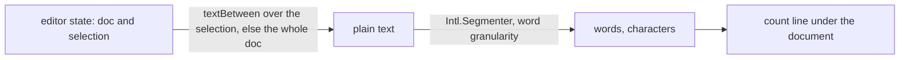

## Context

The Note editor is a menu bar over the document, with no region below the text. The document's text is read by Tiptap's own `textBetween` over the whole document or the selection, so a count needs no stored field and no dependency.

## How it works

The line reads the editor's reactive state, so it follows each keystroke and each selection change. A collapsed selection counts the whole note. A block boundary reads as a space, so the last word of one paragraph and the first of the next are two words.

## Gap analysis

| Feature                                | Verdict                                                                                           |
| -------------------------------------- | ------------------------------------------------------------------------------------------------- |
| Page word and character count          | Built as the count line.                                                                          |
| Count of the selected blocks           | Built as the count of the selected text, which is finer than blocks and the same control.         |
| Reading time, sentence and block count | Not built: the reference shows words and characters, and a reader who wants more has the numbers. |

## Decisions

- **A line under the document, not a menu item.** The count is read while writing, so it stays in view. The reference puts the page count in a menu, a click away from every glance.
- **`Intl.Segmenter`, not a split on spaces.** A split miscounts every language written without spaces. The segmenter ships in the runtime, so no extension is added for a count.
- **Nothing stored.** A stored count would go stale on every edit, and the live document is already in hand.

## Key files

| File                                                       | Role                                    |
| ---------------------------------------------------------- | --------------------------------------- |
| `apps/web/app/components/Resource/Note/Editor.vue`         | hosts the count line under the document |
| `apps/web/app/components/Resource/Note/CountLine.vue`      | draws the words and characters          |
| `apps/web/app/services/resource/note/getNoteTextCounts.ts` | counts a text's words and characters    |

## Sources

- [Notion — Intro to writing & editing](https://www.notion.com/help/writing-and-editing-basics) — selecting blocks shows their word and character counts, and the page's counts are under the page menu.
