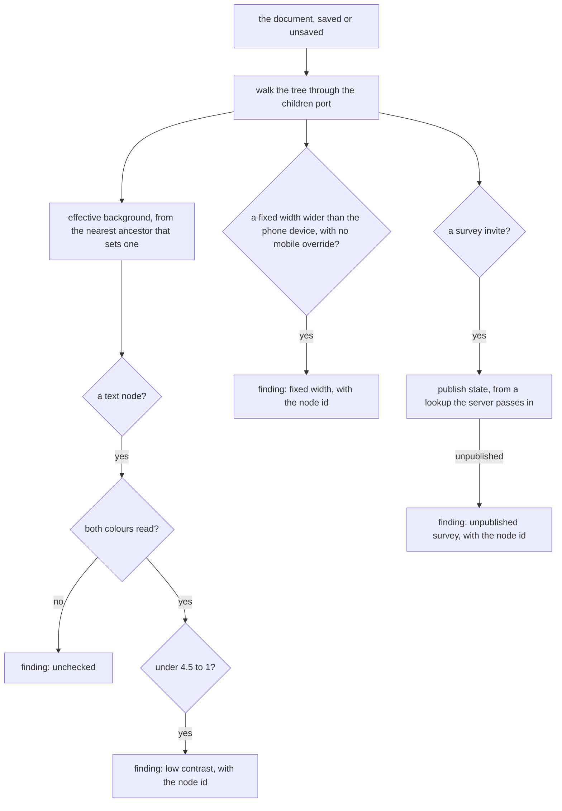

# Page builder critique

A critique of the webpage document: a set of deterministic checks that report what is wrong with a page before it is published, shown in an editor panel and readable by an agent. It is built on the [document model](../../specs/resource/page-builder/document-model/design.md), whose nodes and styles it reads, and on the [style panel](../../specs/resource/page-builder/style-panel/design.md), whose per-breakpoint values it checks. It uses no model: every finding is a computation over the document, so it costs nothing to run and sends nothing anywhere.

## Scope

What works today: the webpage document, its nodes and their per-breakpoint styles, the device widths the canvas draws, the survey invite node, and the generic read tool pattern the resource router already uses for content.

What this change adds: one pure critique function over the document, each check as its own module, an optional critique on the webpage's resource definition, a generic read tool that answers a saved resource's critique, and a Check panel in the webpage editor. The email's checks are a follow-up in the email change, since the email editor is still being built.

## How it works

The critique walks the document once, through the children port the document model already defines, and carries two things down the tree: each node's effective background, which is the nearest ancestor that sets one and otherwise the page's default background, and the mobile override of each style. Each node is checked against its own rules, and the findings are collected in document order.



The walk is the one pass the diagram shows. The checks are gates on the node's own values, and the one external fact, whether a survey is published, is read through a lookup the server fills in, so the function itself never reads the database and runs the same in the browser and on the server.

## Decisions

**One pure function, run in both places.** The critique is one function in the shared page builder services, called by the editor on the unsaved document and by the read tool on the saved one. The alternative was a browser-only check over the rendered canvas, which would read the true cascade through computed styles, but an agent has no canvas to read, and the panel would wait on the frame for every edit. The shared function gives both callers the same answer, which is what the agent needs to trust what the panel showed.

**Checks are declared per type, read by one generic tool.** The webpage's definition in the resource definition map gains an optional critique. The generic read tool reads it off the resource's type, so a second type gains a critique by declaring one and no tool is added. The alternative was a critique tool per type, which the house rule that a feature an agent can use goes through the generic resource tools rejects.

**The browser reads a colour, and a colour it cannot compute is reported unchecked.** The style panel accepts any colour the browser accepts, including forms such as oklch and color-mix. So the editor reads each colour's value through a probe element: the probe takes the value as its colour, and the browser's computed value is read back and converted to an sRGB triple, through a one-pixel canvas where the computed form is not already sRGB. No dependency is added, because the browser already parses every syntax the panel allows. A colour the browser does not compute is reported as unchecked, never as passing, so a page is never shown as clean when the check did not run.

The alternatives were rejected for these reasons:

- **A small parser of hex, rgb and hsl.** It would silently fail on the values the panel allows, such as oklch and color-mix, and the failure would look like a pass.
- **A third-party CSS colour parser.** It would be a second reading of colour syntax beside the browser's, able to disagree with the colour the page renders with, and a dependency to keep current for a job the browser already does. No such package was read for this design, so none is named.

The critique takes each colour as a resolved sRGB value from its caller, so the function itself touches no DOM. The editor supplies the probe's values. The read tool on the server has no browser, so it supplies none: every colour check in its answer is reported as unchecked, and the Notes say so.

**Contrast is held at the normal-text threshold for every text.** WCAG 2.2 criterion 1.4.3 asks for 4.5 to 1 on normal text and 3 to 1 on large text, large meaning 18 point, or 14 point bold ([WCAG 2.2, criterion 1.4.3](https://www.w3.org/TR/WCAG22/#contrast-minimum)). Large text depends on the font size, which the typography sector sets per node and breakpoint, and reading it correctly means resolving the size as the cascade does. The critique holds every text to 4.5 to 1 in this version, so it never passes a text the standard fails, and it may report a large text the standard would allow. Relaxing it for large text is a later change, once the size is resolved.

**Fixed widths are checked against the narrowest device, not measured.** A fixed width wider than the narrowest device the canvas draws, with no mobile override narrowing it, will overflow on a phone. The check reads the value and the device width the canvas names in the page builder's device model. It does not measure rendered layout, because the agent path has no browser and the static fact covers the common fault. Text that overflows for a reason other than a fixed width is not reported, and the Notes say so.

**The survey invite's target is passed in.** Whether a survey is published is a database fact, so the function takes a lookup from its caller, and the server supplies it from the survey's publish state. The alternative was for the function to read the database, which would make it server-only and break the browser's use of it.

**A finding names its node by id.** The canvas selects by node id, so a finding carries the id it names, and the Check panel's selection needs no lookup.

## Procedures

| Procedure                            | Auth                                               | Input           | Purpose                                                                    |
| ------------------------------------ | -------------------------------------------------- | --------------- | -------------------------------------------------------------------------- |
| readCritique, on the resource router | the key owner's resource under the Resources scope | the resource id | answers the critique of the saved content, with the version it was read at |

The procedure takes the owner guard the other generic reads take, so it acts only on the key owner's own resources. For a type with no critique it is refused, naming the type, so an agent learns the check is absent rather than reading an empty list as a clean page.

## Failure and retry

The critique is pure, so it has no retry. A survey lookup that fails leaves its invite's finding reported as unchecked, not dropped. A saved resource that fails to read is refused as the read tool refuses any resource, and the agent may read again.

## Key files

| File                                                             | Role after the change                                                            |
| ---------------------------------------------------------------- | -------------------------------------------------------------------------------- |
| `apps/web/shared/models/pageBuilder/WebpageDocument.ts`          | the document the critique walks                                                  |
| `apps/web/shared/models/pageBuilder/NodeStyle.ts`                | the per-breakpoint, per-state style a node carries                               |
| `apps/web/shared/models/pageBuilder/StyleBreakpoint.ts`          | the breakpoints the mobile override is read from                                 |
| `apps/web/shared/models/pageBuilder/PageBuilderDevice.ts`        | the device widths, whose narrowest bounds the fixed-width check                  |
| `apps/web/shared/models/pageBuilder/SurveyInviteNode.ts`         | the survey invite whose target the lookup checks                                 |
| `apps/web/shared/services/pageBuilder/webpageNodeChildren.ts`    | the children port the walk goes through                                          |
| `apps/web/shared/services/pageBuilder/getNodeStyleCss.ts`        | how a node's style becomes CSS, the values the check reads                       |
| `apps/web/shared/services/pageBuilder/constants.ts`              | the node limit the critique's compute is bounded by                              |
| `apps/web/shared/models/webpageEditor/data/WebpageEditor.ts`     | the webpage content schema the critique reads, unchanged                         |
| `apps/web/shared/models/resource/ResourceDefinition.ts`          | the resource definition, which gains the optional critique                       |
| `apps/web/shared/services/resource/ResourceDefinitionMap.ts`     | the map each type's definition sits in, the webpage's entry gaining its critique |
| `apps/web/server/trpc/routers/resource.ts`                       | the generic resource router, which gains the read tool                           |
| `apps/web/server/services/resource/readStoredResourceContent.ts` | the saved content the read tool answers from                                     |
| `apps/web/server/services/mcp/getMcpTools.ts`                    | the tool listing, which offers the read tool under the Resources scope           |
| `apps/web/app/store/pageBuilder/document.ts`                     | the open, unsaved document the panel checks                                      |
| `apps/web/app/store/pageBuilder/canvas.ts`                       | the selection a finding's selection sets                                         |
| `apps/web/app/components/PageBuilder/Editor.vue`                 | the panel tabs, which gain the Check panel                                       |

New code lands here, in a tree the change creates:

```text
apps/web/shared/services/pageBuilder/critique/   the critique function, each check in its own module, and its bench
apps/web/app/components/PageBuilder/Check/       the Check panel and its list of findings
```

## Notes

- Text that overflows its box for a reason other than a fixed width, such as a long word in a narrow column, is not reported. The canvas measures layout in the browser, and this check does not.
- The critique reads a saved document through the read tool at the version the agent read, so an agent reading it while the owner edits sees the saved state, not the panel's unsaved one.
- A type without a critique is refused by the read tool, which states the absence rather than answering an empty list.
- The read tool has no browser, so it cannot compute colours. Every contrast check in its answer is reported as unchecked, and an agent that needs a contrast verdict reads the panel's findings in the editor instead. Fixed-width and survey findings do not depend on colour and are answered in full.

## Sources

- [WCAG 2.2, success criterion 1.4.3 Contrast (Minimum)](https://www.w3.org/TR/WCAG22/#contrast-minimum), read for this design: 4.5 to 1 for normal text, 3 to 1 for large text, large meaning 18 point or 14 point bold. The critique takes the 4.5 to 1 threshold for all text.
