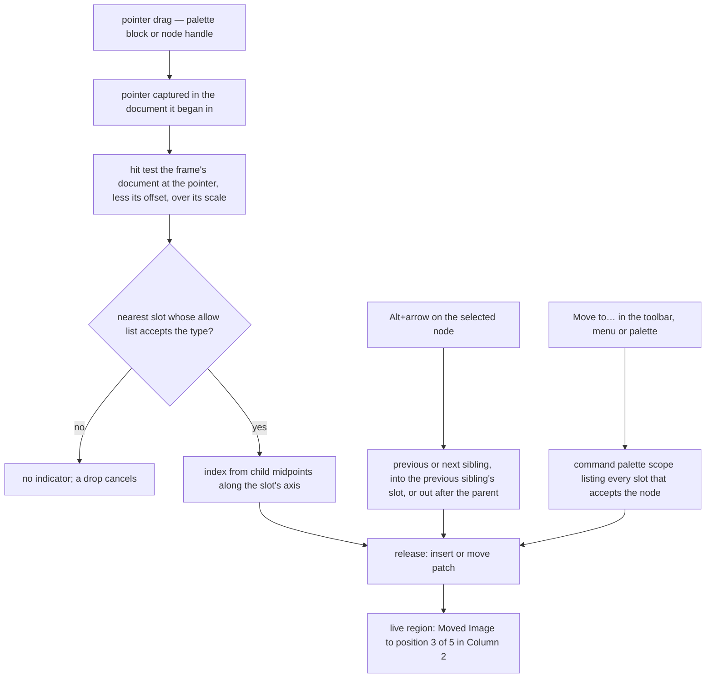

# Canvas

Built on the [document model](../../specs/resource/page-builder/document-model/design.md), which holds the typed nodes the canvas renders and the patches its commands issue.

## The canvas

The canvas is a same-origin frame whose document starts empty from `srcdoc`; Vue renders the tree into its body through a teleport, so the frame holds only DOM while the component instances, reactivity and listeners stay in the app.

A frame, and not a region of the app's own document, because the canvas has to be the published page's rendering context and nothing else gives it that:

- **Viewport.** A media query and a `vw` unit read the frame's width, so the device toggle is honest by setting that width. In the app's document they read the window; a shadow root does too, and so would need every `@media` rewritten as a container query and every viewport unit as a container one, for as long as CSS grows new viewport-relative features.
- **Isolation both ways.** The app's preflight reset, its inherited type and its tokens never reach the page, and the page's `body`, `html` and element selectors never reach the app. A shadow root lets inherited properties through and has no `body` for a page's rules to match.
- **The published context.** The published page is served the same way, in a frame of its own, so the canvas and the page share one rendering context, not merely one stylesheet.

The cost is that pointer routing and hit testing cross a document boundary, which Vuetify 0's `useDragDrop` cannot: it hit-tests with the parent document's `elementFromPoint`, and its keyboard adapter moves a virtual pointer by pixels rather than through a tree. That cost is paid once, in one composable (see "Selection and drag"). The page's styles go into the frame as a constructed stylesheet through `adoptedStyleSheets`, rebuilt at most once per animation frame after a style patch, so the canvas adds no inline style element.

No script ever reaches the canvas, by construction rather than by policy: every element is created by Vue from a typed node, the one raw-HTML type is sanitised before it is inserted, and a style value may contain neither `<`, so it can never close a style element, nor `{` or `}`, so it can never leave its rule. Behaviour a published page runs as a script — the countdown's ticking, typed text, the tabs — runs in the canvas as the type's `canvas` component, in the app's own realm. Whether the frame can also carry `sandbox="allow-same-origin"` as defence in depth depends on whether listeners from the app's realm still fire inside it; a browser test answers that, and the frame carries the sandbox if they do.

**The browser suite.** The isolation, the frame's widths and the sandbox question need a layout engine, which the app's suites, under happy-dom, do not have. This change gives the app a browser suite of its own on `getVitestBrowserConfiguration`, as the Genshin packages have, in a configuration apart from the default run so an ordinary run never starts a browser. Nuxt's test utilities run Vitest's browser mode under the Nuxt environment, so a component's auto-imports resolve there as they do in the unit suites, and each `*.browser.test.ts` runs only in that suite, as in the Genshin packages. The rest of the canvas is component tests under happy-dom, as the library's are.

**Overlays** — the hover outline, the selection outline, the drop indicator — live in a layer inside the frame after the content root, positioned from each node's `getBoundingClientRect` and redrawn in one animation frame after a scroll, a resize or a patch. They read the library's accent and focus tokens through custom properties copied into the frame, so a theme or style switch restyles them, and the selection ring is a double ring that stays visible on any page colour. The node toolbar — select parent, move up, move down, Move to…, duplicate, delete, and the type's own actions — is library buttons in the app's document, placed from the frame's rect plus the node's; the same `Item` list is its overflow menu and the right-click menu through `useContextMenu`.

**Device widths** are the three the [style panel](../resource-page-builder-style-panel/design.md) edits, each inside its own breakpoint: tablet is 768 pixels wide and mobile 375, and desktop fills the pane but is never narrower than 992 pixels, one above the tablet breakpoint at 991, so the frame's media queries always read desktop. In a narrower pane the frame keeps that width and is scaled down to fit. The three widths and the two breakpoints they sit inside are named once, in the module this change creates, and the style panel's cascade reads the same breakpoints.

## Selection and drag

The [headless core](../../specs/headless-block-editor/editor-core/design.md) computes the types a slot accepts, a move, a move into the previous sibling, a paste and where focus goes after a delete. The rest of the navigation the canvas draws is added to the core by this change, as pure functions over the document beside those: the previous and next node in document order, every slot in the document that accepts a node, a move out after the parent, the rows the layers tree draws, and duplicate, a paste of the node's own copy straight after it. They hold no editor's node types, so they belong to the package rather than the app; this page draws, announces and binds them. Every pointer action has a keyboard path, because each is a registered command first, so the keyboard, a single pointer, the palette and the context menu all reach it, and `useCommands` lists each in the shortcuts dialog.



**Pointer.** A drag from the palette or a node's handle captures the pointer in the document it began in, so the drag keeps receiving events while the pointer crosses the frame, and hit-tests the frame's document at the pointer less the frame's offset, divided by its scale. The nearest ancestor slot whose allow list accepts the dragged type is the target, and the index is the first child whose midpoint along the slot's axis the pointer has not crossed — the resolution `useDragDrop` uses, cited rather than imported. The frame scrolls while the pointer rests near its top or bottom edge. Escape cancels. On touch a drag waits for the hold the library's reorderable list already waits for, so a swipe scrolls. A click on a palette block inserts it at the selection, so a drag is never the only way in.

**The layers tree** is the structure's keyboard surface: a new library component on Vuetify 0's `Treeview`, which gives the tree, treeitem and group roles, so the page builder imports nothing from Vuetify 0 itself. The arrows walk it, Home and End jump, type-ahead finds a node by its label, and selection follows focus, so the canvas outlines what the tree has focused and scrolls it into view. A node's label is its type's title, from a map in the app keyed by every webpage node type, so the typecheck holds it complete; the same title names a node in Move to's paths and in each move's announcement. Rejected: a title on the shared type definition, which the publish render never reads.

**Moves** use the chord the library already gives reordering. Alt+Up and Alt+Down move the selected node among its siblings, Alt+Right moves it into the end of the previous sibling's first slot that accepts it, and Alt+Left moves it out to just after its parent. Every move is announced in a polite live region, as the reorderable list reads out "Moved to position 3 of 8", and keeps focus on the node.

**Move to…** opens a command palette scope listing every slot in the document that accepts the selected node, each named by its path ("Section 2 › Column 1, first"), so a move across a long page is one search rather than a chain of Alt presses. With the toolbar's Move up and Move down it is the single-pointer alternative WCAG 2.2's Dragging Movements asks for.

**Insert** is the palette, a `UiCommandList` of the registry's blocks grouped by category: Enter inserts the block after the selected node, or into the selected container's first slot when it is empty, selects it and announces it. **Delete**, **duplicate**, **copy**, **cut** and **paste** are commands on the usual chords. After a delete, selection and focus land on the next sibling, else the previous one, else the parent, so focus is never dropped onto the page. The clipboard carries the node as JSON, validated by the document schema and given fresh ids on paste, so a paste between two webpages works and one between a webpage and an email is refused with a message.

**Text editing.** Enter on a selected text node, in the tree or the canvas, mounts TipTap on that node inside the frame and moves focus into it; Escape leaves the text and returns focus to the tree row. Inside the text, TipTap's own keys and undo apply; leaving it commits one history entry. Composition and paste are ProseMirror's, which reads an input method's text and pasted markup through its schema rather than through `execCommand` — where GrapesJS's IME and Word-paste defects above come from.

The canvas itself is one tab stop named after the page. With focus in it, Up and Down select the previous and next node in document order, Enter edits, and Escape selects the parent — the same commands as the tree, so neither surface is the only way to do anything.

## The shell

The editor around the frame is library parts: the palette and the layers tree in one pane, the canvas with its device toggle in the middle, and `UiTabs` over the Content, Style and Theme panels in the other, each pane sized by a `UiResizeHandle`, and an empty page drawn as a `UiEmptyState` offering the palette. The Content panel is `UiSchemaForm` over the selected node's type's `formSchema`, so a type gains its fields by declaring them; a survey or a column is offered through `itemsKey`, and an image's field uploads through `useUploadResourceFile`, offering the images already in the document beside it. Each field's change is one update-props command, so it reaches the history like any other edit. The Style and Theme panels are the [style panel](../resource-page-builder-style-panel/design.md)'s, and this change draws their tabs empty.

## Key files

| File                                                                         | Role after the change                                                                     |
| :--------------------------------------------------------------------------- | :---------------------------------------------------------------------------------------- |
| `apps/web/app/composables/ui/useCommands.ts`                                 | every pointer and keyboard action registered as a command, listed in the shortcuts dialog |
| `apps/web/app/composables/ui/useContextMenu.ts`                              | the right-click menu the node toolbar's overflow `Item` list also feeds                   |
| `apps/web/app/composables/resource/useUploadResourceFile.ts`                 | an image field's upload in the Content panel                                              |
| `packages/configuration/src/getVitestBrowserConfiguration.ts`                | the shared browser configuration the app's browser suite takes                            |
| `packages/headless-block-editor/src/services/getAcceptedTypes.ts`            | the slot check every listed Move to target passes                                         |
| `packages/headless-block-editor/src/services/pasteBlockNodes.ts`             | the paste a duplicate is, its copy placed straight after the node                         |
| `packages/headless-block-editor/src/services/getBlockLayerRows.ts`           | the layers tree's rows: every node in layer order, with its depth                         |
| `packages/headless-block-editor/src/services/getAdjacentBlockNodePointer.ts` | the previous and next node in document order, across slot boundaries                      |
| `packages/headless-block-editor/src/services/getAcceptingSlotPointers.ts`    | the slots Move to lists for a node, outside the node's own subtree                        |
| `packages/headless-block-editor/src/services/moveOutAfterParent.ts`          | the move Alt+Left makes, to just after the parent                                         |
| `packages/headless-block-editor/src/services/duplicateBlockNode.ts`          | the duplicate command, a paste of the node's copy after it                                |
| `apps/web/package.json`                                                      | the browser suite's script, apart from the default run                                    |
| `apps/web/vitest.browser.config.ts`                                          | the app's browser suite, each `*.browser.test.ts` under the Nuxt environment              |

New code lands here:

```text
apps/web/shared/services/pageBuilder/            the device widths and the breakpoints they sit inside
apps/web/app/store/pageBuilder/                  the selection and the device width, keyed by resource
apps/web/app/components/PageBuilder/             the shell, canvas frame, overlays, toolbar, palette, layers and Content panel
apps/web/app/components/Ui/                      the tree on Vuetify 0's Treeview
```

## Sources

- [Vuetify 0 — useDragDrop](https://0.vuetifyjs.com/composables/system/use-drag-drop) — the midpoint resolution of a drop index, taken; its hit test in one document, which a canvas frame rules out.
- [Vuetify 0 — Treeview](https://0.vuetifyjs.com/components/disclosure/treeview) — the tree, treeitem and group roles the layers tree is built on.
- [WAI-ARIA Authoring Practices — Tree View](https://www.w3.org/WAI/ARIA/apg/patterns/treeview/) — the layers tree's keys.
- [WCAG 2.2 — Understanding Dragging Movements](https://www.w3.org/WAI/WCAG22/Understanding/dragging-movements.html) — a single-pointer alternative to every drag.
