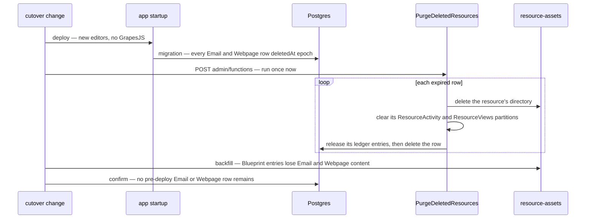

# Cutover

The page builder's last part, built once the editors it ships exist and are proved: the [canvas](../resource-page-builder-canvas/design.md), the [style panel](../resource-page-builder-style-panel/design.md), [undo as patches](../resource-page-builder-undo-as-patches/design.md), the [email editor](../resource-page-builder-email/design.md), and [performance and proof](../resource-page-builder-performance-and-proof/design.md).

## The cutover

One change ships the new editors, deletes the old data and removes GrapesJS with every trace of it, so no code ever reads a GrapesJS document and no document outlives the code that read it.

**The data to delete.** Every Email and Webpage resource, whatever its state — a working copy, a binned row, a published one. Everything such a resource owns is reachable from its row:

| Store                            | What                                                                                                                                                                                         |
| -------------------------------- | -------------------------------------------------------------------------------------------------------------------------------------------------------------------------------------------- |
| Postgres `resource.resources`    | each row with `type` Email or Webpage                                                                                                                                                        |
| its cascades                     | `resource.resourceVersions`, `resource.resourcePublications`, `resource.resourceAccesses`, `resource.resourceFavorites`, and the `resource.resourceLinks` rows the resource is the source of |
| Blob `resource-assets`           | the `{id}/` directory: `content.json`, `stagedContent.json.gz`, the version objects under `objects/`, uploaded files under `files/`, and the clones under each published channel's directory |
| Azure Table                      | the resource's partitions in `ResourceActivity` and `ResourceViews`; the two types own no table of their own in `ResourceOwnedTablesMap`                                                     |
| Postgres `storage.storageLedger` | the `resource-assets` entries under the `{id}/` prefix, released to their owner                                                                                                              |

`purgeResource` (`packages/db/src/services/resource/purgeResource.ts`) already deletes exactly that, in the order that makes it idempotent — the directory, then the partitions, then the ledger, the row last as the marker that re-drives a failed run. So the cutover is not a script of its own: a custom migration in `apps/web/server/db/migrations`, applied at startup in every environment like any migration, puts every such row past the recycle bin's retention, and the purge removes them:

```sql
UPDATE "resource"."resources" SET "deletedAt" = 'epoch' WHERE "type" IN ('Email', 'Webpage');
```

The purge runs daily from `apps/functions/src/handlers/purgeDeletedResourcesHandler.ts`. Straight after the deploy, the session shipping the cutover runs it once in each environment — a POST to the function app's `admin/functions/PurgeDeletedResources` with the master key — so the rows spend minutes rather than up to a day listed in owners' recycle bins, where a restore would bring back a document the new schema refuses. **Confirmation is one count:** the row is deleted last, so no Email or Webpage row created before the deploy remaining means every directory, partition and ledger entry went before it — a query against dev, and in prod the purge's own log naming no failure and the next tick finding nothing.

One thing outside those rows holds editor state: **a Blueprint's captured entries.** An entry of type Email or Webpage carries GrapesJS project data as its `content`, inside the Blueprint's own `content.json` — a blob, which a session can reach where it cannot reach prod's database. A backfill removes `content` from those entries in every Blueprint, dev then prod, as the `backfills` skill runs one; an entry with no content deploys as a fresh document, which the Blueprint already supports. A Blueprint revision older than the backfill still holds the old content, and deploying it fails that entry's parse with the deploy's existing error until the revision expires — the snapshot trade the backfill skill already accepts.

Nothing else holds any. A personalized export is a download, never stored; no route caches a published view; no editor state lives in local storage, because resources need an account.

Two things stay, deliberately. A Program bound to a deleted email keeps its `emailId` and reads it as missing, and the `resourceLinks` row its content projects stays — the state an ordinary purge leaves, which [dangling reference cleanup](../../rejected/resource/dangling-reference-cleanup/design.md) rejects rewriting. Earned achievements stay.

**What leaves with GrapesJS**, in the same change:

- the catalog entries and `apps/web/package.json` dependencies for `grapesjs` and every `grapesjs-` plugin, `js-beautify` and `@types/js-beautify`;
- `useGrapesJsEditor`, `useSurveyInviteBlocks`, `setBlocks`, `readUploadFiles`, `GrapesJsBlock`, the plugin modules and their tests, `WebpageEditorPlugins`, `WebpageEditorStyleManager`, `FlexAlignmentItems`, `getEmailHtml`, `getEmailPreview`, `readEmailPreviewText`, `writeEmailPreviewText`, `createMergeFieldBlocks`, the survey invite block builders, the type shim for the two untyped plugins, `AGrapesJsEditor` and the two stock templates;
- the `grapesjs` exception in `osv-scanner.toml`, whose advisory names a range the locked release was already outside;
- the TUI and cdnjs entries in the security config, and the stock hosts in `apps/web/shared/services/grapesjs/constants.ts` and the image whitelist, keeping Mailjet's for MJML's social icons beside the email types; the `.gjs-mdl-container` override; the comments naming GrapesJS in `ResourceEditorComponentMap`;
- the `grapesjs` skill, replaced by a page-builder skill, and the `grapesjs` ledger;
- the live references outside those: the GrapesJS and `grapesjs-` plugin rows of the dependency ledger, the `grapes.min.css` import in the styling skill's style-blocks reference, the GrapesJS mention in the `useAdoptResourceContent` row of the vue-composable-patterns skill, and the `grapesjs` store row of the resource security ledger;
- the docs: the GrapesJS row of [third-party document adapters](../../specs/architecture/third-party-document-adapters/design.md); the page-builder engine and the plugin-belt paragraph of [dependency admission](../../specs/architecture/dependency-admission/design.md), whose precedent section gains `mjml-blocks` as the adapter `grapesjs-mjml` became; the CDN mentions in the security posture and the security module's defaults review; [email web view](../../specs/resource/email-web-view/design.md), [email preview text](../../specs/resource/email-preview-text/design.md), [email personalization](../../specs/resource/email-personalization/design.md), [webpage survey invite blocks](../../specs/resource/webpage-survey-invite-blocks/design.md) and [resource file assets](../../specs/resource/resource-file-assets/design.md) rewritten as built, with the explorer's blade table and the resource index's lines naming GrapesJS; the absorbed plugins' pages deleted, their upstream verdicts gone with the code; and this proposal rewritten as the page builder's feature page.



## Binding the new editors

The earlier changes build the documents, stores and renderers beside what GrapesJS reads and writes, so this change is the one that binds them to the Webpage and Email resource types:

- **The content classes.** `WebpageEditor` and `EmailEditor` keep their names and their place in `JSONClassMap` and become the [document model](../resource-page-builder-document-model/design.md)'s documents, with the Email's `datasetReference` and, on a published snapshot only, the baked HTML.
- **The stores and hooks.** The two types' content data, autosave and `ResourceContentHookMap` entries move to the page builder's document store, whose load and save were passed in by tests until now, and its reload, registered on `ResourceContentHookMap.Reload`, clears the resource's history, as [undo as patches](../resource-page-builder-undo-as-patches/design.md) designs it. `ResourceEditorComponentMap` mounts the new editors.
- **Publishing.** Each type's `transformPublishedContent` bakes the output on the server: a webpage's HTML document from the renderer, an email's from MJML compiled by the compile service, each rendered after `transformPublishedBlobUrls` has pointed the tree's asset urls at their published clones, so the baked HTML does too. The working copy holds only the tree, so no save captures derived HTML any more, and an email whose MJML fails strict validation is refused at publish with MJML's own message, replacing `transformPublishedEmail`'s check for missing HTML. Both views serve the baked `html` whole through the sandboxed frame; the Webpage view stops joining a separate `css` to it.
- **The survey invite's link.** The invite's survey prop, declared with `createResourceLinkSchema`, is indexed by `ResourceTypeGetLinkTargetsMap` once the type saves the new document, so deleting the survey names the page holding it.
- **The email export.** The compile that bakes an email backs its export too: a `generateEmailHtml` query reads the stored working copy, so the personalized export flushes any pending save, reads the compiled HTML and substitutes per row as `apps/web/app/services/emailEditor/substituteMergeFields.ts` does now. The export then works from the command bar with the Editor blade closed, and the store's bridge to a live editor goes. Because the renderer escapes a merge token exactly once, substitution matches one form of it instead of two — once a test confirms MJML's minifier leaves the escaped form alone.
- **The webpage export.** A Webpage gains an Export of one self-contained HTML file, rendered in the browser by the same pure function, and becomes portable for it; the zip exporter and its viewer go.

## The ceiling

Each editor's script beyond the explorer is at most 200 KiB gzipped, measured on this change's production build before it merges, since only that build holds the editors as a reader loads them. It is an acceptance check of the cutover rather than a standing gate, for the reasons [bundle budgets](../../deferred/architecture/bundle-budgets/design.md) are deferred; the editors stay behind `ResourceEditorComponentMap`'s async components, so nothing of them reaches another route.

## Key files

| File                                                                | Role after the change                                                               |
| ------------------------------------------------------------------- | ----------------------------------------------------------------------------------- |
| `apps/web/shared/models/grapesjs/AGrapesJsEditor.ts`                | deleted                                                                             |
| `apps/web/app/composables/grapesjs/useGrapesJsEditor.ts`            | deleted                                                                             |
| `apps/web/app/services/webpageEditor/WebpageEditorPlugins.ts`       | deleted, with the plugin modules and the style manager                              |
| `apps/web/app/services/emailEditor/getEmailHtml.ts`                 | deleted; the server compiles                                                        |
| `apps/web/shared/services/grapesjs/constants.ts`                    | deleted                                                                             |
| `apps/web/shared/models/webpageEditor/data/WebpageEditor.ts`        | the webpage document, its schema built from the registry                            |
| `apps/web/shared/models/emailEditor/data/EmailEditor.ts`            | the email document, its dataset reference, and baked HTML on a published snapshot   |
| `apps/web/shared/services/superjson/JSONClassMap.ts`                | the two content classes, same names                                                 |
| `apps/web/app/store/webpageEditor/index.ts`                         | replaced by the page builder's document store                                       |
| `apps/web/app/store/emailEditor/index.ts`                           | replaced by the page builder's document store, with no live editor bridge           |
| `apps/web/app/services/resource/ResourceContentHookMap.ts`          | the two types' hooks on the page builder's store, its `Reload` clearing the history |
| `apps/web/app/services/resource/ResourceEditorComponentMap.ts`      | mounts the new editors                                                              |
| `apps/web/app/components/Resource/Webpage/View.vue`                 | serves the baked HTML document whole                                                |
| `apps/web/server/trpc/routers/webpage.ts`                           | publish renders the HTML document                                                   |
| `apps/web/server/trpc/routers/email.ts`                             | `generateEmailHtml` over the stored working copy; publish compiles                  |
| `apps/web/server/services/emailEditor/transformPublishedEmail.ts`   | compiles the snapshot's MJML on the server and refuses invalid MJML                 |
| `apps/web/app/components/Resource/Email/ExportTruncationDialog.vue` | exports from compiled HTML, with no live editor                                     |
| `apps/web/app/composables/emailEditor/useExportPersonalizedHtml.ts` | reads the compiled email instead of a live editor                                   |
| `apps/web/app/services/emailEditor/exportPersonalizedHtml.ts`       | zips per-row HTML from the compiled email                                           |
| `apps/web/app/services/emailEditor/substituteMergeFields.ts`        | matches the single escaped token form                                               |
| `apps/web/app/services/resource/PortableFormatMap.ts`               | the email export without an open editor; the webpage's HTML file export             |
| `apps/web/shared/services/resource/ResourceDefinitionMap.ts`        | Webpage becomes portable, for its HTML file export                                  |
| `apps/web/configuration/security.ts`                                | no GrapesJS origins                                                                 |
| `apps/web/server/db/migrations`                                     | the custom migration binning every Email and Webpage row                            |
| `apps/web/package.json`                                             | GrapesJS and its plugins out                                                        |
| `pnpm-workspace.yaml`                                               | the catalog entries                                                                 |
| `osv-scanner.toml`                                                  | without the `grapesjs` exception                                                    |

## Sources

- [Microsoft Learn — Manually run a non HTTP-triggered function](https://learn.microsoft.com/en-us/azure/azure-functions/functions-manually-run-non-http) — the admin request that runs the purge once at the cutover.
