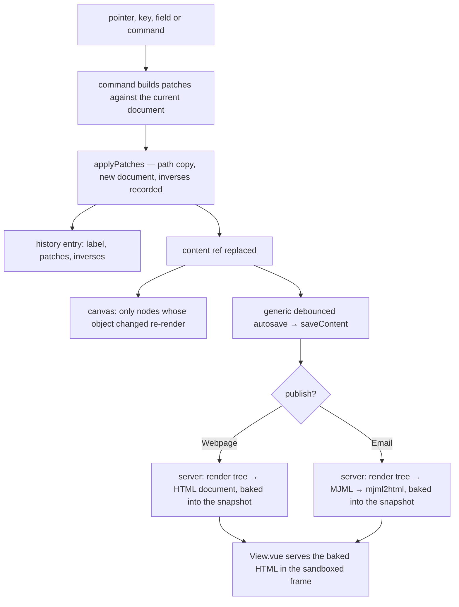

# Document model

The webpage and email editors' documents: the node types each editor registers over the [headless core](../../specs/headless-block-editor/editor-core/design.md)'s tree, and how a finished document becomes the page or the email a reader gets. The webpage's types are the app's own. The email's types are the [MJML blocks](../resource-page-builder-mjml-blocks/design.md) package's, with the app's survey invite added.

## The document model

The universal model for block editing is a typed ordered tree: every node a type tag selecting a schema, and its props; a container is a node one of whose props holds a list of nodes. No one standard is shared across builders — what they share is that tree, and the open specifications differ only in where they put the id and the children:

- **Puck** stores `{ root: { props }, content }`, where `content` and every slot prop hold `ComponentData` — `{ type, props }`, with the id required inside `props`. Slots — a prop holding a node array — replaced its earlier flat `zones` map, and `migrate()` moves old data across. A node is two fields and children are a kind of prop, so a type can have any number of named regions.
- **BlockNote** stores `{ id, type, props, content, children }`: one fixed children list, inline content beside it, and props limited to scalars. It is a ProseMirror document, so a column is a ProseMirror node, and its multi-column package is licensed GPL-3.0 or commercially.
- **Portable Text** is rich text: a flat array of `_type`/`_key` blocks with spans and mark definitions, nested only by list level. It is a text model, not a layout model.
- **The Block Protocol** is a protocol between an embeddable block and the application embedding it — messages, a hook module, entity types now under its SemType specification — with work on its next version paused. Our blocks never leave our editor, so its messaging layer would be cost with no second party.

Puck's is the minimal of these, so the document takes its shape rather than inventing one:

```ts
// A node: Puck's ComponentData, its id inside props
interface PageNode<TType extends string, TProps> {
  props: TProps & { id: string };
  type: TType;
}
// A slot is a prop holding nodes; nothing else is structural
type Slot<TNode> = TNode[];
// The document: Puck's Data, without the zones it deprecated
interface PageDocument<TRootProps, TNode> {
  content: Slot<TNode>;
  root: { props: TRootProps };
}
```

**Beside the live editors.** The two documents are new models, built beside `WebpageEditor` and `EmailEditor` rather than in place of them, and each open one sits in the page builder's document store, keyed by its resource, loaded and saved through functions its caller passes in. GrapesJS still mounts and saves its own shape until the [cutover](../resource-page-builder-cutover/design.md), so nothing it reads or writes changes here, as the [program](../resource-page-builder-program/design.md)'s phases require. The cutover puts these documents into the two content classes, under the same names, and removes `AGrapesJsEditor`, its `pages` default and the `catchall` that let GrapesJS's own keys ride through, so the schemas describe every field, as [persisted data, latest shape only](../../specs/architecture/persisted-data-latest-shape-only/design.md) asks. Rejected: changing the two classes here, which would leave GrapesJS saving documents the new schemas refuse.

The tree, the registry contract and the schema below are the [headless core](../../specs/headless-block-editor/editor-core/design.md)'s, generic over a registry; this page holds the webpage and email registries and what only they read. A registry also says what may sit at the top of a document and what the document-wide props must hold. The webpage's root accepts every placeable type, and its props hold the page's language. The email's root is the MJML blocks', taking only what MJML's body takes, with the head as its props. Each editor's document schema is the core's `createBlockDocumentSchema` over that editor's registry: each node's shape and the root's props, parsed by the root's own schema, come first, then a refinement walks the tree checking every type against the registry and its slot, every props schema, ids unique within the document, and the node count under a named `MAX_*` limit this page passes in, so a refusal names the slot that refused. An id is short, unique within its document and minted by one helper, since it also names the node's class in the emitted CSS.

The text inside a text node is the ProseMirror JSON the Note stores, validated by the node schema `apps/web/shared/models/resource/note/NoteResource.ts` already declares, exported for its second consumer. Portable Text was weighed for it and lost: it would need an editor of its own — Portable Text's is React — or a converter each way, against a format the app already stores, edits and renders on the server.

## Node types replace the plugin belt

A plugin is a typed node-type registration. The webpage's are collected in maps keyed by an enum of the webpage's types, and the email's are the MJML blocks' types, named by their MJML tags, so neither editor's type can be dropped into the other's document. A webpage registration has two halves because two runtimes read it: the server renders a type when it publishes, and only the editor draws one. Each half is a `Record` over the enum, so a type missing either fails the typecheck. The shared half extends the core's `BlockTypeDefinition`:

```ts
// Shared with the server: what a type emits, beside the core's type name, props schema and slots
interface NodeTypeDefinition extends BlockTypeDefinition {
  // Structural CSS emitted once per document holding the type
  css?: string;
  // The editable content props, drawn by UiSchemaForm
  formSchema: z.ZodType;
  // Pure: the node and its rendered slots in, an element tree out, folded by the core's renderBlockNodes
  render: (node: BlockNode, slots: Record<string, HtmlNode[]>, context: RenderContext) => HtmlNode;
  // A self-contained runtime emitted once per published page holding the type
  script?: () => void;
}
// The editor's half: how a type is offered and drawn
interface NodeTypeEditorDefinition {
  // The palette entry; a type with none is created only by its parent, as a Column by Columns
  block?: { category: BlockCategory; icon: UiIconMeaning; label: string };
  // Drawn on the canvas in place of the rendered markup — live behaviour, or an email's layout
  canvas?: Component;
  // The style fields the panel offers (see the style panel page)
  styleFields: StyleFieldDefinition[];
}
```

This change builds the shared half. The editor half is built by the changes that read it: the palette entry and the canvas component by the [canvas](../resource-page-builder-canvas/design.md), and the style fields by the [style panel](../resource-page-builder-style-panel/design.md).

A container whose children are always one type uses a slot that allows only that type — Columns holds Column, Tabs holds Tab, an Email section holds Email columns — so the tree never needs a second structural idea. A cross-resource reference is a prop declared with `createResourceLinkSchema`, so `ResourceTypeGetLinkTargetsMap` indexes it with no code of the type's own: a survey invite in a webpage or an email becomes a `resourceLinks` row, and the [delete reference warning](../../specs/resource/delete-reference-warning/design.md) names it when the survey is deleted, which today it cannot.

The webpage types carry the blocks the editor offers today, rebuilt to these contracts:

| Category | Types                                                                                                                          |
| -------- | ------------------------------------------------------------------------------------------------------------------------------ |
| Layout   | Section (a semantic tag of header, main, section, footer or div), Columns of Column                                            |
| Content  | Text, Button (a link drawn as a button, which also replaces the bare link block), Image, Video (an uploaded file), Custom HTML |
| Extra    | Countdown, Tabs of Tab, Tooltip, Typed text                                                                                    |
| Survey   | Survey invite, one block per published survey, from `useReadPublishedSurveys` as today                                         |

Each type's contract makes its published output accessible by construction rather than by review: an Image requires its `alt` or an explicit decorative flag, a Video requires its title as its accessible name, Tabs emit the tablist pattern with the arrow keys in their script, Typed text keeps its whole text in the accessible name and stands still under reduced motion, a Countdown is a timer whose live region stays off, and a Button is a real link. The regression lessons of the absorbed modules carry across as tests on the types that inherit them — a video with no default source, raw HTML that keeps a placeholder when emptied, a countdown that reads a date as local midnight, writes its end text as text and stops its own timer once detached. The forms plugin's types go with no successor, since the editor offers no form block. A Video plays a file uploaded to the resource through the page's own `<video>` element, which `media-src` already allows; a provider's frame and a Map type are [deferred](../../deferred/resource/page-builder-provider-embeds/design.md).

## Rendering and publishing

`render` returns a small element tree — a tag, typed attributes, children — and one serialiser turns a tree into HTML, escaping every text node and attribute value through the shared sanitiser's `escapeText` and `escapeAttribute`. Attribute names come from a typed set with no event handler in it, every URL prop passes `checkIsAllowedUrl` at its schema, and the one raw-HTML type is written as `sanitizeHtml` returns it, both when it is stored and again when it is published. That closes the vectors GrapesJS's parser leaves open — a `javascript:` URL behind a leading space or another case, `srcdoc`, an SVG `xlink:href` — and each becomes a regression test on Custom HTML. Two types hand the serialiser HTML rather than a tree, as a raw node it writes as given: Text, whose HTML is the Note's `generateHTML` through `sanitizeTextHtml`, and Custom HTML. A render's context is the site's origin, which the survey invite's link to the published survey needs.

A webpage renders to one document through the core's `renderBlockNodes`. The document opens with `<html lang>` from the root, then a single stylesheet of each present type's structural CSS. The [style panel](../resource-page-builder-style-panel/design.md) later opens that stylesheet with the page's tokens and closes it with every styled node's rules. Then come the body, and each present type's script, once. An email renders through the MJML blocks' `renderMjmlDocument` to MJML's JSON form, with the head built from the root's props and the body from its content. The app's survey invite renders as an `mj-button` beside the package's own types.



This change builds and tests what the publish branch of that diagram calls: the webpage renderer, a pure function the browser's export also runs, and the server's compile service. The compile service hands the MJML blocks' JSON to `mjml2html` on MJML's Node package and refuses an email failing strict validation with MJML's own message. The cutover wires both into publishing, the views and the exports, as its "Binding the new editors" describes.

## Key files

| File                                                                       | Role after the change                                 |
| -------------------------------------------------------------------------- | ----------------------------------------------------- |
| `apps/web/shared/models/resource/note/NoteResource.ts`                     | exports its ProseMirror node schema for the text node |
| `packages/shared/src/services/sanitizeHtml/escapeText.ts`                  | escapes every text node the serialiser writes         |
| `packages/shared/src/services/sanitizeHtml/escapeAttribute.ts`             | escapes every attribute value the serialiser writes   |
| `packages/shared/src/services/sanitizeHtml/checkIsAllowedUrl.ts`           | the check every URL prop's schema runs                |
| `packages/shared/src/services/sanitizeHtml/sanitizeHtml.ts`                | what the raw-HTML type stores                         |
| `packages/headless-block-editor/src/services/createBlockDocumentSchema.ts` | each editor's document schema, over its registry      |

New code lands here:

```text
apps/web/shared/models/pageBuilder/            the webpage and email documents, beside the classes GrapesJS still saves
apps/web/shared/services/pageBuilder/          the webpage registry, one module per type, the serialiser and the renderer
apps/web/shared/services/pageBuilder/email/    the email registry: the MJML blocks' types with the survey invite added
apps/web/server/services/emailEditor/          the MJML compile service
apps/web/app/store/pageBuilder/                each open document, keyed by its resource, loaded and saved through what its caller passes
```

## Sources

- [MJML documentation — Using MJML in JSON](https://documentation.mjml.io/#using-mjml-in-json) — the object form the compile service hands `mjml2html`.
- [Puck — Data](https://puckeditor.com/docs/api-reference/data), [ComponentData](https://puckeditor.com/docs/api-reference/data-model/component-data), [the slot field](https://puckeditor.com/docs/api-reference/fields/slot) and [migrate](https://puckeditor.com/docs/api-reference/functions/migrate) — the document's shape: `{ root, content }`, a node as `{ type, props }` with the id inside props, slots as props holding nodes with allow and disallow lists, and zones deprecated in their favour.
- [BlockNote — Document structure](https://www.blocknotejs.org/docs/foundations/document-structure) — the `{ id, type, props, content, children }` block weighed against Puck's; its columns as blocks.
- [Portable Text — Specification](https://portabletext.org/specification/) — a text model of typed blocks, spans and mark definitions, weighed for the text node's content.
- [The Block Protocol — Specification](https://blockprotocol.org/docs/spec) — block-to-embedder interoperability, weighed and not needed with one embedder.
- [WAI-ARIA Authoring Practices — Tabs](https://www.w3.org/WAI/ARIA/apg/patterns/tabs/) — the published Tabs type's roles and keys.
