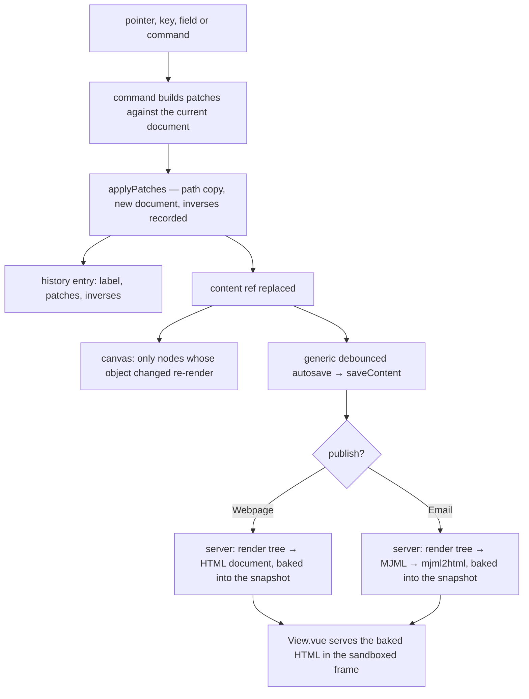

# Document model

The webpage and email editors' documents: the node types each editor registers over the [headless core](../resource-page-builder-headless-core/design.md)'s tree, and how a finished document becomes the page or the email a reader gets. It is built once the core has shipped.

## The document model

The universal model for block editing is a typed ordered tree: every node a type tag selecting a schema, and its props; a container is a node one of whose props holds a list of nodes. No one standard is shared across builders — what they share is that tree, and the open specifications differ only in where they put the id and the children:

- **Puck** stores `{ root: { props }, content }`, where `content` and every slot prop hold `ComponentData` — `{ type, props }`, with the id required inside `props`. Slots — a prop holding a node array — replaced its earlier flat `zones` map, and `migrate()` moves old data across. A node is two fields and children are a kind of prop, so a type can have any number of named regions.
- **BlockNote** stores `{ id, type, props, content, children }`: one fixed children list, inline content beside it, and props limited to scalars. It is a ProseMirror document, so a column is a ProseMirror node, and its multi-column package is licensed GPL-3.0 or commercially.
- **Portable Text** is rich text: a flat array of `_type`/`_key` blocks with spans and mark definitions, nested only by list level. It is a text model, not a layout model.
- **The Block Protocol** is a protocol between an embeddable block and the application embedding it — messages, a hook module, entity types now under its SemType specification — with work on its next version paused. Our blocks never leave our editor, so its messaging layer would be cost with no second party.

Puck's is the minimal of these, so the document takes its shape rather than inventing one:

```ts
// A node: Puck's ComponentData, its id inside props
interface PageNode<TType extends string, TProps> {
  props: TProps & { id: string };
  type: TType;
}
// A slot is a prop holding nodes; nothing else is structural
type Slot<TNode> = TNode[];
// The document: Puck's Data, without the zones it deprecated
interface PageDocument<TRootProps, TNode> {
  content: Slot<TNode>;
  root: { props: TRootProps };
}
```

`WebpageEditor` and `EmailEditor` keep their names and their place in `JSONClassMap` and become this document plus what the editor does not own: the Email's `datasetReference`, and on a published snapshot only, the HTML the publish baked (see "Rendering and publishing"). `AGrapesJsEditor`, its `pages` default and the `catchall` that let GrapesJS's own keys ride through all go — the schemas describe every field, as [persisted data, latest shape only](../../specs/architecture/persisted-data-latest-shape-only/design.md) asks.

The tree, the registry contract and the schema below are the [headless core](../resource-page-builder-headless-core/design.md)'s, generic over a registry; this page holds the webpage and email registries and what only they read. The document schema is one discriminated union over `type`, recursive through each slot, built from the registry. It checks what Zod can: every props schema, every slot's allowed child types, ids unique within the document, and the node count under a named `MAX_*` limit through a refinement on the root. An id is short, unique within its document and minted by one helper, since it also names the node's class in the emitted CSS.

The text inside a text node is the ProseMirror JSON the Note stores, validated by the node schema `apps/web/shared/models/resource/note/NoteResource.ts` already declares, exported for its second consumer. Portable Text was weighed for it and lost: it would need an editor of its own — Portable Text's is React — or a converter each way, against a format the app already stores, edits and renders on the server.

## Node types replace the plugin belt

A plugin is a typed node-type registration, collected in maps keyed by an enum — one enum for each editor, so an Email type can never be dropped into a webpage. A registration has two halves because two runtimes read it: the server renders a type when it publishes, and only the editor draws one. Each half is a `Record` over the enum, so a type missing either fails the typecheck:

```ts
// Shared with the server: what a type is and what it emits
interface NodeTypeDefinition<TType extends string, TProps> {
  // Structural CSS emitted once per document holding the type
  css?: string;
  // The editable content props, drawn by UiSchemaForm
  formSchema: z.ZodType;
  propsSchema: z.ZodType<TProps>;
  // Pure: props and rendered slots in, an element tree out — HTML for a webpage type, MJML for an email type
  render: (props: TProps, slots: Record<string, HtmlNode[]>, context: RenderContext) => HtmlNode;
  // A self-contained runtime emitted once per published page holding the type
  script?: () => void;
  // Each slot prop and the child types it accepts
  slots?: Partial<Record<keyof TProps, { allow: TType[] }>>;
  type: TType;
}
// The editor's half: how a type is offered and drawn
interface NodeTypeEditorDefinition {
  // The palette entry; a type with none is created only by its parent, as a Column by Columns
  block?: { category: BlockCategory; icon: UiIconMeaning; label: string };
  // Drawn on the canvas in place of the rendered markup — live behaviour, or an email's layout
  canvas?: Component;
  // The style fields the panel offers (see the style panel page)
  styleFields: StyleFieldDefinition[];
}
```

A container whose children are always one type uses a slot that allows only that type — Columns holds Column, Tabs holds Tab, an Email section holds Email columns — so the tree never needs a second structural idea. A cross-resource reference is a prop declared with `createResourceLinkSchema`, so `ResourceTypeGetLinkTargetsMap` indexes it with no code of the type's own: a survey invite in a webpage or an email becomes a `resourceLinks` row, and the [delete reference warning](../../specs/resource/delete-reference-warning/design.md) names it when the survey is deleted, which today it cannot.

The webpage types carry the blocks the editor offers today, rebuilt to these contracts:

| Category | Types                                                                                                            |
| -------- | ---------------------------------------------------------------------------------------------------------------- |
| Layout   | Section (a semantic tag of header, main, section, footer or div), Columns of Column                              |
| Content  | Text, Button (a link drawn as a button, which also replaces the bare link block), Image, Video, Map, Custom HTML |
| Extra    | Countdown, Tabs of Tab, Tooltip, Typed text                                                                      |
| Survey   | Survey invite, one block per published survey, from `useReadPublishedSurveys` as today                           |

Each type's contract makes its published output accessible by construction rather than by review: an Image requires its `alt` or an explicit decorative flag, a Video or Map frame requires its title, Tabs emit the tablist pattern with the arrow keys in their script, Typed text keeps its whole text in the accessible name and stands still under reduced motion, a Countdown is a timer whose live region stays off, and a Button is a real link. The regression lessons of the absorbed modules carry across as tests on the types that inherit them — a video with no default source, raw HTML that keeps a placeholder when emptied, a countdown that reads a date as local midnight, writes its end text as text and stops its own timer once detached. The forms plugin's types go with no successor, since the editor offers no form block.

## Rendering and publishing

`render` returns a small element tree — a tag, typed attributes, children — and one serialiser turns a tree into HTML, escaping every text node and attribute value through the shared sanitiser's `escapeText` and `escapeAttribute`. Attribute names come from a typed set with no event handler in it, every URL prop passes `checkIsAllowedUrl` at its schema, and the one raw-HTML type stores what `sanitizeHtml` returns. That closes the vectors GrapesJS's parser leaves open — a `javascript:` URL behind a leading space or another case, `srcdoc`, an SVG `xlink:href` — and each becomes a regression test on Custom HTML.

A webpage renders to one document: `<html lang>` from the root, then a single stylesheet of each present type's structural CSS, which the [style panel](../resource-page-builder-style-panel/design.md) later opens with the page's tokens and closes with every styled node's rules; then the body; then each present type's script, once. An email renders to MJML: the root's `lang`, the preview text as `mj-preview` in `mj-head`, the sections in `mj-body`.



Publishing bakes the output on the server, in each type's `transformPublishedContent`: a webpage's HTML document from the renderer, an email's from MJML compiled server-side, each rendered after `transformPublishedBlobUrls` has pointed the tree's asset urls at their published clones, so the baked HTML does too. The working copy holds only the tree, so no save captures derived HTML any more, and an email whose MJML fails strict validation is refused at publish with MJML's own message, replacing `transformPublishedEmail`'s check for missing HTML. Both views serve the baked `html` whole through the sandboxed frame; the Webpage view stops joining a separate `css` to it.

The same procedure that bakes an email backs its Preview and its export: a `generateEmailHtml` query reads the stored working copy, so the personalized export flushes any pending save, reads the compiled HTML and substitutes per row as `apps/web/app/services/emailEditor/substituteMergeFields.ts` does now. The export then works from the command bar with the Editor blade closed, and the store's bridge to a live editor goes. Because the renderer escapes a merge token exactly once, substitution matches one form of it instead of two — once a test confirms MJML's minifier leaves the escaped form alone.

A Webpage gains an Export of one self-contained HTML file, rendered in the browser by the same pure function; the zip exporter and its viewer go.

## Key files

| File                                                         | Role after the change                                                             |
| ------------------------------------------------------------ | --------------------------------------------------------------------------------- |
| `apps/web/app/components/Resource/Webpage/View.vue`          | serves the baked HTML document whole                                              |
| `apps/web/app/store/webpageEditor/index.ts`                  | the webpage document through `createContentData`; no save-time capture            |
| `apps/web/app/store/emailEditor/index.ts`                    | the email document and its dataset reference; no live editor bridge               |
| `apps/web/shared/models/webpageEditor/data/WebpageEditor.ts` | the webpage document in Puck's shape, its schema built from the registry          |
| `apps/web/shared/models/emailEditor/data/EmailEditor.ts`     | the email document, its dataset reference, and baked HTML on a published snapshot |
| `apps/web/shared/models/resource/note/NoteResource.ts`       | exports its ProseMirror node schema for the text node                             |
| `apps/web/app/services/resource/PortableFormatMap.ts`        | the email export without an open editor; the webpage's HTML file export           |
| `apps/web/server/trpc/routers/webpage.ts`                    | publish renders the HTML document                                                 |
| `apps/web/shared/services/superjson/JSONClassMap.ts`         | the two content classes, same names                                               |
| `apps/web/shared/services/resource/ResourceDefinitionMap.ts` | Webpage becomes portable, for its HTML file export                                |

## Sources

- [Puck — Data](https://puckeditor.com/docs/api-reference/data), [ComponentData](https://puckeditor.com/docs/api-reference/data-model/component-data), [the slot field](https://puckeditor.com/docs/api-reference/fields/slot) and [migrate](https://puckeditor.com/docs/api-reference/functions/migrate) — the document's shape: `{ root, content }`, a node as `{ type, props }` with the id inside props, slots as props holding nodes with allow and disallow lists, and zones deprecated in their favour.
- [BlockNote — Document structure](https://www.blocknotejs.org/docs/foundations/document-structure) — the `{ id, type, props, content, children }` block weighed against Puck's; its columns as blocks.
- [Portable Text — Specification](https://portabletext.org/specification/) — a text model of typed blocks, spans and mark definitions, weighed for the text node's content.
- [The Block Protocol — Specification](https://blockprotocol.org/docs/spec) — block-to-embedder interoperability, weighed and not needed with one embedder.
- [WAI-ARIA Authoring Practices — Tabs](https://www.w3.org/WAI/ARIA/apg/patterns/tabs/) — the published Tabs type's roles and keys.
